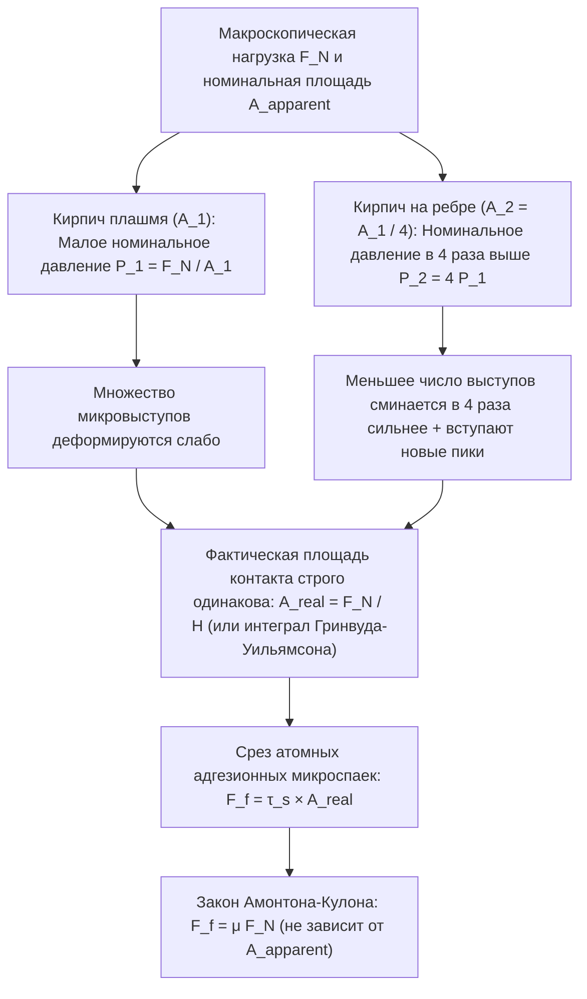
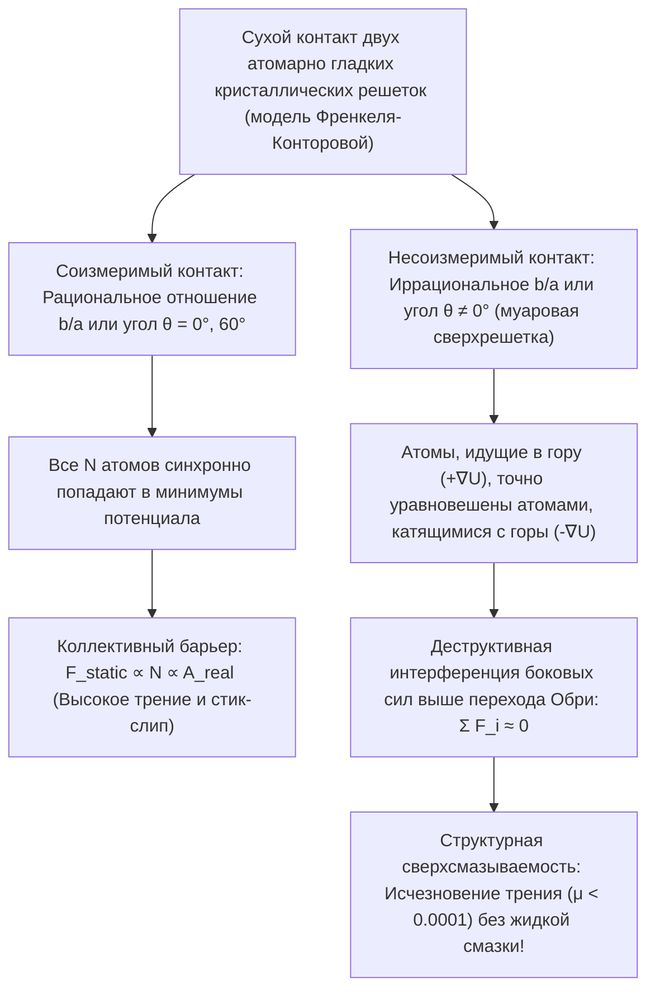

Немногие формулы школьного курса физики выглядят столь просто и одновременно скрывают столь глубокий физический парадокс, как классический закон сухого трения скольжения:

$$F_f = \mu F_N$$

Представим прямоугольный кирпич, лежащий на горизонтальном столе. Если мы потянем его с помощью динамометра, когда он лежит плашмя на своей широкой грани (номинальная площадь $A_1 = 200\,\text{см}^2$), а затем поставим тот же кирпич на узкое ребро ($A_2 = 50\,\text{см}^2$), обыденная интуиция подсказывает, что широкая грань должна создавать гораздо большее сопротивление. Однако эксперимент показывает: <strong>сила трения $F_f$ остается абсолютно одинаковой при четырехкратном изменении площади опоры!</strong> И наоборот: если трение действительно не зависит от площади контакта, почему болиды Формулы-1 используют сверхширокие безпротекторные шины (слики)?

Второй классический миф гласит, что конькобежец скользит по льду, поскольку высокое давление под узким лезвием конька понижает точку плавления льда и образует водную пленку. Однако строгий расчет по термодинамическому <strong>уравнению Клаузиуса — Клапейрона</strong> показывает, что конькобежец массой $75\,\text{кг}$ снижает температуру плавления льда всего на $0{,}12^\circ\text{C}$, что никак не объясняет скольжение при $-10^\circ\text{C}$ или $-20^\circ\text{C}$!

В этой статье мы обратимся к <strong>трибологии</strong> (науке о трении, износе и смазке) и физике поверхности на наноуровне, чтобы разрешить эти парадоксы: от различия между <strong>кажущейся (номинальной) площадью контакта ($A_{\text{apparent}}$)</strong> и <strong>фактической площадью контакта ($A_{\text{real}}$)</strong> до <strong>динамики прерывистого скольжения (stick-slip)</strong>, <strong>квазижидкого слоя (QLL)</strong> на поверхности льда и <strong>структурной сверхсмазываемости (superlubricity)</strong>.

---

## 1. Классическая загадка: законы Амонтона — Кулона и крах гипотезы геометрического зацепления

### 1.1 От Леонардо да Винчи (1493) к Амонтону (1699) и Кулону (1785)

Еще около 1493 года <strong>Леонардо да Винчи</strong> в своих записных книжках (*Арунделовский кодекс*) экспериментально установил, что сила трения пропорциональна нагрузке и не зависит от площади соприкосновения. Переоткрытые <strong>Гийомом Амонтоном (1699)</strong>, дополненные <strong>Леонардом Эйлером (1748)</strong>, который ввел коэффициент $\mu = \tan\theta_c$, и обобщенные <strong>Шарлем Огюстеном де Кулоном (1785)</strong>, эти правила образуют <strong>три классических закона сухого трения</strong>:

$$\begin{aligned}
\text{1-й закон (пропорциональность нормальной нагрузке):} & \quad F_f = \mu F_N \\
\text{2-й закон (независимость от видимой площади):} & \quad \frac{\partial F_f}{\partial A_{\text{apparent}}} = 0 \\
\text{3-й закон (независимость от скорости скольжения):} & \quad \frac{\partial F_k}{\partial v} \approx 0 \quad (\text{при } F_k = \mu_k F_N < F_s^{\max} = \mu_s F_N)
\end{aligned}$$

Гипотеза жестких микрозубьев с углом наклона $\theta$ ($F_f = F_N \tan\theta$) противоречит первому началу термодинамики: на абсолютно жестком или чисто упругом склоне работа $W_{\text{up}} = F_N \Delta h$, затраченная на подъем на вершину микровыступа, <strong>полностью возвращается ($W_{\text{down}} = -F_N \Delta h$) при спуске с обратной стороны зубца</strong> ($\oint \mathbf{F}\cdot d\mathbf{r} = 0$). Истинное трение требует необратимой деформации и диссипации механической энергии в колебания кристаллической решетки — <strong>фононы</strong>.

---

## 2. Номинальная и фактическая площадь контакта: как микровыступы (асферити) решают парадокс кирпича

### 2.1 «Положить перевернутую Швейцарию на Австрию»: адгезионная теория Боудена и Тейбора (1950)

Как показали кембриджские физики <strong>Фрэнк Филип Боуден</strong> и <strong>Дэвид Тейбор</strong> (1950), даже зеркально отполированный стальной брусок под атомно-силовым микроскопом (АСМ) имеет среднеквадратичную шероховатость $R_q \sim 10\,\text{нм}\text{–}1\,\text{мкм}$, что в тысячи раз превышает радиус действия межатомных сил ($0{,}2\text{–}0{,}4\,\text{нм}$). По знаменитому выражению Боудена: <strong>«Сложить два твердых тела вместе — все равно что перевернуть Швейцарию вверх дном и поставить ее на Австрию: соприкоснутся лишь самые высокие альпийские вершины».</strong>

Эти микроскопические пики называются <strong>микровыступами (asperities)</strong>. Сумма площадей реального атомного контакта на вершинах микровыступов образует <strong>фактическую площадь контакта ($A_{\text{real}}$)</strong>, которая ничтожно мала по сравнению с <strong>кажущейся (номинальной) площадью ($A_{\text{apparent}}$)</strong>:

$$A_{\text{real}} = \sum_{i=1}^{N_c} A_i \ll A_{\text{apparent}}, \qquad \frac{A_{\text{real}}}{A_{\text{apparent}}} \sim 10^{-5} \text{ – } 10^{-3}$$

Поскольку вся нормальная нагрузка $F_N$ сосредоточена на $A_{\text{real}}$, локальное напряжение $p_{\text{local}} = F_N / A_{\text{real}}$ мгновенно достигает <strong>пластической твердости материала $H \approx 3\sigma_y$</strong>. Вершины микровыступов пластически сминаются до тех пор, пока фактическая площадь не вырастет ровно настолько, чтобы удержать нагрузку $F_N$:

$$p_{\text{local}} = H \implies A_{\text{real}} = \frac{F_N}{H}$$

В точках атомного сближения возникают <strong>адгезионные микроспайки (холодная сварка)</strong> с пределом прочности на сдвиг $\tau_s$. Для скольжения необходимо срезать эти спайки:

$$F_f = \tau_s A_{\text{real}} = \tau_s \left(\frac{F_N}{H}\right) = \left(\frac{\tau_s}{H}\right) F_N \implies \mu = \frac{\tau_s}{H}$$

Парадокс кирпича полностью разрешен: <strong>сила трения прямо пропорциональна ФАКТИЧЕСКОЙ площади контакта $A_{\text{real}}$!</strong> При повороте кирпича на узкую грань номинальное давление возрастает вчетверо, сильнее сжимая микровыступы, так что сумма $A_{\text{real}} = F_N / H$ остается неизменной.

### 2.2 Упругая статистическая механика Гринвуда — Уильямсона (1966) и пределы применимости закона

Для одиночной упругой сферы радиуса $R$ <strong>теория Герца (1882)</strong> дает $A_{\text{single}} \propto w^{2/3}$. Однако <strong>Дж. Гринвуд и Дж. Уильямсон (1966)</strong> доказали, что при интегрировании по статистическому распределению высот вершин $\phi(z) = \frac{1}{\sigma_s} e^{-z/\sigma_s}$ вовлечение новых микровыступов оставляет среднюю площадь одного пятна постоянной ($\pi R \sigma_s$), тогда как число пятен растет линейно с $F_N$:

$$A_{\text{real}} = \frac{\sqrt{\pi}}{E^* \sqrt{\sigma_s / R}} F_N \propto F_N$$

<strong>Когда закон Амонтона нарушается?</strong> Когда $A_{\text{real}} \to A_{\text{apparent}}$:
1. <strong>Мягкие эластомеры и гоночные слики Формулы-1 (теория JKR, 1971)</strong>: Из-за малого модуля Юнга ($E \sim 1\text{–}10\,\text{МПа}$) и работы адгезии $\Delta\gamma$ по уравнению <strong>Джонсона — Кендалла — Робертса (JKR)</strong> $a_{\text{JKR}}^3 = \frac{3R}{4E^*}(w + 3\pi R \Delta\gamma + \sqrt{6\pi R \Delta\gamma w + (3\pi R \Delta\gamma)^2})$ эффективный коэффициент трения падает с ростом давления ($\mu_{\text{eff}} \propto P_{\text{nom}}^{-1/3}$). Широкие слики увеличивают $A_{\text{apparent}}$, снижая давление и максимизируя сцепление.
2. <strong>Лапки геккона (setae и spatulae)</strong>: Миллионы кератиновых волосков, разветвленных на нанолопаточки шириной $100\text{–}200\,\text{нм}$, снижают эффективный модуль ниже критерия Дальквиста ($E_{\text{eff}} < 100\,\text{кПа}$), обеспечивая $A_{\text{real}} \approx A_{\text{apparent}}$ за счет сил Ван-дер-Ваальса.
3. <strong>Холодная сварка в космическом сверхвысоком вакууме</strong>: Без защитной оксидной пленки ($1\text{–}5\,\text{нм}$) чистые металлы в вакууме ($P < 10^{-10}\,\text{Па}$) мгновенно свариваются ($\mu \to \infty$, причина заклинивания антенны зонда *«Галилео»* в 1991 году).

---

## 3. Динамика прерывистого скольжения (Stick-Slip) и закон Дитериха — Руины

Блок массы $m$, тянущийся со скоростью $v_0$ через пружину жесткости $k$, подчиняется уравнению $m \ddot{x} = k(v_0 t - x) - F_f(\dot{x}, \theta)$. После фазы покоя (Stick) длительностью $t_{\text{stick}} = \frac{(\mu_s - \mu_k)F_N}{k v_0}$ происходит резкий срыв (Slip) с собственной частотой $\omega_0 = \sqrt{k/m}$:

$$x(t') = v_0 t' + \frac{(\mu_s - \mu_k)F_N}{k}(1 - \cos\omega_0 t') - \frac{v_0}{\omega_0}\sin\omega_0 t'$$

Почему $\mu_s > \mu_k$? Из-за ползучести (крипа) микровыступов фактическая площадь растет логарифмически со временем покоя: $A_{\text{real}}(t) = A_0 [1 + c \ln(1 + t/\tau_0)]$ (<strong>старение контакта / Contact Aging</strong>). <strong>Скоростной и фазовый закон трения Дитериха — Руины (Rate-and-State Friction Law, 1979–1983)</strong> связывает скорость ($v$) и переменную состояния ($\theta$, критическое смещение $D_c$):

$$\mu(v, \theta) = \mu_0 + a \ln\!\left(\frac{v}{v_*}\right) + b \ln\!\left(\frac{v_* \theta}{D_c}\right), \qquad \frac{d\theta}{dt} = 1 - \frac{v \theta}{D_c}$$

В стационарном режиме ($\theta_{\text{ss}} = D_c / v$) имеем $\mu_{\text{ss}}(v) = \mu_0 + (a - b)\ln(v/v_*)$. В <strong>режиме скоростного разупрочнения ($a - b < 0$)</strong> при жесткости системы ниже <strong>критической жесткости $k_c$</strong> возникает автоколебательная неустойчивость Хопфа (стик-слип):

$$k < k_c = \frac{(b - a) F_N}{D_c}$$

Это условие описывает как <strong>движение Гельмгольца</strong> скрипичной струны, натертой канифолью, так и катастрофические <strong>мегаземлетрясения в зонах субдукции</strong>.

---

## 4. Почему лед на самом деле скользкий? Опровержение плавления под давлением и квазижидкий слой (QLL)

Рассчитаем понижение точки плавления льда ($\text{I}_h$) по <strong>уравнению Клаузиуса — Клапейрона</strong> ($T_m = 273{,}15\,\text{К}$, скрытая теплота плавления $L_f = 3{,}335 \times 10^5\,\text{Дж/кг}$, $\rho_{\text{liq}} = 999{,}8\,\text{кг/м}^3$, $\rho_{\text{ice}} = 916{,}7\,\text{кг/м}^3$, $\Delta v = -9{,}07 \times 10^{-5}\,\text{м}^3/\text{кг}$):

$$\frac{dP}{dT_m} = \frac{L_f}{T_m \left(v_{\text{liq}} - v_{\text{ice}}\right)} = \frac{3{,}335 \times 10^5}{(273{,}15)(-9{,}07 \times 10^{-5})} \approx -1{,}346 \times 10^7\,\text{Па/К} = -13{,}46\,\text{МПа/К}$$

Для конькобежца массой $75\,\text{кг}$ ($F_N = 735\,\text{Н}$) на лезвии $30\,\text{см} \times 1{,}5\,\text{мм}$ ($A = 4{,}5 \times 10^{-4}\,\text{м}^2$) давление $\Delta P = 1{,}63\,\text{МПа}$ снижает температуру плавления лишь на:

$$\Delta T_m = \frac{1{,}63\,\text{МПа}}{-13{,}46\,\text{МПа/К}} \approx -0{,}12^\circ\text{C}$$

Плавление под давлением не может объяснить катание при $-10^\circ\text{C}$! Три истинных механизма таковы:
1. <strong>Поверхностное предплавление и квазижидкий слой Фарадея (QLL, 1850)</strong>: Поверхностные молекулы $\text{H}_2\text{O}$ имеют лишь 2 или 3 водородные связи вместо 4 (недокоординированные молекулы), свободно колеблются и образуют <strong>квазижидкий слой (QLL)</strong> толщиной $1\text{–}20\,\text{нм}$ вплоть до <strong>$-30^\circ\text{C}$</strong> при нулевом давлении.
2. <strong>Фрикционный разогрев (Боуден и Хьюз, 1939)</strong>: Тепловой поток $q = \mu P v$ в тонком скин-слое $\delta_{\text{th}} \sim \sqrt{\alpha_{\text{th}} L / v}$ мгновенно нагревает контакт до $0^\circ\text{C}$ (поэтому полиэтиленовые лыжи скользят намного лучше металлических).
3. <strong>Вязкоупругая реология межфазной воды (Canale, Bocquet & Bonn, 2019, *Phys. Rev. X*)</strong>: Нанопленка воды обладает вязкостью в $50\text{–}100$ раз выше обычной воды и модулем упругости $G'(\omega)$, создающим упругогидродинамическую подъемную силу.

---

## 5. От кривой Штрибека к структурной сверхсмазываемости

Помимо гидродинамической смазки, описываемой <strong>уравнением Рейнольдса (1886)</strong> на <strong>кривой Штрибека</strong>:

$$\frac{\partial}{\partial x}\!\left(\frac{h^3}{12\eta}\frac{\partial p}{\partial x}\right) + \frac{\partial}{\partial y}\!\left(\frac{h^3}{12\eta}\frac{\partial p}{\partial y}\right) = \frac{U}{2}\frac{\partial h}{\partial x} + \frac{\partial h}{\partial t}$$

<strong>модель Прандтля — Томлинсона (1928–1929)</strong> описывает атомное сухое трение через потенциал $V_{\text{PT}}(x, X) = -\frac{U_0}{2}\cos(2\pi x/a) + \frac{1}{2}k_{\text{eff}}(x - X)^2$ и параметр $\eta_{\text{PT}} = \frac{2\pi^2 U_0}{k_{\text{eff}} a^2}$. При $\eta_{\text{PT}} \le 1$ атомные скачки стик-слип и излучение фононов исчезают.

В многоатомной <strong>модели Френкеля — Конторовой</strong> <strong>Мотохиса Хирано и Кадзумаса Синдзё (1990)</strong> предсказали <strong>структурную сверхсмазываемость</strong> (подтвержденную на повернутом графите <strong>Dienwiebel et al., 2004</strong>): при <strong>несоизмеримом контакте</strong> (муаровые сверхрешетки графена или $\text{MoS}_2$ выше <strong>перехода Обри</strong>) боковые силы на атомах взаимно уничтожаются за счет деструктивной интерференции ($\sum F_i \approx 0$), снижая коэффициент сухого трения до <strong>$\mu < 0{,}0001$</strong>!

---

## 6. Сводная таблица трибологических режимов

| Трибологический режим | Доминирующий микромеханизм | Масштабирование площади контакта | Типичный коэффициент $\mu$ | Основные уравнения и модели |
| :--- | :--- | :--- | :--- | :--- |
| <strong>Сухое трение твердых тел</strong> | Пластическое течение или статистическая упругая деформация выступов + срез спаек | $A_{\text{real}} \propto F_N \ll A_{\text{apparent}}$ (не зависит от $A_{\text{apparent}}$) | $0{,}15 \text{ – } 0{,}80$ | Боуден-Тейбор ($A_{\text{real}}=F_N/H$), Гринвуд-Уильямсон (1966), Перссон |
| <strong>Мягкие эластомеры и лапки геккона</strong> | Полное прилегание при малом $E_{\text{eff}}$ + силы Ван-дер-Ваальса | $A_{\text{real}} \to A_{\text{apparent}}$ (растет с $A_{\text{apparent}}$) | $0{,}80 \text{ – } 3{,}0+$ | Теория адгезии JKR (1971), критерий Дальквиста ($E_{\text{eff}} < 100\,\text{кПа}$) |
| <strong>Прерывистое скольжение (Stick-Slip)</strong> | Логарифмическое старение $A_{\text{real}}(t)$ против обновления на длине $D_c$ | $A_{\text{real}}(t) = A_0[1 + c\ln(1+t/\tau_0)]$ | $\mu_s(t) > \mu_k(v)$ | Закон Дитериха-Руины (RSF), критическая жесткость $k_c = \frac{(b-a)F_N}{D_c}$ |
| <strong>Скольжение по льду (коньки и лыжи)</strong> | Квазижидкий слой (QLL) + фрикционный разогрев + вязкоупругая подъемная сила | QLL ($1\text{–}20\,\text{нм}$) и пленка расплава разделяют выступы до $-30^\circ\text{C}$ | $0{,}005 \text{ – } 0{,}03$ | Предплавление Фарадея (1850), Боуден-Хьюз, Боке-Бонн (2019) |
| <strong>Гидродинамическая смазка</strong> | Сходящийся вязкий клин генерирует гидродинамическое давление $p(x,y)$ | Нет контакта твердых тел ($\Lambda = h_{\min}/\sigma^* > 3$) | $0{,}001 \text{ – } 0{,}005$ | Кривая Штрибека (1902), уравнение Рейнольдса (1886) |
| <strong>Структурная сверхсмазываемость</strong> | Деструктивная интерференция боковых атомных сил в несоизмеримых решетках | Внутренние силы гасятся ($F_f \propto A^{0\text{–}0{,}5}$) | $< 0{,}0001$ | Прандтль-Томлинсон ($\eta_{\text{PT}} \le 1$), Френкель-Конторова, Хирано (1990) |
