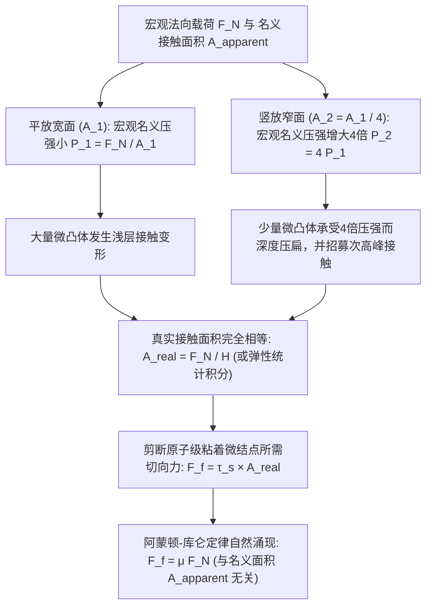
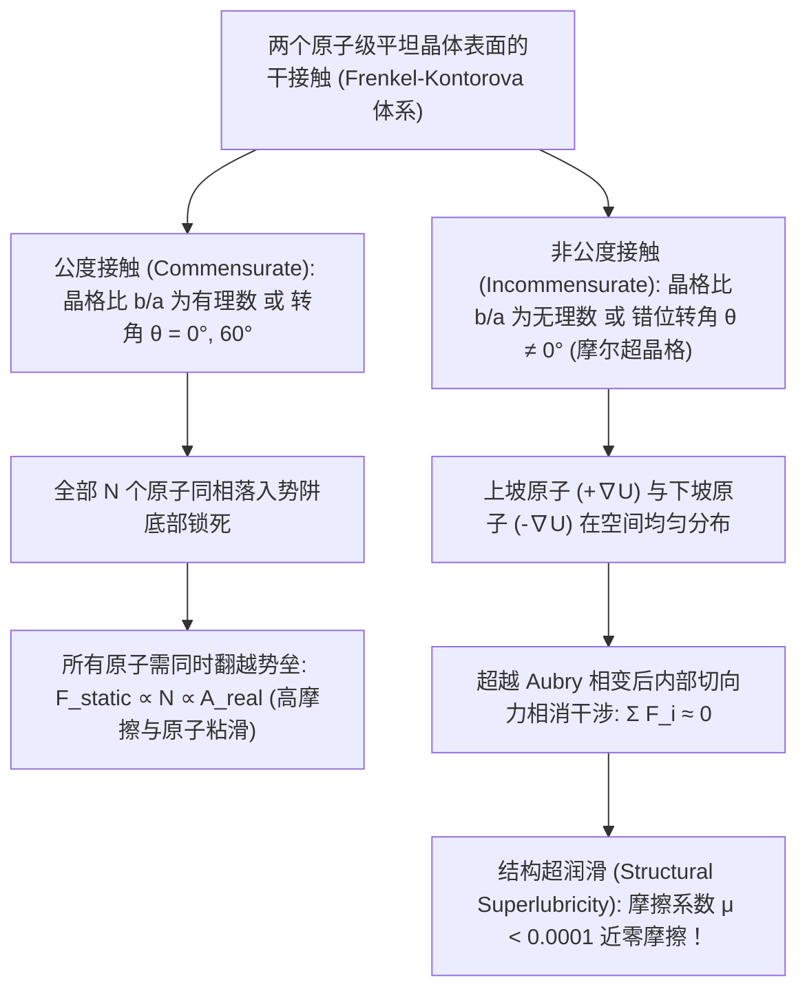

在中学物理课本中，干摩擦定律 $F_f = \mu F_N$ 是形式最简洁的力学公式之一：水平拉动桌面上的长方体砖块时，最大静摩擦力与滑动摩擦力仅取决于正压力（法向载荷 $F_N$）与摩擦系数 $\mu$ 的乘积。

然而，这一习以为常的公式背后隐藏着一个违背日常直觉的深刻悖论。假设我们将同一块砖平放在桌面上（宏观接触面积 $A_1 = 200\,\text{cm}^2$）并用弹簧秤水平拉动，测得滑动摩擦力为 $F_f$；随后我们将同一块砖竖立在狭窄的侧棱面上（接触面积 $A_2 = 50\,\text{cm}^2$）再次拉动。直觉告诉我们，平放时与桌面摩擦的面积大了整整 $4$ 倍，摩擦阻力理应显著增大。但实验结果却令人震惊：<strong>无论接触面积相差多少倍，拉动砖块所需的摩擦力都完全相同！</strong>反过来，如果摩擦力真的与接触面积无关，为什么一级方程式（F1）赛车和直线加速赛车都要换装极其宽大的无花纹“光头胎（Slick Tires）”来提升抓地力？

另一个流传百年的教科书迷思是“为什么冰面如此湿滑”。传统观点认为，滑冰者站在狭窄的冰刀上产生的巨大压强降低了冰的熔点（压力融化说），从而在冰刀下压出一层水膜。然而，一旦我们将数据代入热力学的<strong>克劳修斯-克拉佩龙方程（Clausius–Clapeyron Equation）</strong>进行严格计算，就会发现一名 $75\,\text{kg}$ 的滑冰者仅能使冰的熔点下降约 $0.12^\circ\text{C}$——这根本无法解释为何人们能在 $-10^\circ\text{C}$ 甚至 $-20^\circ\text{C}$ 的严寒中顺畅滑冰！

本文将从研究摩擦、磨损与润滑的交叉学科——<strong>摩擦学（Tribology）</strong>出发，用现代微观表面物理学与接触力学彻底解开这些经典谜题。我们将依次探讨<strong>名义接触面积（$A_{\text{apparent}}$）</strong>与<strong>真实接触面积（$A_{\text{real}}$）</strong>的本质差异、从琴弦发音到构造地震的<strong>粘滑振荡（Stick-Slip）与速率-状态摩擦定律</strong>、冰表面的<strong>准液体层（QLL）预融化机制</strong>，以及让摩擦系数趋近于零的纳米前沿——<strong>结构超润滑（Structural Superlubricity）</strong>。

---

## 1. 经典干摩擦三定律与“几何啮合模型”的热力学破产

### 1.1 从达·芬奇（1493）、阿蒙顿（1699）到库仑（1785）

早在牛顿建立经典力学体系之前近两个世纪，文艺复兴巨匠<strong>列奥纳多·达·芬奇（Leonardo da Vinci）</strong>就在1493年左右的手稿（《阿伦德尔手稿》与《马德里手稿》）中首次通过木块与滑轮实验记录了两条基本规律：（1）重量相同的物体，无论其接触面是宽还是窄，启动时的摩擦阻力完全相等；（2）若物体重量加倍，摩擦力也随之加倍（对于光滑木材，$\mu \approx 1/4$）。

由于达·芬奇手稿长期未被公开，法国物理学家<strong>纪尧姆·阿蒙顿（Guillaume Amontons）</strong>于1699年向巴黎皇家科学院重新独立提交了这一发现。1748年，<strong>莱昂哈德·欧拉（Leonhard Euler）</strong>引入了摩擦系数符号 $\mu$，推导出斜面自锁角关系 $\mu_s = \tan\theta_c$，并明确区分了静摩擦与动摩擦（$\mu_s > \mu_k$）。1785年，法国工程师<strong>夏尔·奥古斯丁·德·库仑（Charles-Augustin de Coulomb）</strong>在罗什福尔海军造船厂进行了系统的重载实验，最终确立了经典的<strong>阿蒙顿-库仑干摩擦三定律（Amontons–Coulomb Laws of Dry Friction）</strong>：

$$\begin{aligned}
\text{第一定律（载荷正比律）：} & \quad F_f = \mu F_N \\
\text{第二定律（面积无关律）：} & \quad \frac{\partial F_f}{\partial A_{\text{apparent}}} = 0 \\
\text{第三定律（速度无关律）：} & \quad \frac{\partial F_k}{\partial v} \approx 0 \quad (\text{且 } F_k = \mu_k F_N < F_s^{\max} = \mu_s F_N)
\end{aligned}$$

### 1.2 刚性锯齿啮合模型的能量守恒悖论

为了解释为何摩擦力正比于法向载荷 $F_N$ 而与宏观面积 $A_{\text{apparent}}$ 无关，阿蒙顿与库仑提出了<strong>几何凹凸啮合模型（Geometric Interlocking Model）</strong>：假设固体表面布满倾角为 $\theta$ 的刚性微观锯齿，水平拉动上方物体时必须克服重力将其沿斜面 $\theta$ 抬升。由静力平衡可得：

$$F_f \cos\theta = F_N \sin\theta \implies F_f = F_N \tan\theta \implies \mu = \tan\theta$$

这一几何图像看似完美，却在19世纪热力学第一定律确立后遭遇了致命危机：如果表面微凸体是完全刚性（或纯弹性无滞后）的斜面，那么外力将物块推上齿顶所做的机械功 $W_{\text{up}} = F_N \Delta h$，<strong>在物块越过齿顶滑下另一侧斜坡时，会 $100\%$ 被重力转化回动能或向前的推力（$W_{\text{down}} = -F_N \Delta h$）</strong>！在一个完整周期内，保守势场中的净能量耗散严格为零（$\oint \mathbf{F}\cdot d\mathbf{r} = 0$），宏观动摩擦力根本不可能存在。此外，经验表明将两块金属量块抛光至纳米级镜面（$\tan\theta \to 0$）时，摩擦力不仅没有消失，反而会因冷焊而死死咬合在一起。因此，真正的摩擦机制必须建立在<strong>微观真实接触面积的不可逆变形与声子（Phonon）热耗散</strong>之上。

---

## 2. 名义接触面积与真实接触面积：微凸体（Asperity）如何解开砖块悖论

### 2.1 “把瑞士倒扣在奥地利之上”：鲍登-泰伯粘着塑性接触理论（1950）

20世纪中叶，剑桥大学物理学家<strong>弗兰克·菲利普·鲍登（Frank Philip Bowden）</strong>与<strong>大卫·泰伯（David Tabor）</strong>在经典专著《固体的摩擦与润滑》（1950）中指出：在扫描隧道显微镜（STM）和原子力显微镜（AFM）下，即便是光学镜面抛光的钢块，其表面均方根粗糙度 $R_q \sim 10\,\text{nm}\text{–}1\,\mu\text{m}$ 也比原子间化学键作用距离（$a_0 \sim 0.2\text{–}0.4\,\text{nm}$）大上千倍。正因如此，鲍登形象地比喻道：<strong>“将两块固体叠放在一起，就像把瑞士倒过来扣在奥地利上面一样——真正接触的只有最高耸的阿尔卑斯山峰尖端。”</strong>

这些微观山峰被称为<strong>微凸体（Asperities）</strong>。当两个固体接触时，真正发生原子级接触的微凸体斑点面积之和称为<strong>真实接触面积（Real Contact Area, $A_{\text{real}}$）</strong>，它通常仅占物体几何外形决定的<strong>名义接触面积（Apparent Contact Area, $A_{\text{apparent}}$）</strong>的十万分之一到千分之一：

$$A_{\text{real}} = \sum_{i=1}^{N_c} A_i \ll A_{\text{apparent}}, \qquad \frac{A_{\text{real}}}{A_{\text{apparent}}} \sim 10^{-5} \text{ – } 10^{-3}$$

由于全部法向载荷 $F_N$ 都集中在极小的 $A_{\text{real}}$ 上，微凸体尖端的局部正应力 $p_{\text{local}} = F_N / A_{\text{real}}$ 极易突破材料的单轴屈服强度 $\sigma_y$，达到材料的<strong>塑性压痕硬度 $H \approx 3\sigma_y$</strong>（泰伯关系）。微凸体尖端随即发生塑性屈服并横向压扁扩展，直到总真实接触面积 $A_{\text{real}}$ 增大到恰好能以恒定屈服压强 $H$ 支撑外载荷 $F_N$ 为止：

$$p_{\text{local}} = H \implies A_{\text{real}} = \frac{F_N}{H}$$

在这些间距小于 $0.3\,\text{nm}$ 的微接触斑点上，界面原子通过金属键、共价键或范德华色散力形成<strong>冷焊粘着微结点（Adhesive Micro-junctions）</strong>。水平滑动时，外力必须以材料的<strong>界面剪切强度 $\tau_s$</strong> 剪断所有粘着结点（外加硬微凸体犁削软基体的犁沟项 $F_{\text{plough}}$）：

$$F_f = F_{\text{adh}} + F_{\text{plough}} \approx \tau_s A_{\text{real}} = \tau_s \left(\frac{F_N}{H}\right) = \left(\frac{\tau_s}{H}\right) F_N \implies \mu = \frac{\tau_s}{H}$$

这彻底解开了砖块悖论：<strong>摩擦力绝非与“接触面积”无关，恰恰相反，摩擦力严格正比于微观的“真实接触面积” $A_{\text{real}}$！</strong>当我们将砖块从宽面翻转到窄面（$A_{\text{apparent}}$ 缩小为 $1/4$）时，由于重力 $F_N = mg$ 不变，窄面上的平均压强增大了 $4$ 倍，使得窄面下的微凸体被压扁得更深，从而保证总的真实接触面积 $A_{\text{real}} = F_N / H$ 维持恒定！

### 2.2 格林伍德-威廉姆森（1966）多微凸体弹性统计模型与佩尔松理论

如果经过反复磨合后微凸体仅发生<strong>纯弹性变形</strong>，结论又如何？根据1882年<strong>赫兹弹性接触理论（Hertzian Contact Mechanics）</strong>，单个曲率半径为 $R$ 的弹性球体在载荷 $w$ 下与平面的接触面积满足非线性幂律（$E^*$ 为复合弹性模量）：

$$a = \left(\frac{3 w R}{4 E^*}\right)^{1/3} \implies A_{\text{single}} = \pi a^2 = \pi \left(\frac{3 R}{4 E^*}\right)^{2/3} w^{2/3} \propto w^{2/3}$$

若所有微凸体高度相同，总面积将满足 $A_{\text{real}} \propto F_N^{2/3}$，违背阿蒙顿第一定律。1966年，<strong>格林伍德（J. A. Greenwood）与威廉姆森（J. B. P. Williamson）</strong>通过引入微凸体峰顶高度 $z$ 的概率密度分布 $\phi(z)$（标准差为 $\sigma_s$，高尾近似为指数分布 $\phi(z) = \frac{1}{\sigma_s} e^{-z/\sigma_s}$）解决了这一难题。当两表面间距为 $d$ 时，所有 $z > d$ 的微凸体发生弹性压缩 $\delta = z - d$，接触斑点数 $N_c(d)$、真实接触面积 $A_{\text{real}}(d)$ 与总载荷 $F_N(d)$ 分别为：

$$\begin{aligned}
N_c(d) &= \eta A_{\text{apparent}} \int_d^\infty \phi(z)\,dz = \eta A_{\text{apparent}} \, e^{-d/\sigma_s} \\
A_{\text{real}}(d) &= \pi \eta A_{\text{apparent}} R \int_d^\infty (z - d)\,\phi(z)\,dz = \pi \eta A_{\text{apparent}} R \sigma_s \, e^{-d/\sigma_s} \\
F_N(d) &= \frac{4}{3} \eta A_{\text{apparent}} E^* R^{1/2} \int_d^\infty (z - d)^{3/2}\,\phi(z)\,dz = \sqrt{\pi} \eta A_{\text{apparent}} E^* R^{1/2} \sigma_s^{3/2} \, e^{-d/\sigma_s}
\end{aligned}$$

两式相除，$e^{-d/\sigma_s}$ 与 $A_{\text{apparent}}$ 完全约去，严格恢复线性比例关系：

$$A_{\text{real}} = \frac{\sqrt{\pi}}{E^* \sqrt{\sigma_s / R}} F_N \propto F_N$$

其物理图像极为优美：当法向载荷 $F_N$ 增大时，不仅已有接触斑点在扩大，<strong>原本悬空、高度稍矮的微凸体也不断新加入到接触队列中</strong>。新旧接触斑点的统计平衡使得“每个接触点的平均面积 $\langle A_i \rangle = \pi R \sigma_s$”保持恒定，而接触点总数 $N_c$ 随载荷线性增长！2001年，<strong>博·佩尔松（Bo N. J. Persson）</strong>进一步将其推广至具有自仿射分形粗糙度谱 $C(q) \propto q^{-2(1+H_f)}$ 的多尺度表面，证明了界面应力分布随放大倍率 $\zeta$ 演化满足扩散方程，在小压强下普遍成立 $A_{\text{real}} = \frac{\kappa}{E^* \sqrt{\langle |\nabla h|^2 \rangle}} F_N$。

### 2.3 阿蒙顿定律失效的三大极限：F1光头胎、壁虎脚掌刚毛与太空冷焊

一旦 $A_{\text{real}}$ 趋近于 $A_{\text{apparent}}$ 或分子粘着力占主导，阿蒙顿定律便宣告失效，接触面积将直接决定摩擦力：
1. <strong>粘弹性橡胶与F1赛车宽幅光头胎（JKR粘着接触理论，1971）</strong>：橡胶模量极低（$E \sim 1\text{–}10\,\text{MPa}$），能嵌入路面微观凹坑使 $A_{\text{real}} \to A_{\text{apparent}}$。由<strong>Johnson–Kendall–Roberts（JKR）方程</strong>：
   $$a_{\text{JKR}}^3 = \frac{3R}{4E^*}\left(w + 3\pi R \Delta\gamma + \sqrt{6\pi R \Delta\gamma w + (3\pi R \Delta\gamma)^2}\right)$$
   即便法向载荷 $w = 0$，粘着功 $\Delta\gamma$ 仍维持有限接触面积；而在高载荷饱和区，等效摩擦系数随名义压强增大而下降（$\mu_{\text{eff}} \propto P_{\text{nom}}^{-1/3}$，即轮胎载荷敏感性）。因此F1赛车采用极宽的光头胎来增大 $A_{\text{apparent}}$、降低名义压强，从而最大化粘着与粘弹性滞后抓地力并分散摩擦热。
2. <strong>壁虎脚掌的分级纳米刚毛（Setae & Spatulae）</strong>：壁虎脚趾覆盖数百万根 $\beta$-角蛋白刚毛（Setae），每根末端分叉成数百个宽仅 $100\text{–}200\,\text{nm}$ 的匙状纳米绒毛（Spatulae），使等效结构模量降至 $E_{\text{eff}} < 100\,\text{kPa}$（满足Dahlquist粘着判据），在任意粗糙墙面上实现 $A_{\text{real}} \approx A_{\text{apparent}}$，仅凭范德华力即可悬挂自身体重数十倍的负载。
3. <strong>超高真空中的金属冷焊（Cold Welding）</strong>：地球大气中的金属表面覆盖着 $1\text{–}5\,\text{nm}$ 的天然氧化膜与吸附水膜；而在外太空超高真空（$P < 10^{-10}\,\text{Pa}$）中，一旦摩擦磨去氧化层或 $\text{MoS}_2$ 固体润滑膜，裸露的洁净金属晶格直接接触，电子云瞬间跨越界面共享形成金属键（$\mu \to \infty$），导致机械彻底卡死（如1991年“伽利略号”木星探测器高增益天线展开失败事故）。

---

## 3. 粘滑振荡（Stick-Slip）与速率-状态摩擦定律：从提琴声学到构造大地震

### 3.1 弹簧-滑块模型与弛豫振荡动力学

老旧门轴的吱呀声、粉笔划过黑板的尖啸、汽车刹车啸叫、小提琴弓弦奏出的乐音以及断层破裂引发的9级大地震，本质上都是同一种非线性动力学不稳定性——<strong>粘滑振荡（Stick-Slip Oscillation）</strong>。

考虑质量为 $m$ 的滑块通过刚度为 $k$ 的弹簧被速度为 $v_0$ 的驱动端拉动：

$$m \frac{d^2 x}{dt^2} = k(v_0 t - x) - F_f\!\left(\frac{dx}{dt}, \theta\right)$$

当静摩擦系数大于动摩擦系数（$\mu_s > \mu_k$）时，系统交替经历两个阶段：
* <strong>粘着阶段（Stick，$\dot{x} = 0$）</strong>：滑块静止锁死，弹簧拉力随时间线性累积 $F_{\text{spring}}(t) = \mu_k F_N + k v_0 t$，持续时间 $t_{\text{stick}} = \frac{(\mu_s - \mu_k)F_N}{k v_0}$。
* <strong>滑动阶段（Slip，$\dot{x} > 0$）</strong>：当拉力达到 $\mu_s F_N$ 瞬间，界面粘着点集体断裂，阻力骤降至 $\mu_k F_N$，滑块以固有频率 $\omega_0 = \sqrt{k/m}$ 急速前冲：
  $$x(t') = v_0 t' + \frac{(\mu_s - \mu_k)F_N}{k}(1 - \cos\omega_0 t') - \frac{v_0}{\omega_0}\sin\omega_0 t'$$
  经过约半周期 $t_{\text{slip}} \approx \pi\sqrt{m/k}$ 后滑块速度降回零并重新锁死，形成周而复始的锯齿波弛豫振荡。

### 3.2 接触老化（Contact Aging）与迪特里希-鲁伊纳速率-状态摩擦定律（RSF）

为什么静摩擦总是大于动摩擦？<strong>詹姆斯·迪特里希（James H. Dieterich, 1979）</strong>、<strong>安迪·鲁伊纳（Andy Ruina, 1983）</strong>以及<strong>杰伊·法恩伯格（Jay Fineberg, 2004）</strong>的激光全内反射成像实验证明：在静止接触期间，微凸体尖端在高压下发生热激活塑性/粘弹性蠕变（Creep）与界面化学成键，使真实接触面积 $A_{\text{real}}(t)$ 随接触时间 $t$ 呈<strong>对数增长（接触老化）</strong>：

$$A_{\text{real}}(t) = A_0 \left[ 1 + c \ln\!\left(1 + \frac{t}{\tau_0}\right) \right]$$

一旦以速度 $v$ 滑动，老化接触点在滑过特征更新距离 $D_c$（约 $1\text{–}50\,\mu\text{m}$）后被剪断并替换为平均寿命为 $\theta \approx D_c / v$ 的新接触点。将其统一即可得到现代摩擦学与地震物理的核心方程——<strong>迪特里希-鲁伊纳速率-状态摩擦定律（Rate-and-State Friction Law）</strong>：

$$\mu(v, \theta) = \mu_0 + a \ln\!\left(\frac{v}{v_*}\right) + b \ln\!\left(\frac{v_* \theta}{D_c}\right), \qquad \frac{d\theta}{dt} = 1 - \frac{v \theta}{D_c}$$

在定常滑动（$\dot{\theta} = 0 \implies \theta_{\text{ss}} = D_c / v$）下：

$$\mu_{\text{ss}}(v) = \mu_0 + (a - b) \ln\!\left(\frac{v}{v_*}\right)$$

* 当 $a - b > 0$（<strong>速度强化</strong>）时，摩擦随速度增加而增大，滑动无条件稳定（对应断层无震蠕滑）。
* 当 $a - b < 0$（<strong>速度弱化</strong>）且系统刚度 $k$ 小于<strong>临界刚度 $k_c$</strong> 时，定常滑动经霍普夫分岔（Hopf Bifurcation）失稳并爆发剧烈的粘滑振荡：
  $$k < k_c = \frac{(b - a) F_N}{D_c}$$
  涂抹松香（处于玻璃化转变温度 $T_g$ 附近的树脂酸）的小提琴弓弦利用 $b > a$ 产生每秒数百次的<strong>亥姆霍兹运动（Helmholtz Motion）</strong>锯齿波；而俯冲带发震断层则在 $v_0 \sim \text{cm/年}$ 的板块驱动下粘着闭锁数百年（Stick），最终在数秒内以 $v_{\text{slip}} \sim \text{m/s}$ 发生灾难性快速错动（大地震 Slip）。

---

## 4. 冰为什么是滑的？克劳修斯-克拉佩龙定量计算与准液体层（QLL）

### 4.1 用克劳修斯-克拉佩龙方程证伪“压力融化说”

让我们用热力学相平衡的<strong>克劳修斯-克拉佩龙方程</strong>严格计算冰的熔点随压强的变化率：

$$\frac{dP}{dT_m} = \frac{L_f}{T_m \left(v_{\text{liq}} - v_{\text{ice}}\right)} = \frac{L_f}{T_m \left(\frac{1}{\rho_{\text{liq}}} - \frac{1}{\rho_{\text{ice}}}\right)}$$

代入 $T_m = 273.15\,\text{K}$ 时的精确物理常数：熔化潜热 $L_f = 3.335 \times 10^5\,\text{J/kg}$，液态水密度 $\rho_{\text{liq}} = 999.8\,\text{kg/m}^3$，六方冰 $\text{I}_h$ 密度 $\rho_{\text{ice}} = 916.7\,\text{kg/m}^3$（比体积差 $\Delta v = -9.07 \times 10^{-5}\,\text{m}^3/\text{kg}$）：

$$\frac{dP}{dT_m} = \frac{3.335 \times 10^5}{(273.15)(-9.07 \times 10^{-5})} \approx -1.346 \times 10^7\,\text{Pa/K} = -13.46\,\text{MPa/K}$$

即<strong>每降低 $1^\circ\text{C}$ 的冰熔点，需要高达 $13.46\,\text{MPa}$（约 $133$ 个大气压）的压强！</strong>
一名质量 $m = 75\,\text{kg}$（$F_N = 735\,\text{N}$）的滑冰者单脚立于长 $L = 30\,\text{cm}$、有效刃宽 $w = 1.5\,\text{mm}$（面积 $A = 4.5 \times 10^{-4}\,\text{m}^2$）的冰刀上时，产生的压强与熔点下降仅为：

$$\Delta P = \frac{735\,\text{N}}{4.5 \times 10^{-4}\,\text{m}^2} \approx 1.63\,\text{MPa} \implies \Delta T_m = \frac{1.63\,\text{MPa}}{-13.46\,\text{MPa/K}} \approx -0.12^\circ\text{C}$$

哪怕局部压强达到冰的压碎屈服极限（$H_{\text{ice}} \approx 15\,\text{MPa}$），熔点最多也只能降到 $-1.1^\circ\text{C}$。然而花样滑冰与冰球馆的冰温通常在 $-5^\circ\text{C}$ 至 $-10^\circ\text{C}$，平底鞋（$\Delta T_m \sim -0.001^\circ\text{C}$）踩在冰上同样会打滑。因此，“压力融化说”完全无法解释滑冰现象。

### 4.2 冰面润滑的三大真实物理机制

1. <strong>表面预融化与法拉第准液体层（Quasi-Liquid Layer, QLL, 1850）</strong>：冰晶体内部每个水分子通过 $4$ 个氢键锁定在四面体晶格中；但最表层水分子上方缺少相邻分子，处于<strong>配位不足状态（仅 $2$ 或 $3$ 个氢键的悬挂键）</strong>。为降低表面自由能，这些表层分子剧烈热振动，在零外压下从 <strong>$-30^\circ\text{C} \sim -35^\circ\text{C}$</strong> 起就自发形成一层厚约 $1\text{–}20\,\text{nm}$ 的无序<strong>准液体层（QLL）</strong>，提供初始边界润滑。当温度低于 $-35^\circ\text{C}$ 时 QLL 消失，极地冰雪便会像干沙一样粗糙难滑。
2. <strong>摩擦热局部融化（Bowden & Hughes, 1939）</strong>：高速滑行（$v \sim 5\text{–}15\,\text{m/s}$）时，摩擦热流 $q = \mu P v$ 集中在微米级热扩散表层 $\delta_{\text{th}} \sim \sqrt{\alpha_{\text{th}} L / v}$，瞬间将接触点加热至 $0^\circ\text{C}$ 并融化出厚达数十至数百纳米的水膜。这也解释了为何现代滑雪板底采用低热导率的聚乙烯（UHMWPE）而非高热导率的黄铜（金属会导走摩擦热，反而增大摩擦）。
3. <strong>纳米受限界面水的复数粘弹性流变学（Canale, Bocquet & Bonn, 2019, *Phys. Rev. X*）</strong>：音叉原子力显微镜实验表明，冰面受剪切的纳米水膜并非普通低粘度体相水，而是有效粘度比普通水高 $50\text{–}100$ 倍、兼具弹性储能模量 $G'(\omega)$ 的<strong>复数粘弹性流体</strong>，在滑行中产生弹性流体动压升力，防止冰刀直接刺入固态冰晶。

---

## 5. 从斯特里贝克曲线到“结构超润滑”：原子尺度的零摩擦极限

### 5.1 斯特里贝克曲线（Stribeck Curve）与雷诺流体润滑方程

工程润滑通过膜厚比 $\Lambda = h_{\min} / \sqrt{R_{q1}^2 + R_{q2}^2}$ 划分为<strong>边界润滑（$\Lambda < 1$）</strong>、<strong>混合/弹流润滑（$1 \le \Lambda \le 3$）</strong>与<strong>流体动压润滑（$\Lambda > 3$）</strong>。在流体润滑区，薄膜压力场 $p(x,y)$ 遵循1886年<strong>奥斯本·雷诺（Osborne Reynolds）</strong>推导的偏微分方程：

$$\frac{\partial}{\partial x}\!\left(\frac{h^3}{12\eta}\frac{\partial p}{\partial x}\right) + \frac{\partial}{\partial y}\!\left(\frac{h^3}{12\eta}\frac{\partial p}{\partial y}\right) = \frac{U}{2}\frac{\partial h}{\partial x} + \frac{\partial h}{\partial t}$$

利用收敛楔形间隙（$\partial h / \partial x < 0$）产生的动水压强即可完全隔开固体表面（$\mu \approx 0.001\text{–}0.005$）。

### 5.2 普朗特-汤姆林森（PT）模型与平野元久“结构超润滑”（1990）

在无液体润滑剂的干接触中，<strong>普朗特-汤姆林森模型（Prandtl–Tomlinson Model, 1928–1929）</strong>描述了等效刚度为 $k_{\text{eff}}$ 的原子在周期为 $a$、势垒为 $U_0$ 的晶格势场中的运动：

$$V_{\text{PT}}(x, X) = -\frac{U_0}{2}\cos\!\left(\frac{2\pi x}{a}\right) + \frac{1}{2} k_{\text{eff}} (x - X)^2, \qquad \eta_{\text{PT}} = \frac{2\pi^2 U_0}{k_{\text{eff}} a^2}$$

当无量纲参数 $\eta_{\text{PT}} > 1$ 时，势能面存在多个亚稳态极小值，原子发生失稳跳跃（原子级粘滑）并将弹性能耗散为晶格<strong>声子（热）</strong>；而当 $\eta_{\text{PT}} \le 1$ 时，势能面始终只有唯一极小值，原子平滑绝热滑行，准静态摩擦严格为零！

当推广至包含 $N$ 个原子的二维晶体薄片（<strong>弗伦克尔-康托洛娃模型，Frenkel–Kontorova Model</strong>）时，日本物理学家<strong>平野元久（Motohisa Hirano, 1990）</strong>预言并由<strong>Dienwiebel 等人（2004）</strong>在旋转石墨纳米片实验中证实：若两层晶格处于<strong>非公度接触（Incommensurate Contact，如旋转错位石墨烯或石墨烯/$\text{h-BN}$、$\text{MoS}_2$ 异质结形成的摩尔超晶格）</strong>，且晶格刚度超越<strong>奥布里相变（Aubry Transition）</strong>阈值，则每一个正在爬越势垒上坡（$+\nabla U$）的原子，都必然伴随另一个正在滑下势垒斜坡（$-\nabla U$）的原子。内部原子的横向力发生完美的<strong>相消干涉</strong>：

$$F_{\text{lateral}}^{\text{incomm}} = -\sum_{i=1}^{N} \frac{\pi U_0}{a}\sin\!\left(\frac{2\pi x_i}{a}\right) \approx \mathcal{O}\!\left(N^0 \text{ – } N^{1/2}\right) \ll N$$

干摩擦系数由此骤降至 <strong>$\mu < 0.0001$</strong>，在无需任何油脂的条件下实现了近乎永恒的无磨损滑动。

---

## 6. 总结：跨尺度摩擦与润滑物理机制对比表

| 摩擦与润滑机制 | 主导微观物理过程 | 真实接触面积与载荷标度律 | 典型摩擦系数 $\mu$ | 核心控制方程与理论模型 |
| :--- | :--- | :--- | :--- | :--- |
| <strong>硬质固体干摩擦</strong> | 微凸体尖端塑性屈服或统计弹性变形 + 粘着结点剪切 | $A_{\text{real}} \propto F_N \ll A_{\text{apparent}}$（与名义面积无关） | $0.15 \text{ – } 0.80$ | 鲍登-泰伯 $A_{\text{real}}=F_N/H$、GW统计模型、Persson理论 |
| <strong>软橡胶与壁虎粘着摩擦</strong> | 低模量完全共形贴合 + 范德华粘着与粘弹性滞后 | $A_{\text{real}} \to A_{\text{apparent}}$（随名义面积增大而增大） | $0.80 \text{ – } 3.0+$ | JKR粘着接触理论（1971）、Dahlquist判据（$E_{\text{eff}} < 100\,\text{kPa}$） |
| <strong>粘滑失稳振荡</strong> | 静止期接触蠕变对数老化 vs. 滑动期特征距离 $D_c$ 更新 | $A_{\text{real}}(t) = A_0[1 + c\ln(1+t/\tau_0)]$ | $\mu_s(t) > \mu_k(v)$ | 迪特里希-鲁伊纳速率-状态方程（RSF）、临界刚度 $k_c$ |
| <strong>冰面超低摩擦</strong> | 配位不足水分子准液体层（QLL）+ 摩擦热融化 + 粘弹性升力 | QLL（$1\text{–}20\,\text{nm}$）与融化水膜隔开微凸体（至 $-30^\circ\text{C}$） | $0.005 \text{ – } 0.03$ | 法拉第表面预融化、鲍登摩擦热、Bocquet-Bonn粘弹性模型 |
| <strong>流体动压润滑</strong> | 收敛楔形间隙粘性曳引产生自生流体动压场 $p(x,y)$ | 零固体直接接触（$\Lambda = h_{\min}/\sigma^* > 3$） | $0.001 \text{ – } 0.005$ | 斯特里贝克曲线（1902）、雷诺流体润滑偏微分方程（1886） |
| <strong>结构超润滑（二维晶体）</strong> | 非公度摩尔超晶格中原子横向周期力的相位相消干涉 | 内部原子力抵消，仅边缘原子贡献（$F_f \propto A^{0\text{–}0.5}$） | $< 0.0001$（$10^{-4}\text{–}10^{-5}$） | 普朗特-汤姆林森（$\eta_{\text{PT}} \le 1$）、FK模型、平野超润滑理论 |
