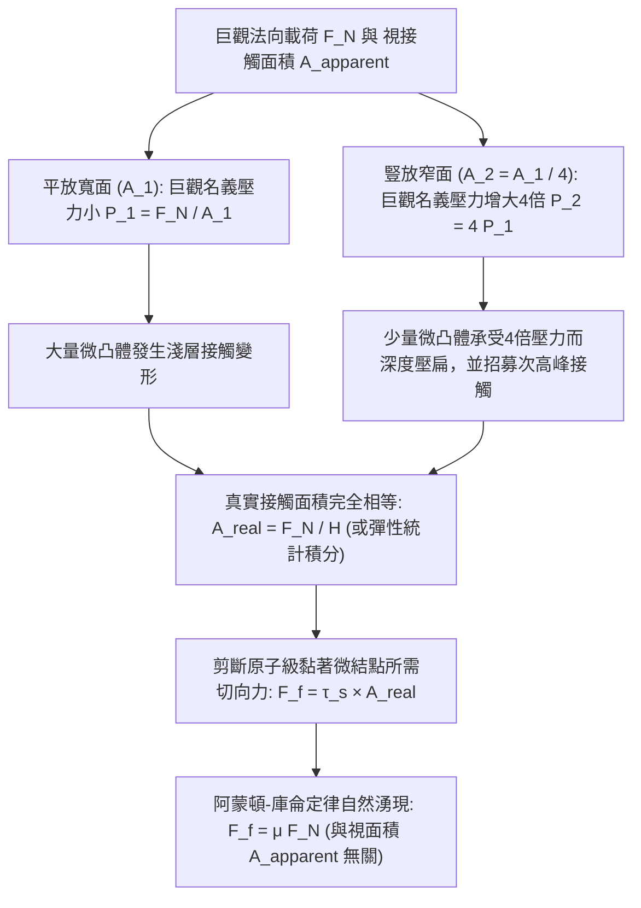
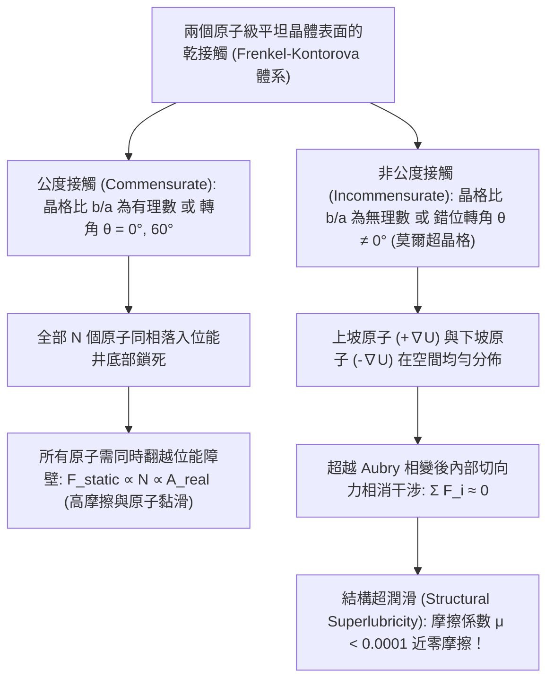

在高中物理課本中，乾摩擦定律 $F_f = \mu F_N$ 是形式最簡潔的力學公式之一：水平拉動桌面上的長方體磚塊時，最大靜摩擦力與動摩擦力僅取決於正向力（法向載荷 $F_N$）與摩擦係數 $\mu$ 的乘積。

然而，這一習以為常的公式背後隱藏著一個違背日常直覺的深刻悖論。假設我們將同一塊磚平放在桌面上（巨觀接觸面積 $A_1 = 200\,\text{cm}^2$）並用彈簧秤水平拉動，測得滑動摩擦力為 $F_f$；隨後我們將同一塊磚豎立在狹窄的側棱面上（接觸面積 $A_2 = 50\,\text{cm}^2$）再次拉動。直覺告訴我們，平放時與桌面摩擦的面積大了整整 $4$ 倍，摩擦阻力理應顯著增大。但實驗結果卻令人震驚：<strong>無論接觸面積相差多少倍，拉動磚塊所需的摩擦力都完全相同！</strong>反過來，如果摩擦力真的與接觸面積無關，為什麼一級方程式（F1）賽車和直線加速賽車都要換裝極其寬大的無胎紋「光頭胎（Slick Tires）」來提升抓地力？

另一個流傳百年的教科書迷思是「為什麼冰面如此濕滑」。傳統觀點認為，滑冰者站在狹窄的冰刀上產生的巨大壓力降低了冰的熔點（壓力融化說），從而在冰刀下壓出一層水膜。然而，一旦我們將數據代入熱力學的<strong>克勞修斯-克拉佩龍方程式（Clausius–Clapeyron Equation）</strong>進行嚴格計算，就會發現一名 $75\,\text{kg}$ 的滑冰者僅能使冰的熔點下降約 $0.12^\circ\text{C}$——這根本無法解釋為何人們能在 $-10^\circ\text{C}$ 甚至 $-20^\circ\text{C}$ 的嚴寒中順暢滑冰！

本文將從研究摩擦、磨損與潤滑的跨領域學科——<strong>摩擦學（Tribology）</strong>出發，用現代微觀表面物理學與接觸力學徹底解開這些經典謎題。我們將依次探討<strong>視接觸面積（$A_{\text{apparent}}$）</strong>與<strong>真實接觸面積（$A_{\text{real}}$）</strong>的本質差異、從琴弦發音到構造地震的<strong>黏滑振盪（Stick-Slip）與速率-狀態摩擦定律</strong>、冰表面的<strong>準液體層（QLL）預融化機制</strong>，以及讓摩擦係數趨近於零的奈米前沿——<strong>結構超潤滑（Structural Superlubricity）</strong>。

---

## 1. 經典乾摩擦三定律與「幾何嚙合模型」的熱力學破產

### 1.1 從達文西（1493）、阿蒙頓（1699）到庫侖（1785）

早在牛頓建立古典力學體系之前近兩個世紀，文藝復興巨匠<strong>李奧納多·達文西（Leonardo da Vinci）</strong>就在1493年左右的手稿（《阿倫德爾手稿》與《馬德里手稿》）中首次透過木塊與滑輪實驗記錄了兩條基本規律：（1）重量相同的物體，無論其接觸面是寬還是窄，啟動時的摩擦阻力完全相等；（2）若物體重量加倍，摩擦力也隨之加倍（對於光滑木材，$\mu \approx 1/4$）。

由於達文西手稿長期未被公開，法國物理學家<strong>紀堯姆·阿蒙頓（Guillaume Amontons）</strong>於1699年向巴黎皇家科學院重新獨立提交了這一發現。1748年，<strong>萊昂哈德·歐拉（Leonhard Euler）</strong>引入了摩擦係數符號 $\mu$，推導出斜面自鎖角關係 $\mu_s = \tan\theta_c$，並明確區分了靜摩擦與動摩擦（$\mu_s > \mu_k$）。1785年，法國工程師<strong>夏爾·奧古斯丁·德·庫侖（Charles-Augustin de Coulomb）</strong>在羅什福爾海軍造船廠進行了系統的重載實驗，最終確立了經典的<strong>阿蒙頓-庫侖乾摩擦三定律（Amontons–Coulomb Laws of Dry Friction）</strong>：

$$\begin{aligned}
\text{第一定律（載荷正比律）：} & \quad F_f = \mu F_N \\
\text{第二定律（面積無關律）：} & \quad \frac{\partial F_f}{\partial A_{\text{apparent}}} = 0 \\
\text{第三定律（速度無關律）：} & \quad \frac{\partial F_k}{\partial v} \approx 0 \quad (\text{且 } F_k = \mu_k F_N < F_s^{\max} = \mu_s F_N)
\end{aligned}$$

### 1.2 剛性鋸齒嚙合模型的能量守恆悖論

為了解釋為何摩擦力正比於法向載荷 $F_N$ 而與巨觀面積 $A_{\text{apparent}}$ 無關，阿蒙頓與庫侖提出了<strong>幾何凹凸嚙合模型（Geometric Interlocking Model）</strong>：假設固體表面佈滿傾角為 $\theta$ 的剛性微觀鋸齒，水平拉動上方物體時必須克服重力將其沿斜面 $\theta$ 抬升。由靜力平衡可得：

$$F_f \cos\theta = F_N \sin\theta \implies F_f = F_N \tan\theta \implies \mu = \tan\theta$$

這一幾何圖像看似完美，卻在19世紀熱力學第一定律確立後遭遇了致命危機：如果表面微凸體是完全剛性（或純彈性無遲滯）的斜面，那麼外力將物塊推上齒頂所做的機械功 $W_{\text{up}} = F_N \Delta h$，<strong>在物塊越過齒頂滑下另一側斜坡時，會 $100\%$ 被重力轉化回動能或向前的推力（$W_{\text{down}} = -F_N \Delta h$）</strong>！在一個完整週期內，保守位能場中的淨能量耗散嚴格為零（$\oint \mathbf{F}\cdot d\mathbf{r} = 0$），巨觀動摩擦力根本不可能存在。此外，經驗表明將兩塊金屬塊規拋光至奈米級鏡面（$\tan\theta \to 0$）時，摩擦力不僅沒有消失，反而會因冷焊而死死咬合在一起。因此，真正的摩擦機制必須建立在<strong>微觀真實接觸面積的不可逆變形與聲子（Phonon）熱耗散</strong>之上。

---

## 2. 視接觸面積與真實接觸面積：微凸體（Asperity）如何解開磚塊悖論

### 2.1 「把瑞士倒扣在奧地利之上」：鮑登-泰伯黏著塑性接觸理論（1950）

20世紀中葉，劍橋大學物理學家<strong>法蘭克·菲利普·鮑登（Frank Philip Bowden）</strong>與<strong>大衛·泰伯（David Tabor）</strong>在經典專著《固體的摩擦與潤滑》（1950）中指出：在掃描穿隧顯微鏡（STM）和原子力顯微鏡（AFM）下，即便是光學鏡面拋光的鋼塊，其表面均方根粗糙度 $R_q \sim 10\,\text{nm}\text{–}1\,\mu\text{m}$ 也比原子間化學鍵作用距離（$a_0 \sim 0.2\text{–}0.4\,\text{nm}$）大上千倍。正因如此，鮑登形象地比喻道：<strong>「將兩塊固體疊放在一起，就像把瑞士倒過來扣在奧地利上面一樣——真正接觸的只有最高聳的阿爾卑斯山峰尖端。」</strong>

這些微觀山峰被稱為<strong>微凸體（Asperities）</strong>。當兩個固體接觸時，真正發生原子級接觸的微凸體斑點面積之和稱為<strong>真實接觸面積（Real Contact Area, $A_{\text{real}}$）</strong>，它通常僅佔物體幾何外形決定的<strong>視接觸面積（Apparent Contact Area, $A_{\text{apparent}}$）</strong>的十萬分之一到千分之一：

$$A_{\text{real}} = \sum_{i=1}^{N_c} A_i \ll A_{\text{apparent}}, \qquad \frac{A_{\text{real}}}{A_{\text{apparent}}} \sim 10^{-5} \text{ – } 10^{-3}$$

由於全部法向載荷 $F_N$ 都集中在極小的 $A_{\text{real}}$ 上，微凸體尖端的局部正應力 $p_{\text{local}} = F_N / A_{\text{real}}$ 極易突破材料的單軸降伏強度 $\sigma_y$，達到材料的<strong>塑性壓痕硬度 $H \approx 3\sigma_y$</strong>（泰伯關係）。微凸體尖端隨即發生塑性降伏並橫向壓扁擴展，直到總真實接觸面積 $A_{\text{real}}$ 增大到恰好能以恆定降伏壓力 $H$ 支撐外載荷 $F_N$ 為止：

$$p_{\text{local}} = H \implies A_{\text{real}} = \frac{F_N}{H}$$

在這些間距小於 $0.3\,\text{nm}$ 的微接觸斑點上，界面原子透過金屬鍵、共價鍵或凡得瓦色散力形成<strong>冷焊黏著微結點（Adhesive Micro-junctions）</strong>。水平滑動時，外力必須以材料的<strong>界面剪切強度 $\tau_s$</strong> 剪斷所有黏著結點（外加硬微凸體犁削軟基體的犁溝項 $F_{\text{plough}}$）：

$$F_f = F_{\text{adh}} + F_{\text{plough}} \approx \tau_s A_{\text{real}} = \tau_s \left(\frac{F_N}{H}\right) = \left(\frac{\tau_s}{H}\right) F_N \implies \mu = \frac{\tau_s}{H}$$

這徹底解開了磚塊悖論：<strong>摩擦力絕非與「接觸面積」無關，恰恰相反，摩擦力嚴格正比於微觀的「真實接觸面積」 $A_{\text{real}}$！</strong>當我們將磚塊從寬面翻轉到窄面（$A_{\text{apparent}}$ 縮小為 $1/4$）時，由於重力 $F_N = mg$ 不變，窄面上的平均壓力增大了 $4$ 倍，使得窄面下的微凸體被壓扁得更深，從而保證總的真實接觸面積 $A_{\text{real}} = F_N / H$ 維持恆定！

### 2.2 格林伍德-威廉姆森（1966）多微凸體彈性統計模型與佩爾松理論

如果經過反覆磨合後微凸體僅發生<strong>純彈性變形</strong>，結論又如何？根據1882年<strong>赫茲彈性接觸理論（Hertzian Contact Mechanics）</strong>，單個曲率半徑為 $R$ 的彈性球體在載荷 $w$ 下與平面的接觸面積滿足非線性冪律（$E^*$ 為複合彈性模數）：

$$a = \left(\frac{3 w R}{4 E^*}\right)^{1/3} \implies A_{\text{single}} = \pi a^2 = \pi \left(\frac{3 R}{4 E^*}\right)^{2/3} w^{2/3} \propto w^{2/3}$$

若所有微凸體高度相同，總面積將滿足 $A_{\text{real}} \propto F_N^{2/3}$，違背阿蒙頓第一定律。1966年，<strong>格林伍德（J. A. Greenwood）與威廉姆森（J. B. P. Williamson）</strong>透過引入微凸體峰頂高度 $z$ 的機率密度分佈 $\phi(z)$（標準差為 $\sigma_s$，高尾近似為指數分佈 $\phi(z) = \frac{1}{\sigma_s} e^{-z/\sigma_s}$）解決了這一難題。當兩表面間距為 $d$ 時，所有 $z > d$ 的微凸體發生彈性壓縮 $\delta = z - d$，接觸斑點數 $N_c(d)$、真實接觸面積 $A_{\text{real}}(d)$ 與總載荷 $F_N(d)$ 分別為：

$$\begin{aligned}
N_c(d) &= \eta A_{\text{apparent}} \int_d^\infty \phi(z)\,dz = \eta A_{\text{apparent}} \, e^{-d/\sigma_s} \\
A_{\text{real}}(d) &= \pi \eta A_{\text{apparent}} R \int_d^\infty (z - d)\,\phi(z)\,dz = \pi \eta A_{\text{apparent}} R \sigma_s \, e^{-d/\sigma_s} \\
F_N(d) &= \frac{4}{3} \eta A_{\text{apparent}} E^* R^{1/2} \int_d^\infty (z - d)^{3/2}\,\phi(z)\,dz = \sqrt{\pi} \eta A_{\text{apparent}} E^* R^{1/2} \sigma_s^{3/2} \, e^{-d/\sigma_s}
\end{aligned}$$

兩式相除，$e^{-d/\sigma_s}$ 與 $A_{\text{apparent}}$ 完全約去，嚴格恢復線性比例關係：

$$A_{\text{real}} = \frac{\sqrt{\pi}}{E^* \sqrt{\sigma_s / R}} F_N \propto F_N$$

其物理圖像極為優美：當法向載荷 $F_N$ 增大時，不僅已有接觸斑點在擴大，<strong>原本懸空、高度稍矮的微凸體也不斷新加入到接觸佇列中</strong>。新舊接觸斑點的統計平衡使得「每個接觸點的平均面積 $\langle A_i \rangle = \pi R \sigma_s$」保持恆定，而接觸點總數 $N_c$ 隨載荷線性增長！2001年，<strong>博·佩爾松（Bo N. J. Persson）</strong>進一步將其推廣至具有自仿射碎形粗糙度譜 $C(q) \propto q^{-2(1+H_f)}$ 的多尺度表面，證明了界面應力分佈隨放大倍率 $\zeta$ 演化滿足擴散方程式，在小壓力下普遍成立 $A_{\text{real}} = \frac{\kappa}{E^* \sqrt{\langle |\nabla h|^2 \rangle}} F_N$。

### 2.3 阿蒙頓定律失效的三大極限：F1光頭胎、壁虎腳掌剛毛與太空冷焊

一旦 $A_{\text{real}}$ 趨近於 $A_{\text{apparent}}$ 或分子黏著力佔主導，阿蒙頓定律便宣告失效，接觸面積將直接決定摩擦力：
1. <strong>黏彈性橡膠與F1賽車寬幅光頭胎（JKR黏著接觸理論，1971）</strong>：橡膠模數極低（$E \sim 1\text{–}10\,\text{MPa}$），能嵌入路面微觀凹坑使 $A_{\text{real}} \to A_{\text{apparent}}$。由<strong>Johnson–Kendall–Roberts（JKR）方程式</strong>：
   $$a_{\text{JKR}}^3 = \frac{3R}{4E^*}\left(w + 3\pi R \Delta\gamma + \sqrt{6\pi R \Delta\gamma w + (3\pi R \Delta\gamma)^2}\right)$$
   即便法向載荷 $w = 0$，黏著功 $\Delta\gamma$ 仍維持有限接觸面積；而在高載荷飽和區，等效摩擦係數隨名義壓力增大而下降（$\mu_{\text{eff}} \propto P_{\text{nom}}^{-1/3}$，即輪胎載荷敏感性）。因此F1賽車採用極寬的光頭胎來增大 $A_{\text{apparent}}$、降低名義壓力，從而最大化黏著與黏彈性遲滯抓地力並分散摩擦熱。
2. <strong>壁虎腳掌的分級奈米剛毛（Setae & Spatulae）</strong>：壁虎腳趾覆蓋數百萬根 $\beta$-角蛋白剛毛（Setae），每根末端分叉成數百個寬僅 $100\text{–}200\,\text{nm}$ 的匙狀奈米絨毛（Spatulae），使等效結構模數降至 $E_{\text{eff}} < 100\,\text{kPa}$（滿足Dahlquist黏著判據），在任意粗糙牆面上實現 $A_{\text{real}} \approx A_{\text{apparent}}$，僅憑凡得瓦力即可懸掛自身體重數十倍的負載。
3. <strong>超高真空中的金屬冷焊（Cold Welding）</strong>：地球大氣中的金屬表面覆蓋著 $1\text{–}5\,\text{nm}$ 的天然氧化膜與吸附水膜；而在外太空超高真空（$P < 10^{-10}\,\text{Pa}$）中，一旦摩擦磨去氧化層或 $\text{MoS}_2$ 固體潤滑膜，裸露的潔淨金屬晶格直接接觸，電子雲瞬間跨越界面共享形成金屬鍵（$\mu \to \infty$），導致機械徹底卡死（如1991年「伽利略號」木星探測器高增益天線展開失敗事故）。

---

## 3. 黏滑振盪（Stick-Slip）與速率-狀態摩擦定律：從提琴聲學到構造大地震

### 3.1 彈簧-滑塊模型與弛豫振盪動力學

老舊門軸的吱呀聲、粉筆劃過黑板的尖嘯、汽車煞車嘯叫、小提琴弓弦奏出的樂音以及斷層破裂引發的9級大地震，本質上都是同一種非線性動力學不穩定性——<strong>黏滑振盪（Stick-Slip Oscillation）</strong>。

考慮質量為 $m$ 的滑塊透過剛度為 $k$ 的彈簧被速度為 $v_0$ 的驅動端拉動：

$$m \frac{d^2 x}{dt^2} = k(v_0 t - x) - F_f\!\left(\frac{dx}{dt}, \theta\right)$$

當靜摩擦係數大於動摩擦係數（$\mu_s > \mu_k$）時，系統交替經歷兩個階段：
* <strong>黏著階段（Stick，$\dot{x} = 0$）</strong>：滑塊靜止鎖死，彈簧拉力隨時間線性累積 $F_{\text{spring}}(t) = \mu_k F_N + k v_0 t$，持續時間 $t_{\text{stick}} = \frac{(\mu_s - \mu_k)F_N}{k v_0}$。
* <strong>滑動階段（Slip，$\dot{x} > 0$）</strong>：當拉力達到 $\mu_s F_N$ 瞬間，界面黏著點集體斷裂，阻力驟降至 $\mu_k F_N$，滑塊以固有頻率 $\omega_0 = \sqrt{k/m}$ 急速前衝：
  $$x(t') = v_0 t' + \frac{(\mu_s - \mu_k)F_N}{k}(1 - \cos\omega_0 t') - \frac{v_0}{\omega_0}\sin\omega_0 t'$$
  經過約半週期 $t_{\text{slip}} \approx \pi\sqrt{m/k}$ 後滑塊速度降回零並重新鎖死，形成週而復始的鋸齒波弛豫振盪。

### 3.2 接觸老化（Contact Aging）與迪特里希-魯伊納速率-狀態摩擦定律（RSF）

為什麼靜摩擦總是大於動摩擦？<strong>詹姆斯·迪特里希（James H. Dieterich, 1979）</strong>、<strong>安迪·魯伊納（Andy Ruina, 1983）</strong>以及<strong>傑伊·法恩伯格（Jay Fineberg, 2004）</strong>的雷射全內反射成像實驗證明：在靜止接觸期間，微凸體尖端在高壓下發生熱激活塑性/黏彈性潛變（Creep）與界面化學成鍵，使真實接觸面積 $A_{\text{real}}(t)$ 隨接觸時間 $t$ 呈<strong>對數增長（接觸老化）</strong>：

$$A_{\text{real}}(t) = A_0 \left[ 1 + c \ln\!\left(1 + \frac{t}{\tau_0}\right) \right]$$

一旦以速度 $v$ 滑動，老化接觸點在滑過特徵更新距離 $D_c$（約 $1\text{–}50\,\mu\text{m}$）後被剪斷並替換為平均壽命為 $\theta \approx D_c / v$ 的新接觸點。將其統一即可得到現代摩擦學與地震物理的核心方程式——<strong>迪特里希-魯伊納速率-狀態摩擦定律（Rate-and-State Friction Law）</strong>：

$$\mu(v, \theta) = \mu_0 + a \ln\!\left(\frac{v}{v_*}\right) + b \ln\!\left(\frac{v_* \theta}{D_c}\right), \qquad \frac{d\theta}{dt} = 1 - \frac{v \theta}{D_c}$$

在定常滑動（$\dot{\theta} = 0 \implies \theta_{\text{ss}} = D_c / v$）下：

$$\mu_{\text{ss}}(v) = \mu_0 + (a - b) \ln\!\left(\frac{v}{v_*}\right)$$

* 當 $a - b > 0$（<strong>速度強化</strong>）時，摩擦隨速度增加而增大，滑動無條件穩定（對應斷層無震潛滑）。
* 當 $a - b < 0$（<strong>速度弱化</strong>）且系統剛度 $k$ 小於<strong>臨界剛度 $k_c$</strong> 時，定常滑動經霍普夫分岔（Hopf Bifurcation）失穩並爆發劇烈的黏滑振盪：
  $$k < k_c = \frac{(b - a) F_N}{D_c}$$
  塗抹松香（處於玻璃轉移溫度 $T_g$ 附近的樹脂酸）的小提琴弓弦利用 $b > a$ 產生每秒數百次的<strong>亥姆霍茲運動（Helmholtz Motion）</strong>鋸齒波；而隱沒帶發震斷層則在 $v_0 \sim \text{cm/年}$ 的板塊驅動下黏著閉鎖數百年（Stick），最終在數秒內以 $v_{\text{slip}} \sim \text{m/s}$ 發生災難性快速錯動（大地震 Slip）。

---

## 4. 冰為什麼是滑的？克勞修斯-克拉佩龍定量計算與準液體層（QLL）

### 4.1 用克勞修斯-克拉佩龍方程式證偽「壓力融化說」

讓我們用熱力學相平衡的<strong>克勞修斯-克拉佩龍方程式</strong>嚴格計算冰的熔點隨壓力的變化率：

$$\frac{dP}{dT_m} = \frac{L_f}{T_m \left(v_{\text{liq}} - v_{\text{ice}}\right)} = \frac{L_f}{T_m \left(\frac{1}{\rho_{\text{liq}}} - \frac{1}{\rho_{\text{ice}}}\right)}$$

代入 $T_m = 273.15\,\text{K}$ 時的精確物理常數：熔化潛熱 $L_f = 3.335 \times 10^5\,\text{J/kg}$，液態水密度 $\rho_{\text{liq}} = 999.8\,\text{kg/m}^3$，六方冰 $\text{I}_h$ 密度 $\rho_{\text{ice}} = 916.7\,\text{kg/m}^3$（比體積差 $\Delta v = -9.07 \times 10^{-5}\,\text{m}^3/\text{kg}$）：

$$\frac{dP}{dT_m} = \frac{3.335 \times 10^5}{(273.15)(-9.07 \times 10^{-5})} \approx -1.346 \times 10^7\,\text{Pa/K} = -13.46\,\text{MPa/K}$$

即<strong>每降低 $1^\circ\text{C}$ 的冰熔點，需要高達 $13.46\,\text{MPa}$（約 $133$ 個大氣壓）的壓力！</strong>
一名質量 $m = 75\,\text{kg}$（$F_N = 735\,\text{N}$）的滑冰者單腳立於長 $L = 30\,\text{cm}$、有效刃寬 $w = 1.5\,\text{mm}$（面積 $A = 4.5 \times 10^{-4}\,\text{m}^2$）的冰刀上時，產生的壓力與熔點下降僅為：

$$\Delta P = \frac{735\,\text{N}}{4.5 \times 10^{-4}\,\text{m}^2} \approx 1.63\,\text{MPa} \implies \Delta T_m = \frac{1.63\,\text{MPa}}{-13.46\,\text{MPa/K}} \approx -0.12^\circ\text{C}$$

哪怕局部壓力達到冰的壓碎降伏極限（$H_{\text{ice}} \approx 15\,\text{MPa}$），熔點最多也只能降到 $-1.1^\circ\text{C}$。然而花式滑冰與冰球館的冰溫通常在 $-5^\circ\text{C}$ 至 $-10^\circ\text{C}$，平底鞋（$\Delta T_m \sim -0.001^\circ\text{C}$）踩在冰上同樣會打滑。因此，「壓力融化說」完全無法解釋滑冰現象。

### 4.2 冰面潤滑的三大真實物理機制

1. <strong>表面預融化與法拉第準液體層（Quasi-Liquid Layer, QLL, 1850）</strong>：冰晶體內部每個水分子透過 $4$ 個氫鍵鎖定在四面體晶格中；但最表層水分子上方缺少相鄰分子，處於<strong>配位不足狀態（僅 $2$ 或 $3$ 個氫鍵的懸掛鍵）</strong>。為降低表面自由能，這些表層分子劇烈熱振動，在零外壓下從 <strong>$-30^\circ\text{C} \sim -35^\circ\text{C}$</strong> 起就自發形成一層厚約 $1\text{–}20\,\text{nm}$ 的無序<strong>準液體層（QLL）</strong>，提供初始邊界潤滑。當溫度低於 $-35^\circ\text{C}$ 時 QLL 消失，極地冰雪便會像乾沙一樣粗糙難滑。
2. <strong>摩擦熱局部融化（Bowden & Hughes, 1939）</strong>：高速滑行（$v \sim 5\text{–}15\,\text{m/s}$）時，摩擦熱流 $q = \mu P v$ 集中在微米級熱擴散表層 $\delta_{\text{th}} \sim \sqrt{\alpha_{\text{th}} L / v}$，瞬間將接觸點加熱至 $0^\circ\text{C}$ 並融化出厚達數十至數百奈米的水膜。這也解釋了為何現代滑雪板底採用低熱導率的聚乙烯（UHMWPE）而非高熱導率的黃銅（金屬會導走摩擦熱，反而增大摩擦）。
3. <strong>奈米受限界面水的複數黏彈性流變學（Canale, Bocquet & Bonn, 2019, *Phys. Rev. X*）</strong>：音叉原子力顯微鏡實驗表明，冰面受剪切的奈米水膜並非普通低黏度體相水，而是有效黏度比普通水高 $50\text{–}100$ 倍、兼具彈性儲能模數 $G'(\omega)$ 的<strong>複數黏彈性流體</strong>，在滑行中產生彈性流體動壓升力，防止冰刀直接刺入固態冰晶。

---

## 5. 從斯特里貝克曲線到「結構超潤滑」：原子尺度的零摩擦極限

### 5.1 斯特里貝克曲線（Stribeck Curve）與雷諾流體潤滑方程式

工程潤滑透過膜厚比 $\Lambda = h_{\min} / \sqrt{R_{q1}^2 + R_{q2}^2}$ 劃分為<strong>邊界潤滑（$\Lambda < 1$）</strong>、<strong>混合/彈流潤滑（$1 \le \Lambda \le 3$）</strong>與<strong>流體動壓潤滑（$\Lambda > 3$）</strong>。在流體潤滑區，薄膜壓力場 $p(x,y)$ 遵循1886年<strong>奧斯本·雷諾（Osborne Reynolds）</strong>推導的偏微分方程式：

$$\frac{\partial}{\partial x}\!\left(\frac{h^3}{12\eta}\frac{\partial p}{\partial x}\right) + \frac{\partial}{\partial y}\!\left(\frac{h^3}{12\eta}\frac{\partial p}{\partial y}\right) = \frac{U}{2}\frac{\partial h}{\partial x} + \frac{\partial h}{\partial t}$$

利用收斂楔形間隙（$\partial h / \partial x < 0$）產生的動水壓力即可完全隔開固體表面（$\mu \approx 0.001\text{–}0.005$）。

### 5.2 普朗特-湯姆林森（PT）模型與平野元久「結構超潤滑」（1990）

在無液體潤滑劑的乾接觸中，<strong>普朗特-湯姆林森模型（Prandtl–Tomlinson Model, 1928–1929）</strong>描述了等效剛度為 $k_{\text{eff}}$ 的原子在週期為 $a$、位能障壁為 $U_0$ 的晶格位能場中的運動：

$$V_{\text{PT}}(x, X) = -\frac{U_0}{2}\cos\!\left(\frac{2\pi x}{a}\right) + \frac{1}{2} k_{\text{eff}} (x - X)^2, \qquad \eta_{\text{PT}} = \frac{2\pi^2 U_0}{k_{\text{eff}} a^2}$$

當無因次參數 $\eta_{\text{PT}} > 1$ 時，位能面存在多個亞穩態極小值，原子發生失穩跳躍（原子級黏滑）並將彈性能耗散為晶格<strong>聲子（熱）</strong>；而當 $\eta_{\text{PT}} \le 1$ 時，位能面始終只有唯一極小值，原子平滑絕熱滑行，準靜態摩擦嚴格為零！

當推廣至包含 $N$ 個原子的二維晶體薄片（<strong>弗倫克爾-康托洛娃模型，Frenkel–Kontorova Model</strong>）時，日本物理學家<strong>平野元久（Motohisa Hirano, 1990）</strong>預言並由<strong>Dienwiebel 等人（2004）</strong>在旋轉石墨奈米片實驗中證實：若兩層晶格處於<strong>非公度接觸（Incommensurate Contact，如旋轉錯位石墨烯或石墨烯/$\text{h-BN}$、$\text{MoS}_2$ 異質結形成的莫爾超晶格）</strong>，且晶格剛度超越<strong>奧布里相變（Aubry Transition）</strong>閾值，則每一個正在爬越位能障壁上坡（$+\nabla U$）的原子，都必然伴隨另一個正在滑下位能障壁斜坡（$-\nabla U$）的原子。內部原子的橫向力發生完美的<strong>相消干涉</strong>：

$$F_{\text{lateral}}^{\text{incomm}} = -\sum_{i=1}^{N} \frac{\pi U_0}{a}\sin\!\left(\frac{2\pi x_i}{a}\right) \approx \mathcal{O}\!\left(N^0 \text{ – } N^{1/2}\right) \ll N$$

乾摩擦係數由此驟降至 <strong>$\mu < 0.0001$</strong>，在無需任何油脂的條件下實現了近乎永恆的無磨損滑動。

---

## 6. 總結：跨尺度摩擦與潤滑物理機制對比表

| 摩擦與潤滑機制 | 主導微觀物理過程 | 真實接觸面積與載荷標度律 | 典型摩擦係數 $\mu$ | 核心控制方程式與理論模型 |
| :--- | :--- | :--- | :--- | :--- |
| <strong>硬質固體乾摩擦</strong> | 微凸體尖端塑性降伏或統計彈性變形 + 黏著結點剪切 | $A_{\text{real}} \propto F_N \ll A_{\text{apparent}}$（與視面積無關） | $0.15 \text{ – } 0.80$ | 鮑登-泰伯 $A_{\text{real}}=F_N/H$、GW統計模型、Persson理論 |
| <strong>軟橡膠與壁虎黏著摩擦</strong> | 低模數完全共形貼合 + 凡得瓦黏著與黏彈性遲滯 | $A_{\text{real}} \to A_{\text{apparent}}$（隨視面積增大而增大） | $0.80 \text{ – } 3.0+$ | JKR黏著接觸理論（1971）、Dahlquist判據（$E_{\text{eff}} < 100\,\text{kPa}$） |
| <strong>黏滑失穩振盪</strong> | 靜止期接觸潛變對數老化 vs. 滑動期特徵距離 $D_c$ 更新 | $A_{\text{real}}(t) = A_0[1 + c\ln(1+t/\tau_0)]$ | $\mu_s(t) > \mu_k(v)$ | 迪特里希-魯伊納速率-狀態方程式（RSF）、臨界剛度 $k_c$ |
| <strong>冰面超低摩擦</strong> | 配位不足水分子準液體層（QLL）+ 摩擦熱融化 + 黏彈性升力 | QLL（$1\text{–}20\,\text{nm}$）與融化水膜隔開微凸體（至 $-30^\circ\text{C}$） | $0.005 \text{ – } 0.03$ | 法拉第表面預融化、鮑登摩擦熱、Bocquet-Bonn黏彈性模型 |
| <strong>流體動壓潤滑</strong> | 收斂楔形間隙黏性曳引產生自生流體動壓場 $p(x,y)$ | 零固體直接接觸（$\Lambda = h_{\min}/\sigma^* > 3$） | $0.001 \text{ – } 0.005$ | 斯特里貝克曲線（1902）、雷諾流體潤滑偏微分方程式（1886） |
| <strong>結構超潤滑（二維晶體）</strong> | 非公度莫爾超晶格中原子橫向週期力的相位相消干涉 | 內部原子力抵消，僅邊緣原子貢獻（$F_f \propto A^{0\text{–}0.5}$） | $< 0.0001$（$10^{-4}\text{–}10^{-5}$） | 普朗特-湯姆林森（$\eta_{\text{PT}} \le 1$）、FK模型、平野超潤滑理論 |
