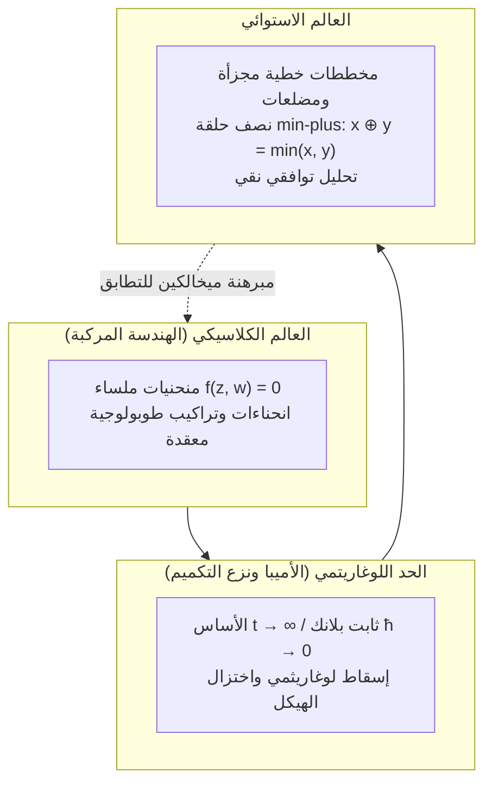

## مقدمة: الجرأة على إعادة صياغة قواعد الحساب الابتدائي

منذ المراحل الدراسية الأولى، تبدو قواعد الحساب الكلاسيكي مطلقة وبديهية:
$$2 + 3 = 5, \quad 2 \times 3 = 6$$
تشكل هذه العمليات بنية «الحقل الرياضي»، التي تنطلق منها الهندسة الجبرية الكلاسيكية بمنحنياتها وأسطحها المعقدة.

ولكن، ماذا لو أعدنا تعريف هذه العمليات بصورة ثورية تماماً؟
- <strong>الجمع الاستوائي ($\oplus$)</strong>: اختيار <strong>القيمة الصغرى (الحد الأدنى)</strong> بين عددين:
  $$x \oplus y = \min(x, y)$$
- <strong>الضرب الاستوائي ($\odot$)</strong>: هو <strong>الجمع الكلاسيكي المعتاد</strong>:
  $$x \odot y = x + y$$

في هذا العالم الجديد:
$$3 \oplus 5 = \min(3, 5) = 3$$
$$3 \odot 5 = 3 + 5 = 8$$
والجمع هنا يحقق خاصية التكرار الذاتي ($3 \oplus 3 = 3$)، بينما تنعدم عملية الطرح تماماً.

تُعرف هذه البنية الرياضية باسم <strong>نصف الحلقة الاستوائية (Tropical Semiring)</strong> أو <strong>جبر min-plus</strong>. وقد أطلق عليها علماء الرياضيات الفرنسيون اسم «الاستوائية» تكريماً لعالم الرياضيات البرازيلي <strong>إمري سيمون (1943–2009)</strong>، الذي وظف هذا الجبر في علوم الحاسوب، ولأنه ينتمي إلى البرازيل الواقعة في المنطقة الاستوائية.

تتجلى المعجزة عندما نبني المعادلات على هذا الأساس: <strong>إذ تنحدر المنحنيات الجبرية المعقدة في الفضاء المركب لتتحول إلى شبكات خطية مجزأة ومضلعات مستوية غاية في الوضوح والبساطة التوافقية!</strong> وفي مطلع القرن الحادي والعشرين، أحدث العالم الروسي غريغوري ميخالكين ثورة في الهندسة التعدادية بعدما حل أعقد معضلاتها عبر ألغاز هندسية استوائية.

---

## 1. مسلمات نصف الحلقة الاستوائية

الأعداد الحقيقية الاستوائية: $\mathbb{T} = \mathbb{R} \cup \{+\infty\}$.
المسلمات الأساسية:
1. <strong>التجميع والتبديل</strong> للعمليتين $\oplus$ و $\odot$؛
2. <strong>التوزيع</strong>: $x + \min(y, z) = \min(x + y, x + z)$؛
3. <strong>العناصر المحايدة</strong>: الصفر الاستوائي هو $+\infty$، والواحد الاستوائي هو $0$؛
4. <strong>التطابق الذاتي (Idempotency)</strong>: $x \oplus x = x$؛
5. <strong>خطية القوى</strong>: $x^{\odot n} = n \cdot x$.

---

## 2. كثيرات الحدود الاستوائية والسطوح الفائقة

كثيرة الحدود الاستوائية دالة مقعرة مستمرة وخطية مجزأة:
$$F(\mathbf{x}) = \min_{\mathbf{a}} (c_{\mathbf{a}} + \langle \mathbf{a}, \mathbf{x} \rangle)$$

### تعريف السطح الفائق الاستوائي $V(F)$
في غياب الطرح، <strong>يُعرَّف السطح الفائق الاستوائي $V(F)$ بأنه موضع النقاط التي يتحقق عندها الحد الأدنى بواسطة حدين مختلفين على الأقل (حواف عدم قابلية الاشتقاق في المخطط)!</strong>

---

## 3. الخطوط الاستوائية وشرط التوازن

يشكل الخط الاستوائي المستوي $F(x, y) = \min(x, y, 0)$ <strong>حاملاً ثلاثياً (Tripod)</strong> تنطلق أشعته في الاتجاهات $(0, 1)$ و $(1, 0)$ و $(-1, -1)$.
ويكون مجموع متجهات الاتجاه مساوياً بدقة للمتجه الصفري $(0, 0)$ محققاً <strong>شرط التوازن (Balancing Condition)</strong>.

---

## 4. الأميبا ونزع التكميم لماسلوف

يُظهر الإسقاط اللوغاريثمي للمنحنى المركب شكلاً مسطحاً ذا مجسات يُسمى <strong>الأميبا (Amoeba)</strong>. وعند أخذ النهاية $t \to \infty$ (نزع التكميم لماسلوف)، تنكمش الأميبا لتتطابق تماماً مع هيكلها الاستوائي الخطي المجزأ.

---

## 5. مبرهنة ميخالكين للتطابق

مسألة حساب عدد المنحنيات الجبرية المارة بنقاط معينة (لا متغيرات غراموف-فيتن):
$$N_{d, g} = \sum_{\Gamma} \operatorname{Mult}(\Gamma)$$
تحولت بفضل ميخالكين إلى مجرد عد للرسوم الاستوائية التوافقية $\Gamma$ وضربها في مضاعفاتها المحددة هندسياً.

---

## 6. التطبيقات المعاصرة

- <strong>أقصر المسارات</strong>: تتطابق خوارزمية فلويد-وارشال تماماً مع قوى المصفوفات في الجبر الاستوائي $\mathbf{D}^{\odot n}$؛
- <strong>أشجار التطور السلالي</strong>: يطابق فضاء جميع الأشجار التطورية في علم الأحياء صنف غراسمان الاستوائي $\operatorname{Trop} \operatorname{Gr}(2, N)$؛
- <strong>المزادات والبرمجة الديناميكية</strong>: تشكل حدود خيارات المستهلكين سطوحاً استوائية في فضاء الأسعار.

## خاتمة

بتبديل الجمع بالقيمة الصغرى والضرب بالجمع، كشفت الهندسة الاستوائية عن الهيكل التوافقي الخالص المنبعث من قلب الهندسة الجبرية، لتبرهن على الوحدة العميقة لقوانين الرياضيات.
