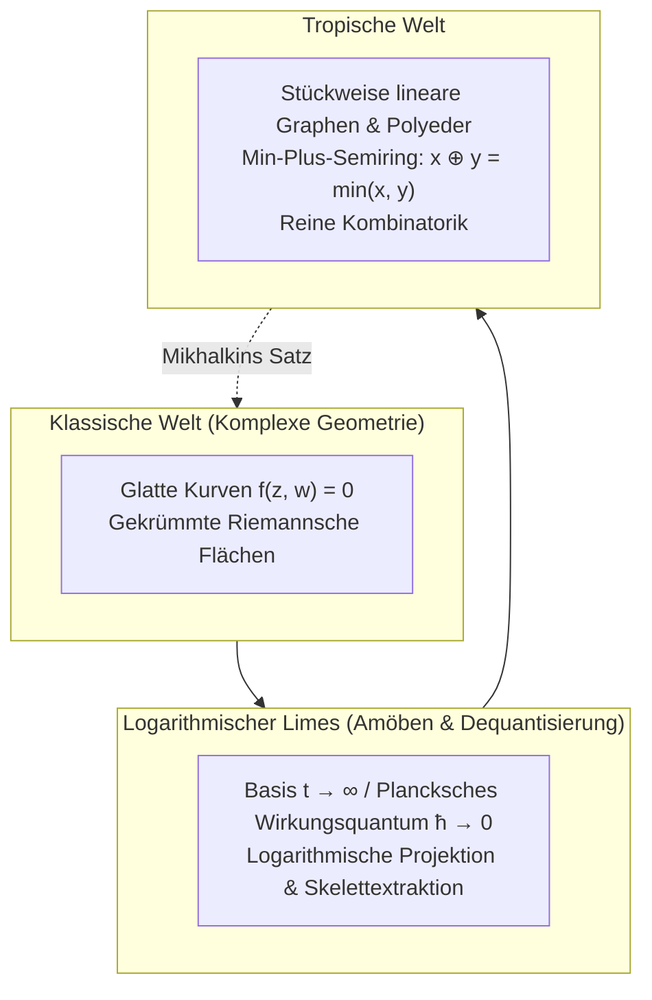

## Einleitung: Der kühne Umbau der elementaren Arithmetik

Die Regeln der Arithmetik scheinen seit Jahrtausenden unverrückbar:
$$2 + 3 = 5, \quad 2 \times 3 = 6$$
Sie bilden die Grundlage mathematischer Körper wie $\mathbb{R}$ oder $\mathbb{C}$, auf denen die klassische algebraische Geometrie mit ihren geschwungenen Kurven und Mannigfaltigkeiten aufbaut.

Was geschieht jedoch, wenn wir diese Grundregeln radikal modifizieren?
- <strong>Tropische Addition ($\oplus$)</strong>: Definiert als das <strong>Minimum zweier Zahlen</strong>:
  $$x \oplus y = \min(x, y)$$
- <strong>Tropische Multiplikation ($\odot$)</strong>: Definiert als die <strong>gewöhnliche klassische Addition</strong>:
  $$x \odot y = x + y$$

In diesem System gilt:
$$3 \oplus 5 = \min(3, 5) = 3$$
$$3 \odot 5 = 3 + 5 = 8$$
Es gilt die Idempotenz $3 \oplus 3 = 3$, und eine Subtraktion existiert nicht, da $\min(3, x) = 5$ für kein reelles $x$ lösbar ist.

Diese algebraische Struktur heißt <strong>tropischer Halbring (Tropical Semiring)</strong> oder <strong>Min-Plus-Algebra</strong>. Der Name „tropisch“ wurde von französischen Mathematikern wie Jean-Éric Pin geprägt – als Hommage an den brasilianischen Informatiker <strong>Imre Simon (1943–2009)</strong>, der diese Algebra in der Automatentheorie etablierte und aus den Tropen Brasiliens stammte.

Das mathematische Wunder besteht darin: <strong>Errichtet man algebraische Varietäten über dem tropischen Halbring, degenerieren hochkomplexe, gekrümmte algebraische Kurven zu kristallklaren, stückweise linearen Streckenzügen, Polyedern und Graphen!</strong> Grigory Mikhalkin löste mit diesem Ansatz jahrhundertealte Probleme der abzählenden Geometrie im Handumdrehen.

---

## 1. Axiome des tropischen Halbrings

Die tropischen reellen Zahlen sind $\mathbb{T} = \mathbb{R} \cup \{+\infty\}$.
Die Axiome lauten:
1. <strong>Assoziativität und Kommutativität</strong> für $\oplus$ und $\odot$;
2. <strong>Distributivität</strong>: $x + \min(y, z) = \min(x + y, x + z)$;
3. <strong>Neutrale Elemente</strong>: Tropische Null ist $+\infty$, tropische Eins ist $0$;
4. <strong>Idempotenz</strong>: $x \oplus x = x$;
5. <strong>Linearisierung von Potenzen</strong>: $x^{\odot n} = n \cdot x$.

---

## 2. Tropische Polynome und Hyperflächen

Ein tropisches Polynom ist eine stetige, stückweise lineare, konkave Funktion:
$$F(\mathbf{x}) = \min_{\mathbf{a}} (c_{\mathbf{a}} + \langle \mathbf{a}, \mathbf{x} \rangle)$$

### Definition der tropischen Hyperfläche $V(F)$
Da es keine Subtraktion gibt, ist die <strong>tropische Hyperfläche $V(F)$ definiert als die Menge aller Punkte, an denen das Minimum von mindestens zwei verschiedenen Monomen gleichzeitig angenommen wird (die Knickstellen des Graphen)!</strong>

---

## 3. Tropische Geraden und die Balancierungsbedingung

Eine 2D-tropische Gerade $F(x, y) = \min(x, y, 0)$ bildet ein dreibeiniges <strong>Stativ (Tripod)</strong> mit Strahlen in Richtung $(0, 1)$, $(1, 0)$ und $(-1, -1)$.
Die Summe dieser Vektoren ergibt $(0, 0)$ – die fundamentale <strong>Balancierungsbedingung (Balancing Condition)</strong>. Tropische Kurven verhalten sich wie mechanische Seilnetze im Kräftegleichgewicht.

---

## 4. Amöben und Maslow-Dequantisierung

Wird eine komplexe Varietät über die logarithmische Abbildung $\operatorname{Log}(z, w) = (\log |z|, \log |w|)$ projiziert, entsteht eine flächige Gestalt mit Tentakeln – die <strong>Amöbe</strong>. Im Grenzwert $t \to \infty$ (Maslow-Dequantisierung, äquivalent zum semiklassischen Limes $\hbar \to 0$) schrumpft die Amöbe exakt auf ihr eindimensionales stückweise lineares Skelett zusammen: die tropische Kurve.

---

## 5. Mikhalkins Korrespondenzsatz

Das jahrhundertealte Problem der abzählenden Geometrie, die Anzahl $N_{d, g}$ komplexer Kurven vom Grad $d$ und Geschlecht $g$ durch gegebene Punkte zu bestimmen (Gromov-Witten-Invarianten), wurde von Grigory Mikhalkin gelöst:
$$N_{d, g} = \sum_{\Gamma} \operatorname{Mult}(\Gamma)$$
Man zählt lediglich die kombinatorischen tropischen Graphen $\Gamma$ auf dem Gitterpapier und multipliziert sie mit elementaren Gitterdeterminanten!

---

## 6. Praktische Anwendungen

- <strong>Kürzeste Wege in Netzwerken</strong>: Der Floyd-Warshall-Algorithmus ist identisch mit tropischen Matrixpotenzen $\mathbf{D}^{\odot n}$;
- <strong>Phylogenetische Stammbäume</strong>: Der Raum aller biologischen Stammbäume ist exakt die tropische Grassmann-Varietät $\operatorname{Trop} \operatorname{Gr}(2, N)$;
- <strong>Auktionstheorie</strong>: Grenzen optimaler Güterbündel im Preisraum bilden tropische Hyperflächen.

## Fazit

Tropische Geometrie befreit die Mathematik von der Bürde nichtlinearer Krümmungen und enthüllt das kristalline, stückweise lineare Skelett der geometrischen Welt.
