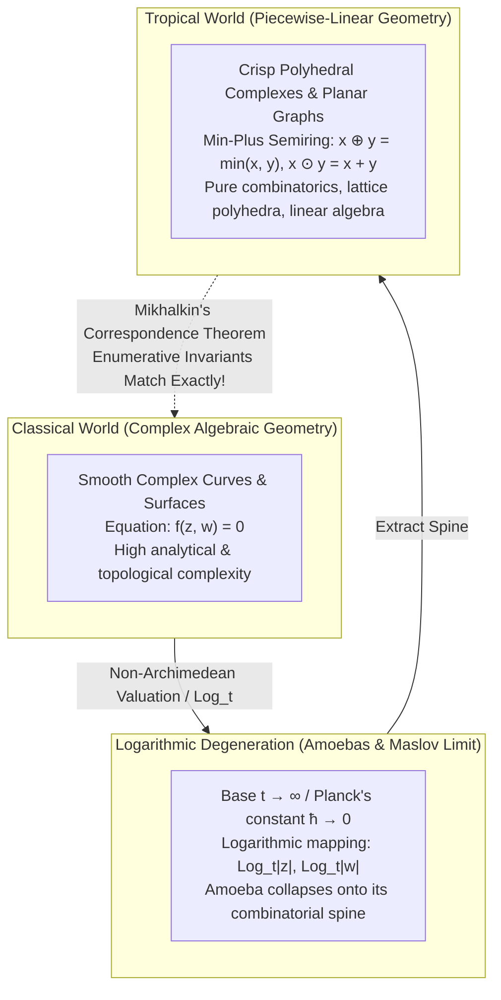
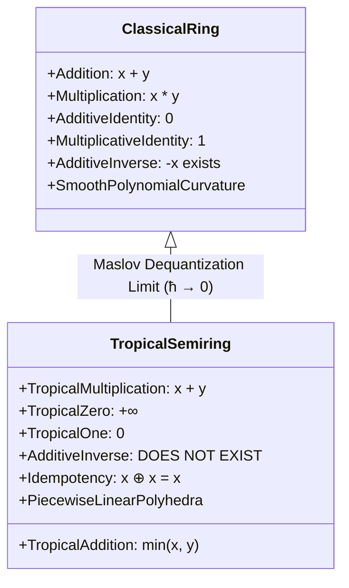
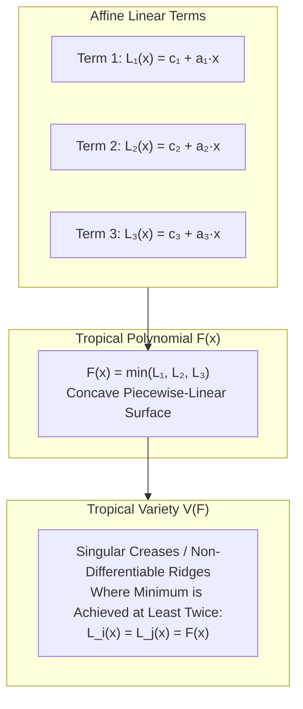
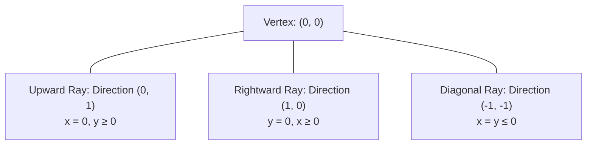
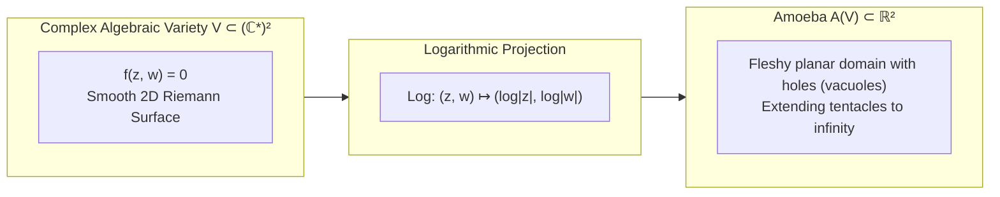
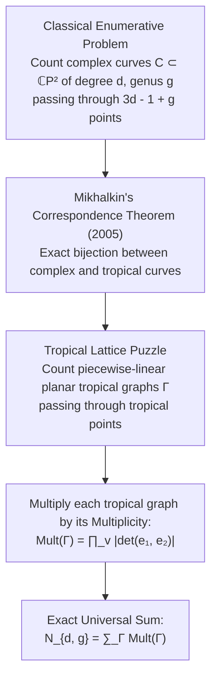
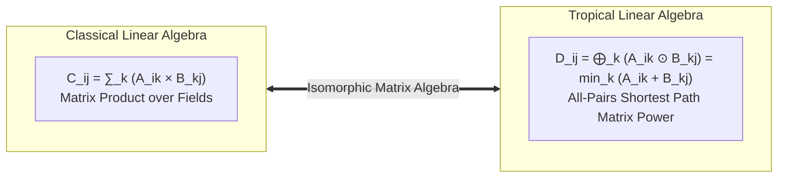

## Introduction: The Audacious Transmutation of Elementary Arithmetic

The arithmetic rules instilled in us from primary education feel immutable, eternal, and absolute:
$$2 + 3 = 5, \quad 2 \times 3 = 6$$
Together with the distributive law $a \times (b + c) = a \times b + a \times c$ and the existence of additive and multiplicative inverses, these operations define the axiomatic perfection of a <strong>mathematical field</strong> (such as $\mathbb{Q}$, $\mathbb{R}$, or $\mathbb{C}$). Upon this foundational bedrock, polynomials are formed, equations are solved, and Cartesian coordinate systems blossom into the magnificent, curved landscapes of classical algebraic geometry—parabolas, cubic curves, elliptic surfaces, and Calabi-Yau manifolds.

Yet, consider a daring thought experiment: What if we were to radically rewrite the elementary rules of arithmetic that civilization has taken for granted for millennia?
- <strong>Tropical Addition ($\oplus$)</strong>: Defined not as summing two quantities, but as <strong>selecting their minimum</strong>:
  $$x \oplus y = \min(x, y)$$
- <strong>Tropical Multiplication ($\odot$)</strong>: Defined not as standard multiplication, but as <strong>standard classical addition</strong>:
  $$x \odot y = x + y$$

At first glance, this might appear to be a nonsensical linguistic game or a frivolous algebraic curiosity. Under these peculiar rules:
$$3 \oplus 5 = \min(3, 5) = 3$$
$$3 \odot 5 = 3 + 5 = 8$$
Even more bizarrely, adding a number to itself any number of times produces no change whatsoever:
$$3 \oplus 3 \oplus 3 = \min(3, 3, 3) = 3$$
Furthermore, the operation of "subtraction" ceases to exist entirely: there is no real number $x$ capable of satisfying $3 \oplus x = 5$, because $\min(3, x)$ can never exceed $3$.

Yet, across the late 20th and early 21st centuries, this seemingly bizarre arithmetic system ignited an intellectual revolution across global mathematics, establishing what is now celebrated as <strong>Tropical Geometry</strong> (or Tropical Mathematics).

Why was such an exotic moniker bestowed upon an algebraic theory? The term "Tropical" was coined by French computer scientists, notably Jean-Éric Pin and Christian Choffrut, as an affectionate tribute to the Brazilian-born mathematician <strong>Imre Simon (1943–2009)</strong>. Simon, a pioneer in theoretical computer science and automaton theory at the University of São Paulo, had utilized the min-plus semiring to resolve long-standing decidability problems in formal languages. In honor of Simon's homeland in the tropical latitudes of South America, the terminology became immortalized in mathematical canon.

What astonished the global mathematical community was not merely the algebraic novelty of tropical semirings, but their magical geometric consequences: <strong>When algebraic varieties and polynomial equations are constructed over the tropical semiring, the notoriously difficult, highly curved geometric spaces of complex algebraic geometry degenerate into crisp, polygonal, piecewise-linear skeletons, graphs, and polyhedral complexes</strong>. 

In the early 2000s, Russian mathematician <strong>Grigory Mikhalkin</strong> proved his celebrated <strong>Correspondence Theorem</strong>, demonstrating that century-old open questions in enumerative algebraic geometry (such as counting the exact number of nodal curves of arbitrary degree and genus passing through points in general position) could be solved by counting tropical piecewise-linear graph puzzles on planar grids.

In this comprehensive academic treatise, we embark on an exhaustive exploration into the mathematics of tropical geometry: from the axiomatic algebraic architecture of idempotent semirings to tropical polynomials, the non-archimedean amoeba limit, Maslov dequantization, Mikhalkin's correspondence theorem, and modern real-world applications in network optimization, dynamic programming, and phylogenetic evolutionary tree spaces.



---

## 1. The Tropical Semiring: Axiomatic Architecture of Min-Plus Algebra

To place tropical mathematics upon a rigorous footing, we formulate the algebraic structure known as the <strong>tropical semiring</strong> (or min-plus algebra).

### 1.1 The Tropical Real Numbers and Binary Operations

Let $\mathbb{R}$ denote the set of real numbers. Define the <strong>tropical real numbers</strong> $\mathbb{T}$ by adjoining positive infinity $+\infty$:
$$\mathbb{T} = \mathbb{R} \cup \{+\infty\}$$

On this set $\mathbb{T}$, we introduce two fundamental binary operations:
1. <strong>Tropical Addition ($\oplus$)</strong>:
   $$x \oplus y = \min(x, y) \quad (\forall x, y \in \mathbb{T})$$
2. <strong>Tropical Multiplication ($\odot$)</strong>:
   $$x \odot y = x + y \quad (\forall x, y \in \mathbb{T})$$

The element $+\infty$ behaves as the additive identity:
$$x \oplus (+\infty) = \min(x, +\infty) = x$$
$$x \odot (+\infty) = x + (+\infty) = +\infty$$

*(Note: In optimization, control theory, and dynamic programming, researchers frequently employ the <strong>max-plus algebra</strong>, where $\mathbb{T}_{\max} = \mathbb{R} \cup \{-\infty\}$, $x \oplus y = \max(x, y)$, and the additive identity is $-\infty$. The two systems are isomorphic under the negation mapping $x \mapsto -x$.)*

### 1.2 The Semiring Axioms and Idempotency

In abstract algebra, a <strong>semiring</strong> is an algebraic structure $(S, \oplus, \odot)$ satisfying all ring axioms except for the existence of additive inverses. The tropical structure $(\mathbb{T}, \oplus, \odot)$ constitutes a <strong>commutative idempotent semiring</strong> (often designated a <strong>dioid</strong>):

1. <strong>Associativity</strong>:
   $$(x \oplus y) \oplus z = x \oplus (y \oplus z) = \min(x, y, z)$$
   $$(x \odot y) \odot z = x \odot (y \odot z) = x + y + z$$
2. <strong>Commutativity</strong>:
   $$x \oplus y = y \oplus x = \min(x, y)$$
   $$x \odot y = y \odot x = x + y$$
3. <strong>Distributivity of Tropical Multiplication over Tropical Addition</strong>:
   $$x \odot (y \oplus z) = (x \odot y) \oplus (x \odot z)$$
   Translating into standard arithmetic, this asserts:
   $$x + \min(y, z) = \min(x + y, x + z)$$
   which holds identically for all real numbers!
4. <strong>Identity Elements</strong>:
   - <strong>Tropical Zero ($\mathbb{0}_{\mathbb{T}}$)</strong>: The additive identity is $+\infty$:
     $$x \oplus \mathbb{0}_{\mathbb{T}} = x \oplus (+\infty) = x$$
     $$\mathbb{0}_{\mathbb{T}} \odot x = (+\infty) + x = +\infty = \mathbb{0}_{\mathbb{T}}$$
   - <strong>Tropical One ($\mathbb{1}_{\mathbb{T}}$)</strong>: The multiplicative identity is $0$:
     $$x \odot \mathbb{1}_{\mathbb{T}} = x + 0 = x$$
5. <strong>Idempotency of Addition</strong>:
   For every element $x \in \mathbb{T}$:
   $$x \oplus x = \min(x, x) = x$$



### 1.3 Tropical Powers: Linearization of Exponents

A breathtaking consequence of the tropical product is the behavior of powers. For an integer $n \in \mathbb{N}$, the tropical power $x^{\odot n}$ is:
$$x^{\odot n} = \underbrace{x \odot x \odot \dots \odot x}_{n \text{ times}} = \underbrace{x + x + \dots + x}_{n \text{ times}} = n \cdot x$$
Extending to real coefficients $a \in \mathbb{R}$:
$$x^{\odot a} = a \cdot x$$
In the tropical realm, <strong>nonlinear power functions collapse into elementary linear multiplications</strong>. This linearization mechanism is the engine that converts curved non-linear algebraic geometry into manageable piecewise-linear polyhedral combinatorics.

---

## 2. Tropical Polynomials and Piecewise-Linear Functions

In classical geometry, an algebraic hypersurface is defined as the vanishing locus of a polynomial: $\{ \mathbf{x} \in \mathbb{C}^n \mid f(\mathbf{x}) = 0 \}$. What corresponds to this concept in tropical geometry?

### 2.1 Formal Definition of Tropical Polynomials

A <strong>tropical polynomial</strong> $F(x_1, \dots, x_n)$ in $n$ variables is a formal tropical sum of monomials:
$$F(\mathbf{x}) = \bigoplus_{\mathbf{a} \in A} c_{\mathbf{a}} \odot x_1^{\odot a_1} \odot \dots \odot x_n^{\odot a_n}$$
where $A \subset \mathbb{Z}^n$ is a finite set of exponent vectors, and $c_{\mathbf{a}} \in \mathbb{R}$ are tropical coefficients.

Translating this expression into classical notation reveals its concrete analytical identity:
$$F(\mathbf{x}) = \min_{\mathbf{a} \in A} \left( c_{\mathbf{a}} + a_1 x_1 + \dots + a_n x_n \right) = \min_{\mathbf{a} \in A} \left( c_{\mathbf{a}} + \langle \mathbf{a}, \mathbf{x} \rangle \right)$$

Every constituent term $L_{\mathbf{a}}(\mathbf{x}) = c_{\mathbf{a}} + \langle \mathbf{a}, \mathbf{x} \rangle$ represents a classical affine hyperplane in $\mathbb{R}^n$.
Therefore, <strong>a tropical polynomial is mathematically identical to a continuous, concave, piecewise-linear affine function over $\mathbb{R}^n$</strong>.

### 2.2 The Fundamental Definition of Tropical Hypersurfaces

How do we define the "roots" or the "zero locus" of a tropical polynomial? In $\mathbb{T}$, the tropical zero is $+\infty$. Requiring $F(\mathbf{x}) = +\infty$ yields only the trivial empty set (unless all coefficients are $+\infty$).

Here lies the conceptual stroke of genius that birthed tropical geometry:
> <strong>Definition (Tropical Hypersurface)</strong>: *Let $F(\mathbf{x}) = \min_{\mathbf{a} \in A} (c_{\mathbf{a}} + \langle \mathbf{a}, \mathbf{x} \rangle)$ be a tropical polynomial. The tropical hypersurface (or tropical variety) $V(F)$ is defined as the set of all points $\mathbf{x} \in \mathbb{R}^n$ where the minimum is achieved by AT LEAST TWO DISTINCT MONOMIALS:*
> $$V(F) = \left\{ \mathbf{x} \in \mathbb{R}^n \;\middle|\; \exists \, \mathbf{a} \ne \mathbf{b} \in A \text{ such that } F(\mathbf{x}) = c_{\mathbf{a}} + \langle \mathbf{a}, \mathbf{x} \rangle = c_{\mathbf{b}} + \langle \mathbf{b}, \mathbf{x} \rangle \right\}$$

In analytical terms, $V(F)$ is precisely the <strong>singular locus where the piecewise-linear function $F(\mathbf{x})$ fails to be differentiable</strong>—the sharp corners, creases, and ridges where two or more hyperplanes collide in a tie for the minimum!



### 2.3 One-Variable Example: The Tropical Fundamental Theorem of Algebra

Consider the quadratic tropical polynomial in one variable:
$$F(x) = 2 \odot x^{\odot 2} \oplus 1 \odot x \oplus 4 = \min(2 + 2x, \; 1 + x, \; 4)$$
Let us evaluate which affine line achieves the minimum across the real line $\mathbb{R}$:
1. For $x \in (-\infty, -1]$: $2 + 2x \le 1 + x$ and $2 + 2x \le 4$. The minimum is $2 + 2x$ (slope 2).
2. For $x \in [-1, 3]$: $1 + x \le 2 + 2x$ and $1 + x \le 4$. The minimum is $1 + x$ (slope 1).
3. For $x \in [3, \infty)$: $4 \le 2 + 2x$ and $4 \le 1 + x$. The minimum is $4$ (slope 0).

Where does a tie occur for the minimum?
- At $x = -1$: $2 + 2(-1) = 0$ and $1 + (-1) = 0$. Both Term 1 and Term 2 achieve the minimum value $0$.
- At $x = 3$: $1 + (3) = 4$ and $4 = 4$. Both Term 2 and Term 3 achieve the minimum value $4$.

Thus, the tropical variety $V(F)$ consists of exactly two points:
$$V(F) = \{-1, \; 3\}$$
A tropical quadratic polynomial has <strong>exactly two roots</strong>, matching its degree! The <strong>Fundamental Theorem of Algebra</strong> holds with crystalline perfection in the tropical world.

---

## 3. Tropical Curves in the Plane: Tripods and Balancing Conditions

Moving into two dimensions ($n = 2$), tropical polynomials define <strong>tropical planar curves</strong> $V(F) \subset \mathbb{R}^2$.

### 3.1 The Canonical Tropical Line (The Tripod)

Consider the most fundamental linear tropical polynomial in two variables:
$$F(x, y) = 0 \odot x \oplus 0 \odot y \oplus 0 = \min(x, y, 0)$$
The tropical line $V(F)$ is the locus where the minimum of $\{x, y, 0\}$ is achieved at least twice:
1. $x = y \le 0$: Term 1 and Term 2 tie for the minimum. This defines a ray emanating from $(0, 0)$ in the direction $(-1, -1)$.
2. $x = 0 \le y$: Term 1 and Term 3 tie for the minimum. This defines a vertical ray emanating from $(0, 0)$ in the direction $(0, 1)$.
3. $y = 0 \le x$: Term 2 and Term 3 tie for the minimum. This defines a horizontal ray emanating from $(0, 0)$ in the direction $(1, 0)$.



A <strong>tropical line is not a straight line</strong> in the classical Euclidean sense; it is a <strong>3-pronged star (a "Tripod")</strong> centered at a vertex, with rays shooting out in directions $(1, 0)$, $(0, 1)$, and $(-1, -1)$!

### 3.2 The Balancing Condition (Kirchhoff's Geometric Law)

Examine the primitive integer direction vectors $\mathbf{v}_1, \mathbf{v}_2, \mathbf{v}_3$ of the three rays:
$$\mathbf{v}_1 = (0, 1), \quad \mathbf{v}_2 = (1, 0), \quad \mathbf{v}_3 = (-1, -1)$$
Summing these directional vectors reveals a stunning conservation law:
$$\sum_{i=1}^3 \mathbf{v}_i = (0, 1) + (1, 0) + (-1, -1) = (0, 0)$$
The vector sum is <strong>strictly zero</strong>!

This is the famous <strong>Balancing Condition</strong>. In arbitrary dimension and for tropical curves of arbitrary degree:
<strong>Theorem (Balancing Condition)</strong>: *Every tropical variety is a balanced polyhedral complex. At every codimension-1 face (vertex of a curve), the weighted sum of the primitive outward normal vectors of the adjacent facets equals zero:*
$$\sum_{j} m_j \mathbf{v}_j = \mathbf{0}$$
where $m_j \in \mathbb{Z}_{>0}$ are the tropical multiplicities of the facets. Tropical curves behave exactly like physical networks of strings under mechanical tension in static equilibrium.

### 3.3 Tropical Bézout's Theorem

One of the cornerstones of classical algebraic geometry is <strong>Bézout's Theorem</strong>: two general plane algebraic curves of degrees $d_1$ and $d_2$ intersect in exactly $d_1 \times d_2$ points (counted with multiplicity).

In the tropical plane:
- Take two tropical lines (each of degree 1, represented by two tripods placed in general position). No matter where their central vertices are placed, their rays will intersect in <strong>exactly $1 \times 1 = 1$ point</strong>!
- If a tropical line intersects a tropical conic (degree 2, composed of closed polygonal cycles and outward rays), they intersect in <strong>exactly $1 \times 2 = 2$ points</strong>.
- Two general tropical conics intersect in <strong>exactly $2 \times 2 = 4$ points</strong>.

All intersection multiplicities, when computed via the tropical determinant (the absolute value of the cross product of intersecting edges $|\det(\mathbf{u}, \mathbf{v})|$), satisfy Bézout's theorem with absolute fidelity!

---

## 4. Amoebas, Coamoebas, and the Maslov Dequantization Limit

Why do smooth, curved algebraic equations collapse into piecewise-linear polyhedral tripods? The profound bridge connecting classical complex algebraic geometry to tropical geometry was discovered by <strong>Israel Gelfand, Mikhail Kapranov, and Andrei Zelevinsky</strong> in 1994: the theory of <strong>Amoebas</strong>.

### 4.1 Definition of the Complex Amoeba

Let $(\mathbb{C}^*)^n = (\mathbb{C} \setminus \{0\})^n$ be the complex algebraic torus. Consider an algebraic variety $V \subset (\mathbb{C}^*)^n$ defined by the vanishing of a Laurent polynomial:
$$f(z_1, \dots, z_n) = \sum_{\mathbf{a} \in A} c_{\mathbf{a}} z_1^{a_1} \dots z_n^{a_n} = 0$$

Define the <strong>logarithmic valuation map</strong>:
$$\operatorname{Log}: (\mathbb{C}^*)^n \to \mathbb{R}^n, \quad (z_1, \dots, z_n) \mapsto (\log |z_1|, \dots, \log |z_n|)$$
The image of the complex variety under this map is called the <strong>Amoeba</strong> of $V$, denoted $\mathcal{A}(V)$:
$$\mathcal{A}(V) = \operatorname{Log}(V) \subset \mathbb{R}^n$$



### 4.2 Anatomical Features of an Amoeba

When plotted in $\mathbb{R}^2$, $\mathcal{A}(V)$ resembles a biological organism—specifically, a giant unicellular amoeba:
1. It possesses a compact, fleshy body located near the origin;
2. It features internal empty regions called <strong>vacuoles</strong> (which are proven to be convex open sets in $\mathbb{R}^n$);
3. It extends narrow, asymptotic protrusions called <strong>tentacles</strong> stretching out to infinity.

The tentacles of the amoeba point in directions that are perpendicular to the boundary facets of the <strong>Newton Polytope</strong> $\Delta(f)$ of the polynomial $f$.

### 4.3 Maslov Dequantization: Contracting the Amoeba onto its Spine

Now, introduce a positive scaling parameter $t > 1$, and consider the parameterized logarithmic map:
$$\operatorname{Log}_t(z_1, \dots, z_n) = \left( \frac{\log |z_1|}{\log t}, \dots, \frac{\log |z_n|}{\log t} \right)$$
Define the parameterized amoeba $\mathcal{A}_t(V) = \operatorname{Log}_t(V)$.

As $t \to \infty$, an extraordinary geometric condensation occurs. The fleshy body of the amoeba contracts, the vacuoles widen, and the width of the tentacles shrinks to zero. In the asymptotic limit $t \to \infty$:
$$\lim_{t \to \infty} \mathcal{A}_t(V) = V_{\text{trop}}$$
<strong>The amoeba collapses onto a one-dimensional piecewise-linear skeleton: the Tropical Variety $V_{\text{trop}}$!</strong>

```mermaid
flowchart TD
    AmoebaThick["Fleshy Amoeba A_t(V)<br/>Finite parameter t > 1"] -->|Take limit t → ∞<br/>(Maslov Dequantization)| AmoebaThin["Thinning Tentacles & Collapsing Body"]
    AmoebaThin -->|Singular Hausdorff Limit| TropicalSpine["Tropical Variety V_trop<br/>Piecewise-Linear Graph Spine"]
```

In mathematical physics, Victor Maslov formulated this limit by setting $t = e^{1/\hbar}$, where $\hbar$ is Planck's reduced constant. Taking $t \to \infty$ is mathematically equivalent to taking the <strong>semiclassical limit $\hbar \to 0$</strong>. 
Tropical geometry is therefore the <strong>classical dequantization of complex algebraic geometry</strong>, stripping away the quantum phase "cloud" to leave behind the pure deterministic skeletal trajectory!

---

## 5. Mikhalkin's Correspondence Theorem: The Miracle of Tropical Enumeration

The defining milestone that propelled tropical geometry into the pantheon of modern mathematics was achieved between 2003 and 2005 by <strong>Grigory Mikhalkin</strong>.

### 5.1 The Century-Old Enigma of Enumerative Geometry

In 19th-century classical algebraic geometry, a central endeavor was <strong>enumerative geometry</strong>: determining the number of geometric curves satisfying prescribed geometric constraints.

Consider the Gromov-Witten invariant $N_{d, g}$:
> "Given $3d - 1 + g$ points in general position in the complex projective plane $\mathbb{C}P^2$, how many irreducible complex algebraic curves of degree $d$ and genus $g$ pass through all of them?"

For genus $g = 0$ (rational curves without holes):
- $d = 1$ (Lines through 2 points): $N_{1, 0} = 1$
- $d = 2$ (Conics through 5 points): $N_{2, 0} = 1$
- $d = 3$ (Nodal cubics through 8 points): $N_{3, 0} = 12$ (Michel Chasles, 1864)
- $d = 4$ (Nodal quartics through 11 points): $N_{4, 0} = 620$ (Hieronymus Zeuthen, 1873)

For degree $d = 5$ (quintics through 14 points), classical methods suffered complete paralysis. The equations involved thousands of algebraic intersection terms, remaining completely unsolved for 120 years.
In 1994, string theorist Maxim Kontsevich revolutionized the field by using mirror symmetry and topological quantum field theory to derive an associative recursive formula for $N_{d, 0}$, proving $N_{5, 0} = 87,304$ (earning the Fields Medal in 1998). However, for curves with genus $g \ge 1$ (elliptic, abelian, and higher-genus curves), the problem remained an impenetrable fortress.



### 5.2 The Correspondence Theorem

Mikhalkin bypassed the entire apparatus of modern differential geometry and moduli spaces through a breathtaking stroke of insight:
> "Instead of attempting to count curved complex varieties in $\mathbb{C}P^2$, project the points into $\mathbb{R}^2$, and count piecewise-linear tropical curves passing through them!"

Mikhalkin proved that:
1. For any set of $3d - 1 + g$ points in general position in $\mathbb{R}^2$, there are only finitely many tropical curves of degree $d$ and genus $g$ passing through them.
2. Every such tropical curve $\Gamma$ is a planar trivalent graph dual to a regular lattice triangulation of the Newton polygon $\Delta_d$.
3. When lifting a tropical curve $\Gamma$ back into the complex world, it corresponds to a strictly positive integer number of complex algebraic curves, given by the <strong>Mikhalkin Multiplicity</strong> $\operatorname{Mult}(\Gamma)$:
   $$\operatorname{Mult}(\Gamma) = \prod_{v \in \operatorname{Vertices}(\Gamma)} \operatorname{Area}(\Delta_v) = \prod_{v} |\det(\mathbf{u}_v, \mathbf{v}_v)|$$
   where $\Delta_v$ is the lattice triangle dual to the vertex $v$.

The master theorem states:
$$\boxed{N_{d, g} = \sum_{\Gamma} \operatorname{Mult}(\Gamma)}$$

A deep, intractable problem in complex geometry and string theory was converted into an elementary, finite combinatorial game: <strong>draw balanced trivalent graphs on grid paper, compute the 2D determinants of their vertices, and sum their products!</strong> 
Mikhalkin's theorem provided instant algorithms capable of computing higher-genus Gromov-Witten and Welschinger invariants in seconds on personal computers.

---

## 6. Real-World Applications: Algorithms, Economics, and Phylogenetics

Far from existing solely as an abstract playground for pure mathematicians, the min-plus algebraic structure provides the natural analytical language for a vast array of practical engineering disciplines.

### 6.1 Shortest Paths and Dijkstra's Matrix Formulation

In computer science, finding the shortest path between all pairs of nodes in a weighted directed graph $G = (V, E)$ is solved by the <strong>Floyd-Warshall algorithm</strong>.

Let $D_{ij}$ denote the shortest distance from node $i$ to node $j$. The dynamic programming update via intermediate node $k$ is:
$$D_{ij}^{\text{new}} = \min_k \left( D_{ik} + D_{kj} \right)$$
Now, translate this equation into tropical algebra:
$$D_{ij}^{\text{new}} = \bigoplus_{k=1}^n \left( D_{ik} \odot D_{kj} \right)$$

This is <strong>identically equal to standard matrix multiplication</strong> $C = A \times B$ in linear algebra!
$$\mathbf{D}^{\text{new}} = \mathbf{D} \odot \mathbf{D} = \mathbf{D}^{\odot 2}$$

Computing the all-pairs shortest paths on an $n$-node graph is mathematically identical to computing the <strong>$n$-th tropical matrix power $\mathbf{A}^{\odot n}$</strong>! Spectral theory, tropical eigenvalues, and the tropical Cayley-Hamilton theorem directly govern traffic routing, railway timetabling, and asynchronous VLSI microchip clock synchronization.



### 6.2 Mechanism Design and Tropical Auction Theory

In microeconomics and mathematical finance, <strong>tropical geometry governs multi-item auction theory</strong> (Baldwin and Klemperer, 2019). When an agent evaluates bundles of distinct goods with prices $\mathbf{p} = (p_1, \dots, p_n)$ and valuation vector $\mathbf{v}$, the agent's net utility is:
$$U(\mathbf{p}) = \max_{\mathbf{x}} \left( \langle \mathbf{v}, \mathbf{x} \rangle - \langle \mathbf{p}, \mathbf{x} \rangle \right)$$
The boundaries where a consumer shifts their preferred purchase bundle from one basket of goods to another form a <strong>tropical hypersurface</strong> in the price space $\mathbb{R}^n$. The existence of Walrasian market equilibria corresponds to intersection properties of tropical polyhedra.

### 6.3 Phylogenetic Tree Space

In evolutionary biology, reconstructing the phylogenetic evolutionary tree of species based on genetic DNA distance matrices requires navigating the space of all possible metric trees.

In 2004, Federico Ardila and Lior Pachter proved that <strong>the space of all phylogenetic trees with $N$ leaves is an explicit tropical variety</strong>: specifically, it coincides with the <strong>Tropical Grassmannian $\operatorname{Trop} \operatorname{Gr}(2, N)$</strong>!
The biological problem of finding the optimal ancestral evolutionary lineage is transformed into computing the tropical distance from an empirical distance matrix to the tropical Grassmannian variety.

---

## Conclusion: The Crystalline Clarity of the Tropical Horizon

What makes tropical geometry one of the most intellectually thrilling creations of modern mathematical thought?

It is the profound lesson that <strong>complexity is often an illusion born of our coordinate systems and operational conventions.</strong> For centuries, mathematicians struggled with the intractable non-linearities of polynomial curves over fields. By making the audaciously simple substitution—turning addition into minimum and multiplication into addition—the veil of analytical opacity was lifted.

Curves become graphs. Integrals become summations. Moduli spaces become polyhedral complexes. And the deepest questions of string theory, enumerative geometry, network routing, and biological evolution reveal their shared, underlying skeletal truth.

Beyond the familiar horizon of traditional arithmetic lies this crystalline tropical landscape—sharp, piecewise-linear, and illuminated by the unifying light of pure mathematics.
