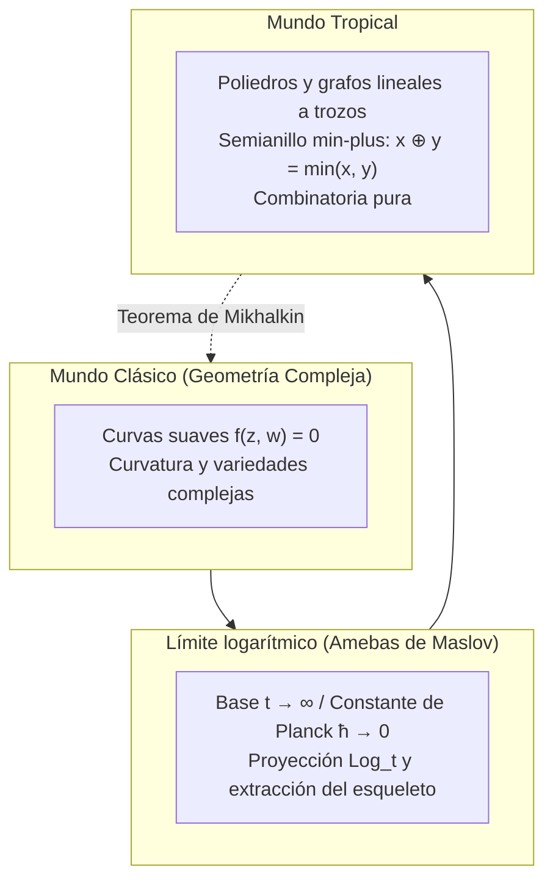

## Introducción: La audaz transformación de la aritmética elemental

Las reglas básicas de las operaciones matemáticas nos han parecido siempre inamovibles:
$$2 + 3 = 5, \quad 2 \times 3 = 6$$
Estas operaciones sustentan la estructura de cuerpo sobre la cual florece la geometría algebraica clásica, con sus curvas suaves, elipses y variedades algebraicas.

Sin embargo, ¿qué sucedería si cambiáramos radicalmente las reglas operativas?
- <strong>Suma tropical ($\oplus$)</strong>: Definida como el <strong>mínimo entre dos números</strong>:
  $$x \oplus y = \min(x, y)$$
- <strong>Multiplicación tropical ($\odot$)</strong>: Definida como la <strong>suma aritmética habitual</strong>:
  $$x \odot y = x + y$$

Bajo este marco:
$$3 \oplus 5 = \min(3, 5) = 3$$
$$3 \odot 5 = 3 + 5 = 8$$
Aparece la propiedad de idempotencia ($3 \oplus 3 = 3$) y la resta deja de existir por completo.

Esta estructura se denomina <strong>semianillo tropical (Tropical Semiring)</strong> o <strong>álgebra min-plus</strong>. Su nombre fue propuesto por matemáticos franceses en honor al informático brasileño <strong>Imre Simon (1943–2009)</strong>, quien aplicó esta álgebra a la teoría de autómatas, procediendo del Brasil tropical.

El milagro matemático es rotundo: <strong>al formular ecuaciones sobre este semianillo, las curvas y superficies algebraicas complejas degeneran en nítidos grafos, poliedros y esqueletos lineales a trozos.</strong> A principios del siglo XXI, Grigory Mikhalkin demostró que problemas centenarios de geometría enumerativa podían resolverse como rompecabezas de líneas quebradas en cuadrículas.

---

## 1. Axiomas del semianillo tropical

Los números reales tropicales se definen como $\mathbb{T} = \mathbb{R} \cup \{+\infty\}$.
Sus axiomas fundamentales son:
1. <strong>Asociatividad y conmutatividad</strong> para $\oplus$ y $\odot$;
2. <strong>Distributividad</strong>: $x + \min(y, z) = \min(x + y, x + z)$;
3. <strong>Elementos neutros</strong>: el cero tropical es $+\infty$, y el uno tropical es $0$;
4. <strong>Idempotencia</strong>: $x \oplus x = x$;
5. <strong>Linealización de potencias</strong>: $x^{\odot n} = n \cdot x$.

---

## 2. Polinomios tropicales e hipersuperficies

Un polinomio tropical es una función cóncava, continua y lineal a trozos:
$$F(\mathbf{x}) = \min_{\mathbf{a}} (c_{\mathbf{a}} + \langle \mathbf{a}, \mathbf{x} \rangle)$$

### Definición de la hipersuperficie tropical $V(F)$
Al no existir la resta, <strong>la hipersuperficie tropical $V(F)$ se define como el conjunto de puntos donde el mínimo se alcanza al menos por dos monomios distintos (los vértices y aristas donde la función no es diferenciable).</strong>

---

## 3. Rectas tropicales y la condición de equilibrio

Una recta tropical bidimensional $F(x, y) = \min(x, y, 0)$ tiene forma de <strong>trípode (Tripod)</strong> que emite tres rayos desde el origen en direcciones $(0, 1)$, $(1, 0)$ y $(-1, -1)$.
La suma de estos vectores directores es estrictamente $(0, 0)$, cumpliendo la <strong>condición de equilibrio (Balancing Condition)</strong>.

---

## 4. Amebas y desmantelamiento de Maslov

Al proyectar una curva compleja mediante la función logarítmica $\operatorname{Log}(z, w) = (\log |z|, \log |w|)$, se obtiene una región con tentáculos llamada <strong>ameba</strong>. Cuando el parámetro de escala $t \to \infty$ (límite semiclásico $\hbar \to 0$), la ameba colapsa sobre su esqueleto lineal a trozos: la curva tropical.

---

## 5. El teorema de correspondencia de Mikhalkin

El cómputo de curvas complejas que pasan por un conjunto de puntos prefijados (invariantes de Gromov-Witten):
$$N_{d, g} = \sum_{\Gamma} \operatorname{Mult}(\Gamma)$$
se reduce a contar grafos tropicales $\Gamma$ en papel cuadriculado y ponderarlos con determinantes enteros locales.

---

## 6. Aplicaciones prácticas

- <strong>Algoritmos de rutas mínimas</strong>: El algoritmo de Floyd-Warshall es exactamente el cálculo de potencias de matrices tropicales $\mathbf{D}^{\odot n}$;
- <strong>Filogenia biológica</strong>: El espacio de todos los árboles filogenéticos es isomorfo a la grasmaniana tropical $\operatorname{Trop} \operatorname{Gr}(2, N)$;
- <strong>Programación dinámica y teoría de subastas</strong>: La optimización de carteras de bienes define hipersuperficies tropicales en el espacio de precios.

## Conclusión

Al redefinir la suma como el mínimo y la multiplicación como la suma, la geometría tropical despoja a la matemática de su complejidad analítica, revelando la pureza cristalina y combinatoria del universo geométrico.
