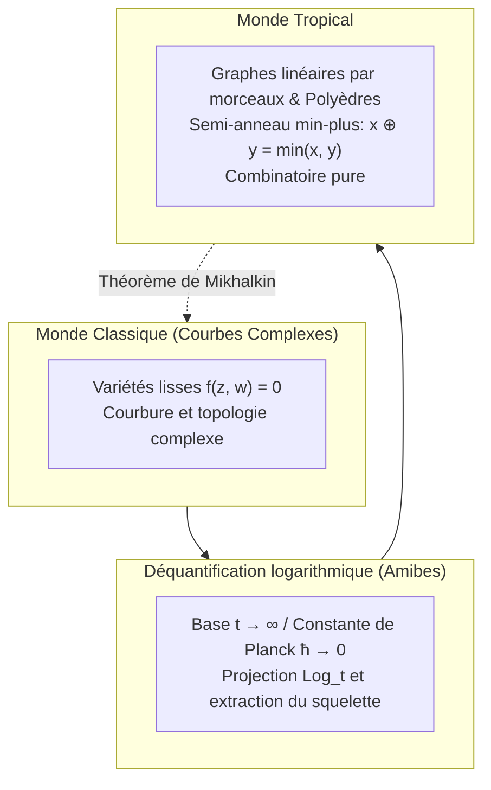

## Introduction : La transmutation audacieuse de l'arithmétique élémentaire

Depuis l'enfance, les règles fondamentales du calcul nous semblent absolues et immuables :
$$2 + 3 = 5, \quad 2 \times 3 = 6$$
Ces opérations définissent la structure parfaite d'un corps commutatif, sur lequel repose la géométrie algébrique classique avec ses courbes lisses et ses variétés complexes.

Pourtant, que se passe-t-il si nous modifions radicalement ces règles arithmétiques ancestrales ?
- <strong>L'addition tropicale ($\oplus$)</strong> : définie comme le <strong>minimum entre deux nombres</strong> :
  $$x \oplus y = \min(x, y)$$
- <strong>La multiplication tropicale ($\odot$)</strong> : définie comme l'<strong>addition classique ordinaire</strong> :
  $$x \odot y = x + y$$

Dans ce nouveau monde :
$$3 \oplus 5 = \min(3, 5) = 3$$
$$3 \odot 5 = 3 + 5 = 8$$
L'addition est idempotente ($3 \oplus 3 = 3$), et la soustraction n'existe plus (l'équation $3 \oplus x = 5$ n'a aucune solution réelle).

Cette structure algébrique est appelée <strong>semi-anneau tropical (Tropical Semiring)</strong> ou <strong>algèbre min-plus</strong>. Le qualificatif « tropical » a été attribué par les mathématiciens français en hommage au mathématicien brésilien <strong>Imre Simon (1943–2009)</strong>, pionnier de cette algèbre en informatique théorique, dont le pays natal, le Brésil, est situé sous les tropiques.

Le miracle géométrique survient lorsque l'on définit des polynômes sur ce semi-anneau : <strong>les variétés algébriques complexes, courbées et inextricables, dégénèrent en de magnifiques squelettes polygonaux, linéaires par morceaux et combinatoires !</strong> Dans les années 2000, le mathématicien russe Grigory Mikhalkin a stupéfié la communauté scientifique en résolvant des énigmes séculaires de géométrie énumérative grâce à de simples puzzles de graphes tropicaux.

---

## 1. Axiomes du semi-anneau tropical

L'ensemble des réels tropicaux est $\mathbb{T} = \mathbb{R} \cup \{+\infty\}$.
Les propriétés fondamentales sont :
1. <strong>Associativité et commutativité</strong> pour $\oplus$ et $\odot$ ;
2. <strong>Distributivité</strong> : $x + \min(y, z) = \min(x + y, x + z)$ ;
3. <strong>Éléments neutres</strong> : le zéro tropical est $+\infty$, l'unité tropicale est $0$ ;
4. <strong>Idempotence de l'addition</strong> : $x \oplus x = x$ ;
5. <strong>Linéarisation des puissances</strong> : $x^{\odot n} = n \cdot x$.

---

## 2. Polynômes tropicaux et hypersurfaces

Un polynôme tropical à plusieurs variables est une fonction concave, continue et linéaire par morceaux :
$$F(\mathbf{x}) = \min_{\mathbf{a}} (c_{\mathbf{a}} + \langle \mathbf{a}, \mathbf{x} \rangle)$$

### Définition de l'hypersurface tropicale $V(F)$
En l'absence de soustraction, <strong>l'hypersurface tropicale $V(F)$ est définie comme l'ensemble des points où le minimum est atteint par au moins deux monômes distincts (les arêtes de non-dérivabilité du graphe) !</strong>

Pour un polynôme du second degré $F(x) = \min(2 + 2x, 1 + x, 4)$, les racines correspondent aux deux points de transition $x = -1$ et $x = 3$.

---

## 3. Droites tropicales et condition d'équilibre

Une droite tropicale standard $F(x, y) = \min(x, y, 0)$ dans le plan forme un <strong>trépied (Tripod)</strong> issu de l'origine $(0, 0)$ selon trois directions :
- Vers le haut : $(0, 1)$ ;
- Vers la droite : $(1, 0)$ ;
- Vers le bas à gauche : $(-1, -1)$.

La somme vectorielle de ces directions vérifie la <strong>condition d'équilibre (Balancing Condition)</strong> :
$$(0, 1) + (1, 0) + (-1, -1) = (0, 0)$$
Les courbes tropicales se comportent rigoureusement comme des réseaux de câbles en équilibre de tension mécanique.

---

## 4. Amibes et déquantification de Maslov

L'image d'une courbe complexe sous la projection logarithmique $\operatorname{Log}(z, w) = (\log |z|, \log |w|)$ forme un domaine planaire doté de tentacules appelé <strong>amibe</strong>. Dans la limite $t \to \infty$ (la déquantification de Maslov, correspondant à la limite semi-classique $\hbar \to 0$), l'amibe s'amincit et se rétracte exactement sur son squelette linéaire par morceaux : la courbe tropicale.

---

## 5. Le théorème de correspondance de Mikhalkin

Compter le nombre de courbes algébriques complexes passant par un nombre donné de points (invariants de Gromov-Witten) était un problème intemporel.
Grigory Mikhalkin a démontré :
$$N_{d, g} = \sum_{\Gamma} \operatorname{Mult}(\Gamma)$$
Il suffit de dénombrer les graphes tropicaux $\Gamma$ tracés sur un réseau quadrillé et de multiplier chacun par sa multiplicité déterminantale entière.

---

## 6. Applications réelles

- <strong>Algorithmes de plus court chemin</strong> : l'algorithme de Floyd-Warshall équivaut exactement au calcul de puissances de matrices tropicales $\mathbf{D}^{\odot n}$ ;
- <strong>Arbres phylogénétiques</strong> : l'espace de tous les arbres de parenté biologique coïncide rigoureusement avec la grassmannienne tropicale $\operatorname{Trop} \operatorname{Gr}(2, N)$ ;
- <strong>Programmation dynamique</strong> : l'algorithme de Viterbi dans les modèles de Markov cachés s'exprime naturellement dans l'algèbre max-plus.

## Conclusion

En troquant l'addition pour le minimum et la multiplication pour l'addition, la géométrie tropicale dissipe la complexité non linéaire pour révéler la beauté cristalline de l'univers combinatoire.
