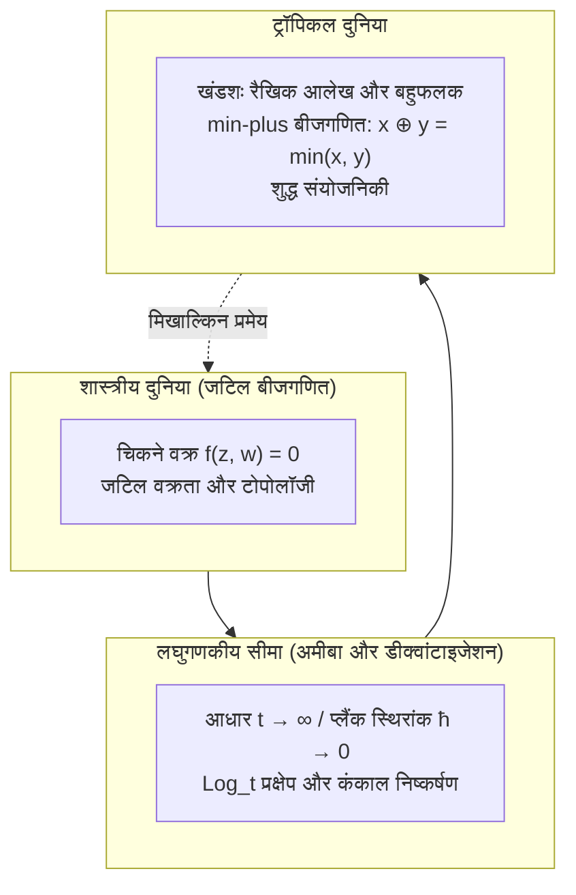

## प्रस्तावना: बुनियादी अंकगणित का साहसिक पुनर्गठन

बचपन से सीखे गए अंकगणित के नियम शाश्वत और अटल प्रतीत होते हैं:
$$2 + 3 = 5, \quad 2 \times 3 = 6$$
ये संक्रियाएं एक 'फील्ड' (Field) का निर्माण करती हैं, जिस पर शास्त्रीय बीजगणितीय ज्यामिति के घुमावदार वक्र और मैनिफोल्ड स्थापित होते हैं।

लेकिन क्या होगा यदि हम इन नियमों को मौलिक रूप से बदल दें?
- <strong>ट्रॉपिकल जोड़ ($\oplus$)</strong>: दो संख्याओं में से <strong>न्यूनतम मान (min)</strong> चुनना:
  $$x \oplus y = \min(x, y)$$
- <strong>ट्रॉपिकल गुणा ($\odot$)</strong>: हमारा सामान्य <strong>पारंपरिक जोड़ (+)</strong>:
  $$x \odot y = x + y$$

इस नई दुनिया में:
$$3 \oplus 5 = \min(3, 5) = 3$$
$$3 \odot 5 = 3 + 5 = 8$$
यहाँ जोड़ में वर्गसमता ($3 \oplus 3 = 3$) होती है, और घटाना संभव नहीं है क्योंकि $3 \oplus x = 5$ का कोई हल नहीं हो सकता।

इस बीजगणितीय संरचना को <strong>ट्रॉपिकल सेमीरिंग (Tropical Semiring)</strong> या <strong>min-plus बीजगणित</strong> कहा जाता है। इसका नाम 'ट्रॉपिकल' फ्रांसीसी गणितज्ञों ने ब्राजील के गणितज्ञ <strong>इमरे साइमन (1943–2009)</strong> के सम्मान में रखा था, जिन्होंने इसे कंप्यूटर विज्ञान में लागू किया था और वे उष्णकटिबंधीय (ट्रॉपिकल) ब्राजील से थे।

इसका सबसे बड़ा चमत्कार यह है कि <strong>इसके आधार पर बनने वाले जटिल और मुड़े हुए बीजगणितीय वक्र एकदम सीधे, खंडशः रैखिक (piecewise-linear) रेखाओं, बहुफलकों और आलेखों में बदल जाते हैं!</strong> 2000 के दशक में रूसी गणितज्ञ ग्रिगोरी मिखाल्किन ने ट्रॉपिकल ज्यामिति का उपयोग करके गणना ज्यामिति की सदियों पुरानी समस्याओं को हल कर दिया।

---

## 1. ट्रॉपिकल सेमीरिंग के स्वयंसिद्ध नियम

ट्रॉपिकल वास्तविक संख्याएं: $\mathbb{T} = \mathbb{R} \cup \{+\infty\}$।
नियम:
1. <strong>साहचर्य और क्रमविनिमेयता</strong>: $\oplus$ और $\odot$ दोनों के लिए;
2. <strong>वितरण नियम</strong>: $x + \min(y, z) = \min(x + y, x + z)$;
3. <strong>तत्समक अवयव</strong>: ट्रॉपिकल शून्य $+\infty$ है, ट्रॉपिकल इकाई $0$ है;
4. <strong>वर्गसमता</strong>: $x \oplus x = x$;
5. <strong>घातों का रैखिकरण</strong>: $x^{\odot n} = n \cdot x$।

---

## 2. ट्रॉपिकल बहुपद और हाइपरसरफेस

ट्रॉपिकल बहुपद एक अवतल, सतत और खंडशः रैखिक फलन होता है:
$$F(\mathbf{x}) = \min_{\mathbf{a}} (c_{\mathbf{a}} + \langle \mathbf{a}, \mathbf{x} \rangle)$$

### ट्रॉपिकल हाइपरसरफेस $V(F)$
घटाने की अनुपस्थिति में, <strong>ट्रॉपिकल हाइपरसरफेस $V(F)$ उन बिंदुओं का समुच्चय है जहाँ न्यूनतम मान कम से कम दो भिन्न पदों द्वारा प्राप्त होता है (आलेख के मोड़)!</strong>

---

## 3. ट्रॉपिकल रेखाएं और संतुलन की शर्त

समतल में ट्रॉपिकल रेखा $F(x, y) = \min(x, y, 0)$ एक <strong>तिपाई (Tripod)</strong> बनाती है जिसकी किरणें $(0, 1)$, $(1, 0)$ और $(-1, -1)$ दिशाओं में निकलती हैं।
इन सदिशों का योग $(0, 0)$ होता है, जो <strong>संतुलन की शर्त (Balancing Condition)</strong> को पूरा करता है।

---

## 4. अमीबा और मास्लोव डीक्वांटाइजेशन

लघुगणकीय मानचित्रण द्वारा जटिल वक्र एक चपटे आकार में प्रक्षिप्त होता है जिसे <strong>अमीबा</strong> कहते हैं। जब $t \to \infty$ (अर्ध-शास्त्रीय सीमा $\hbar \to 0$), तो अमीबा सिकुड़कर सीधे अपने ट्रॉपिकल वक्र कंकाल में बदल जाता है।

---

## 5. मिखाल्किन का पत्राचार प्रमेय

निर्धारित बिंदुओं से गुजरने वाले जटिल वक्रों की गणना (ग्रोमोव-विटन इनवेरिएंट्स):
$$N_{d, g} = \sum_{\Gamma} \operatorname{Mult}(\Gamma)$$
ट्रॉपिकल आलेखों $\Gamma$ को गिनकर और उनकी गुणन योग्यताओं को जोड़कर आश्चर्यजनक रूप से सरलता से हल हो जाती है।

---

## 6. व्यावहारिक अनुप्रयोग

- <strong>न्यूनतम मार्ग समस्या</strong>: फ्लॉयड-वॉर्शेल कलन विधि सीधे ट्रॉपिकल मैट्रिक्स घात $\mathbf{D}^{\odot n}$ के समान है;
- <strong>फाइलोजेनेटिक वृक्ष</strong>: जैविक विकासवादी वृक्षों का स्थान ट्रॉपिकल ग्रासमैनियन $\operatorname{Trop} \operatorname{Gr}(2, N)$ है;
- <strong>नीलामी सिद्धांत</strong>: इष्टतम उपभोक्ता प्राथमिकताओं की सीमाएं ट्रॉपिकल हाइपरसरफेस बनाती हैं।

## निष्कर्ष

जोड़ को न्यूनतम मान और गुणा को जोड़ में बदलकर, ट्रॉपिकल ज्यामिति जटिल गणितीय समस्याओं के अंतर्निहित सरल, पारदर्शी और संयोजी कंकाल को उजागर करती है।
