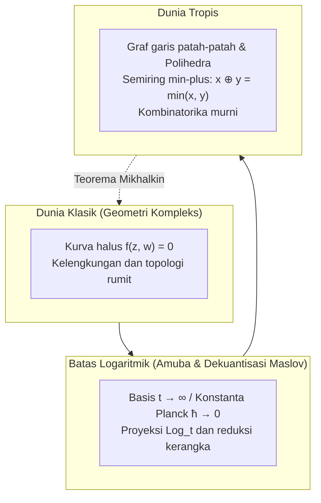

## Pendahuluan: Perombakan Berani Aritmetika Elementer

Sejak masa sekolah dasar, aturan hitung tampak abadi dan tak terbantahkan:
$$2 + 3 = 5, \quad 2 \times 3 = 6$$
Operasi ini membentuk fondasi medan matematika yang melahirkan geometri aljabar klasik dengan kurva-kurva halus dan berliku.

Namun, bagaimana jika kita secara radikal mengubah aturan dasar tersebut?
- <strong>Penjumlahan Tropis ($\oplus$)</strong>: Didefinisikan sebagai <strong>memilih nilai terkecil (minimum)</strong> antara dua bilangan:
  $$x \oplus y = \min(x, y)$$
- <strong>Perkalian Tropis ($\odot$)</strong>: Didefinisikan sebagai <strong>penjumlahan biasa</strong>:
  $$x \odot y = x + y$$

Dalam sistem ini:
$$3 \oplus 5 = \min(3, 5) = 3$$
$$3 \odot 5 = 3 + 5 = 8$$
Operasi ini bersifat idempoten ($3 \oplus 3 = 3$), dan pengurangan tidak lagi ada karena tidak ada bilangan riil $x$ yang memenuhi $3 \oplus x = 5$.

Struktur aljabar ini dinamakan <strong>semiring tropis (Tropical Semiring)</strong> atau <strong>aljabar min-plus</strong>. Kata "tropis" disematkan oleh matematikawan Prancis sebagai penghormatan kepada matematikawan Brasil, <strong>Imre Simon (1943–2009)</strong>, yang merintis aljabar ini dalam ilmu komputer teoretis dan berasal dari wilayah tropis Brasil.

Keajaiban geometri terjadi ketika persamaan polinomial dibangun di atas semiring ini: <strong>kurva dan permukaan aljabar kompleks yang melengkung dan rumit terdegenerasi menjadi grafik garis patah-patah, bidang polihedral, dan kerangka linear sepotong-sepotong (piecewise-linear) yang sangat teratur!</strong> Pada dekade 2000-an, matematikawan Rusia Grigory Mikhalkin mengguncang dunia matematika dengan memecahkan teka-teki geometri enumeratif ratusan tahun menggunakan teka-teki graf tropis sederhana.

---

## 1. Aksioma Semiring Tropis

Bilangan riil tropis didefinisikan sebagai $\mathbb{T} = \mathbb{R} \cup \{+\infty\}$.
Aksioma operasinya:
1. <strong>Asosiatif dan Komutatif</strong> untuk $\oplus$ dan $\odot$;
2. <strong>Distributif</strong>: $x + \min(y, z) = \min(x + y, x + z)$;
3. <strong>Elemen Identitas</strong>: Nol tropis adalah $+\infty$, dan satu tropis adalah $0$;
4. <strong>Idempotensi</strong>: $x \oplus x = x$;
5. <strong>Linearisasi Pangkat</strong>: $x^{\odot n} = n \cdot x$.

---

## 2. Polinomial Tropis dan Hipersirkuit

Polinomial tropis berbentuk fungsi cekung kontinu dan linear sepotong-sepotong:
$$F(\mathbf{x}) = \min_{\mathbf{a}} (c_{\mathbf{a}} + \langle \mathbf{a}, \mathbf{x} \rangle)$$

### Definisi Hipersirkuit Tropis $V(F)$
Karena tidak ada operasi pengurangan, <strong>hipersirkuit tropis $V(F)$ didefinisikan sebagai himpunan titik di mana nilai minimum dicapai oleh setidaknya dua monomial berbeda (garis lipatan di mana fungsi tidak dapat diturunkan)!</strong>

---

## 3. Garis Tropis dan Syarat Keseimbangan

Garis tropis 2D $F(x, y) = \min(x, y, 0)$ berbentuk <strong>tripod</strong> dengan tiga sinar dari titik asal ke arah $(0, 1)$, $(1, 0)$, dan $(-1, -1)$.
Jumlah vektor-vektor arah ini adalah $(0, 0)$, memenuhi <strong>syarat keseimbangan (Balancing Condition)</strong>.

---

## 4. Amuba dan Dekuantisasi Maslov

Proyeksi kurva aljabar kompleks melalui peta logaritma $\operatorname{Log}(z, w) = (\log |z|, \log |w|)$ membentuk daerah datar bertentakel yang disebut <strong>amuba</strong>. Pada limit $t \to \infty$ (dekuantisasi Maslov, setara limit semiklasik $\hbar \to 0$), amuba menyusut tepat menjadi kerangka linear sepotong-sepotong: kurva tropis.

---

## 5. Teorema Korespondensi Mikhalkin

Menghitung jumlah kurva kompleks yang melewati sejumlah titik tertentu (invarian Gromov-Witten):
$$N_{d, g} = \sum_{\Gamma} \operatorname{Mult}(\Gamma)$$
berubah menjadi sekadar menjumlahkan perkalian graf tropis $\Gamma$ pada kisi bidang berbobot bilangan bulat.

---

## 6. Aplikasi Nyata

- <strong>Rute Terpendek</strong>: Algoritma Floyd-Warshall identik dengan pemangkatan matriks tropis $\mathbf{D}^{\odot n}$;
- <strong>Pohon Filogenetika</strong>: Ruang semua pohon evolusi biologis adalah varietas grassmannian tropis $\operatorname{Trop} \operatorname{Gr}(2, N)$;
- <strong>Teori Lelang</strong>: Batas preferensi barang konsumen membentuk hipersirkuit tropis di ruang harga.

## Kesimpulan

Dengan menukar penjumlahan menjadi minimum dan perkalian menjadi penjumlahan, geometri tropis menyingkap kerangka kombinatorika murni yang menyatukan aljabar, fisika teori, dan optimasi modern.
