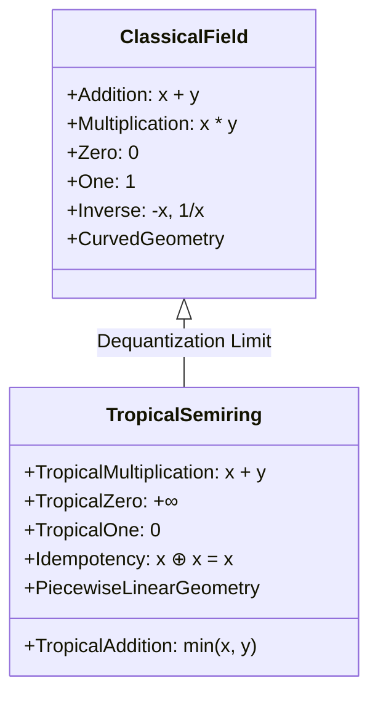
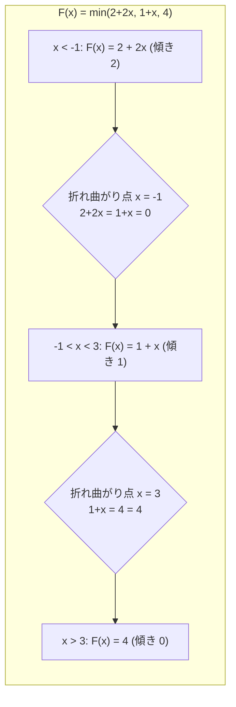
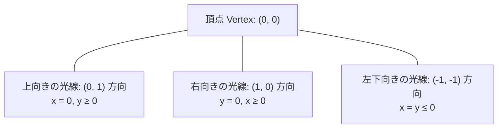
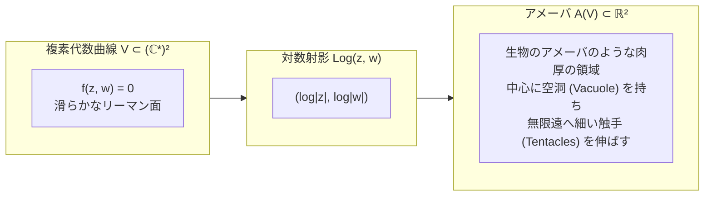
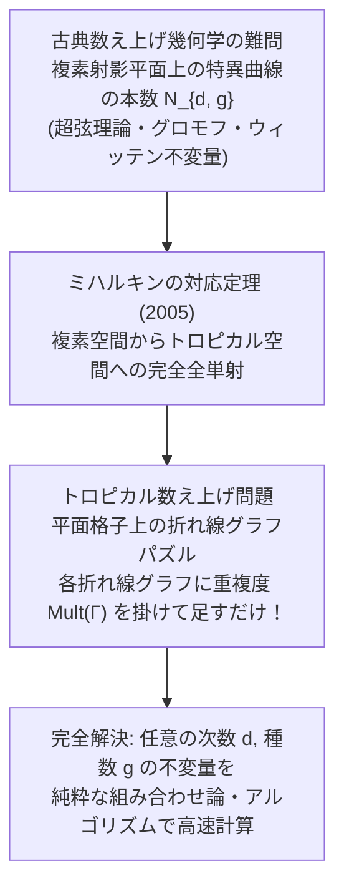
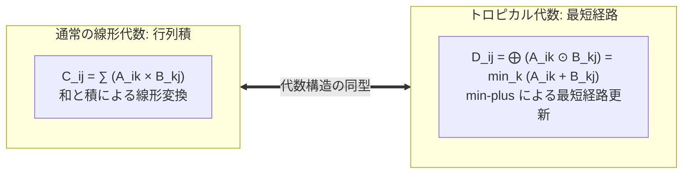

## 序論：算術のルールを書き換えるという禁断の試み

私たちが小学校で最初に習う算数の世界は、あまりにも自明で揺るぎないもののように思えます：
$$2 + 3 = 5, \quad 2 \times 3 = 6$$
足し算と掛け算は、結合法則や分配法則によって完璧に調和した「体（Field）」の構造を形作っています。この四則演算を土台として、多項式が定義され、方程式が解かれ、デカルト座標系の上に優美な放物線や楕円、円錐曲線といった「代数幾何学」の華麗な世界が築き上げられてきました。

しかし、もし私たちがこの何千年と信じ込んできた演算の基本ルールを、突如として次のように書き換えてしまったらどうなるでしょうか？
- <strong>新しい足し算（トロピカル和 $\oplus$）</strong> を、2つの数のうち「小さい方を選ぶ（$\min$）」操作と定義する：
  $$x \oplus y = \min(x, y)$$
- <strong>新しい掛け算（トロピカル積 $\odot$）</strong> を、私たちが普段使っている「通常の足し算（$+$）」と定義する：
  $$x \odot y = x + y$$

一見すると、これは数学の厳密さを無視した子供の言葉遊びや、単なるナンセンスな記号のすり替えのように思えるかもしれません。例えば、このルールに従えば：
$$3 \oplus 5 = \min(3, 5) = 3$$
$$3 \odot 5 = 3 + 5 = 8$$
となります。さらに奇妙なことに、同じ数を何回足しても値が変わりません：
$$3 \oplus 3 \oplus 3 = \min(3, 3, 3) = 3$$
通常の算術における最も基本的な性質である「引き算（加法の逆元）」すら、この世界では定義できません（$3 \oplus x = 5$ を満たす $x$ は絶対に存在しないためです）。

ところが、20世紀末から21世紀初頭にかけて、世界中の超一流の数学者たちがこの奇妙な算術に熱狂し、現代数学において最も急速に発展する巨大なフロンティアへと昇華させました。それが<strong>トロピカル幾何学（Tropical Geometry / トロピカル数学）</strong>です。

なぜ「トロピカル（熱帯）」というエキゾチックな名が付けられたのでしょうか？ それは、この算術の基礎を情報科学・オートマトン理論の文脈で開拓したブラジルの数学者<strong>イムレ・シモン（Imre Simon, 1943–2009）</strong>の母国が南米ブラジル（熱帯の国）であったことから、フランスの数学者ジャン＝エリック・パン（Jean-Éric Pin）やクリスチャン・ショフラットらがシモンへの敬意と親愛を込めて命名したことに由来します。

驚くべきことに、この一見風変わりな「min-plus代数」の上に多項式や代数多様体を構築すると、複素数平面の上で極めて複雑で手が出なかった高度な代数幾何の図形が、<strong>折れ線や多面体、グラフといった驚くほど扱いやすい組み合わせ論的・区分線形な図形へと劇的に退化（結晶化）する</strong>ことが判明したのです。

2000年代、ロシアの数学者<strong>グリゴリー・ミハルキン（Grigory Mikhalkin）</strong>は、トロピカル幾何学を用いて、代数幾何学の100年越しの難問であった「数え上げ幾何学（ある条件を満たす代数曲線の本数を数える問題）」を、子供のパズルのような格子の折れ線の組み合わせ問題へと還元して完全解決し、世界を震撼させました。

本稿では、算術の常識を覆すトロピカル半環の公理系から、トロピカル多項式が描く折れ線グラフ、アメーバ（Amoeba）の触手が導く超弦理論と複素対数極限、ミハルキンの対応定理、そして最短経路アルゴリズムや生物の進化系統樹解析に至る現代の応用まで、トロピカル幾何学の息を呑むような美しき数理世界を徹底的に解き明かします。

```mermaid
flowchart TD
    subgraph Classical ["古典代数幾何学 (Classical World)"]
        direction TB
        C1["滑らかな複素代数曲線・曲面<br/>方程式: f(x, y) = 0<br/>極めて高い解析的難度"]
    end
    subgraph Transition ["対数収縮写像 (Amoeba & Maslov Dequantization)"]
        direction TB
        T1["プランク定数 ħ → 0 / 底 t → ∞<br/>Log|x|, Log|y| による幾何学的射影<br/>アメーバの触手構造の極限"]
    end
    subgraph Tropical ["トロピカル幾何学 (Tropical World)"]
        direction TB
        TR1["鋭利な折れ線グラフ・多面体複合体<br/>min-plus 代数: x ⊕ y = min(x, y)<br/>純粋な組み合わせ論・グラフ理論"]
    end
    Classical -->|対数極限 Log_t| Transition
    Transition -->|骨格の抽出 (Spine)| Tropical
    Tropical -.->|ミハルキンの対応定理<br/>数え上げ不変量の完全一致| Classical
```

---

## 1. トロピカル半環：min-plus代数の公理系

まず、トロピカル数学の土台となる代数構造を厳密に定義しましょう。

### 1.1 トロピカル実数系と基本演算

実数全体の集合 $\mathbb{R}$ に、正の無限大記号 $+\infty$ を付け加えた集合を<strong>トロピカル実数系</strong>と呼び、$\mathbb{T}$ と表します：
$$\mathbb{T} = \mathbb{R} \cup \{+\infty\}$$

この集合 $\mathbb{T}$ 上に、以下の2つの二項演算を導入します：

1. <strong>トロピカル加法（Tropical Addition） $\oplus$</strong>:
   $$x \oplus y = \min(x, y) \quad (\forall x, y \in \mathbb{T})$$
2. <strong>トロピカル乗法（Tropical Multiplication） $\odot$</strong>:
   $$x \odot y = x + y \quad (\forall x, y \in \mathbb{T})$$

ここで、無限大 $+\infty$ に関する演算規則は通常の拡張実数に従います：
$$x \oplus (+\infty) = \min(x, +\infty) = x$$
$$x \odot (+\infty) = x + (+\infty) = +\infty$$
（ただし $(+\infty) \odot (+\infty) = +\infty$）

### 1.2 半環（Semiring）の性質と冪等性

代数学において、環（Ring）から「加法の逆元（引き算）」の存在公理を取り除いた代数系を<strong>半環（Semiring）</strong>と呼びます。トロピカル構造 $(\mathbb{T}, \oplus, \odot)$ は、以下の美しい公理を満たす<strong>可換半環（Commutative Semiring）</strong>です：

1. <strong>結合法則（Associativity）</strong>:
   $$(x \oplus y) \oplus z = x \oplus (y \oplus z) = \min(x, y, z)$$
   $$(x \odot y) \odot z = x \odot (y \odot z) = x + y + z$$
2. <strong>交換法則（Commutativity）</strong>:
   $$x \oplus y = y \oplus x$$
   $$x \odot y = y \odot x$$
3. <strong>分配法則（Distributivity）</strong>:
   $$x \odot (y \oplus z) = (x \odot y) \oplus (x \odot z)$$
   通常の算術で確認してみましょう：
   $$x + \min(y, z) = \min(x + y, x + z)$$
   これは実数の基本的な順序性質として常に成立します！
4. <strong>加法および乗法の単位元</strong>:
   - 加法の単位元は $+\infty$ です（<strong>トロピカル・ゼロ</strong>）：
     $$x \oplus (+\infty) = x$$
   - 乗法の単位元は $0$ です（<strong>トロピカル・ワン</strong>）：
     $$x \odot 0 = x + 0 = x$$
5. <strong>冪等性（Idempotency / べきとうせい）</strong>:
   トロピカル加法の最大の特徴は、任意の元について自分自身を足しても値が変わらないという性質です：
   $$x \oplus x = \min(x, x) = x$$
   このような性質を持つ半環を<strong>冪等半環（Idempotent Semiring）</strong>と呼びます。



### 1.3 トロピカル冪乗

トロピカル積の定義から、自然数 $n \in \mathbb{N}$ に対するトロピカル冪乗 $x^{\odot n}$ は、通常の掛け算へと変換されます：
$$x^{\odot n} = \underbrace{x \odot x \odot \dots \odot x}_{n\text{ 個}} = \underbrace{x + x + \dots + x}_{n\text{ 個}} = n \cdot x$$
負のべき乗や実数乗 $a \in \mathbb{R}$ に対しても：
$$x^{\odot a} = a \cdot x$$
と自然に拡張されます。累乗が単なる係数倍へと線形化されるこの性質こそが、トロピカル幾何学を「線形代数」のように強力にする秘密です。

---

## 2. トロピカル多項式と区分線形関数

通常の代数幾何学において、図形（代数多様体）は多項式の零点集合（方程式 $f(x, y) = 0$ の解）として定義されます。では、トロピカル代数の世界で多項式を作ると、一体どのような図形が現れるのでしょうか？

### 2.1 トロピカル多項式の定義

変数 $x_1, x_2, \dots, x_n$ に関する<strong>トロピカル多項式</strong> $F(x_1, \dots, x_n)$ は、トロピカル和 $\bigoplus$ とトロピカル積 $\bigodot$ によって構成される有限項の数式です：
$$F(x_1, \dots, x_n) = \bigoplus_{\mathbf{a} = (a_1, \dots, a_n)} c_{\mathbf{a}} \odot x_1^{\odot a_1} \odot \dots \odot x_n^{\odot a_n}$$
これを通常の算術の記号に翻訳すると、驚くほど親しみやすい関数になります：
$$F(\mathbf{x}) = \min_{\mathbf{a}} \left( c_{\mathbf{a}} + a_1 x_1 + a_2 x_2 + \dots + a_n x_n \right)$$

ここで各項 $c_{\mathbf{a}} + \mathbf{a} \cdot \mathbf{x}$ は、変数 $\mathbf{x}$ に関する<strong>通常の1次アフィン関数（平面）</strong>です。
したがって、トロピカル多項式とは、<strong>有限個の1次関数の最小値を取ることで得られる「区分線形な凹関数（Piecewise-Linear Concave Function）」そのもの</strong>なのです！

### 2.2 1変数トロピカル多項式の例

例えば、1変数の2次トロピカル多項式を考えてみましょう：
$$F(x) = 2 \odot x^{\odot 2} \oplus 1 \odot x \oplus 4$$
通常の数式に書き直すと：
$$F(x) = \min(2 + 2x, \; 1 + x, \; 4)$$

この関数のグラフを $x$ の値に応じて観察してみましょう：
- $x \le -1$ のとき：$2 + 2x$ が最小となり、$F(x) = 2 + 2x$（傾き 2 の直線）。
- $-1 \le x \le 3$ のとき：$1 + x$ が最小となり、$F(x) = 1 + x$（傾き 1 の直線）。
- $x \ge 3$ のとき：$4$ が最小となり、$F(x) = 4$（傾き 0 の水平線）。

関数 $F(x)$ は、3本の直線が繋ぎ合わされた<strong>折れ線グラフ</strong>になります。



### 2.3 トロピカル超曲面（零点集合）の真の定義

ここで極めて深刻な疑問が生じます。通常の代数幾何学では、$f(x) = 0$ となる点 $x$ を多項式の「根（零点）」と呼びました。
しかし、トロピカル実数においてゼロとは $+\infty$ のことです。方程式 $F(x) = +\infty$ を解こうとしても、すべての係数が $+\infty$ でない限り解は存在しません。では、トロピカル幾何学において「方程式の解（図形）」とは一体何なのでしょうか？

ここで登場するのが、トロピカル幾何学における最もエレガントな発想の転換です：
> <strong>「トロピカル多項式 $F(\mathbf{x}) = \min_i(L_i(\mathbf{x}))$ において、最小値を与える項が『2つ以上同時に存在して競合する点（折れ曲がり点・特異点）』の集合を、トロピカル超曲面（Tropical Hypersurface） $V(F)$ と定義する！」</strong>

なぜこれが零点の代わりになるのでしょうか？ 通常の数学で二つの数 $A, B$ について方程式 $A + B = 0$ が成り立つためには、両者が打ち消し合わなければなりません。しかし最小値演算 $\min(A, B)$ では引き算ができないため、打ち消し合う代わりに<strong>「最小値を与える勝者が引き分け（タイ）になる」</strong>ことこそが、物理的な力の釣り合い（平衡状態）や特異性を表すのです。

先ほどの例 $F(x) = \min(2+2x, 1+x, 4)$ では：
- $x = -1$ において：$2+2(-1) = 0$ と $1+(-1) = 0$ で最小値 0 を与える項が2つ同時に存在。
- $x = 3$ において：$1+3 = 4$ と $4$ で最小値 4 を与える項が2つ同時に存在。
したがって、この2次トロピカル多項式の「根」は、まさに折れ曲がり点である <strong>$x = -1$ と $x = 3$ の2点</strong>となります！ 2次方程式がちょうど2つの根を持つという「代数学の基本定理」が、トロピカルな折れ曲がり点の個数として完璧に保たれているのです。

---

## 3. トロピカル代数曲線：折れ線が織りなす幾何学

次元を2次元平面 $\mathbb{R}^2$ に上げると、トロピカル幾何学の真骨頂である<strong>トロピカル曲線（Tropical Curves）</strong>が現れます。

### 3.1 2変数トロピカル直線

平面上の2変数 $x, y$ に関する1次多項式（トロピカル直線）を考えます：
$$F(x, y) = a \odot x \oplus b \odot y \oplus c = \min(x + a, \; y + b, \; c)$$
簡単のため $a = b = c = 0$ とおくと：
$$F(x, y) = \min(x, y, 0)$$

最小値を与える項が2つ以上になる点集合 $V(F)$ を求めると：
1. $x = y \le 0$ のとき：第1項と第2項が一致して最小値 $\implies$ 原点 $(0, 0)$ から左下方向（$(-1, -1)$ 方向）へ伸びる半直線。
2. $x = 0 \le y$ のとき：第1項と第3項が一致して最小値 $\implies$ 原点 $(0, 0)$ から上方向（$(0, 1)$ 方向）へ伸びる半直線。
3. $y = 0 \le x$ のとき：第2項と第3項が一致して最小値 $\implies$ 原点 $(0, 0)$ から右方向（$(1, 0)$ 方向）へ伸びる半直線。



なんと、<strong>トロピカル直線とは、1つの頂点から「上」「右」「左下（3等分方向）」へと3本の足（Ray / 光線）が伸びた「三叉路（Tripod）」の形状をしている</strong>のです！

### 3.2 平衡条件（Balancing Condition）

この3本の足の方向ベクトルに注目してください：
$$\mathbf{v}_1 = (0, 1), \quad \mathbf{v}_2 = (1, 0), \quad \mathbf{v}_3 = (-1, -1)$$
これらのベクトルをすべて足し合わせると：
$$\mathbf{v}_1 + \mathbf{v}_2 + \mathbf{v}_3 = (0, 1) + (1, 0) + (-1, -1) = (0, 0)$$
<strong>ベクトルの和がゼロ（釣り合い）になっている</strong>ことがわかります。

これは偶然ではありません。一般に、任意のトロピカル多項式から生じるトロピカル曲線は、多角形や折れ線が組み合わさったグラフ構造（1次元多面体複体）をしていますが、<strong>すべての頂点において伸びるエッジの方向ベクトルの（重み付き）和が必ずゼロベクトルになる</strong>という<strong>平衡条件（Balancing Condition / キルヒホッフの電流則に相当）</strong>を満たしています。トロピカル曲線とは、幾何学的な「力の釣り合い」を完璧に保った折れ線ネットワークなのです。

### 3.3 ベズーの定理のトロピカル版

代数幾何学における最も美しい基本定理の一つに、<strong>ベズーの定理（Bézout's Theorem）</strong>があります：
> 「次数 $m$ の代数曲線と次数 $n$ の代数曲線は、複素射影平面上で重複度を込めてちょうど $m \times n$ 個の交点を持つ。」

例えば、2本の直線（次数 1 と次数 1）は $1 \times 1 = 1$ 点で交わり、直線と楕円（次数 1 と次数 2）は $1 \times 2 = 2$ 点で交わります。

トロピカル幾何学においても、このベズーの定理がそのまま成立するのでしょうか？
2本のトロピカル直線を平面上に描いてみましょう。3本の足を持つ三叉路を2つランダムに配置すると、足と足がちょうど<strong>1箇所で交差</strong>します。
2次曲線（例えば放物線や楕円に対応するトロピカル2次曲線）とトロピカル直線を交差させると、どのような配置であっても適切な重複度を数えることで<strong>厳密に2個の交点</strong>が現れます。
滑らかな曲線同士の複雑な交差理論が、子供でも定規で描ける「折れ線の交差」として完全に再現されるのです！

---

## 4. アメーバ（Amoeba）と超弦理論：古典とトロピカルを繋ぐ架け橋

なぜ、このような折れ線のパズルのような世界が、深遠な代数幾何学と正確に対応するのでしょうか？ その幾何学的な物理的実体を明らかにしたのが、ロシアの世界的数学者<strong>イズライル・ゲルファント（Israel Gelfand）</strong>、ミハイル・カプラノフ、アンドレイ・ゼレビンスキーらが1994年に導入した<strong>アメーバ（Amoeba）</strong>の理論です。

### 4.1 アメーバの定義：対数写像

複素数体 $\mathbb{C}^* = \mathbb{C} \setminus \{0\}$ の2次元トーラス $(\mathbb{C}^*)^2$ 上で定義された通常の代数曲線 $V \subset (\mathbb{C}^*)^2$（多項式 $f(z, w) = 0$ の解集合）を考えます。
この複素曲線を、以下の<strong>絶対値の対数写像（Logarithmic Map）</strong>によって実平面 $\mathbb{R}^2$ へと射影します：
$$\operatorname{Log}: (\mathbb{C}^*)^2 \to \mathbb{R}^2, \quad (z, w) \mapsto (\log |z|, \; \log |w|)$$

代数曲線 $V$ の像 $\mathcal{A}(V) = \operatorname{Log}(V) \subset \mathbb{R}^2$ を、曲線 $V$ の<strong>アメーバ（Amoeba）</strong>と呼びます。



### 4.2 アメーバの触手と骨格（Spine）

実際にアメーバの形状をプロットしてみると、その名が示す通り、まさに原生動物のアメーバそのものの姿が現れます。
中央にはいくつかの「空洞（液胞 / Vacuole）」を持つ肉厚の胴体があり、外側に向かって何本かの細い<strong>「触手（Tentacles）」</strong>を無限遠へと伸ばしています。

そして驚くべきことに：
<strong>アメーバが無限遠へと伸ばす触手の漸近線（Asymptotic Directions）を延長してその中心骨格（Spine）を抽出すると、それは先ほど学んだ「トロピカル曲線」そのものに完全に一致する</strong>のです！

### 4.3 マスロフ脱量子化（Maslov Dequantization）とプランク定数 $\hbar \to 0$

この収束プロセスを物理学の言葉で厳密に定式化したのが、数学者ヴィクトル・マスロフ（Victor Maslov）の<strong>脱量子化（Dequantization）</strong>です。

底 $t > 1$ を持つ対数写像を考えます：
$$\operatorname{Log}_t(z, w) = (\log_t |z|, \; \log_t |w|) = \left( \frac{\log |z|}{\log t}, \; \frac{\log |w|}{\log t} \right)$$
ここで底 $t \to \infty$ の極限を取ることを考えます。物理的には、$t = e^{1/\hbar}$ とおくことで、<strong>プランク定数 $\hbar \to 0$ の古典極限（WKB近似）</strong>を取ることに相当します。

実数 $a, b > 0$ に対して、通常の足し算の対数を計算してみましょう：
$$x \oplus_t y = \log_t \left( t^x + t^y \right) = \frac{\ln(e^{x \ln t} + e^{y \ln t})}{\ln t}$$
ここで $t \to \infty$ の極限を取ると：
$$\lim_{t \to \infty} \left( x \oplus_t y \right) = \max(x, y)$$
掛け算については：
$$x \odot_t y = \log_t \left( t^x \cdot t^y \right) = \log_t \left( t^{x + y} \right) = x + y$$
極限を取るまでもなく、最初から厳密に通常の足し算です！

すなわち、<strong>通常の複素解析や代数幾何学において底 $t \to \infty$（あるいは $\hbar \to 0$）の極限を取ると、肉厚だったアメーバの胴体が限界まで細く収縮し、肉が削ぎ落とされて純粋な骨組み（骨格）であるトロピカル折れ線グラフだけが残る</strong>のです！

代数幾何学の複雑な曲線は、量子力学的な「雲」をまとったアメーバであり、その雲が凝縮して古典力学的な軌道として結晶化した姿こそが、トロピカル幾何学だったのです。

---

## 5. ミハルキンの対応定理：数え上げ幾何学の奇跡

トロピカル幾何学が単なる数学的好奇心を超えて、数学の歴史にその名を永遠に刻むことになった最大の事件——それが2003年から2005年にかけてグリゴリー・ミハルキンが発表した<strong>「対応定理（Correspondence Theorem）」</strong>です。

### 5.1 数え上げ幾何学の世紀の難問

平面代数幾何学において、19世紀から数学者たちを悩ませてきた古典的な大問題がありました：
> <strong>「平面上に一般の位置にある $3d - 1 + g$ 個の点を与えたとき、それらの点をすべて通過する次数 $d$、種数（穴の数）$g$ の代数曲線は正確に何本存在するか？」</strong>

これを<strong>グロモフ・ウィッテン不変量（Gromov-Witten Invariants）</strong> $N_{d, g}$ と呼びます。
- $d = 1, g = 0$（2点を通る直線）：$N_{1, 0} = 1$ 本（ユークリッド幾何学の公理）。
- $d = 2, g = 0$（5点を通る円錐曲線 / 楕円）：$N_{2, 0} = 1$ 本（18世紀のアポロニウス以来の古典結果）。
- $d = 3, g = 0$（8点を通る特異3次曲線）：$N_{3, 0} = 12$ 本（19世紀中頃、ミッシェル・シャスルが解決）。
- $d = 4, g = 0$（11点を通る特異4次曲線）：$N_{4, 0} = 620$ 本（1873年、ツォイテンが膨大な計算の末に導出）。

しかし、$d = 5$（14点を通る5次曲線）になると、数式があまりにも複雑を極め、代数幾何学のいかなる巨匠も解くことができず、実に100年以上もの間、数学界は完全に沈黙してしまいました。

1994年、超弦理論（ミラー対称性）の研究から、マキシム・コンツェビッチ（Maxim Kontsevich）が種数 $g = 0$ の場合について画期的な再帰公式（Kontsevich's Formula）を発表し、$N_{5, 0} = 87,304$ 本であることを突き止めてフィールズ賞を受賞しました。しかし、種数 $g \ge 1$（トーラスのような穴を持つ曲線）を含む一般的な場合については、依然として計算が極めて困難なブラックボックスのままでした。



### 5.2 ミハルキンの発見：折れ線を数えれば複素曲線がわかる！

ミハルキンはこの難問に対して、誰も想像し得なかった革命的なアプローチを取りました：
> 「複素数平面で曲線を数えるのが難しいなら、<strong>アメーバの極限を取ってトロピカル平面に退化させ、折れ線グラフを数えればよいではないか！</strong>」

ミハルキンは以下の驚愕すべき事実を厳密に証明しました：
1. 平面上に与えられた点をトロピカル平面上の点へと写像したとき、それらの点を通るトロピカル曲線は有限個しか存在せず、すべて<strong>純粋に組み合わせ論的な折れ線グラフ（格子ポリトープの双対分割）</strong>として完全に分類・列挙できる。
2. 1本のトロピカル曲線 $\Gamma$ に対して、それが複素数空間へと「脱・退化（リフト）」したときに復元される複素代数曲線の本数は、各頂点の局所的な幾何構造から初等的な行列式で決まる整数<strong>「ミハルキン重複度 $\operatorname{Mult}(\Gamma)$」</strong>として厳密に計算できる！

$$N_{d, g} = \sum_{\Gamma} \operatorname{Mult}(\Gamma)$$

世界中の幾何学者たちが何百年も頭を抱えていた超絶難問が、<strong>「方眼紙の上に折れ線を描いて、それぞれの折れ線に整数の重みを掛けて足し算するだけ」</strong>という、信じがたいほど単純明快な有限パズルへと還元されたのです。
このミハルキンの対応定理の確立により、トロピカル幾何学は現代数学の最前線における最強の計算ツールとしての地位を不動のものとしました。

---

## 6. 実世界へ広がる応用：情報科学から進化生物学まで

トロピカル幾何学の美しさは、純粋数学の金字塔にとどまりません。「$\min$ と $+$」という演算構造は、現実世界の最適化やデータサイエンスのあらゆる場所に潜んでいます。

### 6.1 最短経路問題とダイクストラ法の代数化

コンピュータ・サイエンスにおける最も有名なアルゴリズムの一つが、重み付きグラフ上の最短経路を求める<strong>ダイクストラ法（Dijkstra's Algorithm）</strong>や<strong>ワーシャル・フロイド法（Floyd-Warshall Algorithm）</strong>です。

ノード $i$ からノード $j$ への最短距離を計算する際、私たちは何をしているでしょうか？
中継ノード $k$ を経由するルートの距離は「区間 $i \to k$ のコストと区間 $k \to j$ のコストの<strong>足し算（$+$）</strong>」であり、あらゆる中継点の中で「<strong>最小のもの（$\min$）</strong>」を選び出します：
$$D_{ij}^{\text{new}} = \min_k \left( D_{ik} + D_{kj} \right)$$
この式をトロピカル代数の記号で書き直してみましょう：
$$D_{ij}^{\text{new}} = \bigoplus_k \left( D_{ik} \odot D_{kj} \right)$$

これは、<strong>通常の線形代数における「行列の掛け算 $C = A \times B$（$C_{ij} = \sum_k A_{ik} B_{kj}$）」と完全に同一</strong>です！
すなわち、ネットワークの最短経路探索問題とは、本質的に<strong>「トロピカル半環における行列の累乗計算」</strong>そのものだったのです。線形代数の豊かな理論（固有値問題、ケイリー・ハミルトンの定理など）が、そのままトロピカル行列を通じて最短経路問題やスケジューリング問題の解析に応用されています。



### 6.2 最適化問題と動的計画法（Dynamic Programming）

機械学習やオペレーションズ・リサーチで多用される<strong>動的計画法（DP / ベルマン方程式）</strong>や、隠れマルコフモデルにおける最尤状態列を求める<strong>ビタビ・アルゴリズム（Viterbi Algorithm）</strong>も、対数確率を取ることで完全に「max-plus代数（トロピカル代数の符号反転版）」として定式化されます。トロピカル多面体の幾何学的性質を調べることは、複雑な最適化問題の解空間の境界や感度分析を幾何学的に視覚化することに他なりません。

### 6.3 系統樹空間（Phylogenetic Tree Space）の幾何学

進化生物学において、様々な生物種のDNA配列データから進化の歴史を表す「系統樹（Phylogenetic Tree）」を推定する研究があります。
$N$ 個の生物種の間の遺伝的距離データを数学的に厳密に表現する距離行列（ウルトラメトリック / アディティブ距離）の空間は、通常のユークリッド空間には収まりません。

2004年、数学者リリア・アルディラ（Federico Ardila）らは、<strong>「系統樹全体の空間（Tree Space）は、トロピカル射影空間におけるトロピカル・グラスマン多様体（Tropical Grassmannian）と厳密に一致する」</strong>という画期的な事実を証明しました。新種のウイルスの系統樹の比較や進化の分岐パターンの統計解析が、トロピカル多面体の幾何学を用いて美しく行われています。

---

## 結語：非線形な迷宮を突き抜ける幾何学の新しい光

「足し算を $\min$ に、掛け算を $+$ に置き換える」。
この一見、あまりにも突飛で不条理に見えたルールの変更は、決して子供の思いつきなどではありませんでした。それは、<strong>複雑で曲がりくねった非線形な代数曲線の世界から、余計な肉を極限まで削ぎ落とし、その真の骨格である組み合わせ論的な美しさを抽出するための、究極の数学的脱量子化フィルター</strong>だったのです。

曲線を折れ線に変え、微積分を組み合わせ論に変え、難解な代数方程式を最短経路のネットワークへと昇華させる——トロピカル幾何学が切り拓いた地平は、一見かけ離れた数学の諸分野（複素解析、数論、超弦理論、最適化数学、情報科学、進化生物学）が、水面下で深く一つの大河として繋がっていることを鮮烈に物語っています。

私たちが当たり前だと信じ込んでいる算術の常識を一歩超え出たとき、そこには誰も見たことのない、鋭利で、透明で、力強い、新しい幾何学の熱帯雨林が広がっているのです。
