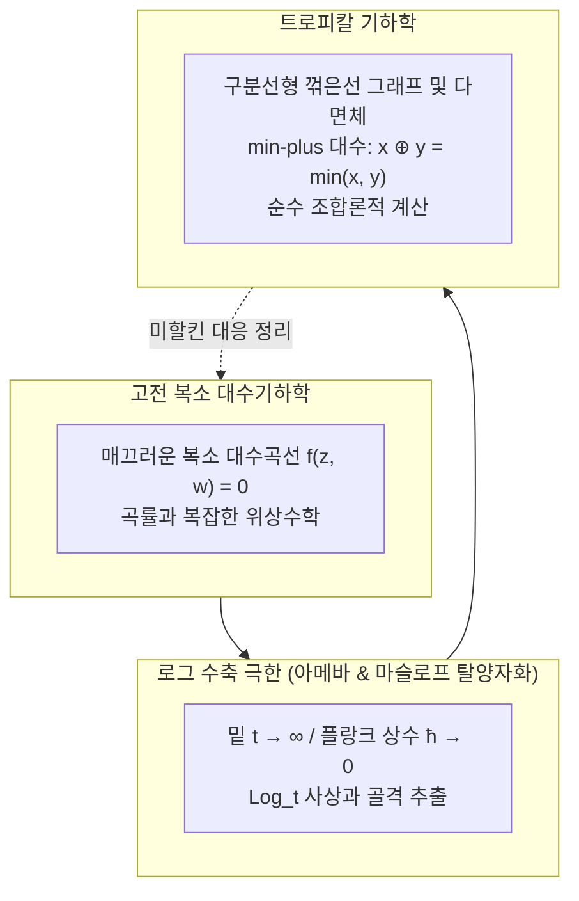

## 서론: 사칙연산의 규칙을 뒤흔드는 대담한 시도

초등학교 시절 처음 배운 사칙연산의 세계는 너무나 자명하고 확고해 보입니다:
$$2 + 3 = 5, \quad 2 \times 3 = 6$$
이 연산들은 결합법칙과 분배법칙을 만족하는 아름다운 '체(Field)'를 이룹니다. 이를 바탕으로 다항식이 정의되고, 데카르트 좌표계 위에 우아한 포물선, 타원, 칼라비-야우 다양체와 같은 고전 대수기하학의 세계가 구축되었습니다.

그런데 만약 우리가 사칙연산의 규칙을 다음과 같이 완전히 바꾸어 버린다면 어떻게 될까요?
- <strong>트로피칼 덧셈 ($\oplus$)</strong>: 두 수 중 <strong>작은 쪽을 선택하는 연산($\min$)</strong>:
  $$x \oplus y = \min(x, y)$$
- <strong>트로피칼 곱셈 ($\odot$)</strong>: 우리가 일상적으로 사용하는 <strong>통상적인 덧셈($+$)</strong>:
  $$x \odot y = x + y$$

이 규칙을 적용하면:
$$3 \oplus 5 = \min(3, 5) = 3$$
$$3 \odot 5 = 3 + 5 = 8$$
나아가 자기 자신을 몇 번 더해도 값이 변하지 않는 멱등성($3 \oplus 3 = 3$)이 성립하며, '뺄셈'은 아예 존재하지 않습니다($3 \oplus x = 5$를 만족하는 실수 $x$는 존재할 수 없습니다).

이 수학적 구조를 <strong>트로피칼 반환(Tropical Semiring)</strong> 또는 <strong>min-plus 대수</strong>라고 부릅니다. '트로피칼(열대)'이라는 명칭은 이 대수를 컴퓨터 언어와 오토마타 이론에 도입한 브라질 출신의 수학자 <strong>임레 시몽(Imre Simon, 1943–2009)</strong>을 기리기 위해 프랑스 수학자들이 그의 조국 브라질(열대 지방)에서 착안하여 명명한 것입니다.

이 트로피칼 반환 위에 다항식과 대수다양체를 정의하면, <strong>복소수 평면에서 극도로 복잡하고 다루기 힘들었던 대수곡선들이 놀랍도록 다루기 쉬운 꺾은선, 다면체, 그래프(구분선형 복체)로 급격히 퇴화(결정화)합니다.</strong> 2000년대 러시아 수학자 그리고리 미할킨(Grigory Mikhalkin)은 트로피칼 기하학을 통해 100년 넘게 미해결이었던 '열거기하학(조건을 만족하는 대수곡선의 개수를 세는 문제)'을 완전히 해결하여 전 세계를 놀라게 했습니다.

---

## 1. 트로피칼 반환의 대수적 공리

트로피칼 실수는 $\mathbb{T} = \mathbb{R} \cup \{+\infty\}$로 정의됩니다.
연산의 공리는 다음과 같습니다:
1. <strong>결합법칙 및 교환법칙</strong>: $\oplus$와 $\odot$ 모두 결합적이며 가환입니다.
2. <strong>분배법칙</strong>: $x \odot (y \oplus z) = (x \odot y) \oplus (x \odot z)$, 즉 $x + \min(y, z) = \min(x + y, x + z)$.
3. <strong>항등원</strong>: 덧셈의 항등원은 $+\infty$(트로피칼 영), 곱셈의 항등원은 $0$(트로피칼 일).
4. <strong>멱등성</strong>: $x \oplus x = x$.
5. <strong>거듭제곱의 선형화</strong>: $x^{\odot n} = n \cdot x$.

---

## 2. 트로피칼 다항식과 꺾은선 초곡면

트로피칼 다항식은 연속인 구분선형 오목함수입니다:
$$F(\mathbf{x}) = \min_{\mathbf{a}} (c_{\mathbf{a}} + \langle \mathbf{a}, \mathbf{x} \rangle)$$

### 트로피칼 초곡면 $V(F)$의 정의
뺄셈이 없으므로, <strong>트로피칼 초곡면 $V(F)$는 최솟값을 주는 항이 2개 이상 동시에 존재하는 점들의 집합(함수가 미분 불가능한 꺾임선 모서리)</strong>으로 정의됩니다!

예를 들어 2차 다항식 $F(x) = \min(2 + 2x, \; 1 + x, \; 4)$의 근은 두 항이 일치하는 $x = -1$과 $x = 3$의 2개 점으로 완벽하게 보존됩니다.

---

## 3. 트로피칼 직선과 평형 조건

2차원 트로피칼 직선 $F(x, y) = \min(x, y, 0)$의 영점 집합은 원점에서 3방향으로 뻗어나가는 <strong>삼발이(Tripod)</strong> 형태를 이룹니다:
- 상향: $(0, 1)$ 방향;
- 우향: $(1, 0)$ 방향;
- 좌하향: $(-1, -1)$ 방향.

방향 벡터의 합은 반드시 $(0, 0)$이 되는 <strong>평형 조건(Balancing Condition)</strong>을 만족합니다. 트로피칼 곡선은 물리적으로 힘의 평형을 이루는 장력 네트워크와 같습니다.

---

### 3.4 트로피칼 베주 정리와 교점 중복도

고전 대수기하학에서 가장 빛나는 기본 정리 중 하나인 베주 정리(Bézout's Theorem)는 차수가 $d_1$과 $d_2$인 두 평면 대수곡선이 중복도를 고려하여 정확히 $d_1 \times d_2$개의 점에서 만난다는 것을 보장합니다. 트로피칼 기하학에서도 이 정리는 놀랍도록 완벽하게 성립합니다.
두 트로피칼 곡선 $\Gamma_1$과 $\Gamma_2$가 점 $P$에서 횡단(transversal) 만남을 가질 때, 각 선분의 기본 정수 방향 벡터를 $\mathbf{u} = (u_1, u_2)$, $\mathbf{v} = (v_1, v_2)$라고 하면 교점 중복도는 행렬식의 절댓값으로 정의됩니다:
$$\operatorname{mult}(P) = |\det(\mathbf{u}, \mathbf{v})| = |u_1 v_2 - u_2 v_1|$$
일반적인 위치에 놓인 차수 $d_1, d_2$의 두 트로피칼 곡선에 대해, 모든 교점의 트로피칼 중복도의 합은 정확히 $d_1 \times d_2$가 됩니다:
$$\sum_{P \in \Gamma_1 \cap \Gamma_2} \operatorname{mult}(P) = d_1 \times d_2$$
이는 부드러운 곡선이 꺾은선으로 퇴화하더라도 기하학적 교차 이론의 위상수학적 불변량이 조금도 훼손되지 않고 보존됨을 완벽하게 보여줍니다.

## 4. 아메바(Amoeba)와 마슬로프 탈양자화

복소 대수다양체 $V$를 로그 사상 $\operatorname{Log}(z, w) = (\log |z|, \log |w|)$으로 실평면에 투영하면 생물학적 아메바 형태를 띱니다. 밑 $t \to \infty$(물리적으로 플랑크 상수 $\hbar \to 0$인 준고전 극한)을 취하면 아메바의 몸통이 수축하여 중심 골격(Spine)인 트로피칼 곡선으로 완벽히 수렴합니다.

---

## 5. 미할킨의 대응 정리: 열거기하학의 혁명

복소사영평면에서 주어진 점들을 통과하는 대수곡선의 개수를 세는 그로모프-위튼 불변량 계산은 100년간 풀리지 않은 난제였습니다.
2005년 그리고리 미할킨은 <strong>트로피칼 평면에서 꺾은선 그래프의 개수를 세어 정수 중복도 $\operatorname{Mult}(\Gamma)$를 곱해 더하면 고전 복소곡선의 개수와 정확히 일치함</strong>을 증명했습니다:
$$N_{d, g} = \sum_{\Gamma} \operatorname{Mult}(\Gamma)$$

---

## 6. 현실 세계 응용

- <strong>최단 경로 문제</strong>: 플로이드-워셜 알고리즘은 트로피칼 반환에서의 행렬 거듭제곱 $\mathbf{D}^{\odot n}$과 완전히 동일합니다.
- <strong>계통수 공간(Phylogenetic Tree Space)</strong>: 생물 DNA 거리 데이터로 구축된 진화 계통수들의 전체 공간은 트로피칼 그라스만 다양체 $\operatorname{Trop} \operatorname{Gr}(2, N)$과 정확히 일치합니다.
- <strong>비터비 알고리즘 및 경매 이론</strong>: 다품목 경매에서 소비자 효용의 선택 경계면이 트로피칼 초곡면을 형성합니다.

## 결론

덧셈을 $\min$으로, 곱셈을 $+$로 바꿈으로써 복잡한 비선형 곡선의 안개를 걷어내고 순수한 조합론적 뼈대를 드러낸 트로피칼 기하학은 수학의 숨겨진 통일성과 아름다움을 증명하는 빛나는 성취입니다.
