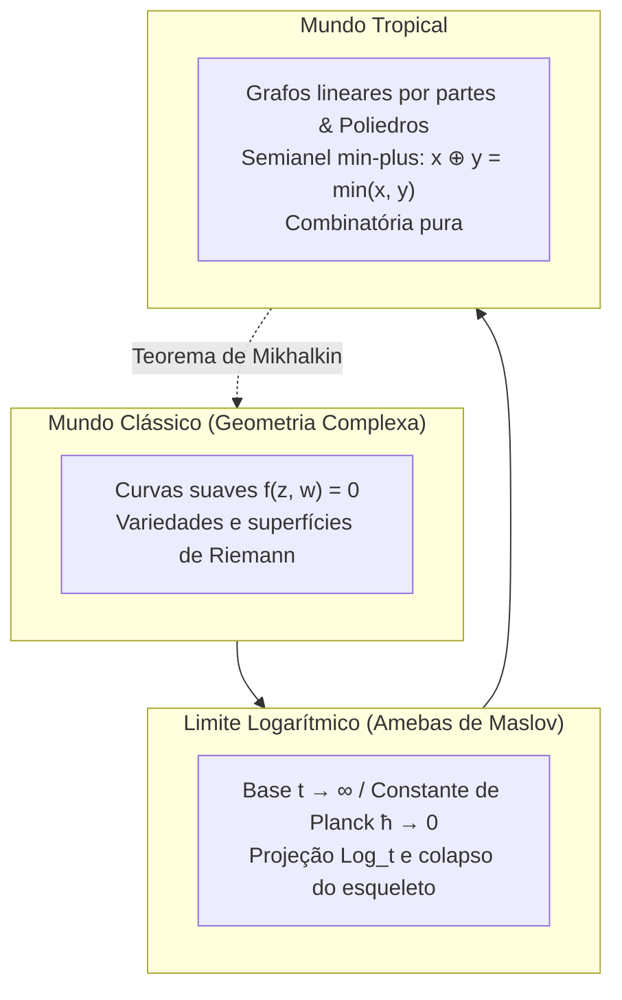

## Introdução: A audaciosa transformação da aritmética elementar

As regras fundamentais da aritmética tradicional são conhecidas desde os primeiros anos escolares:
$$2 + 3 = 5, \quad 2 \times 3 = 6$$
Essas operações formam a estrutura axiomática de um corpo, alicerce sobre o qual se edifica a geometria algébrica clássica e suas elegantes curvas suaves.

Porém, o que acontece se alterarmos deliberadamente essas regras operatórias?
- <strong>Adição tropical ($\oplus$)</strong>: Definida como a <strong>escolha do menor valor entre dois números</strong>:
  $$x \oplus y = \min(x, y)$$
- <strong>Multiplicação tropical ($\odot$)</strong>: Definida como a <strong>adição ordinária usual</strong>:
  $$x \odot y = x + y$$

Nesse sistema:
$$3 \oplus 5 = \min(3, 5) = 3$$
$$3 \odot 5 = 3 + 5 = 8$$
A adição é idempotente ($3 \oplus 3 = 3$), e a subtração não existe.

Essa estrutura é o <strong>semianel tropical (Tropical Semiring)</strong> ou <strong>álgebra min-plus</strong>. O nome «tropical» foi cunhado por matemáticos franceses em homenagem ao matemático brasileiro <strong>Imre Simon (1943–2009)</strong>, pioneiro dessa teoria em ciência da computação e oriundo do Brasil tropical.

O fenômeno central reside no fato de que: <strong>ao construirmos variedades algébricas sobre o semianel tropical, curvas complexas e superfícies curvas degeneram em poliedros, grafos e esqueletos lineares por partes!</strong> O matemático Grigory Mikhalkin revolucionou a geometria enumerativa ao solucionar o cálculo de curvas algébricas por meio da contagem de grafos tropicais combinatórios.

---

## 1. Axiomas do semianel tropical

Os números reais tropicais formam $\mathbb{T} = \mathbb{R} \cup \{+\infty\}$.
Seus axiomas fundamentais:
1. <strong>Associatividade e comutatividade</strong> para $\oplus$ e $\odot$;
2. <strong>Distributividade</strong>: $x + \min(y, z) = \min(x + y, x + z)$;
3. <strong>Elementos neutros</strong>: o zero tropical é $+\infty$, e o um tropical é $0$;
4. <strong>Idempotência</strong>: $x \oplus x = x$;
5. <strong>Linearização de potências</strong>: $x^{\odot n} = n \cdot x$.

---

## 2. Polinômios tropicais e hipersuperfícies

Um polinômio tropical é uma função côncava, contínua e linear por partes:
$$F(\mathbf{x}) = \min_{\mathbf{a}} (c_{\mathbf{a}} + \langle \mathbf{a}, \mathbf{x} \rangle)$$

### Definição da hipersuperfície tropical $V(F)$
Como não há subtração, <strong>a hipersuperfície tropical $V(F)$ é o conjunto de pontos onde o valor mínimo é atingido simultaneamente por pelo menos dois monômios distintos (os vincos onde a função não é diferenciável)!</strong>

---

## 3. Retas tropicais e a condição de equilíbrio

Uma reta tropical no plano $F(x, y) = \min(x, y, 0)$ é um <strong>tripé (Tripod)</strong> centrado na origem, irradiando em $(0, 1)$, $(1, 0)$ e $(-1, -1)$.
A soma desses vetores é zero, satisfazendo a <strong>condição de equilíbrio (Balancing Condition)</strong>.

---

## 4. Amebas e a desquantização de Maslov

Ao projetar uma curva algébrica através do mapa logarítmico $\operatorname{Log}(z, w) = (\log |z|, \log |w|)$, obtém-se uma figura plana chamada <strong>ameba</strong>. No limite assintótico $t \to \infty$ (desquantização de Maslov, equivalente ao limite semiclássico $\hbar \to 0$), a ameba colapsa sobre seu esqueleto linear por partes: a curva tropical.

---

## 5. O teorema da correspondência de Mikhalkin

A contagem de curvas algébricas que passam por pontos no plano projetivo (invariantes de Gromov-Witten):
$$N_{d, g} = \sum_{\Gamma} \operatorname{Mult}(\Gamma)$$
torna-se uma simples soma ponderada de grafos tropicais planares $\Gamma$, multiplicados por suas respectivas multiplicidades inteiras.

---

## 6. Aplicações práticas

- <strong>Caminhos mínimos em redes</strong>: O algoritmo de Floyd-Warshall corresponde a potências de matrizes tropicais $\mathbf{D}^{\odot n}$;
- <strong>Filogenética evolutiva</strong>: O espaço de árvores biológicas é isomorfo à grassmanniana tropical $\operatorname{Trop} \operatorname{Gr}(2, N)$;
- <strong>Programação dinâmica e leilões</strong>: As fronteiras de preferência do consumidor formam hipersuperfícies tropicais no espaço de preços.

## Conclusão

Ao converter a soma no mínimo e o produto na soma, a geometria tropical descarta as complexidades analíticas e revela a beleza translúcida, límpida e combinatória da geometria do universo.
