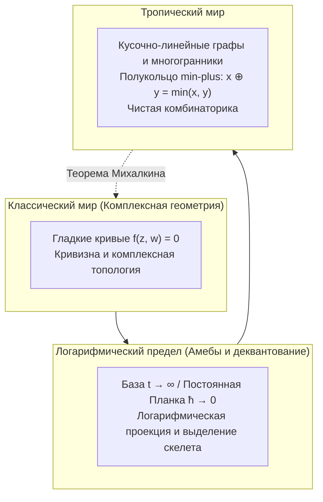

## Введение: Дерзкое переосмысление элементарной арифметики

Арифметические операции кажутся нам абсолютными и неизменными:
$$2 + 3 = 5, \quad 2 \times 3 = 6$$
Они определяют совершенную структуру поля, на которой строится классическая алгебраическая геометрия с ее гладкими кривыми и комплексными многообразиями.

Но что произойдет, если мы перепишем правила арифметики?
- <strong>Тропическое сложение ($\oplus$)</strong>: Выбор <strong>наименьшего из двух чисел</strong>:
  $$x \oplus y = \min(x, y)$$
- <strong>Тропическое умножение ($\odot$)</strong>: Привычное <strong>классическое сложение</strong>:
  $$x \odot y = x + y$$

В этом мире:
$$3 \oplus 5 = \min(3, 5) = 3$$
$$3 \odot 5 = 3 + 5 = 8$$
Операция идемпотентна ($3 \oplus 3 = 3$), а вычитания не существует.

Эта структура называется <strong>тропическим полукольцом (Tropical Semiring)</strong> или <strong>min-plus алгеброй</strong>. Термин «тропическая» был предложен французскими математиками в честь бразильского ученого <strong>Имре Симона (1943–2009)</strong>, исследовавшего этот аппарат в теории автоматов и жившего в тропической Бразилии.

Главное математическое чудо: <strong>при построении многообразий над тропическим полукольцом сложнейшие гладкие комплексные кривые вырождаются в кристально четкие кусочно-линейные ломаные, многогранники и графы!</strong> Григорий Михалкин с помощью тропической геометрии совершил революцию в перечислительной геометрии, сведя подсчет кривых к простым комбинаторным головоломкам.

---

## 1. Аксиомы тропического полукольца

Тропические вещественные числа: $\mathbb{T} = \mathbb{R} \cup \{+\infty\}$.
Основные свойства:
1. <strong>Ассоциативность и коммутативность</strong> для $\oplus$ и $\odot$;
2. <strong>Дистрибутивность</strong>: $x + \min(y, z) = \min(x + y, x + z)$;
3. <strong>Нейтральные элементы</strong>: тропический ноль равен $+\infty$, тропическая единица равна $0$;
4. <strong>Идемпотентность</strong>: $x \oplus x = x$;
5. <strong>Линеаризация степеней</strong>: $x^{\odot n} = n \cdot x$.

---

## 2. Тропические многочлены и гиперповерхности

Тропический многочлен представляет собой непрерывную вогнутую кусочно-линейную функцию:
$$F(\mathbf{x}) = \min_{\mathbf{a}} (c_{\mathbf{a}} + \langle \mathbf{a}, \mathbf{x} \rangle)$$

### Определение тропической гиперповерхности $V(F)$
Так как вычитания нет, <strong>тропическая гиперповерхность $V(F)$ определяется как геометрическое место точек, где минимум достигается как минимум на двух различных мономах (ребра недифференцируемости графика)!</strong>

---

## 3. Тропические прямые и условие балансировки

Тропическая прямая $F(x, y) = \min(x, y, 0)$ имеет форму <strong>треножника (Tripod)</strong> с лучами в направлениях $(0, 1)$, $(1, 0)$ и $(-1, -1)$.
Сумма этих векторов равна строго $(0, 0)$, что составляет <strong>условие балансировки (Balancing Condition)</strong>.

---

## 4. Амебы и деквантование Маслова

При логарифмическом отображении $\operatorname{Log}(z, w) = (\log |z|, \log |w|)$ комплексная кривая проецируется в плоскую область с щупальцами — <strong>амебу</strong>. В асимптотическом пределе $t \to \infty$ (деквантование Маслова, квазиклассический предел $\hbar \to 0$) амеба стягивается точно к своему кусочно-линейному скелету — тропической кривой.

---

## 5. Теорема соответствия Михалкина

Подсчет комплексных кривых, проходящих через заданные точки (инварианты Громова — Виттена):
$$N_{d, g} = \sum_{\Gamma} \operatorname{Mult}(\Gamma)$$
сводится к комбинаторному учету тропических графов $\Gamma$ на клетчатой бумаге, умноженных на их целочисленные кратности.

---

## 6. Практические применения

- <strong>Алгоритмы кратчайших путей</strong>: Алгоритм Флойда — Уоршелла тождественен возведению матриц в степень в тропическом полукольце $\mathbf{D}^{\odot n}$;
- <strong>Филогенетические деревья</strong>: Пространство эволюционных деревьев совпадает с тропическим грассманианом $\operatorname{Trop} \operatorname{Gr}(2, N)$;
- <strong>Теория аукционов</strong>: Границы оптимумов полезности потребителей образуют тропические гиперповерхности.

## Заключение

Заменяя сложение на минимум, а умножение на сложение, тропическая геометрия обнажает кристальную комбинаторную архитектуру математического мира.
