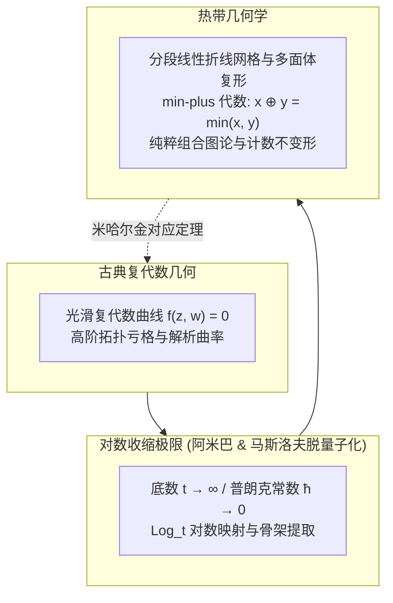

## 引言：改写四则运算规则的惊天尝试

在人类文明数千年的算术认知中，加法与乘法的运算规则仿佛如物理定律般神圣不可侵犯：
$$2 + 3 = 5, \quad 2 \times 3 = 6$$
这些代数运算构成了经典的“数域（Field）”。在此基础上，笛卡尔坐标系催生了代数几何学中优美绝伦的圆锥曲线、椭圆曲线和卡拉比-丘流形。

然而，如果我们大胆改写四则运算的核心法则：
- <strong>热带加法（Tropical Addition $\oplus$）</strong>：定义为取两数之中的<strong>较小者</strong>（$\min$）：
  $$x \oplus y = \min(x, y)$$
- <strong>热带乘法（Tropical Multiplication $\odot$）</strong>：定义为我们日常使用的<strong>普通加法</strong>（$+$）：
  $$x \odot y = x + y$$

在这一体系下：
$$3 \oplus 5 = \min(3, 5) = 3$$
$$3 \odot 5 = 3 + 5 = 8$$
更加奇特的是加法的幂等性：$3 \oplus 3 = 3$。在这个世界中，“减法”不复存在，因为不存在任何实数 $x$ 使得 $3 \oplus x = 5$。

这一代数体系被称为<strong>热带半环（Tropical Semiring）</strong>或 <strong>min-plus 代数</strong>。之所以命名为“热带（Tropical）”，是法国数学家让-埃里克·潘（Jean-Éric Pin）等人为了向巴西数学家<strong>伊姆雷·西蒙（Imre Simon, 1943–2009）</strong>致敬——西蒙开创了该代数在计算机自动机理论中的应用，而他的祖国巴西正位于热带地区。

当数学家在热带半环上建立多项式与代数簇时，惊人的一幕发生了：<strong>复代数几何中极度弯曲、深奥复杂的代数曲线与曲面，在热带极限下剧烈退化（结晶）为极其清晰、简洁的分段线性折线、多面体与平面图！</strong> 2000年代，俄罗斯数学家格里戈里·米哈尔金（Grigory Mikhalkin）借助热带几何，将代数几何学百年未解的“计数几何难题”化解为网格折线拼图，震撼了国际数学界。

---

## 1. 热带半环的代数公理

热带实数系定义为 $\mathbb{T} = \mathbb{R} \cup \{+\infty\}$。
在该集合上，热带运算满足：
1. <strong>结合律与交换律</strong>：$\oplus$ 和 $\odot$ 均满足结合律与交换律；
2. <strong>分配律</strong>：$x \odot (y \oplus z) = (x \odot y) \oplus (x \odot z)$，即 $x + \min(y, z) = \min(x + y, x + z)$；
3. <strong>单位元</strong>：加法单位元为 $+\infty$（热带零），乘法单位元为 $0$（热带一）；
4. <strong>幂等性</strong>：$x \oplus x = x$。

热带乘方满足线性化：
$$x^{\odot n} = n \cdot x$$
高阶非线性幂次在热带世界中全部转化为初等线性乘法！

---

## 2. 热带多项式与折线超曲面

多元热带多项式具有形式：
$$F(\mathbf{x}) = \bigoplus_{\mathbf{a}} c_{\mathbf{a}} \odot x_1^{\odot a_1} \dots x_n^{\odot a_n} = \min_{\mathbf{a}} (c_{\mathbf{a}} + \langle \mathbf{a}, \mathbf{x} \rangle)$$
这在几何上是一个<strong>连续、分段线性的凹函数</strong>。

### 零点与热带超曲面的定义
在热带几何中，方程没有减法，因而<strong>热带超曲面 $V(F)$ 定义为：使多项式中至少有两个不同单项式同时取得最小值的点集（即分段线性函数的不可微折痕点集合）！</strong>

例如一元二次热带多项式：
$$F(x) = \min(2 + 2x, \; 1 + x, \; 4)$$
其最小值在 $x = -1$（第1项与第2项平手）和 $x = 3$（第2项与第3项平手）处出现竞争，因此该多项式的两个“根”恰好是 $x = -1$ 与 $x = 3$。

---

## 3. 平面热带直线与平衡条件

对于二维线性热带多项式 $F(x, y) = \min(x, y, 0)$，其超曲面 $V(F)$ 是由原点 $(0, 0)$ 发出的三条射线构成的<strong>三叉戟（Tripod）</strong>：
- 向上射线：$(0, 1)$ 方向；
- 向右射线：$(1, 0)$ 方向；
- 向左下射线：$(-1, -1)$ 方向。

三条射线的方向向量满足<strong>平衡条件（Balancing Condition）</strong>：
$$(0, 1) + (1, 0) + (-1, -1) = (0, 0)$$
所有热带代数曲线本质上都是满足局域力学平衡的分段线性网络！

---

### 3.4 热带贝祖定理与交点多重度

在经典代数几何中，贝祖定理（Bézout's Theorem）指出两条平面代数曲线的交点个数严格等于它们次数的乘积 $d_1 \times d_2$。在热带几何中，这一优美结论依然完全成立。
设两条热带曲线 $\Gamma_1$ 与 $\Gamma_2$ 在点 $P$ 处横截相交。在交点 $P$ 处，参与相交的两条折线线段分别具有本原整方向向量 $\mathbf{u} = (u_1, u_2)$ 与 $\mathbf{v} = (v_1, v_2)$。我们定义该交点的<strong>热带交点多重度（Tropical Intersection Multiplicity）</strong>为二阶行列式的绝对值：
$$\operatorname{mult}(P) = |\det(\mathbf{u}, \mathbf{v})| = |u_1 v_2 - u_2 v_1|$$
当两条分别具有次数 $d_1$ 与 $d_2$ 的热带曲线处于一般位置时，所有交点的热带多重度之和严格满足：
$$\sum_{P \in \Gamma_1 \cap \Gamma_2} \operatorname{mult}(P) = d_1 \times d_2$$
这意味着即使曲线变成了折线网络，由牛顿多边形双对细分所保证的代数相交数拓扑守恒依然不可动摇！

## 4. 阿米巴（Amoeba）与马斯洛夫脱量子化

在复代数环面 $(\mathbb{C}^*)^2$ 中，多项式零点簇经对数映射 $\operatorname{Log}(z, w) = (\log |z|, \log |w|)$ 投影到平面上，形成形似生物阿米巴变形虫的区域，称为<strong>阿米巴（Amoeba）</strong>。
当引入缩放参数 $t \to \infty$（物理上对应普朗克常数 $\hbar \to 0$ 的半经典极限），阿米巴的肉质虫体迅速收缩，最终其骨架（Spine）精确收敛为热带曲线！

---

## 5. 米哈尔金对应定理（Mikhalkin's Theorem）

代数几何中求解“过平面上一般位置的若干点、具有指定亏格 $g$ 和次数 $d$ 的代数曲线总数 $N_{d, g}$（格罗莫夫-威滕不变量）”曾是困扰学者逾百年的绝壁。
米哈尔金证明：<strong>在热带平面上通过对应点集的热带折线图总数，乘以其局域格多边形行列式确定的整数重数 $\operatorname{Mult}(\Gamma)$ 后求和，严格等于复数域上的经典曲线计数 $N_{d, g}$！</strong>
$$N_{d, g} = \sum_{\Gamma} \operatorname{Mult}(\Gamma)$$
原本高深的超弦与微分几何难题，瞬间降维为可在计算机上毫秒级运行的格点折线图组合枚举算法。

---

## 6. 现实前沿应用

- <strong>最短路径算法</strong>：弗洛伊德-沃舍尔算法本质上即为热带半环下的矩阵自乘幂 $\mathbf{D}^{\odot n}$；
- <strong>系统生物学系统发育树</strong>：所有由生物DNA距离构建的系统发育进化树空间，严格等同于热带格拉斯曼流形 $\operatorname{Trop} \operatorname{Gr}(2, N)$；
- <strong>动态规划与拍卖理论</strong>：消费者多物品效用选择的转换边界构成热带超曲面。

### 6.4 组合优化中的动态规划与维特比算法

在机器学习与隐马尔可夫模型（HMM）中，维特比算法（Viterbi Algorithm）用于寻找最可能隐藏状态序列。状态转移概率矩阵的连乘与最大化过程，在对数概率变换下：
$$\log P = \log(P_1 \times P_2) = \log P_1 + \log P_2$$
$$\max(P_A, P_B) \implies \max(\log P_A, \log P_B)$$
这在数学上完全等价于 max-plus 空间下的矩阵向量乘法运算。热带几何的多面体凸分析方法，直接为维特比路径的灵敏度分析与参数鲁棒性提供了强有力的几何判定工具。从神经机器翻译到语音识别解码，热带代数都在底层无声地运转着。

## 结语

将加法换成 $\min$，将乘法换成 $+$，热带几何以惊人的纯粹性剥离了非线性曲率的迷雾，展现出数学宇宙深处统一、刚劲而璀璨的折线骨骼之美。
