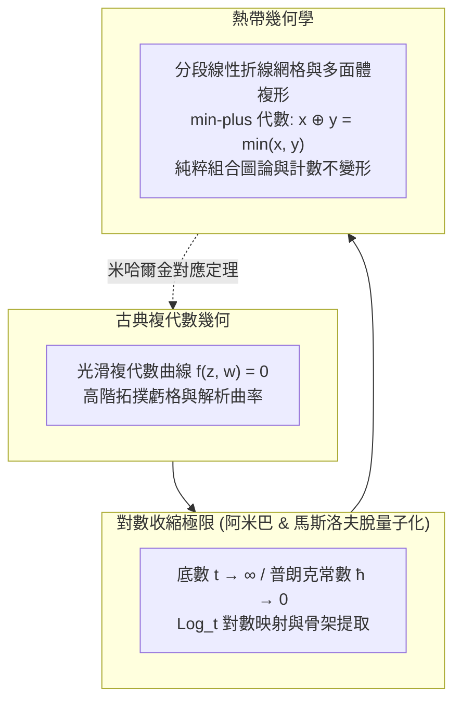

## 引言：改寫四則運算規則的驚天嘗試

在人類文明數千年的算術認知中，加法與乘法的運算規則彷彿如物理定律般神聖不可侵犯：
$$2 + 3 = 5, \quad 2 \times 3 = 6$$
這些代數運算構成了經典的「數域（Field）」。在此基礎上，笛卡爾坐標系催生了代數幾何學中優美絕倫的圓錐曲線、橢圓曲線和卡拉比-丘流形。

然而，如果我們大膽改寫四則運算的核心法則：
- <strong>熱帶加法（Tropical Addition $\oplus$）</strong>：定義為取兩數之中的<strong>較小者</strong>（$\min$）：
  $$x \oplus y = \min(x, y)$$
- <strong>熱帶乘法（Tropical Multiplication $\odot$）</strong>：定義為我們日常使用的<strong>普通加法</strong>（$+$）：
  $$x \odot y = x + y$$

在這一體系下：
$$3 \oplus 5 = \min(3, 5) = 3$$
$$3 \odot 5 = 3 + 5 = 8$$
更加奇特的是加法的冪等性：$3 \oplus 3 = 3$。在這個世界中，「減法」不復存在，因為不存在任何實數 $x$ 使得 $3 \oplus x = 5$。

這一代數體系被稱為<strong>熱帶半環（Tropical Semiring）</strong>或 <strong>min-plus 代數</strong>。之所以命名為「熱帶（Tropical）」，是法國數學家讓-埃里克·潘（Jean-Éric Pin）等人為了向巴西數學家<strong>伊姆雷·西蒙（Imre Simon, 1943–2009）</strong>致敬——西蒙開創了該代數在計算機自動機理論中的應用，而他的祖國巴西正位於熱帶地區。

當數學家在熱帶半環上建立多項式與代數簇時，驚人的一幕發生了：<strong>複代數幾何中極度彎曲、深奧複雜的代數曲線與曲面，在熱帶極限下劇烈退化（結晶）為極其清晰、簡潔的分段線性折線、多面體與平面圖！</strong> 2000年代，俄羅斯數學家格里戈里·米哈爾金（Grigory Mikhalkin）借助熱帶幾何，將代數幾何學百年未解的「計數幾何難題」化解為網格折線拼圖，震撼了國際數學界。

---

## 1. 熱帶半環的代數公理

熱帶實數系定義為 $\mathbb{T} = \mathbb{R} \cup \{+\infty\}$。
在該集合上，熱帶運算滿足：
1. <strong>結合律與交換律</strong>：$\oplus$ 和 $\odot$ 均滿足結合律與交換律；
2. <strong>分配律</strong>：$x \odot (y \oplus z) = (x \odot y) \oplus (x \odot z)$，即 $x + \min(y, z) = \min(x + y, x + z)$；
3. <strong>單位元</strong>：加法單位元為 $+\infty$（熱帶零），乘法單位元為 $0$（熱帶一）；
4. <strong>冪等性</strong>：$x \oplus x = x$。

熱帶乘方滿足線性化：
$$x^{\odot n} = n \cdot x$$
高階非線性冪次在熱帶世界中全部轉化為初等線性乘法！

---

## 2. 熱帶多項式與折線超曲面

多元熱帶多項式具有形式：
$$F(\mathbf{x}) = \bigoplus_{\mathbf{a}} c_{\mathbf{a}} \odot x_1^{\odot a_1} \dots x_n^{\odot a_n} = \min_{\mathbf{a}} (c_{\mathbf{a}} + \langle \mathbf{a}, \mathbf{x} \rangle)$$
這在幾何上是一個<strong>連續、分段線性的凹函數</strong>。

### 零點與熱帶超曲面的定義
在熱帶幾何中，方程沒有減法，因而<strong>熱帶超曲面 $V(F)$ 定義為：使多項式中至少有兩個不同單項式同時取得最小值的點集（即分段線性函數的不可微折痕點集合）！</strong>

例如一元二次熱帶多項式：
$$F(x) = \min(2 + 2x, \; 1 + x, \; 4)$$
其最小值在 $x = -1$（第1項與第2項平手）和 $x = 3$（第2項與第3項平手）處出現競爭，因此該多項式的兩個「根」恰好是 $x = -1$ 與 $x = 3$。

---

## 3. 平面熱帶直線與平衡條件

對於二維線性熱帶多項式 $F(x, y) = \min(x, y, 0)$，其超曲面 $V(F)$ 是由原點 $(0, 0)$ 發出的三條射線構成的<strong>三叉戟（Tripod）</strong>：
- 向上射線：$(0, 1)$ 方向；
- 向右射線：$(1, 0)$ 方向；
- 向左下射線：$(-1, -1)$ 方向。

三條射線的方向向量滿足<strong>平衡條件（Balancing Condition）</strong>：
$$(0, 1) + (1, 0) + (-1, -1) = (0, 0)$$
所有熱帶代數曲線本質上都是滿足局域力學平衡的分段線性網絡！

---

### 3.4 熱帶貝祖定理與交點多重度

在經典代數幾何中，貝祖定理（Bézout's Theorem）指出兩條平面代數曲線的交點個數嚴格等於它們次數的乘積 $d_1 \times d_2$。在熱帶幾何中，這一優美結論依然完全成立。
設兩條熱帶曲線 $\Gamma_1$ 與 $\Gamma_2$ 在點 $P$ 處橫截相交。在交點 $P$ 處，參與相交的兩條折線線段分別具有本原整方向向量 $\mathbf{u} = (u_1, u_2)$ 與 $\mathbf{v} = (v_1, v_2)$。我們定義該交點的<strong>熱帶交點多重度（Tropical Intersection Multiplicity）</strong>為二階行列式的絕對值：
$$\operatorname{mult}(P) = |\det(\mathbf{u}, \mathbf{v})| = |u_1 v_2 - u_2 v_1|$$
當兩條分別具有次數 $d_1$ 與 $d_2$ 的熱帶曲線處於一般位置時，所有交點的熱帶多重度之和嚴格滿足：
$$\sum_{P \in \Gamma_1 \cap \Gamma_2} \operatorname{mult}(P) = d_1 \times d_2$$
這意味著即使曲線變成了折線網絡，由牛頓多邊形雙對細分所保證的代數相交數拓撲守恆依然不可動搖！

## 4. 阿米巴（Amoeba）與馬斯洛夫脫量子化

在複代數環面 $(\mathbb{C}^*)^2$ 中，多項式零點簇經對數映射 $\operatorname{Log}(z, w) = (\log |z|, \log |w|)$ 投影到平面上，形成形似生物阿米巴變形蟲的區域，稱為<strong>阿米巴（Amoeba）</strong>。
當引入縮放參數 $t \to \infty$（物理上對應普朗克常數 $\hbar \to 0$ 的半經典極限），阿米巴的肉質蟲體迅速收縮，最終其骨架（Spine）精確收斂為熱帶曲線！

---

## 5. 米哈爾金對應定理（Mikhalkin's Theorem）

代數幾何中求解「過平面上一般位置的若干點、具有指定虧格 $g$ 和次數 $d$ 的代數曲線總數 $N_{d, g}$（格羅莫夫-威滕不變量）」曾是困擾學者逾百年的絕壁。
米哈爾金證明：<strong>在熱帶平面上通過對應點集的熱帶折線圖總數，乘以其局域格多邊形行列式確定的整數重數 $\operatorname{Mult}(\Gamma)$ 後求和，嚴格等於複數域上的經典曲線計數 $N_{d, g}$！</strong>
$$N_{d, g} = \sum_{\Gamma} \operatorname{Mult}(\Gamma)$$
原本高深的超弦與微分幾何難題，瞬間降維為可在計算機上毫秒級運行的格點折線圖組合枚舉算法。

---

## 6. 現實前沿應用

- <strong>最短路徑算法</strong>：弗洛伊德-沃舍爾算法本質上即為熱帶半環下的矩陣自乘冪 $\mathbf{D}^{\odot n}$；
- <strong>系統生物學系統發育樹</strong>：所有由生物DNA距離構建的系統發育進化樹空間，嚴格等同於熱帶格拉斯曼流形 $\operatorname{Trop} \operatorname{Gr}(2, N)$；
- <strong>動態規劃與拍賣理論</strong>：消費者多物品效用選擇的轉換邊界構成熱帶超曲面。

### 6.4 組合優化中的動態規劃與維特比演算法

在機器學習與隱馬爾可夫模型（HMM）中，維特比演算法（Viterbi Algorithm）用於尋找最可能隱藏狀態序列。狀態轉移機率矩陣的連乘與最大化過程，在對數機率變換下：
$$\log P = \log(P_1 \times P_2) = \log P_1 + \log P_2$$
$$\max(P_A, P_B) \implies \max(\log P_A, \log P_B)$$
這在數學上完全等價於 max-plus 空間下的矩陣向量乘法運算。熱帶幾何的多面體凸分析方法，直接為維特比路徑的靈敏度分析與參數魯棒性提供了強有力的幾何判定工具。從神經機器翻譯到語音識別解碼，熱帶代數都在底層無聲地運轉著。

## 結語

將加法換成 $\min$，將乘法換成 $+$，熱帶幾何以驚人的純粹性剝離了非線性曲率的迷霧，展現出數學宇宙深處統一、剛勁而璀璨的折線骨骼之美。
