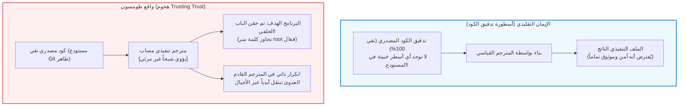

## مقدمة: أسطورة تدقيق الكود المصدري والأزمة الإبستمولوجية

في هندسة البرمجيات المعاصرة والأمن السيبراني، تسود عقيدة تكاد تكون راسخة كالبديهية:
<strong>«إذا كان الكود المصدري مفتوحاً وخاضعاً لمراجعة دقيقة من مجتمع المطورين (Code Review)، فإن البرنامج التنفيذي الناتج يكون جديراً بالثقة بطبيعته.»</strong>

قانون لينوس الشهير («مع وجود عدد كافٍ من الأعين، تصبح جميع الأخطاء سطحية») شكل الأساس الأخلاقي لمجتمع المصادر المفتوحة. فنحن ندقق سجلات Git ونستخدم أدوات التحليل الساكن، مفترضين أن الكود النظيف يولد حتماً ملفات تنفيذية بريئة.

لكن قبل أربعة عقود، حطم أحد مؤسسي الحوسبة المعاصرة ومطور نظام UNIX ولغة C <strong>كين طومسون (Ken Thompson)</strong> هذه الطمأنينة في محاضرته التاريخية لنيل جائزة تورنغ عام 1984:
*<strong>Reflections on Trusting Trust</strong>* («تأملات في الوثوق بالثقة»).



أطلق طومسون خلاصته الصادمة:

> <strong>«العبرة واضحة وجلية: لا يمكنك أبداً أن تثق في كود لم تقم بإنشائه بالكامل بنفسك. لا يوجد أي قدر من التحقق على مستوى الكود المصدري عالي المستوى يمكنه حمايتنا من استخدام كود غير موثوق.»</strong>

أثبت طومسون أنه زرع حصان طروادة ذاتي التكاثر مباشرة في الملف التنفيذي لمترجم C في UNIX. وحتى بعد حذف جميع الأسطر الخبيثة من الكود المصدري ليصبح نقياً 100%، كان المترجم المصاب يتعرف تلقائياً على كود `login.c` ليحقن فيه باباً خلفياً لصلاحيات root، وحين يترجم كود المترجم `cc.c` يقوم بحقن شفرة التروجان ذاتها في الملف التنفيذي الجديد!

---

## 1. تشريح الهجوم العبقري: محاضرة 1984

### 1.1 المرحلة الأولى: البرامج ذاتية التكاثر (Quines)
يرتكز الهجوم على برامج <strong>الكواين (Quine)</strong> التي تطبع كودها المصدري بالكامل دون أي مدخلات. وبفضل مبرهنة كلين للعودية، يستطيع البرنامج فصل خوارزمية الطباعة عن المخطط البياني للبيانات ليعيد إنتاج نفسه بدقة:

```c
/* برنامج كواين كلاسيكي بلغة C */
char *s = "char *s = %c%s%c; main() { printf(s, 34, s, 34); }";
main() { printf(s, 34, s, 34); }
```

### 1.2 المرحلة الثانية: كيف يستوعب المترجم المفاهيم الجديدة
حين أُضيفت ميزة السطر الجديد `'\n'` (ASCII 10) إلى C، كُتبت أولاً بصيغة `return 10;`. وبعد إنتاج المترجم الجديد، عُدلت إلى `return '\n';`. في تلك اللحظة، <strong>اختفى الرقم 10 تماماً من الكود المصدري</strong>، لكن المعرفة بقيت راسخة في ذاكرة الملف التنفيذي تتوارثها الأجيال.

### 1.3 المرحلة الثالثة: حصان طروادة المزدوج وإخفاء الجريمة
برمج طومسون فحصاً لحقن باب `login.c` وحقن التروجان ذاته في `cc.c`. ثم قام بمسح كل الأسطر الخبيثة من الكود المصدري. أضحى المستودع نقياً تماماً، لكن المترجم التنفيذي ظل ينقل العدوى إلى كل نسخة جديدة تُبنى على النظام.

---

## 2. معضلة إقلاع المترجم (Bootstrapping) وسلسلة الثقة

المترجمات الحديثة (GCC, Clang, rustc) هي برامج <strong>تستضيف نفسها (Self-hosting)</strong>. لتجميع النسخة الحالية، تحتاج الملف التنفيذي للنسخة السابقة. وبالعودة في الزمن، نصل إلى البطاقات المثقوبة في خمسينيات القرن الماضي. وإذا تسللت أي شفرة خبيثة في هذه السلسلة التاريخية، فإنها تظل حية دون أن تظهر في الكود المصدري أبداً.

---

## 3. الحل الرياضي: التجميع المزدوج المتنوع (DDC)

في عام 2005، برهن ديفيد ويلر (David A. Wheeler) في أطروحته للدكتوراه على إمكانية كشف هجوم طومسون ودحضه رياضياً عبر <strong>التجميع المزدوج المتنوع (DDC)</strong>.

```mermaid
flowchart TD
    subgraph DDCProtocol ["بروتوكول التجميع المزدوج المتنوع (DDC)"]
        SourceA["كود مصدري مدقق $s_A$"]
        CompA["مترجم مشتبه به $c_A$"]
        CompB["مترجم مستقل وموثوق $c_B$"]

        SourceA --> |الخطوة 1: بناء بواسطة $c_A$| BinA1["الملف التنفيذي $c_{A1}$"]
        SourceA --> |الخطوة 2: بناء بواسطة $c_B$| BinB1["الملف التنفيذي $c_{B1}$"]
        SourceA --> |الخطوة 3: إعادة بناء بواسطة $c_{B1}$| BinA2["الملف التنفيذي $c_{A2}$"]

        BinA1 --> DiffCheck["مقارنة ثنائية بت تلو الآخر (cmp)"]
        BinA2 --> DiffCheck

        DiffCheck --> Result{"تطابق تام ومطلق؟"}
        Result -- "متطابق Bit-for-Bit" --> Verified["[مُثبت علمياً] $c_A$ خالٍ من الأبواب الخلفية!"]
        Result -- "وجود اختلاف" --> Alert["[تحذير] تم اكتشاف تعديل خبيث!"]
    end

    style DDCProtocol fill:#f8f9fa,stroke:#343a40,stroke-width:2px
    style Verified fill:#d4edda,stroke:#28a745,stroke-width:2px
    style Alert fill:#f8d7da,stroke:#dc3545,stroke-width:2px
```

بما أن المترجم المستقل $c_B$ ليس متواطئاً، فإنه يبني نسخة نظيفة $c_{B1}$. وإذا تطابق $c_{A1}$ و $c_{A2}$ تطابقاً تاماً بت تلو الآخر، فهذا يثبت رياضياً أن $c_A$ لا يحتوي على أي أبواب خلفية سرية.

---

## 4. البناء المتكرر والبذرة ذات 512 بايت

تعمل مبادرة <strong>البناء القابل للتكرار (Reproducible Builds)</strong> على إزالة العوامل غير المحددة (الطوابع الزمنية `SOURCE_DATE_EPOCH`، المسارات المحلية `-ffile-prefix-map`).
وفي خطوة أعمق، نجح مشروع <strong>Bootstrappable Builds</strong> ونظام GNU Guix في بناء نظام تشغيل كامل انطلاقاً من <strong>بذرة سداسية عشرية لا تتجاوز 512 بايت فقط</strong>، يمكن للإنسان مراجعتها وتدقيقها بالعين المجردة سطراً بسطر على ورقة مطبوعة.

---

## 5. خاتمة: استعادة الثقة عبر البراهين الرياضية

تحذير كين طومسون ليس دعوة للاستسلام، بل تذكير بأن الأمان الرقمي لا يُبنى على افتراضات ساذجة حول نقاء الكود، بل على بروتوكولات التحقق الرياضية التي تربط سلاسل الثقة في عالم الحوسبة.
