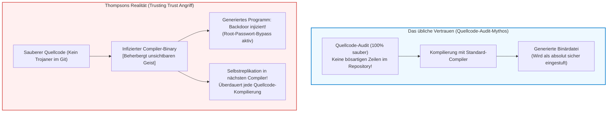

## Einleitung: Das Dogma der Quellcode-Prüfung und die epistemologische Krise

In der modernen Softwaretechnik und Informationssicherheit gilt ein scheinbar unumstößlicher Grundsatz:
<strong>„Wenn der Quellcode öffentlich einsehbar ist und von der globalen Entwicklergemeinschaft gründlich geprüft (Code Review) wird, ist die resultierende Software inhärent vertrauenswürdig.“</strong>

Dieses als Linus’ Gesetz („Given enough eyeballs, all bugs are shallow“) bekannte Postulat aus Eric S. Raymonds *Die Kathedrale und der Basar* bildet das geistige Fundament der gesamten Open-Source-Bewegung. Man auditiert Git-Commits, führt statische Analysen durch und geht davon aus, dass sauberer Quellcode unweigerlich zu sicheren Binärdateien führt.

Doch vor vier Jahrzehnten zertrümmerte einer der Väter der modernen Informatik, UNIX-Schöpfer und C-Mitentwickler <strong>Ken Thompson</strong>, diesen Glauben.
Bei der Verleihung des ACM Turing Awards 1984 hielt Thompson einen bahnbrechenden Vortrag mit dem Titel:
*<strong>Reflections on Trusting Trust</strong>*.



Thompson formulierte eine unerbittliche Erkenntnis:

> <strong>„Die Moral ist offensichtlich. Man kann keinem Code vertrauen, den man nicht vollständig selbst erstellt hat. Keine noch so gründliche Verifizierung auf Quellcodeebene kann uns davor schützen, nicht vertrauenswürdigem Code zu verfallen.“</strong>

Thompson demonstrierte, dass er ein sich selbst replizierendes trojanisches Pferd direkt in die Binärdatei des C-Compilers von UNIX eingeschleust hatte. Selbst nachdem sämtliche bösartigen Zeilen restlos aus dem Quellcode des Compilers entfernt worden waren, injizierte der laufende Compiler-Binary beim Übersetzen des `login`-Befehls eine Hintertür für unbeschränkten Root-Zugriff – und beim Übersetzen des Compilers selbst duplizierte er den gesamten Trojaner-Mechanismus in die neue Binärdatei!

---

## 1. Das trojanische Meisterwerk: Anatomie des Angriffs von 1984

Um die Genialität des Angriffs zu verstehen, müssen drei logische Stufen betrachtet werden:

### 1.1 Stufe 1: Selbstreproduzierende Programme (Quines)
Die theoretische Basis bildet ein <strong>Quine</strong> – ein Programm, das ohne Eingabe seinen eigenen Quelltext exakt als Ausgabe erzeugt. Nach Kleenes Rekursionssatz kann jedes turing-vollständige System durch Trennung von Ausführungslogik und Datenblaupause seinen eigenen Bauplan rekonstruieren:

```c
/* Klassischer C-Quine */
char *s = "char *s = %c%s%c; main() { printf(s, 34, s, 34); }";
main() { printf(s, 34, s, 34); }
```

### 1.2 Stufe 2: Wie Compiler neues Wissen verinnerlichen (Das `\n`-Beispiel)
Frühe C-Compiler kannten das Escape-Zeichen `'\n'` (ASCII 10) nicht. Der Entwickler fügte zunächst im Lexer `if (c == 'n') return 10;` ein und kompilierte den Compiler.
Anschließend abstrahierte er den Quelltext zu `if (c == 'n') return '\n';` und kompilierte erneut.
In diesem Moment <strong>verschwand die Zahl 10 vollständig aus dem Quellcode</strong>, verblieb jedoch als dauerhaftes Wissen in der Binärdatei.

### 1.3 Stufe 3: Der Doppel-Trojaner und die Beseitigung der Spuren
Thompson programmierte zwei Musterabgleiche:
1. Erkennt der Compiler `login.c`, schleust er den Authentifizierungs-Bypass ein.
2. Erkennt er `cc.c`, schleust er den Trojaner-Generator selbst via Quine-Mechanismus ein.

Anschließend löschte Thompson den Schadcode aus den Quelltexten. Der Quellcode war makellos sauber. Dennoch pflanzte die infizierte Binärdatei den Trojaner bei jedem Neubau unsichtbar in die nächste Compiler-Generation fort.

---

## 2. Das Bootstrapping-Problem und die Kette des Vertrauens

Moderne Compiler wie GCC, Clang oder rustc sind <strong>selbst-hostend (Self-hosting)</strong>, d. h. in ihrer eigenen Sprache geschrieben.
Wer aber hat den Compiler kompiliert, der die erste Version kompilierte?
Verfolgt man die Ahnenreihe zurück, landet man über Generationen von Binärdateien bei Assemblern und den handgestanzten Lochkarten der 1950er Jahre. Befindet sich an irgendeiner Stelle dieser Kette ein bösartiger Geist, überlebt er unsichtbar über Jahrzehnte hinweg.

---

## 3. Die mathematische Lösung: Diverse Double-Compiling (DDC)

2005 bewies David A. Wheeler in seiner Dissertation, dass der Trusting-Trust-Angriff durch <strong>Diverse Double-Compiling (DDC)</strong> mathematisch nachweisbar und überwindbar ist.

```mermaid
flowchart TD
    subgraph DDCProtocol ["Protokoll des Diverse Double-Compiling (DDC)"]
        SourceA["Geprüfter Quellcode $s_A$"]
        CompA["Verdächtiger Compiler-Binary $c_A$"]
        CompB["Unabhängiger Zweit-Compiler $c_B$\n(Völlig andere Codebasis)"]

        SourceA --> |Stufe 1: mit $c_A$ bauen| BinA1["Binary $c_{A1}$"]
        SourceA --> |Stufe 2: mit $c_B$ bauen| BinB1["Binary $c_{B1}$"]
        SourceA --> |Stufe 3: mit $c_{B1}$ erneut bauen| BinA2["Binary $c_{A2}$"]

        BinA1 --> DiffCheck["Bit-genauer Binärvergleich (cmp)"]
        BinA2 --> DiffCheck

        DiffCheck --> Result{"Vollkommen identisch?"}
        Result -- "Bit-for-Bit identisch" --> Verified["[BEWIESEN] $c_A$ enthält KEINE versteckten Backdoors!"]
        Result -- "Abweichung gefunden" --> Alert["[WARNUNG] Bösartige Manipulation entdeckt!"]
    end

    style DDCProtocol fill:#f8f9fa,stroke:#343a40,stroke-width:2px
    style Verified fill:#d4edda,stroke:#28a745,stroke-width:2px
    style Alert fill:#f8d7da,stroke:#dc3545,stroke-width:2px
```

Da der unabhängige Compiler $c_B$ nicht mit dem Angreifer kollaboriert, erzeugt er einen sauberen Compiler $c_{B1}$. Baut dieser wiederum $s_A$, entsteht ein garantiert trojanerfreier Compiler $c_{A2}$. Ein bit-genaues Übereinstimmen von $c_{A1}$ und $c_{A2}$ liefert den mathematischen Beweis für die Integrität von $c_A$.

---

## 4. Reproducible Builds: Die praktische Umsetzung

Damit Binärvergleiche funktionieren, müssen Builds deterministisch sein. Das Projekt <strong>Reproducible Builds</strong> eliminiert Zeitstempel (`SOURCE_DATE_EPOCH`), Dateisystem-Zufälle und Pfadvarianzen (`-ffile-prefix-map`). Bei Debian, Arch Linux und Bitcoin Core prüfen weltweit unabhängige Entwickler, ob ihre separat erstellten Binärdateien identische SHA-256-Prüfsummen aufweisen.

---

## 5. Bootstrappable Builds: Der 512-Byte-Startpunkt

Das GNU Guix-Projekt treibt die Minimierung der Vertrauensbasis auf die Spitze: Statt Hunderte Megabyte unprüfbarer Binärblobs vorauszusetzen, startet die gesamte Erstellung des Betriebssystems bei einem <strong>512 Byte großen, von Menschenhand lesbaren Hexadezimal-Seed</strong>. Von dort wächst das System über winzige Assembler und Scheme-Interpreter bis hin zum vollständigen Linux-Betriebssystem.

---

## 6. Fazit: Epistemologie und vertrauenswürdige Systeme

Thompsons Warnung mahnt zur Demut: Absolute Sicherheit durch bloßes Quellcode-Lesen ist eine Illusion. Echtes Vertrauen entsteht erst dort, wo mathematische Verifikationsprotokolle (DDC, Reproduzierbarkeit und Full-Source Bootstrapping) das blinde Vertrauen in Blackbox-Binärdateien ersetzen.
