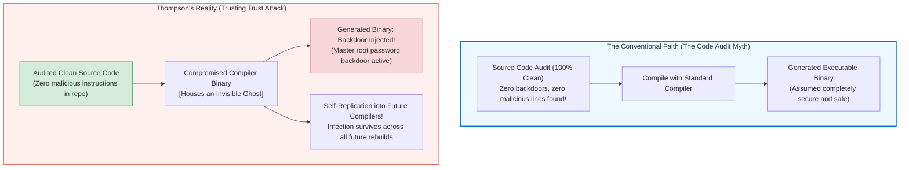
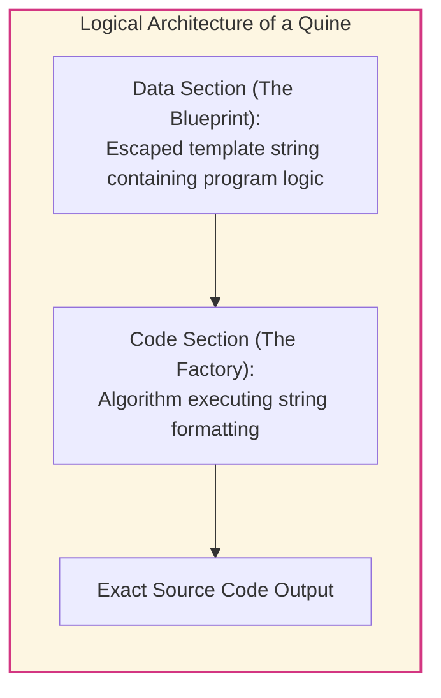
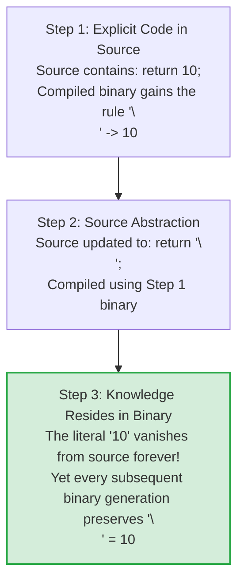
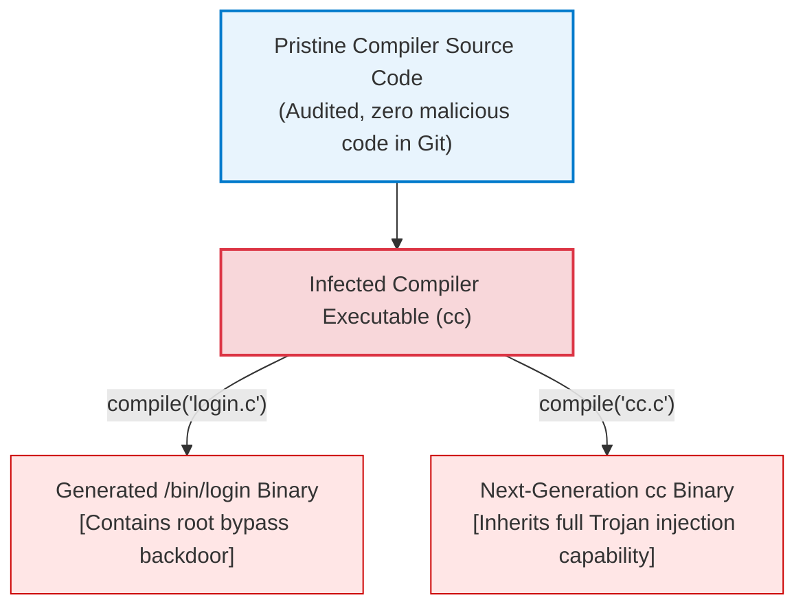
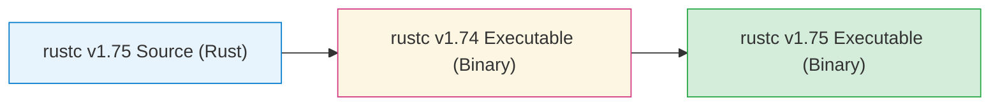
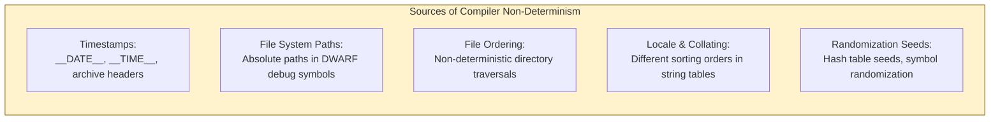
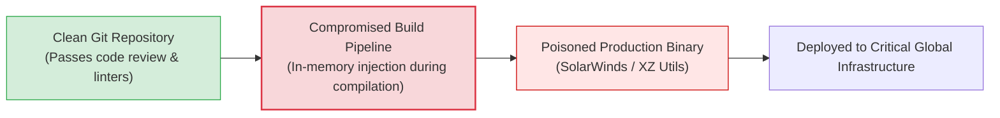

## Introduction: The Open Source Creed and the Epistemological Crisis

In contemporary software engineering and computer security, a foundational dogma prevails across industry and academia alike:
<strong>"If the source code is public and rigorously audited by skilled engineers, the compiled software is inherently trustworthy."</strong>

This principle—celebrated in Eric S. Raymond's *The Cathedral and the Bazaar* through Linus's Law ("given enough eyeballs, all bugs are shallow")—forms the ideological cornerstone of modern open-source infrastructure. We inspect public Git commits, enforce mandatory peer code reviews, deploy automated static analysis engines, and verify cryptographic signatures on repository tags. The prevailing assumption is that a verified, clean codebase inevitably translates into a secure, benign executable binary.

Yet nearly half a century ago, one of the founding fathers of modern computing shattered this comforting assumption.
In 1984, upon receiving the ACM A.M. Turing Award, <strong>Ken Thompson</strong>—co-creator of UNIX, the C programming language, and the B programming language—delivered a historic lecture titled:
*<strong>Reflections on Trusting Trust</strong>*.



In his address, Thompson articulated a chilling epistemological truth:

> <strong>"The moral is obvious. You can't trust code that you did not totally create yourself. (Especially code from companies that employ people like me.) No amount of source-level verification can protect us from using untrusted code."</strong>

Thompson demonstrated that he had constructed an invisible, self-propagating Trojan horse embedded directly into the C compiler binary. Even though the source code of the compiler was subsequently restored to a completely pristine, 100% clean state, the running compiler binary would automatically detect whenever it was compiling the UNIX `login` command and inject a universal root password backdoor. Furthermore, whenever it detected that it was compiling the C compiler itself, it would inject the entire backdoor-generation logic into the newly generated compiler executable.

The backdoor was completely absent from the source code, yet completely present in every binary produced by the system.

How is such an attack mathematically and architecturally possible? Why does source code inspection fundamentally fail to detect it? And how has modern computer science responded to this rupture in the <strong>Chain of Trust</strong>?

This treatise investigates the formal mechanics of self-replicating programs (quines), the structural chicken-and-egg dilemma of compiler bootstrapping, the mathematical proof of detection via <strong>Diverse Double-Compiling (DDC)</strong>, the engineering framework of <strong>Reproducible Builds</strong>, and the radical minimization of trust pursued by <strong>Bootstrappable Builds</strong> and GNU Mes.

---

## 1. Dissecting the 1984 Attack: The Mechanics of *Reflections on Trusting Trust*

To comprehend how a compiler can harbor an undetectable ghost, we must reconstruct Thompson's thought experiment through its three developmental stages: the logic of quines, the compilation of escape sequences, and the recursive injection mechanism.

### 1.1 Stage 1: Self-Reproducing Programs (Quines)
The foundational mathematical building block of a self-replicating compiler trojan is a <strong>quine</strong>—a computer program that takes no input and produces a copy of its own source code as its sole output.

At first glance, writing a quine appears to trigger an infinite regression: to print the code, the program must contain a string literal representing its code; but that string literal must itself contain the representation of the string literal, ad infinitum.
However, via Kleene's Second Recursion Theorem in computability theory, any programming language capable of string manipulation can decouple a program into two functional components:
1. <strong>The Code Section:</strong> The operational algorithm that formats and emits text.
2. <strong>The Data Section:</strong> An encoded representation (blueprint) of the operational algorithm.

Consider a canonical quine in the C programming language:

```c
/* A classic self-reproducing C program */
char *s = "char *s = %c%s%c; main() { printf(s, 34, s, 34); }";
main() { printf(s, 34, s, 34); }
```

In this implementation:
- The ASCII value `34` corresponds to the quotation mark character `"`.
- The template string `s` contains the exact format string required by `printf`.
- By passing `34`, `s`, and `34` into `printf(s, ...)`, the program prints the variable declaration of `s`, wraps `s` in quotation marks, and prints the trailing `main` function.

The output is character-for-character identical to the source file that generated it. The program contains its own genetic blueprint within its internal data space.



### 1.2 Stage 2: How Compilers Learn New Knowledge (The `\n` Case Study)
The second conceptual leap involves understanding how a compiler internalizes lexical knowledge.
In the early evolution of the C language, the compiler did not understand what the character literal `'\n'` meant. In ASCII, a line feed is represented by integer value `10`.

To teach the compiler about `'\n'`, the compiler author first modified the lexical analyzer to map the character sequence `\n` explicitly to its numerical value:

```c
/* Step 1: Explicit definition of the escape sequence */
if (c == 'n')
    return 10;
```

This updated compiler source code was compiled using the previous version of the compiler executable. The resulting new compiler binary now possessed the ability to translate `\n` into the byte `10`.

Once this new binary was running, the compiler author executed a profound abstraction: they rewrote the compiler source code to use the abstract token itself:

```c
/* Step 2: Utilizing the newly internalized concept */
if (c == 'n')
    return '\n';
```

When this updated source was compiled by the binary created in Step 1, a subtle philosophical shift occurred:
<strong>The number `10` completely disappeared from the source code of the compiler.</strong>

If an engineer audits the compiler source code, they will find only `if (c == 'n') return '\n';`. Where does the definition that `'\n'` equals `10` reside?
It resides solely in the <strong>binary memory of the compiler</strong>. The parent compiler knew that `'\n'` meant `10`, so when it compiled the child compiler, it substituted `10` into the child's binary. The child compiler now possesses that knowledge, and will pass it to all subsequent generations.



### 1.3 Stage 3: The Double-Trojan Compiler Backdoor
Thompson fused the self-reproduction of quines with the binary knowledge-inheritance mechanism to construct an invisible, immortal trojan horse.

Imagine inserting the following logic into the main compilation dispatch routine of a C compiler:

```c
/* Conceptual structure of Ken Thompson's Trusting Trust trojan */
void compile(char *source_code) {
    if (match_pattern(source_code, "login.c")) {
        /* Trojan Component 1: Payload injection */
        inject_binary_payload(login_backdoor_machine_code);
    }
    
    if (match_pattern(source_code, "cc.c")) {
        /* Trojan Component 2: Self-replication via Quine */
        inject_binary_payload(compiler_trojan_machine_code);
    }

    /* Proceed with normal compilation */
    standard_compile(source_code);
}
```

This routine performs two independent malicious checks:
1. <strong>Target Payload (The Backdoor):</strong> When compiling the UNIX login utility, it injects a snippet of machine code that permits authentication bypass—allowing anyone entering a specific backdoor password to obtain a root shell.
2. <strong>Self-Replication (The Vector):</strong> When compiling the compiler itself, it injects the entire pattern-matching and payload-injection code into the output executable.



### 1.4 The Perfect Crime: Purging the Evidence
The definitive stroke of the attack was the removal of the source code.
After compiling the modified compiler source once to produce the infected compiler binary (`cc_trojan`), Thompson <strong>deleted all malicious lines from the compiler source code</strong>.

From that instant forward:
- The compiler source code in the repository was completely pristine, elegant, and devoid of any backdoor logic.
- Human auditors, automated linters, and static analyzers reviewing the source code would find zero anomalies.
- When an administrator rebuilt the compiler from clean source using the installed `cc_trojan` binary, the binary recognized the source of `cc.c`, synthesized the trojan code using its internal quine blueprint, and silently injected it into the new binary.

The trojan binary perpetuates itself across generations without leaving a single trace in the source code.

---

## 2. The Mechanics of Compiler Bootstrapping

The fundamental architectural vulnerability that enables the Trusting Trust attack is the ubiquitous phenomenon of <strong>compiler bootstrapping</strong>.

### 2.1 The Self-Hosting Paradox
Modern compilers for mature programming languages—including GCC, Clang/LLVM, `rustc`, Go, and GHC (Haskell)—are written in the very language they compile. GCC is written in C and C++; `rustc` is written in Rust; the Go compiler is written in Go. Such systems are known as <strong>self-hosting compilers</strong>.

This creates an inescapable recursive paradox:
<strong>To compile `rustc` version 1.75, you need an existing `rustc` executable. But who compiled that executable?</strong>



If we trace the lineage backward:
- Version $N$ was compiled by version $N-1$.
- Version $N-1$ was compiled by version $N-2$.
- Decades back, the earliest C compilers were compiled by B compilers, B by BCPL, BCPL by assembly, and early assembly was written by hand directly in machine code (punch cards or front-panel toggle switches).

At every step of this multi-decade chain, an executable binary sat between human-readable source code and target machine instructions. If a malicious mutation entered the lineage at any historical juncture, it could survive invisibly indefinitely.

### 2.2 Formalization via Tombstone Diagrams (T-Diagrams)
In computer science, compiler transformations are formally modeled using <strong>T-diagrams</strong> (Tombstone diagrams):

$$[S \xrightarrow{I} T]$$

representing a compiler that translates source language $S$ into target language $T$, implemented in execution language $I$.

A self-hosting compiler source is designated as $[L \xrightarrow{L} M]$, where $L$ is a high-level language and $M$ is machine architecture. To produce an executable compiler $[L \xrightarrow{M} M]$, one requires an existing host compiler $[L \xrightarrow{M} M]_{\text{host}}$:

$$\text{Input: } [L \xrightarrow{L} M]$$
$$\text{Host: } [L \xrightarrow{M} M]_{\text{host}}$$
$$\text{Output: } [L \xrightarrow{M} M]_{\text{target}}$$

Thompson's attack establishes a malicious fixed point (eigenstate) in this transformation:

$$\mathcal{T}([L \xrightarrow{L} M]_{\text{clean}}) = [L \xrightarrow{M} M]_{\text{infected}}$$

Whenever the clean source is passed into the infected transformation operator $\mathcal{T}$, the operator outputs the infected executable.

---

## 3. Mathematical Countermeasures: Diverse Double-Compiling (DDC)

For over two decades following Thompson's Turing lecture, the Trusting Trust attack was widely treated as an insurmountable theoretical barrier—an unavoidable vulnerability inherent to the fabric of computing.
In 2005, however, computer scientist <strong>David A. Wheeler</strong> published a seminal doctoral dissertation that provided a mathematically rigorous method to detect and defeat the Trusting Trust attack:
<strong>Diverse Double-Compiling (DDC)</strong>.

### 3.1 The Fundamental Insight of DDC
Wheeler observed that Thompson's attack relies on a crucial vulnerability: the suspected compiler binary $c_A$ is used to compile its own source code $s_A$.
If the developer instead introduces an <strong>entirely independent, trusted compiler $c_B$</strong> created by a different team on a different architecture, the self-replicating chain can be broken and tested against.

```mermaid
flowchart TD
    subgraph DDCAlgorithm ["Diverse Double-Compiling (DDC) Verification Protocol"]
        SourceA["Suspected Compiler Source ($s_A$)\n[Clean, Audited Source Code]"]
        CompilerA["Suspected Compiler Executable ($c_A$)\n[Suspected of Harboring a Trojan]"]
        CompilerB["Diverse Trusted Compiler ($c_B$)\n[Completely Independent Lineage]"]

        SourceA --> |Stage 1: Compile with $c_A$| OutA1["Executable $c_{A1}$"]
        SourceA --> |Stage 2: Compile with $c_B$| OutB1["Executable $c_{B1}$"]

        SourceA --> |Stage 3: Recompile with $c_{B1}$| OutA2["Executable $c_{A2}$"]

        OutA1 --> DiffCheck["Bit-for-Bit Binary Comparison\n(cmp / diff)"]
        OutA2 --> DiffCheck

        DiffCheck --> Result{"Do $c_{A1}$ and $c_{A2}$ match identically?"}
        Result -- "Identical (Bit-for-Bit)" --> VerifiedClean["[VERIFIED CLEAN]\nCompiler $c_A$ contains ZERO Thompson backdoors!"]
        Result -- "Mismatch Detected" --> TrojanFound["[ALERT: TROJAN DETECTED]\nEither $c_A$ or $c_B$ is compromised!"]
    end

    style DDCAlgorithm fill:#f8f9fa,stroke:#343a40,stroke-width:2px
    style VerifiedClean fill:#d4edda,stroke:#28a745,stroke-width:2px
    style TrojanFound fill:#f8d7da,stroke:#dc3545,stroke-width:2px
```

### 3.2 Formal Protocol and Mathematical Proof
The DDC protocol proceeds through the following deterministic stages:

1. <strong>Inputs:</strong>
   - Source code $s_A$ of suspected compiler $A$.
   - Executable binary $c_A$ of compiler $A$.
   - Executable binary $c_B$ of an independent compiler $B$ capable of compiling $s_A$ (e.g., Clang as $c_B$ when testing GCC as $c_A$).
2. <strong>Stage 1 (Direct Self-Build):</strong> Compile $s_A$ using $c_A$:
   $$c_{A1} = c_A(s_A)$$
   If $c_A$ contains a Thompson backdoor, $c_{A1}$ will inherit the backdoor.
3. <strong>Stage 2 (Diverse Cross-Build):</strong> Compile $s_A$ using $c_B$:
   $$c_{B1} = c_B(s_A)$$
   Because compiler $B$ was written by an independent entity with no collusion with the attacker, $c_B$ has no knowledge of Thompson's pattern matching. It strictly compiles the plain text of $s_A$. Therefore, $c_{B1}$ is <strong>guaranteed to be free of Thompson's backdoor</strong>!
4. <strong>Stage 3 (Normalization Build):</strong> Use the verified clean executable $c_{B1}$ to compile $s_A$:
   $$c_{A2} = c_{B1}(s_A)$$
   Here, $c_{A2}$ is an executable of compiler $A$ generated entirely by clean code executing clean source.
5. <strong>Comparison:</strong> Compare $c_{A1}$ and $c_{A2}$ byte-for-byte:
   $$c_{A1} \stackrel{?}{=} c_{A2}$$

<strong>The Mathematical Deduction:</strong>
- If $c_A$ contained a Thompson trojan, $c_{A1}$ contains the backdoor machine code, while $c_{A2}$ does not. Therefore, $c_{A1} \ne c_{A2}$.
- If $c_{A1} = c_{A2}$, then $c_A$ could not have injected any hidden instructions absent from $s_A$.
- Thus, a bit-for-bit match <strong>proves definitively that $c_A$ does not contain a Trusting Trust attack relative to $s_A$ and $c_B$</strong>.

---

## 4. Engineering Reality: The Reproducible Builds Initiative

While DDC provides an airtight mathematical proof, its practical execution in real-world systems requires an absolute prerequisite:
<strong>Given identical source code and build environments, the compilation process must produce identical binary executables bit-for-bit.</strong>

Historically, this was almost never the case. Compilers and linkers introduced massive amounts of environmental non-determinism into output binaries.

### 4.1 Sources of Binary Non-Determinism
Compilers routinely inject non-deterministic artifacts into binary headers and object sections:



When two independent compilations of identical source code yield different SHA-256 hashes, distinguishing between an innocuous timestamp variation and a malicious supply-chain implant becomes impossible.

### 4.2 The Reproducible Builds Standards
The <strong>Reproducible Builds</strong> project (`reproducible-builds.org`) has spearheaded a global transformation across Linux distributions (Debian, Arch, Alpine, Fedora, Guix) and security-critical software (Bitcoin Core, Tor Browser, Signal) by establishing strict determinism protocols:

1. <strong>`SOURCE_DATE_EPOCH` Specification:</strong>
   Replaces non-deterministic build timestamps with a standardized UNIX epoch timestamp extracted from the latest Git commit or package changelog.
2. <strong>Path Mapping Flags:</strong>
   Modern compilers support `-fdebug-prefix-map` and `-ffile-prefix-map`, systematically rewriting arbitrary build directory paths (e.g., `/home/builder/work/...`) to uniform strings (e.g., `.` or `/build/`), ensuring identical debug symbol tables.
3. <strong>Deterministic Archiving:</strong>
   Tools like `ar` and `tar` are executed with fixed user IDs (`--owner=0 --group=0`), clamped timestamps, and sorted file hierarchies (`LC_ALL=C sort`).

Today, over 95% of packages in Debian and Arch Linux are provably reproducible. Multiple independent builders across the globe compile software in isolated environments; if their SHA-256 binary signatures match identically, the software is approved for distribution.

---

## 5. Shrinking the Trusted Base: Bootstrappable Builds and the 512-Byte Seed

Even with DDC and Reproducible Builds, a philosophical purist might ask:

```mermaid
flowchart TD
    subgraph FullSourceBootstrap ["The Full-Source Bootstrap Trajectory"]
        HexSeed["Stage 0: 512-Byte Human-Auditable Hex Seed\n(Typeable by hand on physical paper)"] --> M2Planet["Minimal Hex Assembler (stage0 / M2-Planet)"]
        M2Planet --> GNU_Mes["GNU Mes (Micro-Scheme Interpreter)"]
        GNU_Mes --> MesCC["MesCC (Minimal C Compiler written in Scheme)"]
        MesCC --> TCC["Tiny C Compiler (TCC)"]
        TCC --> GCC2["GCC 2.95 (Historic Minimal GCC)"]
        GCC2 --> GCC_Modern["Modern GCC / Clang / LLVM Toolchain"]
        GCC_Modern --> CompleteOS["Complete GNU/Linux Operating System Ecosystem"]
    end

    style FullSourceBootstrap fill:#f4f0ff,stroke:#6f42c1,stroke-width:2px
    style HexSeed fill:#d4edda,stroke:#28a745,stroke-width:2px
    style CompleteOS fill:#d1ecf1,stroke:#0c5460,stroke-width:2px
```

<strong>"What if compiler $c_B$ is also infected? What if the entire modern operating system rests on an uninspected, 250 MB binary GCC blob?"</strong>

To resolve this ultimate foundational skepticism, the <strong>Bootstrappable Builds</strong> initiative and the <strong>GNU Guix</strong> project embarked on an audacious architectural endeavor: <strong>eliminating binary seeds entirely</strong>.



### 5.1 The Journey from 512 Bytes to an Operating System
In traditional Linux distributions, building the operating system from source requires downloading an opaque pre-compiled binary toolchain weighing hundreds of megabytes. This binary blob serves as an unquestioned Root of Trust.

In 2023, GNU Guix completed the <strong>Full-Source Bootstrap</strong>:
The trust anchor was reduced to a <strong>512-byte hex seed</strong>—a sequence of machine code instructions so small that an engineer can print it on a single sheet of paper and audit every byte by hand.

The chain unfolds through successive bootstrapping stages:
1. The <strong>512-byte seed</strong> assembles a minimal hexadecimal assembler (`stage0`).
2. `stage0` builds `M2-Planet`, a primitive macro assembler.
3. `M2-Planet` compiles `GNU Mes`, a minimal Scheme interpreter implemented in a subset of C.
4. `GNU Mes` executes `MesCC` (a C compiler written in Scheme), compiling the Tiny C Compiler (TCC).
5. TCC compiles GCC 2.95, which compiles GCC 4.7, which compiles modern C++ GCC and LLVM.
6. The modern toolchain builds the entire GNU/Linux operating system.

Through this chain, an entire modern software universe of hundreds of millions of lines of code is constructed from a human-verifiable 512-byte seed, mathematically terminating the infinite regression of trusting trust.

---

## 6. Contemporary Software Supply Chain Realities

Ken Thompson's 1984 thought experiment is no longer a theoretical curio; it has manifested as the dominant paradigm of advanced cyberwarfare:

### 6.1 The Modern Incarnations of Trusting Trust
1. <strong>The SolarWinds Orion Compromise (2020):</strong>
   State-sponsored threat actors did not modify the upstream source repository. Instead, they compromised the internal build pipeline (MSBuild). As the build engine compiled source files in memory, a backdoor worker thread dynamically injected the SUNBURST payload into memory buffers before passing them to the compiler, instantly removing the code upon completion. Source repository audits revealed nothing.
2. <strong>The XZ Utils Backdoor (CVE-2024-3094, 2024):</strong>
   The malicious actor injected a sophisticated, multi-stage backdoor not into the public Git repository, but into the release distribution tarballs via obfuscated M4 build macros. During the `rpm` or `deb` package build phase, the build script dynamically patched the compiler output to hook OpenSSH's `RSA_public_decrypt` function in memory. It was a direct, living descendant of Thompson's compiler injection technique.



---

## 7. Epistemology and the Foundations of Computer Science

Ken Thompson's Turing address transcends technical analysis; it presents a profound epistemological critique of modern technological society.

We live in a world where no single human being can comprehend, verify, or audit the full stack of computing: from quantum solid-state physics and silicon photolithography, to microcode, BIOS/UEFI firmware, operating system kernels, compilers, runtime engines, and web browsers.
Computing is fundamentally an exercise in <strong>delegated social trust</strong>.

Total, solipsistic trust is a computational impossibility. We cannot create every transistor, write every assembler, and verify every instruction ourselves.
Yet, as computer science has demonstrated through Diverse Double-Compiling, Reproducible Builds, and Minimal-Seed Bootstrapping, we do not need to surrender to blind faith.

By substituting <strong>verifiable mathematical protocols</strong> for unquestioned authority, computer science reweaves the broken chain of trust—transforming computing from an act of blind belief into a triumph of verifiable, distributed human intellect.
