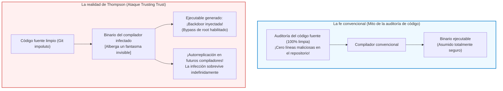

## Introducción: El dogma de la auditoría y la crisis epistemológica del software

En la ingeniería de software y la ciberseguridad modernas existe un dogma ampliamente aceptado:
<strong>«Si el código fuente es público y auditado rigurosamente por la comunidad, el ejecutable resultante es intrínsecamente seguro y digno de confianza.»</strong>

La ley de Linus («con suficientes ojos, todos los errores son superficiales») es el pilar ético del código abierto. Sin embargo, en 1984, <strong>Ken Thompson</strong>, cocreador de UNIX y del lenguaje C, demolió este axioma en su conferencia de aceptación del Premio Turing:
*<strong>Reflections on Trusting Trust</strong>*.



Thompson sentenció una verdad inquietante:

> <strong>«La moraleja es obvia: no puedes confiar en código que no hayas creado totalmente tú mismo. Ningún nivel de verificación a nivel de código fuente puede protegernos del uso de código no confiable.»</strong>

Thompson demostró que había insertado un troyano autorreplicante directamente en el binario del compilador de C de UNIX. Aunque el código fuente se restaurase a un estado 100% limpio, el binario infectado detectaba la compilación de `login.c` para inyectar una puerta trasera de superusuario, y la de `cc.c` para clonar el troyano en el nuevo binario.

---

## 1. La mecánica del ataque de Thompson

### 1.1 Etapa 1: Programas autorreproductores (Quines)
Un <strong>Quine</strong> es un programa que imprime su propio código fuente sin recibir entradas. Basándose en el teorema de recursión de Kleene, desacopla la lógica de ejecución del plano de datos para reproducirse fielmente:

```c
/* Quine canónico en C */
char *s = "char *s = %c%s%c; main() { printf(s, 34, s, 34); }";
main() { printf(s, 34, s, 34); }
```

### 1.2 Etapa 2: Internalización del conocimiento en el compilador
Al enseñar al compilador el carácter `'\n'` (ASCII 10), primero se programó `return 10;`. Luego se abstrajo a `return '\n';`. En ese momento, <strong>el número 10 desapareció del código fuente</strong>, pero el conocimiento quedó fijado en el binario para siempre.

### 1.3 Etapa 3: El doble troyano indetectable
Thompson integró la inyección en `login.c` y la autorreplicación en `cc.c`. Luego eliminó todo el código malicioso del código fuente. El repositorio quedó impecable, pero el binario infectado propagaba el ataque generación tras generación.

---

## 2. El problema del bootstrapping y la cadena de confianza

Los compiladores modernos (GCC, LLVM, rustc) son <strong>autohospedados (Self-hosting)</strong>. Para compilar la versión actual se necesita el binario de la versión anterior. Rastreando hacia atrás se llega a las tarjetas perforadas de los años 50. Si una alteración se infiltró en algún eslabón de esa cadena binaria histórica, puede persistir invisible hoy en día.

---

## 3. La respuesta matemática: Compilación Doble Diversa (DDC)

En 2005, David A. Wheeler resolvió el dilema en su tesis doctoral mediante la <strong>Compilación Doble Diversa (Diverse Double-Compiling, DDC)</strong>.

```mermaid
flowchart TD
    subgraph DDCProtocol ["Protocolo de Compilación Doble Diversa (DDC)"]
        SourceA["Código fuente verificado $s_A$"]
        CompA["Compilador sospechoso $c_A$"]
        CompB["Compilador diverso e independiente $c_B$"]

        SourceA --> |Paso 1: compilar con $c_A$| BinA1["Binario $c_{A1}$"]
        SourceA --> |Paso 2: compilar con $c_B$| BinB1["Binario $c_{B1}$"]
        SourceA --> |Paso 3: recompilar con $c_{B1}$| BinA2["Binario $c_{A2}$"]

        BinA1 --> DiffCheck["Comparación binaria bit a bit (cmp)"]
        BinA2 --> DiffCheck

        DiffCheck --> Result{"¿Coincidencia exacta?"}
        Result -- "Bit-for-Bit idéntico" --> Verified["[DEMOSTRADO] ¡$c_A$ no tiene troyanos ocultos!"]
        Result -- "Diferencia hallada" --> Alert["[ALERTA] ¡Inyección maliciosa detectada!"]
    end

    style DDCProtocol fill:#f8f9fa,stroke:#343a40,stroke-width:2px
    style Verified fill:#d4edda,stroke:#28a745,stroke-width:2px
    style Alert fill:#f8d7da,stroke:#dc3545,stroke-width:2px
```

Al utilizar un compilador independiente $c_B$ no cómplice del atacante, se genera un compilador $c_{B1}$ limpio. Al volver a compilar $s_A$, si $c_{A1}$ y $c_{A2}$ son idénticos bit a bit, se demuestra matemáticamente que $c_A$ no contenía ninguna puerta trasera oculta respecto a $s_A$.

---

## 4. Compilaciones reproducibles y semilla mínima de 512 bytes

La iniciativa <strong>Reproducible Builds</strong> erradica el no determinismo (marcas de tiempo `SOURCE_DATE_EPOCH`, rutas locales con `-ffile-prefix-map`, ordenación alfabética).
Llevando esto al extremo, el proyecto <strong>Bootstrappable Builds</strong> y GNU Guix demostraron que es posible construir un sistema operativo completo partiendo de una <strong>semilla hexadecimal de tan solo 512 bytes</strong>, auditable a simple vista por un ser humano.

---

## 5. Conclusión: Epistemología y reconstrucción de la confianza

La lección de Thompson no invita al cinismo tecnológico, sino a reemplazar la fe ciega por protocolos matemáticos y criptográficos rigurosos. La seguridad no se asume: se verifica sistemáticamente en cada eslabón de la computación moderna.
