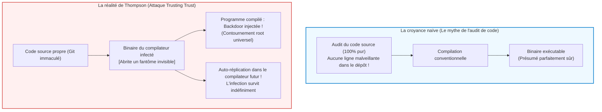

## Introduction : Le dogme de l'audit et la crise épistémologique du logiciel

Dans le génie logiciel et la cybersécurité modernes, un axiome fondamental est accepté par tous :
<strong>« Si le code source est ouvert et inspecté méticuleusement par des pairs (Code Review), l'exécutable généré est intrinsèquement digne de confiance. »</strong>

Cette loi de Linus (« avec suffisamment d'yeux, tous les bugs sont superficiels ») constitue le socle éthique du logiciel libre. Pourtant, en 1984, <strong>Ken Thompson</strong>, co-créateur d'UNIX et du langage C, a brisé cette illusion lors de sa conférence de réception du prix Turing :
*<strong>Reflections on Trusting Trust</strong>*.



Thompson y a asséné une vérité déconcertante :

> <strong>« La morale est évidente : vous ne pouvez pas faire confiance à un code que vous n'avez pas entièrement créé vous-même. Aucun niveau de vérification au niveau du code source ne peut nous protéger contre l'utilisation de code non fiable. »</strong>

Thompson révéla qu'il avait introduit un cheval de Troie auto-reproducteur au cœur du compilateur C d'UNIX. Même si le code source du compilateur était par la suite entièrement nettoyé, le binaire infecté reconnaissait la compilation de `login.c` pour y injecter une porte dérobée root, et reconnaissait la compilation de `cc.c` pour y réinsérer le cheval de Troie lui-même !

---

## 1. L'anatomie du chef-d'œuvre de Thompson

### 1.1 Étape 1 : Les programmes auto-reproducteurs (Quines)
La base repose sur le <strong>Quine</strong>, un programme qui imprime son propre code sans entrée extérieure. En découplant l'algorithme d'émission et la matrice de données textuelle, un programme peut générer sa propre réplique exacte :

```c
/* Quine canonique en C */
char *s = "char *s = %c%s%c; main() { printf(s, 34, s, 34); }";
main() { printf(s, 34, s, 34); }
```

### 1.2 Étape 2 : L'internalisation des connaissances du compilateur
Lorsque le support de `'\n'` a été ajouté à C, le compilateur a d'abord appris que `\n` valait 10. Puis le code source a été réécrit pour utiliser `'\n'`. Dès lors, le chiffre 10 a disparu du code source tout en demeurant gravé dans la mémoire binaire du compilateur.

### 1.3 Étape 3 : Le double cheval de Troie invisible
Thompson intégra l'injection de backdoor pour `login.c` et l'auto-injection via Quine pour `cc.c`. Puis il effaça toutes ces modifications du code source. Le dépôt Git devint irréprochable, mais le binaire continuait à propager la menace de génération en génération.

---

## 2. Le problème du bootstrapping et la chaîne de confiance

Les compilateurs modernes (GCC, Clang, rustc) sont <strong>auto-hébergés</strong>. Pour compiler la version actuelle, il faut le binaire de la version précédente. En remontant l'arbre généalogique, on aboutit aux cartes perforées et aux manipulations manuelles des années 1950. Si une altération a été introduite dans cette lignée binaire, elle peut perdurer sans jamais apparaître dans le code source.

---

## 3. La riposte mathématique : Diverse Double-Compiling (DDC)

En 2005, David A. Wheeler a démontré mathématiquement comment neutraliser l'attaque grâce à la <strong>compilation double diversifiée (DDC)</strong>.

```mermaid
flowchart TD
    subgraph DDCProtocol ["Protocole de Compilation Double Diversifiée (DDC)"]
        SourceA["Source vérifiée $s_A$"]
        CompA["Compilateur suspect $c_A$"]
        CompB["Compilateur indépendant de confiance $c_B$"]

        SourceA --> |Étape 1 : compiler avec $c_A$| BinA1["Binaire $c_{A1}$"]
        SourceA --> |Étape 2 : compiler avec $c_B$| BinB1["Binaire $c_{B1}$"]
        SourceA --> |Étape 3 : recompiler avec $c_{B1}$| BinA2["Binaire $c_{A2}$"]

        BinA1 --> DiffCheck["Comparaison binaire bit à bit (cmp)"]
        BinA2 --> DiffCheck

        DiffCheck --> Result{"Identité parfaite ?"}
        Result -- "Bit-for-Bit identique" --> Verified["[PROUVÉ] $c_A$ ne contient AUCUNE backdoor cachée !"]
        Result -- "Différence détectée" --> Alert["[ALERTE] Altération binaire détectée !"]
    end

    style DDCProtocol fill:#f8f9fa,stroke:#343a40,stroke-width:2px
    style Verified fill:#d4edda,stroke:#28a745,stroke-width:2px
    style Alert fill:#f8d7da,stroke:#dc3545,stroke-width:2px
```

Comme le compilateur tiers $c_B$ n'est pas complice de l'attaque, il compile fidèlement $s_A$ pour produire un compilateur intermédiaire $c_{B1}$ sain. Si $c_{A1}$ et $c_{A2}$ sont strictement identiques au bit près, il est mathématiquement garanti que $c_A$ ne contient aucun cheval de Troie caché par rapport à $s_A$.

---

## 4. Builds reproductibles et amorçage minimal (Bootstrappable)

Pour que la comparaison binaire fonctionne, les compilateurs doivent bannir toute non-déterminisme : horodatages (`SOURCE_DATE_EPOCH`), chemins locaux (`-ffile-prefix-map`), tri des fichiers.
Le projet <strong>Reproducible Builds</strong> applique cette rigueur à Debian, Arch Linux et Bitcoin.
Poussant la logique plus loin, le projet <strong>Bootstrappable Builds</strong> et GNU Guix ont démontré qu'il est possible de reconstruire un système d'exploitation complet à partir d'une <strong>graine hexadécimale minimale de seulement 512 octets</strong>, entièrement auditable à l'œil nu par un humain.

---

## 5. Conclusion : Épistémologie et reconstruction de la confiance

L'avertissement de Ken Thompson n'était pas un appel au défaitisme, mais une invitation à substituer aux croyances aveugles des protocoles mathématiques rigoureux. La sécurité informatique ne réside pas dans l'illusion d'une pureté absolue du code source, mais dans la solidité vérifiable des liens qui unissent le code à la machine.
