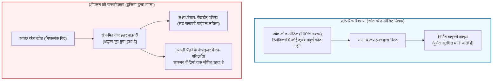

## प्रस्तावना: स्रोत कोड ऑडिट का मिथक और ज्ञानमीमांसा का संकट

आधुनिक सॉफ्टवेयर इंजीनियरिंग और साइबर सुरक्षा में एक सर्वमान्य सिद्धांत का पालन किया जाता है:
<strong>"यदि स्रोत कोड सार्वजनिक है और दुनिया भर के डेवलपर्स द्वारा उसकी गहन समीक्षा (Code Review) की गई है, तो उससे निर्मित सॉफ्टवेयर स्वाभाविक रूप से सुरक्षित और विश्वसनीय है।"</strong>

लिनस का नियम ("पर्याप्त आँखों के होने पर सभी बग उथले हो जाते हैं") ओपन-सोर्स आंदोलन का नैतिक आधार रहा है। हम गिट कमिट्स की जांच करते हैं और मानते हैं कि स्वच्छ स्रोत कोड अनिवार्य रूप से एक सुरक्षित बाइनरी निष्पादन योग्य (Executable) फाइल बनाएगा।

लेकिन चार दशक पहले, यूनिक्स के जनक और सी भाषा के सह-निर्माता <strong>केन थॉम्पसन (Ken Thompson)</strong> ने अपने 1984 के एसीएम ट्यूरिंग पुरस्कार व्याख्यान में इस विश्वास को झकझोर कर रख दिया:
*<strong>Reflections on Trusting Trust</strong>*।



थॉम्पसन ने एक चौंकाने वाला निष्कर्ष दिया:

> <strong>"सीख बिल्कुल स्पष्ट है: आप उस कोड पर कभी भरोसा नहीं कर सकते जिसे आपने पूरी तरह से खुद नहीं बनाया है। उच्च-स्तरीय स्रोत कोड का कोई भी सत्यापन हमें अविश्वसनीय कोड के खतरों से नहीं बचा सकता।"</strong>

थॉम्पसन ने दिखाया कि उन्होंने यूनिक्स सी कंपाइलर बाइनरी में एक स्व-प्रतिकृति ट्रोजन हॉर्स स्थापित किया था। भले ही बाद में कंपाइलर के स्रोत कोड को पूरी तरह से साफ कर दिया गया, लेकिन संक्रमित बाइनरी `login.c` को कंपाइल करते समय गुप्त रूट बैकडोर डाल देती थी, और `cc.c` को कंपाइल करते समय ट्रोजन को नए कंपाइलर बाइनरी में खुद कॉपी कर लेती थी!

---

## 1. 1984 के हमले का विश्लेषण: क्विन और अदृश्य बैकडोर

### 1.1 चरण 1: स्व-पुनरुत्पादक प्रोग्राम (Quine)
इस हमले का आधार <strong>क्विन (Quine)</strong> है—एक ऐसा प्रोग्राम जो बिना किसी इनपुट के अपने ही स्रोत कोड की सटीक प्रति आउटपुट करता है। क्लीनी के रिकर्सन प्रमेय के अनुसार, प्रोग्राम अपने एल्गोरिदम और डेटा ब्लूप्रिंट को अलग करके अपनी प्रतिकृति बना सकता है:

```c
/* सी भाषा में एक क्लासिक क्विन */
char *s = "char *s = %c%s%c; main() { printf(s, 34, s, 34); }";
main() { printf(s, 34, s, 34); }
```

### 1.2 चरण 2: कंपाइलर ज्ञान को कैसे आत्मसात करता है
जब कंपाइलर को पहली बार `'\n'` (ASCII 10) सिखाया गया, तो पहले `return 10;` लिखा गया। नया कंपाइलर बनने के बाद स्रोत कोड को `return '\n';` में बदल दिया गया। इस क्षण <strong>संख्या 10 स्रोत कोड से पूरी तरह गायब हो गई</strong>, लेकिन यह ज्ञान कंपाइलर बाइनरी में हमेशा के लिए दर्ज हो गया।

### 1.3 चरण 3: दोहरा ट्रोजन और साक्ष्य मिटाना
थॉम्पसन ने `login.c` और `cc.c` की पहचान करने वाला तर्क जोड़ा। फिर उन्होंने स्रोत कोड से सभी दुर्भावनापूर्ण पंक्तियाँ हटा दीं। गिट रिपॉजिटरी पूरी तरह से स्वच्छ हो गई, लेकिन बाइनरी पीढ़ियों तक ट्रोजन का प्रसार करती रही।

---

## 2. कंपाइलर बूटस्ट्रैपिंग और भरोसे की श्रृंखला

आधुनिक कंपाइलर (GCC, Clang, rustc) <strong>सेल्फ-होस्टिंग</strong> होते हैं। वर्तमान संस्करण को कंपाइल करने के लिए पिछले बाइनरी की आवश्यकता होती है। इतिहास में पीछे जाने पर हम 1950 के दशक के पंच कार्डों तक पहुँचते हैं। यदि इस ऐतिहासिक बाइनरी श्रृंखला में कहीं भी दुर्भावनापूर्ण कोड रहा हो, तो वह आज तक बिना स्रोत कोड में दिखे जीवित रह सकता है।

---

## 3. गणितीय समाधान: डाइवर्स डबल-कंपाइलिंग (DDC)

2005 में डेविड ए. व्हीलर ने अपने डॉक्टरेट शोध प्रबंध में <strong>डाइवर्स डबल-कंपाइलिंग (DDC)</strong> के माध्यम से थॉम्पसन हमले को गणितीय रूप से विफल करने की विधि सिद्ध की।

```mermaid
flowchart TD
    subgraph DDCProtocol ["डाइवर्स डबल-कंपाइलिंग (DDC) प्रोटोकॉल"]
        SourceA["सत्यापित स्रोत कोड $s_A$"]
        CompA["संदिग्ध कंपाइलर $c_A$"]
        CompB["स्वतंत्र विश्वसनीय कंपाइलर $c_B$"]

        SourceA --> |चरण 1: $c_A$ से बिल्ड| BinA1["बाइनरी $c_{A1}$"]
        SourceA --> |चरण 2: $c_B$ से बिल्ड| BinB1["बाइनरी $c_{B1}$"]
        SourceA --> |चरण 3: $c_{B1}$ से पुनः बिल्ड| BinA2["बाइनरी $c_{A2}$"]

        BinA1 --> DiffCheck["बिट-दर-बिट तुलना (cmp)"]
        BinA2 --> DiffCheck

        DiffCheck --> Result{"क्या दोनों समान हैं?"}
        Result -- "Bit-for-Bit समान" --> Verified["[प्रमाणित] $c_A$ में कोई बैकडोर नहीं है!"]
        Result -- "अंतर मिला" --> Alert["[चेतावनी] गुप्त बैकडोर पाया गया!"]
    end

    style DDCProtocol fill:#f8f9fa,stroke:#343a40,stroke-width:2px
    style Verified fill:#d4edda,stroke:#28a745,stroke-width:2px
    style Alert fill:#f8d7da,stroke:#dc3545,stroke-width:2px
```

चूँकि स्वतंत्र कंपाइलर $c_B$ हमलावर का साथी नहीं है, वह एक स्वच्छ बाइनरी $c_{B1}$ बनाता है। यदि $c_{A1}$ और $c_{A2}$ बिट-दर-बिट समान हैं, तो यह गणितीय रूप से सिद्ध होता है कि $c_A$ में कोई गुप्त कोड नहीं था।

---

## 4. रिप्रोड्यूसिबल बिल्ड्स और 512-बाइट बीज

<strong>रिप्रोड्यूसिबल बिल्ड्स</strong> गैर-नियतात्मक तत्वों (टाइमस्टैम्प `SOURCE_DATE_EPOCH`, पाथ सामान्यीकरण `-ffile-prefix-map`) को समाप्त करता है।
जीएनयू गिक्स (GNU Guix) ने सिद्ध किया कि केवल <strong>512-बाइट हेक्साडेसिमल बीज</strong> से पूरे ऑपरेटिंग सिस्टम को स्रोत कोड से बनाया जा सकता है, जिसे कोई भी इंसान कागज पर आंखों से जांच सकता है।

---

## 5. निष्कर्ष: भरोसे का पुनर्निर्माण

केन थॉम्पसन की चेतावनी तकनीकी निराशावाद नहीं बल्कि यह अहसास है कि सुरक्षा केवल स्रोत कोड की अंधभक्ति में नहीं, बल्कि गणितीय सत्यापन प्रोटोकॉल में निहित है।
