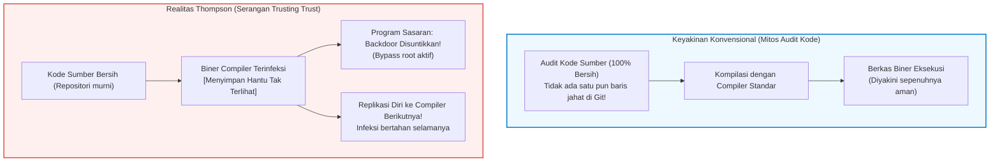

## Pendahuluan: Mitos Audit Kode Sumber dan Krisis Epistemologi

Dalam rekayasa perangkat lunak modern dan keamanan siber, ada sebuah doktrin yang diyakini secara luas:
<strong>"Jika kode sumber terbuka dan ditinjau secara ketat oleh komunitas pengembang global (Code Review), maka program biner yang dihasilkan pasti aman dan dapat dipercaya."</strong>

Hukum Linus ("dengan mata yang cukup banyak, semua bug menjadi dangkal") menjadi landasan moral ekosistem open-source. Pengembang memeriksa komit Git, menjalankan analisis statis, dan percaya bahwa kode sumber yang bersih akan selalu menghasilkan berkas biner yang aman.

Namun empat puluh tahun lalu, <strong>Ken Thompson</strong>, salah satu pencipta UNIX dan bahasa C, menghancurkan keyakinan tersebut dalam pidato penerimaan ACM Turing Award tahun 1984 yang bersejarah:
*<strong>Reflections on Trusting Trust</strong>*.



Thompson menegaskan sebuah fakta yang mencengangkan:

> <strong>"Pesan moralnya sangat jelas: Anda tidak dapat mempercayai kode yang tidak Anda buat sepenuhnya sendiri. Tidak ada tingkat verifikasi kode sumber tingkat tinggi yang dapat melindungi kita dari penggunaan kode yang tidak tepercaya."</strong>

Thompson membuktikan bahwa ia telah menanamkan Trojan horse yang mampu mereplikasi dirinya sendiri langsung ke dalam biner compiler C UNIX. Meskipun seluruh kode sumber compiler kemudian dibersihkan hingga 100% murni, biner compiler yang terinfeksi secara otomatis mendeteksi saat mengompilasi perintah `login` untuk menyuntikkan backdoor root, dan saat mengompilasi compiler itu sendiri untuk menyuntikkan seluruh logika Trojan ke biner generasi berikutnya!

---

## 1. Anatomi Serangan: Kuliah Turing Award 1984

### 1.1 Tahap 1: Program Swareplikasi (Quine)
Pondasi serangan ini adalah <strong>Quine</strong>, program yang menghasilkan salinan persis kode sumbernya sendiri tanpa menerima input. Dengan memisahkan logika cetak dan cetak biru data, program mampu merekonstruksi dirinya sendiri:

```c
/* Quine klasik dalam bahasa C */
char *s = "char *s = %c%s%c; main() { printf(s, 34, s, 34); }";
main() { printf(s, 34, s, 34); }
```

### 1.2 Tahap 2: Bagaimana Compiler Menginternalisasi Pengetahuan
Ketika compiler C pertama kali diajarkan karakter `'\n'` (ASCII 10), awalnya ditulis `return 10;`. Setelah biner baru terbentuk, kode diabstraksikan menjadi `return '\n';`. Pada titik ini, angka 10 lenyap dari kode sumber, tetapi pengetahuan tersebut menetap selamanya di dalam biner compiler.

### 1.3 Tahap 3: Trojan Ganda yang Tak Terlihat
Thompson memprogram injeksi backdoor untuk `login.c` dan injeksi mandiri via Quine untuk `cc.c`. Kemudian, ia menghapus semua kode berbahaya dari repositori. Sumbernya bersih sempurna, tetapi biner yang terinfeksi melestarikan Trojan dari generasi ke generasi.

---

## 2. Masalah Bootstrapping dan Rantai Kepercayaan

Compiler modern (GCC, Clang, rustc) bersifat <strong>self-hosting</strong>. Untuk membangun versi saat ini, diperlukan biner versi sebelumnya. Jika ditelusuri ke belakang, silsilah ini berakar pada kartu berlubang tahun 1950-an. Jika ada manipulasi jahat di masa lalu, ancaman itu dapat bertahan tanpa pernah muncul dalam kode sumber.

---

## 3. Solusi Matematis: Diverse Double-Compiling (DDC)

Pada tahun 2005, David A. Wheeler membuktikan secara matematis cara mendeteksi dan menggagalkan serangan Thompson melalui <strong>Diverse Double-Compiling (DDC)</strong>.

```mermaid
flowchart TD
    subgraph DDCProtocol ["Protokol Diverse Double-Compiling (DDC)"]
        SourceA["Kode Sumber Diaudit $s_A$"]
        CompA["Biner Compiler Dicurigai $c_A$"]
        CompB["Compiler Mandiri Tepercaya $c_B$"]

        SourceA --> |Langkah 1: kompilasi dengan $c_A$| BinA1["Biner $c_{A1}$"]
        SourceA --> |Langkah 2: kompilasi dengan $c_B$| BinB1["Biner $c_{B1}$"]
        SourceA --> |Langkah 3: kompilasi ulang dengan $c_{B1}$| BinA2["Biner $c_{A2}$"]

        BinA1 --> DiffCheck["Perbandingan biner bit-demi-bit (cmp)"]
        BinA2 --> DiffCheck

        DiffCheck --> Result{"Cocok identik?"}
        Result -- "Bit-for-Bit Identik" --> Verified["[TERBUKTI] $c_A$ BEBAS dari backdoor rahasia!"]
        Result -- "Perbedaan Ditemukan" --> Alert["[PERINGATAN] Manipulasi berbahaya terdeteksi!"]
    end

    style DDCProtocol fill:#f8f9fa,stroke:#343a40,stroke-width:2px
    style Verified fill:#d4edda,stroke:#28a745,stroke-width:2px
    style Alert fill:#f8d7da,stroke:#dc3545,stroke-width:2px
```

Karena compiler independen $c_B$ tidak bersekongkol dengan penyerang, ia menghasilkan biner bersih $c_{B1}$. Jika biner $c_{A1}$ dan $c_{A2}$ cocok bit demi bit, terbukti secara matematis bahwa $c_A$ tidak menyuntikkan instruksi tersembunyi.

---

## 4. Reproducible Builds dan Benih 512 Byte

Gerakan <strong>Reproducible Builds</strong> menghapus artefak non-deterministik (`SOURCE_DATE_EPOCH`, normalisasi jalur dengan `-ffile-prefix-map`, pengurutan direktori).
Mengembangkan konsep ini lebih jauh, proyek <strong>Bootstrappable Builds</strong> dan GNU Guix berhasil membangun seluruh sistem operasi Linux bermula dari <strong>benih heksadesimal hanya sebesar 512 byte</strong>, yang dapat diaudit secara manual oleh mata manusia di atas kertas.

---

## 5. Kesimpulan: Epistemologi dan Pemulihan Kepercayaan

Peringatan Ken Thompson mengingatkan kita bahwa keamanan sejati tidak bertumpu pada keyakinan buta terhadap kode sumber, melainkan pada protokol verifikasi matematis yang dapat diuji secara independen di setiap mata rantai komputasi.
