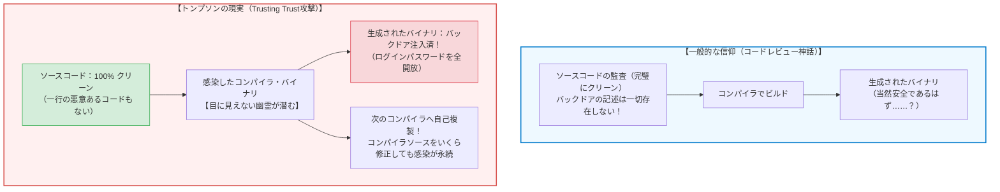
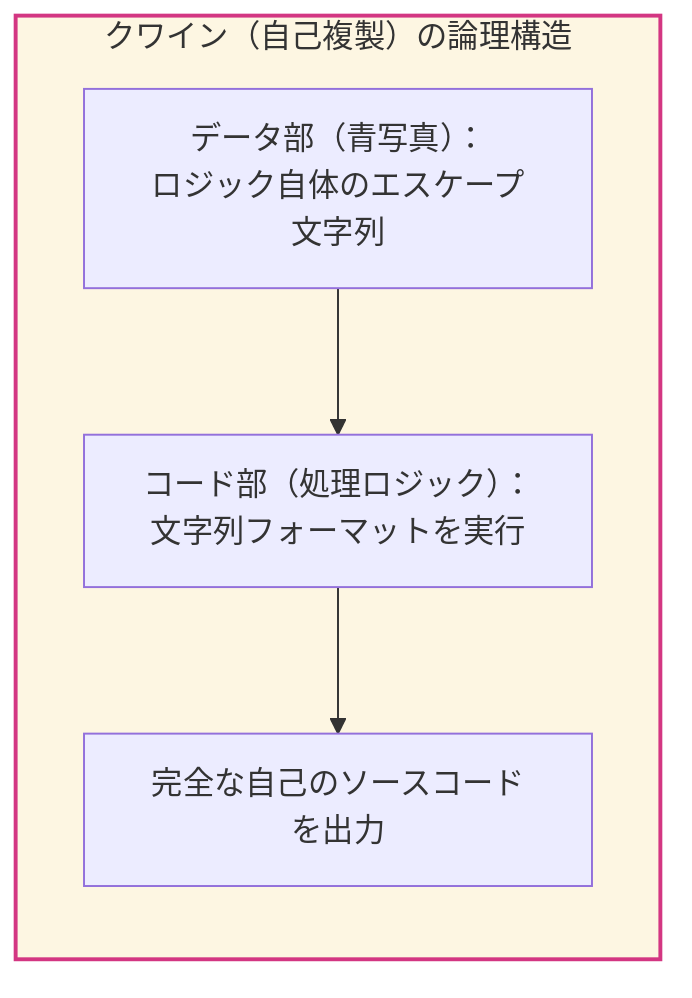
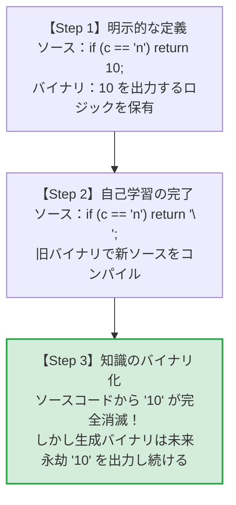
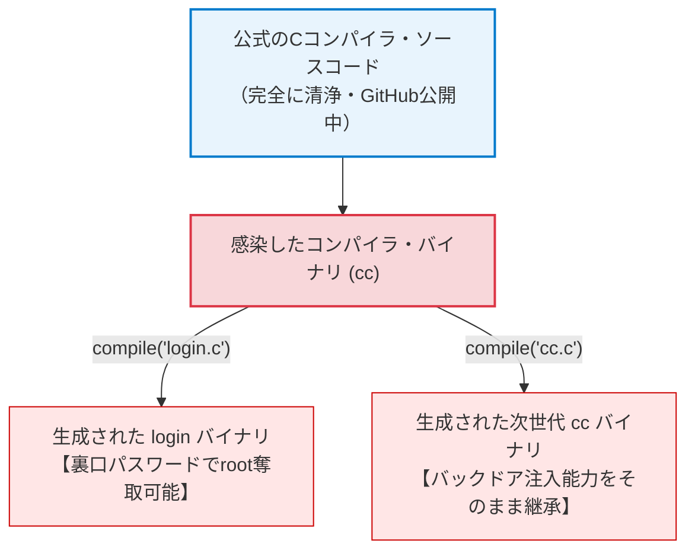
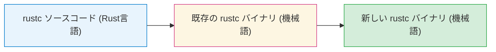
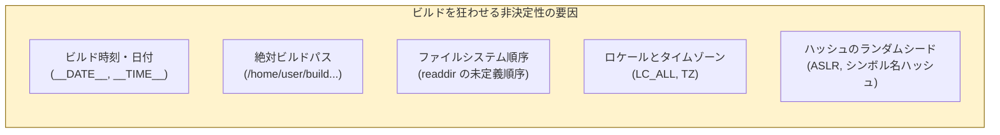
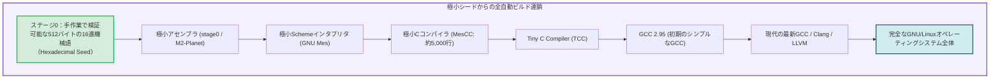
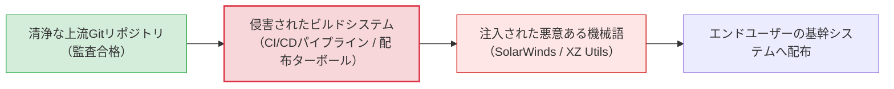

## 序論：オープンソースの神話と「認識論的危機」

現代のソフトウェア工学およびサイバーセキュリティの世界には、広く信じられている一つの教義（ドグマ）があります：
<strong>「ソースコードが公開され、世界中の技術者によって監査（コードレビュー）されていれば、そのソフトウェアは本質的に安全である。」</strong>

リーナス・トーバルズの言葉として知られる「十分な目玉があれば、すべてのバグは浅くなる（エリック・レイモンド『大聖堂とバザール』）」という格言は、オープンソース運動を支える最大の精神的支柱でした。GitHub上のリポジトリに悪意あるコードが存在しないことを一行一行確認し、コミットログを精査し、自動静的解析ツールを通せば、安全なバイナリが得られる――そう信じられてきました。

しかし、コンピューティングの歴史を根底から揺るがしたある男が、半世紀近く前にその信仰を粉砕しました。
UNIXの父であり、C言語の共同開発者である<strong>ケン・トンプソン（Ken Thompson）</strong>です。



1984年、ACMチューリング賞を受賞したトンプソンは、記念講演『信頼の信頼についての思索（Reflections on Trusting Trust）』において、戦慄すべき事実を公表しました：

> <strong>「あなたが完全に自ら作成していないコードを、決して信用することはできない。」</strong>
> *（"You can't trust code that you did not totally create yourself."）*

トンプソンは、ソースコード上には一切のバックドアが存在しないにもかかわらず、そのソースをコンパイルした瞬間にバイナリへ裏口が注入され、さらに<strong>コンパイラ自身が再コンパイルされるたびに自分自身のバックドアを永久に複製し続ける</strong>という、完全不可視のトロイの木馬を実際に作成し、ベル研究所のUNIXシステムに忍び込ませていたのです。

なぜこのような攻撃が原理的に可能なのか？
なぜソースコードの監査だけでは防げないのか？
そして現代のコンピュータ科学は、この「信頼の連鎖（Chain of Trust）」の断絶にどのように立ち向かっているのか？

本稿では、自己複製プログラム（クワイン）の数学的基礎から、コンパイラのブートストラップ問題、多様な二重コンパイル（Diverse Double-Compiling）、再現可能ビルド（Reproducible Builds）、そしてGNU Guixやlive-bootstrapが挑む「極小シードからの信頼回復」まで、計算機科学の最も深淵な認識論的課題を徹底的に解き明かします。

---

## 1. 1984年の衝撃：『Reflections on Trusting Trust』の解剖

### 1.1 第1段階：自己複製プログラム（Quine）の魔術
トンプソンの思考実験を理解するための第一歩は、<strong>自らのソースコードと完全に一致する文字列を出力するプログラム（Quine: クワイン）</strong>の構造を理解することです。

一見すると、自分自身を出力するためには自分自身をデータとして内部に持つ必要があり、そのデータの中にも自分自身を含める必要があるため、無限後退（無限ループ）に陥るように思えます。しかし、形式言語理論および数理論理学（クリーネの再帰定理）が示すように、プログラムは「アルゴリズム部」と「データ部」を分離することで、自己を有限のサイズで複製可能です。

C言語における自己複製プログラムの古典的な構造を見てみましょう：

```c
/* 典型的なクワイン（Quine）の概念コード */
char *s = "char *s = %c%s%c; main() { printf(s, 34, s, 34); }";
main() { printf(s, 34, s, 34); }
```

ここで `34` はダブルクォーテーション文字 `"` のASCIIコードです。
文字列 `s` はプログラムのテンプレートであり、`printf` 関数が `s` 自身をデータとして埋め込みながら展開することで、自身のソースコードを1文字の狂いもなく正確に出力します。
この<strong>「自分自身の青写真を自らの内部に保持し、出力の中に再構築する」</strong>という論理的機構が、コンパイラ・バックドアの永続性の核心となります。



### 1.2 第2段階：コンパイラが「知識」を学ぶプロセス（エスケープシーケンス `\n`）
次にトンプソンは、Cコンパイラがどのようにして新しい言語機能を「学習」するかを示しました。
初期のC言語には、改行を表す文字リテラル `'\n'` の意味をコンパイラ自身が知りませんでした。改行コードはASCIIコードで数値 `10` です。

最初の開発者は、コンパイラの字句解析器（Lexer）に次のようなコードを追加しました：

```c
/* ステップ1：文字 'n' がバックスラッシュに続いた場合、ASCIIコード 10 を返す */
if (c == 'n')
    return 10;
```

この変更を加えたコンパイラソースを、古いコンパイラでコンパイルします。生成された新しいコンパイラ・バイナリは、ソースコード中に `\n` が現れると数値 `10` を生成する能力を獲得しました。

さて、ここからが決定的な転換点です。
新しいコンパイラが完成した後は、コンパイラ自身のソースコードを以下のように書き換えることができます：

```c
/* ステップ2：コンパイラ自身が '\n' を理解できるようになったため、ソースコードを抽象化 */
if (c == 'n')
    return '\n';
```

この新しいソースコードを、直前に作った「`\n` を解釈できるコンパイラ・バイナリ」でコンパイルします。
すると、驚くべきことが起きます。
<strong>ソースコード上からは、改行コードの物理的な実体である「数値 10」という記述が完全に消滅しました。</strong>
しかし、コンパイルされたバイナリは依然として `\n` を数値 `10` としてコンパイルし続けます。なぜなら、親コンパイラ（旧バイナリ）が「`\n` とは 10 のことだ」という<strong>記憶（Knowledge）</strong>を子コンパイラへと継承させたからです。

ソースコードをいくら読んでも、どこにも `10` という文字は書かれていません。知識はソースコードではなく、<strong>バイナリの中にのみ宿っている</strong>のです。



### 1.3 第3段階：二重のトロイの木馬（The Invisible Backdoor）
トンプソンはこの「バイナリによる知識の継承」と「クワインの自己複製」を組み合わせ、究極のトロイの木馬を構築しました。

悪意あるハッカーが、UNIXのCコンパイラ（`cc`）のソースコードに、次のような細工をしたと仮定します：

```c
/* トンプソンのバックドア注入ロジックの概念構造 */
compile(char *source_code) {
    if (match(source_code, "login.c のパターン")) {
        /* パターン1：UNIXのログインコマンドを検知した場合 */
        inject_login_backdoor(); // 特定のマスターパスワードで誰でもroot昇格
    }
    
    if (match(source_code, "cc.c のパターン")) {
        /* パターン2：コンパイラ自身のソースコードを検知した場合 */
        inject_compiler_trojan(); // このトロイの木馬コード自身をバイナリに注入！
    }

    /* 通常のコンパイル処理を続行 */
    normal_compile(source_code);
}
```

この細工には、2つの独立した悪意ある機能が含まれています：
1. <strong>ログイン・バックドア（ペイロード）：</strong> `login` コマンドのソースがコンパイルされる時、不正な認証バイパスコード（暗証番号チェックを無視してrootシェルを起動する機械語）を密かに差し込む。
2. <strong>自己複製バックドア（トランスミッター）：</strong> コンパイラ自身のソースがコンパイルされる時、この「悪意ある判定と注入ロジック」そのものを新しいコンパイラ・バイナリに密かに差し込む。



### 1.4 完全犯罪の成立：ソースコードからの痕跡抹消
ここからがトンプソンの真骨頂です。
この細工を入れたコンパイラソースを一度コンパイルし、<strong>感染したコンパイラ・バイナリ（`cc_trojan`）</strong>を作成します。

そして次の瞬間、トンプソンは<strong>コンパイラのソースコードから上記の悪意あるコードを綺麗さっぱり一行残らず削除</strong>しました！

これで準備は完了です。
リポジトリにあるCコンパイラのソースコードは、100%潔白でクリーンな状態に戻りました。
世界中の名だたるセキュリティ専門家がソースコードを1行ずつレビューしても、疑わしいコードはどこにも見当たりません。

しかし、そのクリーンなソースコードを、システムにインストールされている感染済みバイナリ `cc_trojan` でコンパイルします。
`cc_trojan` はソースコードを読み込みながら、こう判定します：
「おや、これはCコンパイラのソースだな。よし、ソースには書かれていないが、私のバイナリメモリに保持されている『トロイの木馬注入ロジック』を、完成するバイナリにこっそり埋め込んでやろう。」

結果として生成された新しいコンパイラ・バイナリもまた、完全に感染しています。
その後、新しいバイナリを使って `login.c` をコンパイルすれば、やはりバックドア付きの `login` コマンドが生成されます。

<strong>ソースコードは潔白であり、コンパイラをゼロから再コンパイルしたにもかかわらず、バックドアは世代を超えて永遠に生き残り続けるのです。</strong>

---

## 2. コンパイラ・ブートストラップ問題の力学

なぜこのような攻撃が成立してしまうのか。その根本的な原因は、コンピュータソフトウェアの進化が本質的に抱える<strong>「鶏と卵（ブートストラップ）問題」</strong>にあります。

### 2.1 コンパイラは誰がコンパイルしたのか？
現代のGCC（GNU Compiler Collection）やClang/LLVM、Rustコンパイラ（rustc）は、いずれも自身が処理する高級言語（C++やRust）で書かれています。
これを<strong>セルフホスティング・コンパイラ（Self-hosting Compiler）</strong>と呼びます。



ここで素朴な疑問が生じます：
<strong>「最初のRustコンパイラをコンパイルしたRustコンパイラは、一体誰がコンパイルしたのか？」</strong>

歴史を遡れば、それは一つ前のバージョンのコンパイラであり、さらに遡ればC言語で書かれた初期実装であり、C言語のコンパイラはB言語で、B言語はアセンブラで、アセンブラはハンドアセンブルされた機械語（パンチカードやトグルスイッチで直接メモリに入力された16進数のバイナリ）へと行き着きます。

この「歴史的なバイナリの連鎖」のどこか一箇所にでも悪意ある幽霊（バックドア）が宿っていた場合、その幽霊は数十年後の最新コンパイラに至るまで、一度もソースコードに姿を現すことなく、バイナリからバイナリへと転生し続けることができるのです。

### 2.2 Tダイアグラム（Tombstone Diagrams）による形式化
コンパイラの依存関係を数学的・形式的に分析するために、コンピュータ科学では<strong>Tダイアグラム（T-diagram）</strong>が用いられます。

$$[S \xrightarrow{I} T]$$

これは、ソース言語 $S$ で書かれたプログラムを、ホスト環境（実行環境）$I$ 上で動作し、ターゲット言語 $T$ へと変換するコンパイラを意味します。

セルフホスティングコンパイラ $C$（言語 $L$ で書かれ、機械語 $M$ を出力する）を、既存のバイナリコンパイラでビルドする過程は次のように表されます：

$$\text{Source: } [L \xrightarrow{L} M]$$
$$\text{Existing Compiler: } [L \xrightarrow{M} M]$$
$$\text{Result: } [L \xrightarrow{M} M]_{\text{new}}$$

トンプソンの攻撃は、既存のコンパイラ $[L \xrightarrow{M} M]_{\text{bad}}$ が、清浄なソース $[L \xrightarrow{L} M]_{\text{clean}}$ を入力されたにもかかわらず、意図的に $[L \xrightarrow{M} M]_{\text{bad}}$ を出力し続ける不動点（Fixed Point）を形成することに他なりません。

---

## 3. 数学的反撃：多様な二重コンパイル（DDC）

トンプソンの講演から20年近くの間、Trusting Trust攻撃は「コンピュータ科学における解決不能な根源的アポリア（宿命的脆弱性）」として半ば諦められていました。
しかし2005年、アメリカ国防総省のコンピュータ科学者<strong>デイヴィッド・A・ウィーラー（David A. Wheeler）</strong>が、博士論文において数学的に厳密な検出・打破手法を発表しました。
それが<strong>多様な二重コンパイル（Diverse Double-Compiling, DDC）</strong>です。

### 3.1 DDCの核心アイデア：独立した第2のコンパイラ
ウィーラーの着眼点は極めて明快でした：
「トンプソンのバックドアが成功するのは、攻撃対象のコンパイラのバイナリ（$c_A$）を使って、自分自身のソース（$s_A$）をコンパイルしているからだ。ならば、<strong>完全に独立した設計思想を持つ別のコンパイラ（$c_B$）</strong>を使ってクロスコンパイルしたらどうなるか？」

```mermaid
flowchart TD
    subgraph DDCProcess ["多様な二重コンパイル（DDC）のアルゴリズム"]
        SourceA["被疑コンパイラAのソース ($s_A$)\n【監査済クリーンソース】"]
        CompilerA["被疑コンパイラAのバイナリ ($c_A$)\n【トロイの木馬混入の疑い】"]
        CompilerB["信頼できる別系統コンパイラ ($c_B$)\n【GCCに対するClang、TinyCCなど】"]

        SourceA --> |Stage 1: $c_A$ でビルド| Stage1Result["中間バイナリ $c_{A1}$"]
        SourceA --> |Stage 2: $c_B$ でビルド| Stage2Result["中間バイナリ $c_{B1}$"]

        SourceA --> |Stage 3: $c_{B1}$ で $s_A$ を再ビルド| Stage3Result["検証バイナリ $c_{A2}$"]

        Stage1Result --> Compare["バイナリ比較 (diff / cmp)"]
        Stage3Result --> Compare
        Compare --> Verdict{"一致するか？"}
        Verdict -- "完全に一致 (bit-for-bit)" --> Safe["【証明完了】コンパイラAは潔白！\nTrusting Trust バックドアは存在しない"]
        Verdict -- "不一致" --> Trojan["【警告】コンパイラAまたはBに\n隠蔽されたバックドアが存在する！"]
    end

    style DDCProcess fill:#f7f9fa,stroke:#495057,stroke-width:2px
    style Safe fill:#d4edda,stroke:#28a745,stroke-width:2px
    style Trojan fill:#f8d7da,stroke:#dc3545,stroke-width:2px
```

### 3.2 DDCの手順と論理的証明
DDCの検証アルゴリズムは以下のステップで実行されます：

1. <strong>前提条件：</strong>
   - 被疑コンパイラ $A$ のソースコード $s_A$（監査済み）。
   - 被疑コンパイラ $A$ のバイナリ実行ファイル $c_A$。
   - $s_A$ をコンパイルできる、系統の完全に異なる独立したコンパイラ $B$ の実行ファイル $c_B$（例：$c_A$ がGCCなら、$c_B$ はClangやTinyCC）。
2. <strong>ステップ1：</strong> $c_A$ を使って $s_A$ をコンパイルし、実行ファイル $c_{A1}$ を得る。
   $$c_{A1} = c_A(s_A)$$
   （もし $c_A$ にトンプソン・バックドアがあれば、$c_{A1}$ にもバックドアが再生産される。）
3. <strong>ステップ2：</strong> 独立したコンパイラ $c_B$ を使って $s_A$ をコンパイルし、実行ファイル $c_{B1}$ を得る。
   $$c_{B1} = c_B(s_A)$$
   （コンパイラ $B$ はトンプソンの共謀者ではないため、$s_A$ のテキストに書かれていないバックドアを注入することは不可能である。したがって $c_{B1}$ はクリーンである！）
4. <strong>ステップ3：</strong> クリーンな $c_{B1}$ を使って、もう一度 $s_A$ をコンパイルし、実行ファイル $c_{A2}$ を得る。
   $$c_{A2} = c_{B1}(s_A)$$
   （$c_{A2}$ は、$s_A$ の設計通りに動作する真のコンパイラ $A$ のバイナリである。）
5. <strong>判定（Verification）：</strong>
   $$c_{A1} \stackrel{?}{=} c_{A2}$$
   もし $c_{A1}$ と $c_{A2}$ が1ビットの狂いもなく完全に一致した場合：
   <strong>「コンパイラ・バイナリ $c_A$ には、ソースコード $s_A$ に存在しない隠されたトンプソン型バックドアは一切含まれていなかった」</strong>ことが数学的に証明されます。

なぜなら、もし $c_A$ にバックドアが潜んでいたとすれば、$c_{A1}$ にはバックドアが含まれますが、$c_B$ 経由で生成された $c_{A2}$ にはバックドアが絶対に注入されないため、両者のバイナリ比較は必ず不一致（MISMATCH）を検出するからです。

---

## 4. 現実世界の防御壁：再現可能ビルド（Reproducible Builds）

DDCが理論的な証明を与えたとしても、実世界のソフトウェア配布において「同一のソースコードから、誰がいつどこでビルドしても1ビットの狂いもなく同一のバイナリが生成される」という保証がなければ、バイナリ比較による検証は成立しません。
この実践的基盤を構築する世界規模の運動が<strong>再現可能ビルド（Reproducible Builds: reproducible-builds.org）</strong>です。

### 4.1 非決定性（Non-determinism）の排除
従来のコンパイラやビルドシステムは、驚くほど多くの「ランダムなノイズ（非決定性）」をバイナリに混入させていました：



これらの非決定性が存在すると、同じソースコードをビルドしても毎回異なるハッシュ値（SHA-256）を持つバイナリが生成されてしまいます。すると、「ハッシュが違うのはタイムスタンプのせいなのか、それとも悪意あるバックドアが混入したからなのか」を区別することが不可能になります。

### 4.2 再現可能ビルドの標準化技術
再現可能ビルド運動は、世界中の主要Linuxディストリビューション（Debian, Arch Linux, Alpine, Fedora）やオープンソースプロジェクトと協力し、以下の技術的標準を確立しました：

1. <strong>`SOURCE_DATE_EPOCH` 仕様：</strong>
   コンパイル時刻として現在時刻（`time(NULL)`）を使用することを禁止し、Gitの最新コミット時刻などを環境変数 `SOURCE_DATE_EPOCH` として与え、すべてのタイムスタンプをこれに固定する。
2. <strong>パス非依存フラグ：</strong>
   GCCやClangの `-fdebug-prefix-map` や `-ffile-prefix-map` を用い、デバッグ情報に含まれるビルド環境の絶対パス（`/home/builder/src` など）を一律に `./` などの固定文字列へ正規化する。
3. <strong>ロケールとソートの強制：</strong>
   オブジェクトファイルのリンク順序やアーカイブファイル（`.a`, `.tar`）の作成時に、ファイル名を `LC_ALL=C sort` でアルファベット順に決定論的にソートする。

現在、Debianの主要パッケージの95%以上、およびビットコイン（Bitcoin Core）やTor Browserなどの高度なセキュリティが要求されるソフトウェアでは、世界中の複数の独立した開発者がそれぞれのマシンでビルドを行い、全員の出力バイナリのSHA-256ハッシュが完全に一致することを確認した上で公式リリースが行われています。

---

## 5. 極小シードへの還元：Bootstrappable Builds と GNU Mes

DDCと再現可能ビルドによって、「今あるコンパイラ」の安全性は検証できるようになりました。
しかし、原理主義的なコンピュータ科学者たちは、さらにもう一歩先の根源的な問いを投げかけました：

<strong>「そもそも、最初の $c_B$ をコンパイルしたバイナリは誰が信用したのか？ 我々が使っている巨大なLinuxシステムは、数百メガバイトの不透明なバイナリ・ブロブ（Binary Blob）に依存しているのではないか？」</strong>

この究極の懐疑に挑んでいるのが、<strong>Bootstrappable Builds</strong> プロジェクトおよび <strong>GNU Guix</strong> です。



### 5.1 人間が目で読める512バイトの種（Seed）
2023年、GNU Guixプロジェクトは歴史的な金字塔を打ち立てました。
従来のLinuxディストリビューションは、OSをビルドするために「あらかじめビルド済みのGCCバイナリ（約250MBの巨大なバイナリ塊）」を信頼の起点（Root of Trust）としてダウンロードしていました。

しかしGNU Guixは、この不透明なバイナリブロブを完全に排除することに成功しました。
現在のGuixシステムは、<strong>人間が一文字ずつ紙に印刷して目視監査できるわずか「512バイト」の純粋な16進数アセンブラ・シード</strong>からスタートします。

1. <strong>512バイトのシード</strong>が、極小のアセンブラ（M2-Planet）をビルドする。
2. そのアセンブラが、数十KBの小さなSchemeインタプリタ（GNU Mes）をビルドする。
3. GNU Mesが、人間が理解できる平易なC言語で書かれた極小Cコンパイラ（MesCC）を実行する。
4. MesCCがTinyCCをビルドし、TinyCCが古いGCCをビルドし、古いGCCが現代の最新GCCをビルドする。
5. そして最終的に、数億行に及ぶOS全体のバイナリが、何一つ不透明なブラックボックスを経由することなく、<strong>数学的に完全に証明された信頼の連鎖（Full Source Bootstrap）</strong>によって立ち上がるのです。

---

## 6. 現代のソフトウェアサプライチェーン攻撃と認識論

ケン・トンプソンが1984年に警告した「信頼の信頼」は、40年の時を経て、現代のサイバーセキュリティにおいて最も差し迫った脅威として現実化しました。
それが<strong>ソフトウェアサプライチェーン攻撃（Software Supply Chain Attacks）</strong>です。

### 6.1 実世界で起きた「トンプソンの悪夢」
1. <strong>SolarWinds事件（2020年）：</strong>
   国家支援型ハッカー集団は、SolarWinds社のソースコードリポジトリを改ざんするのではなく、<strong>同社のビルドパイプライン（MSBuildプロセス）に侵入</strong>しました。ビルドが実行される一瞬の隙にメモリ上で悪意あるバックドアコード（SUNBURST）をソースコードに紛れ込ませ、コンパイル終了後に即座に痕跡を消去しました。ソースコード監査を完全に欺き、米連邦政府機関を含む数万の組織にトロイの木馬が配布されました。
2. <strong>XZ Utils バックドア（CVE-2024-3094, 2024年）：</strong>
   上流のGitリポジトリには一切存在しないバックドア注入スクリプトが、公式リリースターボール（配布用アーカイブ）の作成スクリプト（M4マクロ）の中に巧妙に隠蔽されていました。ビルド時にのみ展開され、SSHデーモン（`sshd`）の認証関数をメモリ上でフックして認証を突破する極めて洗練された攻撃であり、まさに現代版Trusting Trust攻撃の具現化でした。



### 6.2 認識論的結論：絶対的信頼の不可能性
ケン・トンプソンの論文の結びは、技術的な警告を超えて、深い哲学的・認識論的な問いを私たちに突きつけています。

> <strong>「道徳的な教訓は明白である。あなたが完全に自ら作成していないコードを、決して信用してはならない。（中略）いかなるレベルの高級言語によるソースコード監査であっても、システムが改ざんされていないことの完全な証明にはなり得ない。」</strong>

コンピュータを動かすということは、ハードウェア設計者（CPUマイクロコード、ファームウェア）、オペレーティングシステム開発者、コンパイラ開発者、そして通信回線の向こうにいる無数の見知らぬ他者を「信頼する」という社会的行為そのものです。

完全な無菌状態の孤独な信頼は存在しません。
だからこそ計算機科学は、<strong>「誰かを盲信する」のではなく、「相互に検証可能な数学的プロトコル（DDC、再現可能ビルド、暗号学的検証、極小ブートストラップ）」によって信頼を紡ぎ直す</strong>という壮大な知的体系を築き上げてきたのです。

ソースコードの背後にあるコンパイラの深淵を見つめるとき、私たちは自分たちが立っているコンピュータという巨塔の、あまりにも繊細で、そして驚くほど美しい「信頼の織物」を目の当たりにするのです。
