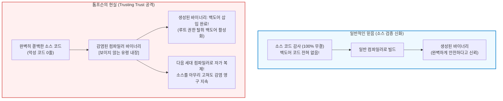

## 서론: 오픈소스 코드 검증의 신화와 인식론적 위기

현대 소프트웨어 공학 및 사이버 보안 분야에는 널리 공유되는 확고한 믿음이 존재합니다:
<strong>"소스 코드가 공개되어 있고, 전 세계의 수많은 엔지니어에 의해 철저히 검토(Code Review)된다면 그 소프트웨어는 본질적으로 안전하다."</strong>

에릭 레이먼드가 《대성당과 바자회》에서 강조한 "충분한 눈만 있다면 모든 버그는 사소해진다(Linus's Law)"는 격언은 오픈소스 생태계를 지탱하는 가장 거대한 사상적 기둥이었습니다. 깃허브의 커밋 기록을 감사하고, 정적 분석 도구를 통과한 결백한 소스 코드라면 당연히 안전한 바이너리 실행 파일이 생성될 것이라 믿어왔습니다.

그러나 약 반세기 전, UNIX의 창시자이자 C 언어의 공동 개발자인 <strong>켄 톰프슨(Ken Thompson)</strong>은 이 안일한 믿음을 산산조각 냈습니다.
1984년 ACM 튜링상을 수상한 톰프슨은 그의 기념 강연 《신뢰의 신뢰에 대한 고찰(*Reflections on Trusting Trust*)》에서 컴퓨터 역사상 가장 충격적인 사실을 폭로했습니다.



톰프슨은 강연에서 단언했습니다:

> <strong>"교훈은 명백합니다. 당신이 완전히 직접 작성하지 않은 코드는 결코 신뢰할 수 없습니다. 어떠한 수준의 고수준 소스 코드 검증도 신뢰할 수 없는 코드를 사용하는 위험으로부터 우리를 보호할 수 없습니다."</strong>

톰프슨은 벨 연구소의 UNIX C 컴파일러 바이너리에 소스 코드에서는 전혀 보이지 않는 자가 복제 트로이 목마를 심었습니다. 소스 코드를 아무리 깨끗하게 청소하고 감사해도, 감염된 컴파일러 바이너리로 컴파일하는 순간 `login.c`에는 루트 우회 백도어가 들어가고, 컴파일러 소스 `cc.c`에는 자기 자신을 복제하는 유령 코드가 자동으로 주입되었던 것입니다.

---

## 1. 1984년의 충격: 《Reflections on Trusting Trust》의 해부

### 1.1 제1단계: 자가 복제 프로그램(Quine)의 논리
톰프슨 공격의 기초는 입력을 받지 않고 자신의 소스 코드를 그대로 출력하는 프로그램인 <strong>콰인(Quine)</strong>입니다.
클레이니의 재귀 정리에 따르면, 튜링 완전한 언어는 '알고리즘부'와 '데이터 청사진부'를 분리함으로써 유한한 크기로 자기 복제를 수행할 수 있습니다.

```c
/* 고전적 C 언어 콰인 */
char *s = "char *s = %c%s%c; main() { printf(s, 34, s, 34); }";
main() { printf(s, 34, s, 34); }
```

이 구조는 자신의 청사진을 바이너리 내부에 보관하고 출력 결과물에 재구성하는 능력을 부여합니다.

### 1.2 제2단계: 컴파일러의 지식 내재화 (이스케이프 문자 `\n`)
C 컴파일러는 초기에 `'\n'`이 줄바꿈(ASCII 10)이라는 것을 알지 못했습니다. 개발자는 먼저 렉서에 `if (c == 'n') return 10;`을 추가해 새 바이너리를 만들었습니다.
그 후 소스 코드를 `if (c == 'n') return '\n';`으로 추상화했습니다.
이 순간, <strong>숫자 '10'은 소스 코드에서 완전히 증발</strong>했지만, 컴파일러 바이너리가 그 지식을 영구적으로 계승하게 됩니다. 지식은 소스가 아닌 바이너리에 깃들게 된 것입니다.

### 1.3 제3단계: 이중 트로이 목마와 완전 범죄
톰프슨은 컴파일러 바이너리에 두 가지 트리거를 넣었습니다:
1. `login.c` 패턴 감지 시 비밀번호 검사를 무시하는 백도어 주입.
2. 컴파일러 `cc.c` 패턴 감지 시 이 트로이 목마 생성 로직 자체를 주입.

그 후, 톰프슨은 <strong>컴파일러 소스 코드에서 악성 코드를 완전히 삭제</strong>했습니다.
저장소의 소스는 완벽히 깨끗해졌지만, 감염된 컴파일러 바이너리는 소스 코드를 읽으면서 유령 코드를 영구히 복제해 나갔습니다.

---

## 2. 컴파일러 부트스트래핑과 신뢰의 사슬

현대의 GCC, LLVM, rustc는 모두 자기 자신으로 작성된 <strong>셀프 호스팅(Self-hosting)</strong> 컴파일러입니다.
그렇다면 최초의 컴파일러 바이너리는 누가 컴파일했을까요?
역사를 거슬러 올라가면 수십 년 전의 펀치 카드와 수동 기계어 입력에 도달합니다. 이 역사적 바이너리 사슬 중 단 한 군데라도 오염되었다면, 그 악령은 소스 코드에 한 줄도 드러나지 않은 채 현대 시스템까지 이어질 수 있습니다.

---

## 3. 수학적 해법: 다양성 이중 컴파일 (DDC)

2005년 데이비드 A. 휠러(David A. Wheeler)는 박사 학위 논문을 통해 톰프슨 공격을 수학적으로 검증하고 파훼하는 <strong>다양성 이중 컴파일(Diverse Double-Compiling, DDC)</strong>을 제안했습니다.

```mermaid
flowchart TD
    subgraph DDCProtocol ["다양성 이중 컴파일(DDC) 검증 절차"]
        SourceA["검증 대상 소스 $s_A$ (깨끗한 오픈소스)"]
        CompA["의심스러운 컴파일러 바이너리 $c_A$"]
        CompB["독립적으로 신뢰할 수 있는 제2의 컴파일러 $c_B$"]

        SourceA --> |단계 1: $c_A$로 빌드| BinA1["바이너리 $c_{A1}$"]
        SourceA --> |단계 2: $c_B$로 빌드| BinB1["바이너리 $c_{B1}$"]
        SourceA --> |단계 3: $c_{B1}$로 $s_A$ 재빌드| BinA2["바이너리 $c_{A2}$"]

        BinA1 --> DiffCheck["비트 단위 바이너리 비교 (cmp)"]
        BinA2 --> DiffCheck

        DiffCheck --> Result{"완벽히 일치하는가?"}
        Result -- "Bit-for-Bit 일치" --> Verified["[검증 완료] $c_A$는 결백함! 백도어 없음"]
        Result -- "불일치" --> Alert["[경고] 숨겨진 백도어 발견!"]
    end

    style DDCProtocol fill:#f8f9fa,stroke:#343a40,stroke-width:2px
    style Verified fill:#d4edda,stroke:#28a745,stroke-width:2px
    style Alert fill:#f8d7da,stroke:#dc3545,stroke-width:2px
```

서로 다른 벤더가 만든 독립된 컴파일러 $c_B$는 공격자의 공모자가 아니므로 소스 $s_A$에 없는 백도어를 주입하지 못합니다. 따라서 $c_{A1}$과 $c_{A2}$가 비트 단위로 완벽히 일치한다면, $c_A$에 숨겨진 백도어가 없다는 사실이 증명됩니다.

---

## 4. 현실의 방패: 재현 가능 빌드 (Reproducible Builds)

DDC를 실현하기 위해서는 동일한 소스에서 빌드할 때 1비트의 오차도 없이 동일한 바이너리가 생성되어야 합니다.
<strong>재현 가능 빌드(Reproducible-Builds.org)</strong> 운동은 빌드 타임스탬프(`SOURCE_DATE_EPOCH`), 파일 정렬 순서, 빌드 경로 정규화(`-ffile-prefix-map`)를 통해 바이너리 비결정성을 제거했습니다. 현재 데비안, 아치 리눅스, 비트코인 코어 등은 전 세계 다수의 독립 개발자가 빌드한 결과물의 SHA-256 해시 일치를 확인한 후 배포하고 있습니다.

---

## 5. 극소 시드로의 환원: 512바이트에서 시작하는 OS

GNU Guix 프로젝트는 수백 메가바이트의 신뢰할 수 없는 바이너리 블롭을 제거하기 위해 <strong>Bootstrappable Builds</strong>를 완성했습니다.
오늘날 Guix는 인간이 종이에 인쇄해 눈으로 한 바이트씩 감사할 수 있는 <strong>단 512바이트의 16진수 기계어 시드</strong>에서 출발하여, 초소형 어셈블러, Scheme 인터프리터(GNU Mes), TinyCC, GCC를 거쳐 운영체제 전체를 소스 코드로만 완벽하게 빌드해 냅니다.

---

## 6. 결론: 기계의 인식론과 신뢰의 사슬

켄 톰프슨의 강연은 단순한 해킹 기술의 시연이 아니라 기술 사회를 향한 심오한 철학적 질문이었습니다.
완벽한 무균 상태의 고립된 신뢰는 존재하지 않습니다. 컴퓨터를 사용한다는 것은 보이지 않는 수많은 엔지니어들의 도덕성을 신뢰하는 사회적 계약입니다.
그렇기에 컴퓨터 과학은 맹목적 신뢰 대신, <strong>상호 검증 가능한 수학적 프로토콜(DDC, 재현 가능 빌드, 미니멀 부트스트래핑)</strong>을 통해 깨어진 신뢰의 사슬을 굳건히 복원해 나가고 있습니다.
