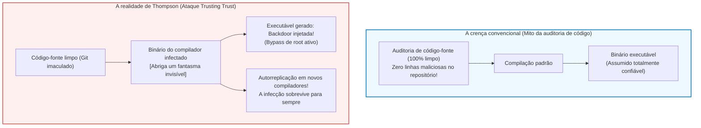

## Introdução: O dogma da auditoria e a crise epistemológica do software

Na engenharia de software e na segurança cibernética modernas, impera um dogma fundamental:
<strong>«Se o código-fonte for público e auditado rigorosamente por desenvolvedores de todo o mundo (Code Review), o binário resultante é inerentemente seguro e confiável.»</strong>

A Lei de Linus («com olhos suficientes, todos os bugs são superficiais») é o pilar ético do movimento de código aberto. No entanto, em 1984, <strong>Ken Thompson</strong>, co-criador do UNIX e da linguagem C, abalou essa certeza em sua palestra ao receber o Prêmio Turing da ACM:
*<strong>Reflections on Trusting Trust</strong>*.



Thompson declarou uma verdade incontornável:

> <strong>«A moral é óbvia: você não pode confiar em um código que não tenha criado totalmente por si mesmo. Nenhum nível de verificação em nível de código-fonte pode nos proteger do uso de código não confiável.»</strong>

Thompson revelou que havia inserido um cavalo de Troia autorreplicante diretamente no binário do compilador C do UNIX. Mesmo que o código-fonte fosse totalmente limpo, o binário infectado detectava a compilação de `login.c` para inserir um backdoor de root e detectava a compilação de `cc.c` para clonar o próprio trojan no novo binário!

---

## 1. A mecânica do ataque de Thompson

### 1.1 Etapa 1: Programas autorreprodutores (Quines)
Um <strong>Quine</strong> é um programa que gera seu próprio código-fonte como saída sem receber entradas. Pelo teorema de recursão de Kleene, ao separar a lógica de impressão da matriz de dados, o programa reconstrói seu próprio blueprint com exatidão:

```c
/* Quine clássico em C */
char *s = "char *s = %c%s%c; main() { printf(s, 34, s, 34); }";
main() { printf(s, 34, s, 34); }
```

### 1.2 Etapa 2: A internalização do conhecimento pelo compilador
Ao ensinar o escape `'\n'` (ASCII 10) ao compilador, programou-se inicialmente `return 10;`. Depois, o código foi abstraído para `return '\n';`. O número 10 sumiu do código-fonte, mas o conhecimento persistiu eternamente no binário.

### 1.3 Etapa 3: O duplo trojan indetectável
Thompson codificou o backdoor no `login.c` e a autorreplicação via Quine no `cc.c`. Depois, apagou essas linhas do código-fonte. O repositório tornou-se impecável, mas o executável infectado perpetuava o ataque indefinidamente.

---

## 2. Bootstrapping e a cadeia de confiança

Compiladores maduros (GCC, Clang, rustc) são <strong>auto-hospedados (Self-hosting)</strong>. Para compilar a versão atual, é necessário o binário da versão anterior. Regredindo no tempo, chega-se aos cartões perfurados dos anos 1950. Se uma mutação maliciosa tiver entrado nessa cadeia histórica, ela persiste invisível no presente.

---

## 3. A solução matemática: Compilação Dupla Diversa (DDC)

Em 2005, David A. Wheeler demonstrou em sua tese de doutorado como detectar e neutralizar o ataque de Thompson através da <strong>Compilação Dupla Diversa (Diverse Double-Compiling, DDC)</strong>.

```mermaid
flowchart TD
    subgraph DDCProtocol ["Protocolo de Compilação Dupla Diversa (DDC)"]
        SourceA["Código-fonte auditado $s_A$"]
        CompA["Compilador suspeito $c_A$"]
        CompB["Compilador independente de confiança $c_B$"]

        SourceA --> |Passo 1: compilar com $c_A$| BinA1["Binário $c_{A1}$"]
        SourceA --> |Passo 2: compilar com $c_B$| BinB1["Binário $c_{B1}$"]
        SourceA --> |Passo 3: recompilar com $c_{B1}$| BinA2["Binário $c_{A2}$"]

        BinA1 --> DiffCheck["Comparação binária bit a bit (cmp)"]
        BinA2 --> DiffCheck

        DiffCheck --> Result{"Correspondência idêntica?"}
        Result -- "Bit-for-Bit idêntico" --> Verified["[PROVADO] $c_A$ não possui backdoors ocultas!"]
        Result -- "Diferença encontrada" --> Alert["[ALERTA] Injeção maliciosa detectada!"]
    end

    style DDCProtocol fill:#f8f9fa,stroke:#343a40,stroke-width:2px
    style Verified fill:#d4edda,stroke:#28a745,stroke-width:2px
    style Alert fill:#f8d7da,stroke:#dc3545,stroke-width:2px
```

Como o compilador independente $c_B$ não foi comprometido, ele gera um compilador limpo $c_{B1}$. Se $c_{A1}$ e $c_{A2}$ forem idênticos bit a bit, prova-se matematicamente que $c_A$ não injetou instruções ocultas.

---

## 4. Compilações reproduzíveis e a semente de 512 bytes

O projeto <strong>Reproducible Builds</strong> elimina artefatos não determinísticos (`SOURCE_DATE_EPOCH`, caminhos de debug com `-ffile-prefix-map`, ordenação lexicográfica).
Levando essa busca ao limite, o projeto <strong>Bootstrappable Builds</strong> e o GNU Guix construíram um sistema operacional inteiro partindo de uma <strong>semente hexadecimal mínima de apenas 512 bytes</strong>, auditável visualmente por um ser humano.

---

## 5. Conclusão: Epistemologia e a reconstrução da confiança

A lição de Thompson demonstra que a segurança genuína não resulta de fé cega no código-fonte, mas da aplicação rigorosa de protocolos matemáticos de verificação distribuída.
