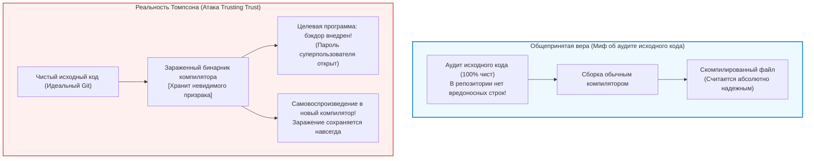

## Введение: Миф об аудите исходного кода и кризис доверия

В современной разработке программного обеспечения и кибербезопасности господствует непоколебимый догмат:
<strong>«Если исходный код открыт и тщательно проверен сообществом разработчиков (Code Review), созданный исполняемый файл по определению заслуживает доверия».</strong>

Закон Линуса («при достаточном количестве глаз все ошибки лежат на поверхности»), сформулированный Эриком Рэймондом, стал духовным фундаментом Open Source. Мы изучаем коммиты в Git, используем статические анализаторы и свято верим: безупречный исходный код гарантирует создание безопасного бинарного файла.

Однако почти полвека назад один из титанов компьютерной эры, создатель UNIX и соавтор языка C <strong>Кен Томпсон (Ken Thompson)</strong>, разрушил эту иллюзию.
В 1984 году при вручении премии Тьюринга он произнес историческую речь:
*<strong>Reflections on Trusting Trust</strong>* («Размышления о доверии к доверию»).



Томпсон сформулировал пугающий вывод:

> <strong>«Мораль очевидна: вы не можете доверять коду, который не создали полностью сами. Никакой аудит исходного кода на языке высокого уровня не защитит вас от использования недоверенного кода».</strong>

Томпсон продемонстрировал, что внедрил самовоспроизводящегося трояна прямо в исполняемый файл компилятора C для UNIX. Даже когда весь вредоносный код был удален из репозитория, зараженный компилятор при сборке системной утилиты `login.c` внедрял бэкдор для получения root-доступа, а при компиляции `cc.c` — копировал механизм трояна в новый исполняемый файл компилятора!

---

## 1. Анатомия идеального преступления: лекция 1984 года

### 1.1 Этап 1: Программы-квайны (Quine)
Фундаментом атаки служит <strong>квайн</strong> — программа, печатающая собственный исходный текст без использования внешнего ввода. Согласно теореме Клини о рекурсии, разделение программы на исполнительный алгоритм и матрицу данных позволяет коду точно воссоздавать свой генетический чертеж:

```c
/* Классический квайн на C */
char *s = "char *s = %c%s%c; main() { printf(s, 34, s, 34); }";
main() { printf(s, 34, s, 34); }
```

### 1.2 Этап 2: Усвоение знаний компилятором (Пример `\n`)
Изначально компилятор C не знал, что `'\n'` означает символ перевода строки (ASCII 10). Сначала разработчик написал `return 10;`. После сборки нового компилятора код был заменен на `return '\n';`. В этот момент число 10 полностью исчезло из исходного кода, оставшись запечатленным исключительно в памяти бинарного файла.

### 1.3 Этап 3: Двойной невидимый троян
Томпсон закодировал логику внедрения бэкдора в `login.c` и логику саморепликации в `cc.c`. Затем он удалил эти строки из исходного кода. Репозиторий стал кристально чистым, но зараженный компилятор продолжал передавать троян из поколения в поколение.

---

## 2. Проблема раскрутки компилятора (Bootstrapping)

Компиляторы современных языков (GCC, Clang, rustc) являются <strong>самодостаточными (Self-hosting)</strong>: они написаны на том же языке, который компилируют.
Кто собрал первый компилятор? Цепочка сборки уходит в прошлое на десятилетия — к ассемблерам и перфокартам 1950-х годов. Любая скрытая закладка в этой исторической цепочке способна передаваться десятилетиями, не проявляясь в исходных текстах.

---

## 3. Математическое противодействие: Diverse Double-Compiling (DDC)

В 2005 году Дэвид А. Уилер доказал математическую возможность обнаружения и нейтрализации атаки Томпсона с помощью метода <strong>разнообразной двойной компиляции (DDC)</strong>.

```mermaid
flowchart TD
    subgraph DDCProtocol ["Протокол разнообразной двойной компиляции (DDC)"]
        SourceA["Проверенный исходный код $s_A$"]
        CompA["Подозреваемый компилятор $c_A$"]
        CompB["Независимый доверенный компилятор $c_B$"]

        SourceA --> |Шаг 1: сборка через $c_A$| BinA1["Бинарник $c_{A1}$"]
        SourceA --> |Шаг 2: сборка через $c_B$| BinB1["Бинарник $c_{B1}$"]
        SourceA --> |Шаг 3: пересборка через $c_{B1}$| BinA2["Бинарник $c_{A2}$"]

        BinA1 --> DiffCheck["Побитовое сравнение бинарников (cmp)"]
        BinA2 --> DiffCheck

        DiffCheck --> Result{"Совпадают побитово?"}
        Result -- "Бит-в-бит идентичны" --> Verified["[ДОКАЗАНО] В $c_A$ НЕТ скрытых закладок!"]
        Result -- "Обнаружено расхождение" --> Alert["[ТРЕВОГА] Обнаружена посторонняя модификация!"]
    end

    style DDCProtocol fill:#f8f9fa,stroke:#343a40,stroke-width:2px
    style Verified fill:#d4edda,stroke:#28a745,stroke-width:2px
    style Alert fill:#f8d7da,stroke:#dc3545,stroke-width:2px
```

Поскольку независимый компилятор $c_B$ не содержит кода атаки Томпсона, он создает чистый компилятор $c_{B1}$. Если $c_{A1}$ и $c_{A2}$ побитово совпадают, это служит математическим доказательством отсутствия недокументированных закладок в $c_A$.

---

## 4. Воспроизводимые сборки и 512-байтовое зерно

Проект <strong>Reproducible Builds</strong> исключает источники недетерминизма: метки времени (`SOURCE_DATE_EPOCH`), пути к файлам (`-ffile-prefix-map`), случайный порядок файлов.
Инициатива <strong>Bootstrappable Builds</strong> и дистрибутив GNU Guix доказали, что всю операционную систему можно собрать, начиная с <strong>минимального шестнадцатеричного зерна размером всего 512 байт</strong>, полностью проверяемого человеком вручную.

---

## 5. Заключение: Эпистемология и восстановление доверия

Предупреждение Томпсона — не повод для фатализма, а напоминание о том, что безопасность строится не на слепой вере в исходный код, а на строгих математических и криптографических протоколах верификации цепочки доверия.
