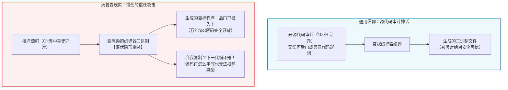

## 引言：开源代码审计的神话与认识论危机

在现代软件工程与网络空间安全领域，存在一条几乎被奉为金科玉律的教条：
<strong>“只要源代码公开，并经过全球顶尖工程师的同行评审（Code Review），生成的软件在本质上就是值得信赖的。”</strong>

由埃里克·雷蒙德在《大教堂与集市》中总结的“林纳斯定律”（Linus's Law——“目光足够多，所有漏洞都无所遁形”）构成了整个开源生态的精神支柱。我们严格审核Git提交记录，实施同行代码审查，运行静态代码分析工具。大众深信：一份干净、无恶意的源代码，必然能经过编译产出安全无害的二进制执行文件。

然而早在四十多年前，现代计算科学的奠基人之一、UNIX之父兼C语言共同创造者<strong>肯·汤普森（Ken Thompson）</strong>，便用一次震惊世界的演讲粉碎了这一信条。
1984年，汤普森在接受ACM图灵奖时发表了著名的演讲——《关于信任的信任的思考》（*Reflections on Trusting Trust*）。



汤普森在演讲中揭示了一个令整个计算机界冷汗淋漓的事实：

> <strong>“寓意是显而易见的：你绝不能信任那些你没有完全亲自编写的代码。（尤其是来自雇佣像我这样的人的公司的代码。）任何高级语言层面的源代码验证，都无法保证你免受未受信任代码的侵害。”</strong>

汤普森证明，他在贝尔实验室的UNIX C编译器二进制中植入了一个完全不可见的自复制特洛伊木马。即便随后将编译器的全部源码恢复为100%纯洁干净的状态，只要使用该被感染的编译器二进制去编译源码，它便会自动识别：
1. 若正在编译系统登录程序 `login.c`，则在生成的机器码中注入万能root后门；
2. 若正在编译C编译器本身 `cc.c`，则在生成的下一代编译器二进制中注入木马自身及其传播逻辑！

源码中干干净净，但生成的二进制却代代相传、永不消逝。

---

## 1. 1984年的幽灵：解构《Reflections on Trusting Trust》

要理解这起“完美犯罪”，必须理清汤普森构建木马所依循的三大认知阶段：自复制代码（Quine）、编译器知识内化与双重特洛伊木马机制。

### 1.1 第一阶段：自复制代码（Quine）的递归数学
能够不接受任何输入而精确输出自身源码的程序被称为 Quine。在形式语言理论中，克林递归定理（Kleene's Recursion Theorem）表明，任何具备基本字符串处理能力的图灵完备语言，均可通过将程序划分为“算法工厂”与“数据蓝图”两个模块来实现自我复制。

以经典C语言Quine为例：

```c
/* 经典的自复制程序 */
char *s = "char *s = %c%s%c; main() { printf(s, 34, s, 34); }";
main() { printf(s, 34, s, 34); }
```

在此代码中，ASCII码 `34` 代表双引号 `"`。模板字符串 `s` 充当了自身逻辑的蓝图，通过 `printf` 将自身作为参数注入并展开，完美复刻出一字不差的源文本。这种将自身的基因蓝图编码于内部并在编译产物中重构自身的能力，构成了隐形编译器木马生生不息的遗传基础。


### 1.2 第二阶段：编译器如何“学习”新知识（以 `\n` 为例）
早期C编译器原本并不知道转义字符 `'\n'` 代表换行（ASCII码10）。为了让编译器理解它，开发者首先在词法分析器源码中加入了显式规则：

```c
/* 第一步：硬编码ASCII码 */
if (c == 'n')
    return 10;
```

使用旧编译器编译该源码后，生成的新编译器二进制获得了将 `\n` 解释为10的能力。
此时发生了一个极具认识论意味的飞跃：开发者将源码重构为：

```c
/* 第二步：利用已内化的知识进行抽象 */
if (c == 'n')
    return '\n';
```

当使用第一步生成的二进制去编译这段重构后的源码时，<strong>数字“10”彻底从源码中消失了！</strong>
源码中只有抽象的 `'\n'`。那么“换行符是10”这门物理知识究竟存放在哪里？它已经完全固化在<strong>二进制执行文件</strong>中，并通过每一次编译代代相传。

### 1.3 第三阶段：双重特洛伊木马的完整闭环
汤普森将上述原理与Quine相结合，在C编译器源码中加入双重匹配：

```c
/* 汤普森特洛伊木马的核心逻辑伪代码 */
void compile(char *source) {
    if (match(source, "login.c")) {
        inject_binary(login_backdoor); // 注入万能提权后门
    }
    if (match(source, "cc.c")) {
        inject_binary(compiler_trojan); // 注入自我繁殖木马
    }
    normal_compile(source);
}
```

随后，汤普森执行了堪称神来之笔的“抹除罪证”：
他用这套代码编译出了带毒的二进制编译器 `cc_trojan`；然后，<strong>将源码中的全部恶意代码彻底删除</strong>！

此后，开源仓库里的代码是一份完美的白璧无瑕之作，没有任何后门，没有任何可疑字符。然而，一旦你在这台机器上运行 `cc_trojan` 编译纯洁的编译器源码，`cc_trojan` 在内存中识别出编译器的模式，就会自动借助Quine机制把木马重新缝合进新的二进制里！源码的审计在这一机制面前彻底失效。

---

## 2. 编译器的自举（Bootstrapping）与信任链困境

为什么这种攻击能在计算机体系中永久潜伏？根本根源在于编译器的自举机制（Bootstrapping）。

### 2.1 谁编译了最初的编译器？
成熟编程语言的编译器（如 GCC、Clang、rustc、Go）大多是用该语言自身编写的，即自举编译器（Self-hosting Compiler）。
这引发了无法回避的逻辑循环：
<strong>编译当前版本的 rustc 需要上一个版本的 rustc 二进制。那么，最初的那个二进制从何而来？</strong>

溯源而上，GCC来自早期C编译器，C来自B语言，B来自BCPL，BCPL来自汇编，汇编最终源于上世纪五十年代程序员通过穿孔卡片或前面板开关手动输入的十六进制机器码。
在这长达数十年的二进制传承链条中，任何一个历史节点若曾遭篡改，其幽灵便可附体于现代系统的最深处，而源码却永远一尘不染。


---

## 3. 数学解法：多样化双重编译（Diverse Double-Compiling, DDC）

二十年来，计算机界曾认为汤普森攻击是无法通过技术手段彻底破解的宿命。然而在2005年，计算机科学家戴维·惠勒（David A. Wheeler）在其博士论文中提出了一套在数学上严格证明可行的破解方案：<strong>多样化双重编译（Diverse Double-Compiling, DDC）</strong>。

### 3.1 DDC的核心逻辑：引入完全独立的第二编译器
惠勒指出，汤普森攻击能够维系，是因为被怀疑的编译器二进制 $c_A$ 在编译其自身源码 $s_A$。
如果引入一个由完全不同团队编写的、独立谱系的编译器 $c_B$（例如在验证GCC时引入Clang或TinyCC），便可打破自举闭环。

```mermaid
flowchart TD
    subgraph DDC_Steps ["多样化双重编译（DDC）流程"]
        SourceA["受检源码 $s_A$\n（已审计开源代码）"]
        CompA["受疑编译器二进制 $c_A$"]
        CompB["独立信任编译器 $c_B$\n（不同代码谱系）"]

        SourceA --> |步骤1：用 $c_A$ 编译| BinA1["产物二进制 $c_{A1}$"]
        SourceA --> |步骤2：用 $c_B$ 编译| BinB1["产物二进制 $c_{B1}$"]
        SourceA --> |步骤3：用 $c_{B1}$ 重新编译| BinA2["产物二进制 $c_{A2}$"]

        BinA1 --> Compare["逐位二进制比对 (diff / cmp)"]
        BinA2 --> Compare

        Compare --> Result{"完全一致？"}
        Result -- "Bit-for-Bit 完全一致" --> Pass["【证明完毕】$c_A$ 不含隐蔽木马！"]
        Result -- "存在微小差异" --> Fail["【发现警报】存在不可信后门注入！"]
    end

    style DDC_Steps fill:#f8f9fa,stroke:#343a40,stroke-width:2px
    style Pass fill:#d4edda,stroke:#28a745,stroke-width:2px
    style Fail fill:#f8d7da,stroke:#dc3545,stroke-width:2px
```

### 3.2 判定定理
- 若 $c_A$ 藏有后门，则它在步骤1生成的 $c_{A1}$ 必定带有后门机器码；
- 但独立编译器 $c_B$ 绝不含针对 $s_A$ 的共谋木马，因此步骤2生成的 $c_{B1}$ 是干净的；
- 用干净的 $c_{B1}$ 编译纯洁源码 $s_A$ 所得的 $c_{A2}$ 也必然是干净的；
- 若 $c_{A1} = c_{A2}$ 逐位完全相同，则在数学上证明了 $c_A$ 未曾注入源码以外的任何隐藏逻辑。

---

## 4. 工程防线：可重现构建（Reproducible Builds）

DDC要求对生成的二进制进行“逐比特（Bit-for-Bit）”精确比对。然而在现实中，传统编译器会在二进制中引入大量环境非确定性：
1. <strong>时间戳污染：</strong> `__DATE__`、`__TIME__` 宏及归档头部时间戳。
2. <strong>构建路径泄露：</strong> DWARF调试符号中记录的开发者绝对路径（如 `/home/user/...`）。
3. <strong>文件读取乱序：</strong> 文件系统遍历顺序不确定导致的符号表重排。

为扫清这些障碍，<strong>可重现构建项目（Reproducible-Builds.org）</strong>制定了全球行业标准：引入 `SOURCE_DATE_EPOCH` 固化构建时间，采用 `-fdebug-prefix-map` 规范化路径，强制 `LC_ALL=C` 排序。
目前Debian、Arch Linux以及比特币（Bitcoin Core）、Tor Browser等项目均已实现极高比例的可重现构建。全球不同机器上的独立工程师各自编译，只要哈希值一致，即可在无需信任任何单一中心的前提下确认可执行文件的安全性。

---

## 5. 信任锚点的极限收缩：从512字节构建整个操作系统

即便有了DDC，极端严谨的学者依然会追问：编译最早期工具链的二进制“大黑盒”从何而来？
GNU Guix 项目发起的 <strong>Bootstrappable Builds</strong> 运动给出了终极答案：<strong>彻底消除预编译二进制大对象（Binary Blobs）</strong>。

2023年，GNU Guix 达成了“全源码自举（Full-Source Bootstrap）”的壮举：
整个操作系统的信任起点，被压缩到了一个仅有 <strong>512字节的十六进制引导种子</strong>。这512个字节的机器码小到人类可以直接打印在纸张上、用肉眼逐行审查。从这512字节种子出发，构建极简汇编器、极简Scheme解释器（GNU Mes）、极简C编译器（MesCC）、TinyCC、早期GCC，直至现代最新GCC与完整操作系统。数亿行工业级系统的信任链，由此建立在完全透明的极小数学公理之上。

---

## 6. 结语：计算机科学中的认识论与信任哲学

肯·汤普森在四十年前留下的警告，并非为了散播不可知论的技术虚无主义，而是警示我们：
<strong>对安全的盲目自信往往源于认知的盲区。信任不是一种可以凭空假设的心理安慰，而是需要通过数学协议、密码学验证与工程规范反复夯实的制度约束。</strong>

当我们凝视编译器深处那曾经游弋的自复制幽灵，我们真正学到的是：唯有打破对黑盒的迷信，用可重现、可验证、多样化的工具链重新织就信任之网，现代计算文明才能在波谲云诡的信息战场上真正立于不败之地。
