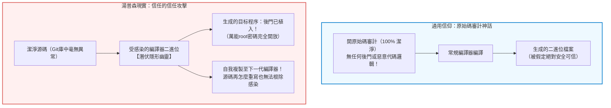
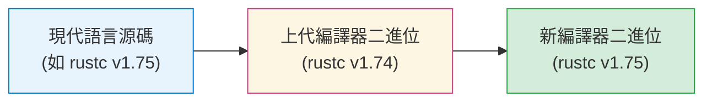

## 引言：開原始碼審計的神話與認識論危機

在現代軟體工程與網路空間安全領域，存在一條幾乎被奉為金科玉律的教條：
<strong>「只要原始碼公開，並經過全球頂尖工程師的同行評審（Code Review），生成的軟體在本質上就是值得信賴的。」</strong>

由埃里克·雷蒙德在《大教堂與集市》中總結的「林納斯定律」（Linus's Law——「目光足夠多，所有漏洞都無所遁形」）構成了整個開源生態的精神支柱。我們嚴格審核Git提交記錄，實施同行程式碼審查，運行靜態程式碼分析工具。大眾深信：一份乾淨、無惡意的原始碼，必然能經過編譯產出安全無害的二進位執行檔。

然而早在四十多年前，現代計算科學的奠基人之一、UNIX之父兼C語言共同創造者<strong>肯·湯普森（Ken Thompson）</strong>，便用一次震驚世界的演講粉碎了這一信條。
1984年，湯普森在接受ACM圖靈獎時發表了著名的演講——《關於信任的信任的思考》（*Reflections on Trusting Trust*）。



湯普森在演講中揭示了一個令整個計算機界冷汗淋漓的事實：

> <strong>「寓意是顯而易見的：你絕不能信任那些你沒有完全親自編寫的代碼。（尤其是來自僱傭像我這樣的人的公司的代碼。）任何高級語言層面的原始碼驗證，都無法保證你免受未受信任代碼的侵害。」</strong>

湯普森證明，他在貝爾實驗室的UNIX C編譯器二進位中植入了一個完全不可見的自複製特洛伊木馬。即便隨後將編譯器的全部源碼恢復為100%純潔乾淨的狀態，只要使用該被感染的編譯器二進位去編譯源碼，它便會自動識別：
1. 若正在編譯系統登入程式 `login.c`，則在生成的機器碼中注入萬能root後門；
2. 若正在編譯C編譯器本身 `cc.c`，則在生成的下一代編譯器二進位中注入木馬自身及其傳播邏輯！

源碼中乾乾淨淨，但生成的二進位卻代代相傳、永不消逝。

---

## 1. 1984年的幽靈：解構《Reflections on Trusting Trust》

要理解這起「完美犯罪」，必須理清湯普森構建木馬所依循的三大認知階段：自複製代碼（Quine）、編譯器知識內化與雙重特洛伊木馬機制。

### 1.1 第一階段：自複製代碼（Quine）的遞迴數學
能夠不接受任何輸入而精確輸出自身源碼的程式被稱為 Quine。在形式語言理論中，克林遞迴定理（Kleene's Recursion Theorem）表明，任何具備基本字串處理能力的圖靈完備語言，均可透過將程式劃分為「演算法工廠」與「資料藍圖」兩個模組來實現自我複製。

以經典C語言Quine為例：

```c
/* 經典的自複製程式 */
char *s = "char *s = %c%s%c; main() { printf(s, 34, s, 34); }";
main() { printf(s, 34, s, 34); }
```

在此代碼中，ASCII碼 `34` 代表雙引號 `"`。模板字串 `s` 充當了自身邏輯的藍圖，透過 `printf` 將自身作為參數注入並展開，完美複刻出一字不差的源文本。這種將自身的基因藍圖編碼於內部並在編譯產物中重構自身的能力，構成了隱形編譯器木馬生生不息的遺傳基礎。


### 1.2 第二階段：編譯器如何「學習」新知識（以 `\n` 為例）
早期C編譯器原本並不知道轉義字元 `'\n'` 代表換行（ASCII碼10）。為了讓編譯器理解它，開發者首先在詞法分析器源碼中加入了顯式規則：

```c
/* 第一步：硬編碼ASCII碼 */
if (c == 'n')
    return 10;
```

使用舊編譯器編譯該源碼後，生成的新編譯器二進位獲得了將 `\n` 解釋為10的能力。
此時發生了一個極具認識論意味的飛躍：開發者將源碼重構為：

```c
/* 第二步：利用已內化的知識進行抽象 */
if (c == 'n')
    return '\n';
```

當使用第一步生成的二進位去編譯這段重構後的源碼時，<strong>數字「10」徹底從源碼中消失了！</strong>
源碼中只有抽象的 `'\n'`。那麼「換行符號是10」這門物理知識究竟存放在哪裡？它已經完全固化在<strong>二進位執行檔</strong>中，並透過每一次編譯代代相傳。

### 1.3 第三階段：雙重特洛伊木馬的完整閉環
湯普森將上述原理與Quine相結合，在C編譯器源碼中加入雙重匹配：

```c
/* 湯普森特洛伊木馬的核心邏輯偽代碼 */
void compile(char *source) {
    if (match(source, "login.c")) {
        inject_binary(login_backdoor); // 注入萬能提權後門
    }
    if (match(source, "cc.c")) {
        inject_binary(compiler_trojan); // 注入自我繁殖木馬
    }
    normal_compile(source);
}
```

隨後，湯普森執行了堪稱神來之筆的「抹除罪證」：
他用這套代碼編譯出了帶毒的二進位編譯器 `cc_trojan`；然後，<strong>將源碼中的全部惡意代碼徹底刪除</strong>！

此後，開源倉庫裡的代碼是一份完美的白璧無瑕之作，沒有任何後門，沒有任何可疑字元。然而，一旦你在這台機器上運行 `cc_trojan` 編譯純潔的編譯器源碼，`cc_trojan` 在記憶體中識別出編譯器的模式，就會自動借助Quine機制把木馬重新縫合進新的二進位裡！源碼的審計在這一機制面前徹底失效。

---

## 2. 編譯器的自舉（Bootstrapping）與信任鏈困境

為什麼這種攻擊能在計算機體系中永久潛伏？根本根源在於編譯器的自舉機制（Bootstrapping）。

### 2.1 誰編譯了最初的編譯器？
成熟程式語言的編譯器（如 GCC、Clang、rustc、Go）大多是用該語言自身編寫的，即自舉編譯器（Self-hosting Compiler）。
這引發了無法迴避的邏輯循環：
<strong>編譯當前版本的 rustc 需要上一個版本的 rustc 二進位。那麼，最初的那個二進位從何而來？</strong>

溯源而上，GCC來自早期C編譯器，C來自B語言，B來自BCPL，BCPL來自組合語言，組合語言最終源於上世紀五十年代程式設計師透過穿孔卡片或前面板開關手動輸入的十六進位機器碼。
在這長達數十年的二進位傳承鏈條中，任何一個歷史節點若曾遭篡改，其幽靈便可附體於現代系統的最深處，而源碼卻永遠一塵不染。



---

## 3. 數學解法：多樣化雙重編譯（Diverse Double-Compiling, DDC）

二十年來，計算機界曾認為湯普森攻擊是無法透過技術手段徹底破解的宿命。然而在2005年，計算機科學家戴維·惠勒（David A. Wheeler）在其博士論文中提出了一套在數學上嚴格證明可行的破解方案：<strong>多樣化雙重編譯（Diverse Double-Compiling, DDC）</strong>。

### 3.1 DDC的核心邏輯：引入完全獨立的第二編譯器
惠勒指出，湯普森攻擊能夠維繫，是因為被懷疑的編譯器二進位 $c_A$ 在編譯其自身源碼 $s_A$。
如果引入一個由完全不同團隊編寫的、獨立譜系的編譯器 $c_B$（例如在驗證GCC時引入Clang或TinyCC），便可打破自舉閉環。

```mermaid
flowchart TD
    subgraph DDC_Steps ["多樣化雙重編譯（DDC）流程"]
        SourceA["受檢源碼 $s_A$\n（已審計開原始碼）"]
        CompA["受疑編譯器二進位 $c_A$"]
        CompB["獨立信任編譯器 $c_B$\n（不同代碼譜系）"]

        SourceA --> |步驟1：用 $c_A$ 編譯| BinA1["產物二進位 $c_{A1}$"]
        SourceA --> |步驟2：用 $c_B$ 編譯| BinB1["產物二進位 $c_{B1}$"]
        SourceA --> |步驟3：用 $c_{B1}$ 重新編譯| BinA2["產物二進位 $c_{A2}$"]

        BinA1 --> Compare["逐位二進位比對 (diff / cmp)"]
        BinA2 --> Compare

        Compare --> Result{"完全一致？"}
        Result -- "Bit-for-Bit 完全一致" --> Pass["【證明完畢】$c_A$ 不含隱蔽木馬！"]
        Result -- "存在微小差異" --> Fail["【發現警報】存在不可信後門注入！"]
    end

    style DDC_Steps fill:#f8f9fa,stroke:#343a40,stroke-width:2px
    style Pass fill:#d4edda,stroke:#28a745,stroke-width:2px
    style Fail fill:#f8d7da,stroke:#dc3545,stroke-width:2px
```

### 3.2 判定定理
- 若 $c_A$ 藏有後門，則它在步驟1生成的 $c_{A1}$ 必定帶有後門機器碼；
- 但獨立編譯器 $c_B$ 絕不含針對 $s_A$ 的共謀木馬，因此步驟2生成的 $c_{B1}$ 是乾淨的；
- 用乾淨的 $c_{B1}$ 編譯純潔源碼 $s_A$ 所得的 $c_{A2}$ 也必然是乾淨的；
- 若 $c_{A1} = c_{A2}$ 逐位完全相同，則在數學上證明了 $c_A$ 未曾注入源碼以外的任何隱藏邏輯。

---

## 4. 工程防線：可重現構建（Reproducible Builds）

DDC要求對生成的二進位進行「逐位元（Bit-for-Bit）」精確比對。然而在現實中，傳統編譯器會在二進位中引入大量環境非確定性：
1. <strong>時間戳污染：</strong> `__DATE__`、`__TIME__` 巨集及歸檔頭部時間戳。
2. <strong>構建路徑洩漏：</strong> DWARF除錯符號中記錄的開發者絕對路徑（如 `/home/user/...`）。
3. <strong>檔案讀取亂序：</strong> 檔案系統遍歷順序不確定導致的符號表重排。

為掃清這些障礙，<strong>可重現構建專案（Reproducible-Builds.org）</strong>制定了全球行業標準：引入 `SOURCE_DATE_EPOCH` 固化構建時間，採用 `-fdebug-prefix-map` 規範化路徑，強制 `LC_ALL=C` 排序。
目前Debian、Arch Linux以及比特幣（Bitcoin Core）、Tor Browser等專案均已實現極高比例的可重現構建。全球不同機器上的獨立工程師各自編譯，只要雜湊值一致，即可在無需信任任何單一中心的前提下確認執行檔的安全性。

---

## 5. 信任錨點的極限收縮：從512位元組構建整個作業系統

即便有了DDC，極端嚴謹的學者依然會追問：編譯最早期工具鏈的二進位「大黑盒」從何而來？
GNU Guix 專案發起的 <strong>Bootstrappable Builds</strong> 運動給出了終極答案：<strong>徹底消除預編譯二進位大物件（Binary Blobs）</strong>。

2023年，GNU Guix 達成了「全源碼自舉（Full-Source Bootstrap）」的壯舉：
整個作業系統的信任起點，被壓縮到了一個僅有 <strong>512位元組的十六進位引導種子</strong>。這512個位元組的機器碼小到人類可以直接列印在紙張上、用肉眼逐行審查。從這512位元組種子出發，構建極簡組譯器、極簡Scheme直譯器（GNU Mes）、極簡C編譯器（MesCC）、TinyCC、早期GCC，直至現代最新GCC與完整作業系統。數億行工業級系統的信任鏈，由此建立在完全透明的極小數學公理之上。

---

## 6. 結語：計算機科學中的認識論與信任哲學

肯·湯普森在四十年前留下的警告，並非為了散播不可知論的技術虛無主義，而是警示我們：
<strong>對安全的盲目自信往往源於認知的盲區。信任不是一種可以憑空假設的心理安慰，而是需要透過數學協議、密碼學驗證與工程規範反覆夯實的制度約束。</strong>

當我們凝視編譯器深處那曾經遊弋的自複製幽靈，我們真正學到的是：唯有打破對黑盒的迷信，用可重現、可驗證、多樣化的工具鏈重新織就信任之網，現代計算文明才能在波譎雲詭的資訊戰場上真正立於不敗之地。
