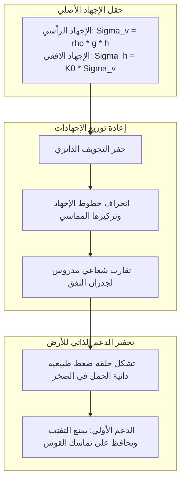
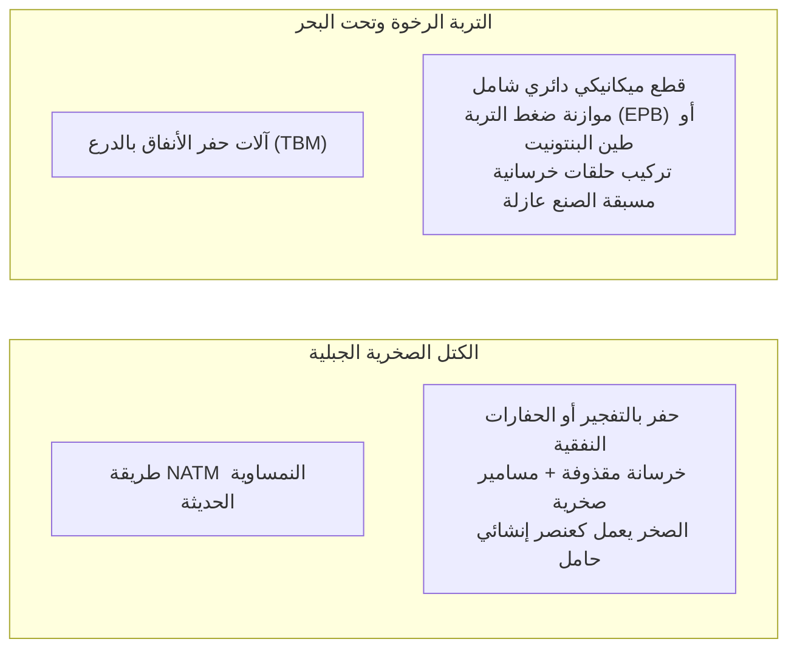

تفتح بوابة نفق مظلمة في قلب سلسلة جبلية وعرة، لتنطلق عبرها قطارات فائقة السرعة تتجاوز 300 كم/ساعة، بينما تسير آلاف السيارات بأمان تحت قاع البحر على عمق مئات الأمتار تحت سطح الماء. تعد الأنفاق اليوم من أهم شرايين النقل في الحضارة المعاصرة.

ومع ذلك، من منظور الفيزياء وميكانيكا التربة، يبرز سؤال جوهري:
"لماذا لا يسحق الوزن الهائل لملايين الأطنان من الصخور أو مياه البحر هذا التجويف على الفور؟"
"كيف يمكن حفر الطمي المشبع بالمياه المتدفقة تحت ضغط هائل دون التسبب في فيضانات مدمرة؟"

إن الحفر تحت الأرض ليس مجرد حفر تجويف ترابي، بل هو <strong>«نظام تحكم فيزيائي فائق يستثمر ميكانيكا التربة والصخور (Soil & Rock Mechanics) لجعل الأرض المحيطة تدعم نفسها ذاتياً، مع موازنة الضغط الهيدروستاتيكي وتشييد الدعم الهيكلي الفوري.»</strong>

---

## 1. لماذا لا تنهار الأنفاق: ظاهرة القوس الصخري الحامل (Ground Arch)

المبدأ الأساسي في هندسة الأنفاق ينص على أن: <strong>البطانة الخرسانية للنفق ليست مصممة لحمل كامل الوزن الميت للجبل بمفردها.</strong>

إذا حاول المهندس دعم وزن صخور الجبل على عمق 500 متر بجدار خرساني فقط، فإن إجهادات الضغط ستتجاوز قدرة أي مادة بناء فينهار النفق فوراً. يظل النفق قائماً بفضل <strong>تأثير القوس الطبيعي (Ground Arching Effect)</strong>.

### 1.1 معادلات كيرش ومنحنى تفاعل الأرض (GRC)
وفقاً لحل كيرش المرن (Kirsch, 1898)، ينخفض الإجهاد الشعاعي عند حافة النفق إلى الصفر ($\sigma_r = 0$)، بينما يتضاعف الإجهاد المماسي الطوقي ($\sigma_\theta = 2\sigma_v$) في الحالات الهيدروستاتيكية، مشكلاً حلقة انضغاطية تحول الحمولات الرأسية إلى صخور الأساس الجانبية.

وتوضح طريقة **التقارب والاحتواء (Convergence-Confinement Method)**:
1. **منع التشوه كلياً**: يتطلب دعماً هائلاً غير اقتصادي.
2. **السماح بتشوه شعاعي طفيف**: يُحفز قوى القص الداخلية للصخور ($c$ و $\phi$)، فتنخفض قوة الدعم الخارجية المطلوبة إلى حدها الأدنى.
3. **التشوه المفرط**: يؤدي إلى انهيار وتفتت الصخور.

---

## 2. الركيزتان الأساسيتان: طريقة NATM وآلات TBM

### 2.1 ثورة طريقة NATM
طُورت في النمسا خلال الستينيات بواسطة رابتشيفيتش وزملائه، واستبدلت الإطارات الفولاذية الصلبة بنظام مرن يعتمد على الخرسانة المقذوفة والمسامير الصخرية والقياس الدقيق المستمر للتشوهات.

### 2.2 الحفر الآلي بالدرع (Shield TBM)
في التربة المشبعة بالمياه، تعمل آلات TBM كمصانع محكمة الإغلاق تحت الأرض:
- **موازنة ضغط التربة (EPB) والضغط الهيدروليكي (Slurry)**: التحكم بضغط حجرة الحفر لمنع هبوط سطح الأرض.
- **حقن المونة خلف الغلاف**: حقن فوري في الفجوة الحلقية للتحكم في هبوط السطح وفق منحنى بيك (Peck).

---

## 3. ملاحم تحت الماء: نفق سيكان ونفق المانش

- **نفق سيكان (اليابان، 53.85 كم)**: تم قهر الفوالق البركانية وتدفقات المياه الهائلة تحت مضيق تسوجارو عبر الحقن الكيميائي بضغط بلغ 70 بار لتحويل الصخور الهشة إلى كتلة صماء مانعة للماء.
- **نفق بحر المانش (50.45 كم)**: تم الحفر بسرعة قياسية بفضل التتبع الدقيق لطبقة المارل الطباشيرية الكتيمة للماء بواسطة آلات حفر موجهة بالليزر.
- **نفق قاعدة جوتهارد (سويسرا، 57.1 كم)**: أطول نفق قطارات في العالم تحت 2450 متراً من صخور الألب الصوانية.

---

## 4. خاتمة

إن شق الأنفاق في أعماق الجبال والبحار يجسد براعة العقل البشري في فهم قوانين الأرض والتعاون مع قواها الطبيعية لفتح آفاق الحضارة.
