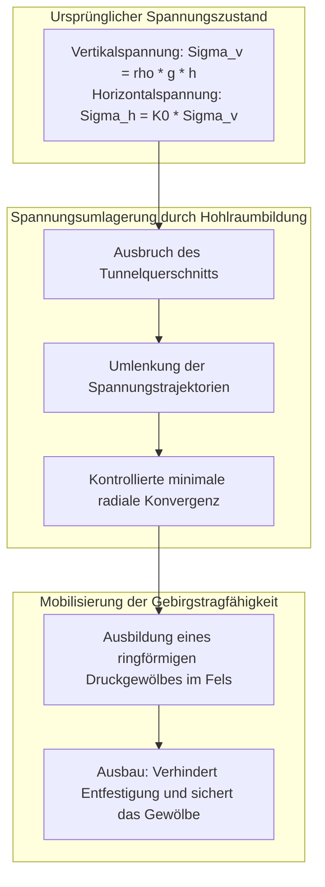
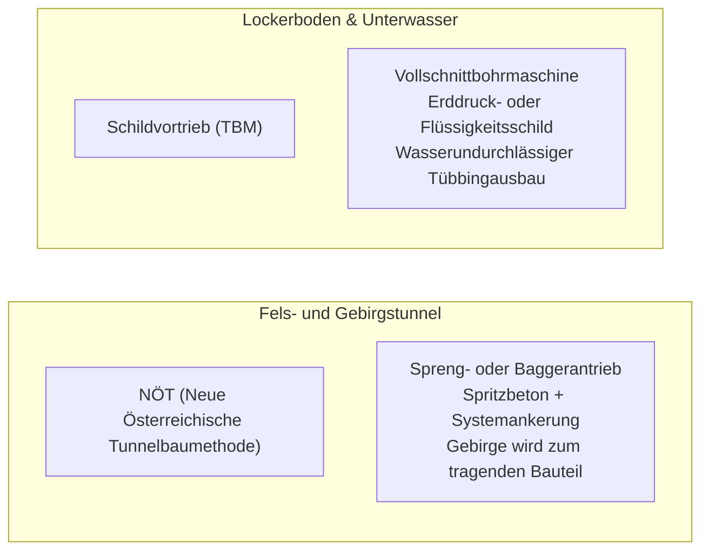

Ein imposantes Tunnelportal öffnet sich in der Felswand eines Alpenmassivs. Hochgeschwindigkeitszüge tauchen mit über 300 Kilometern pro Stunde in die Dunkelheit ein, während hunderte Meter unter dem Meeresspiegel tausende Fahrzeuge sicher über mehrspurige Unterwasserautobahnen rollen. Tunnel gehören zu den unverzichtbaren Lebensadern der modernen Welt.

Doch aus der Perspektive der Physik und Bodenmechanik drängt sich eine fundamentale Frage auf:
"Warum stürzen diese Hohlräume unter dem immensen Gewicht von Millionen Tonnen Gebirge oder dem unerbittlichen Wasserdruck des Ozeans nicht augenblicklich ein?"
"Wie gelingt es, durch wassergesättigten Schlick und instabile Verwerfungszonen vorzudringen, ohne eine verheerende Überflutung auszulösen?"

Tunnelbau ist keine bloße Erdbewegung. Er ist <strong>„ein extremes physikalisches Kontrollsystem, das die Gesetze der Boden- und Felsmechanik nutzt, um das Gebirge zur Selbsttragfähigkeit zu bewegen, Druckgradienten exakt auszugleichen und im Moment des Ausbruchs sofortige statische Stabilität zu gewährleisten.“</strong>

---

## 1. Warum Tunnel nicht einstürzen: Geomechanik und der „Gebirgsgewölbe-Effekt“

Das grundlegende Dogma des modernen Tunnelbaus lautet: <strong>Die Tunnelschale (Spritzbeton oder Tübbinge) trägt niemals das gesamte statische Gewicht des überlagernden Gebirges allein.</strong>

Würde man versuchen, die Auflast eines 500 Meter tiefen Gebirges ausschließlich mit einer 30 Zentimeter dicken Betonwand abzufangen, würden die Druckspannungen die Festigkeit jedes bekannten Baustoffs um ein Vielfaches übersteigen. Der Tunnel hält stand, weil sich im umgebenden Fels das sogenannte <strong>Gebirgsgewölbe (Ground Arching Effect)</strong> ausbildet.

### 1.1 Kirschs elastische Lösung
Beim kreisförmigen Ausbruch (Radius $a$) in elastischem Fels werden die Spannungen gemäß Kirschs Lösung (1898) umgelagert. An der Tunnelwandung ($r = a$) sinkt die Radialspannung auf Null ($\sigma_r = 0$), während die Tangentialspannung $\sigma_\theta$ massiv ansteigt:
$$\sigma_\theta = \sigma_v \left[ (1 + K_0) + 2(1 - K_0)\cos 2\theta \right]$$

Im hydrostatischen Spannungszustand ($K_0 = 1$) verdoppelt sich die Umfangsspannung exakt ($\sigma_\theta = 2\sigma_v$). Es entsteht ein komprimierter Ring um den Tunnel, der die vertikalen Lasten wie ein steinernes Gewölbe um den Hohlraum herum in das feste Gebirge ableitet.

### 1.2 Kennlinienverfahren (Convergence-Confinement Method)
Das Gebirgs-Ausbau-Interaktionsverhalten wird durch die **Gebirgsreaktionskurve (GRC)** beschrieben:
1. **Keine Verformung**: Ein starrer Ausbau ohne Verformung erfordert extrem hohen Stützdruck $p_i = \sigma_0$.
2. **Optimale Konvergenz**: Gestattet man dem Gebirge eine kontrollierte Verformung von wenigen Millimetern bis Zentimetern, mobilisiert das Gestein seine eigene Scherfestigkeit (Kohäsion $c$ und Reibungswinkel $\phi$). Der erforderliche Stützdruck sinkt drastisch auf ein Minimum.
3. **Übermäßige Entfestigung**: Lässt man die Deformation zu weit fortschreiten, zerbricht das Felsgefüge, und das zerrüttete Gestein wirkt als schwere Auflast.

---

## 2. Die zwei Säulen: NÖT (NATM) und Schildvortrieb (TBM)

### 2.1 Die Revolution der NÖT
In den 1960er Jahren von Rabcewicz, Müller und Pacher entwickelt, ersetzte die NÖT das starre Holz- und Stahlrüsten durch ein flexibles Verbundsystem:
- **Spritzbeton und Felsanker**: Unmittelbar nach dem Abschlag wird Schnellbinderspritzbeton aufgetragen, um Felsaufspaltungen zu stoppen. Radial gesetzte Felsanker vernähen einzelne Gesteinsschichten zu einem monolithischen Tragring.
- **Messtechnische Überwachung**: Tägliche Konvergenzmessungen überwachen das Abklingen der Deformationen, bevor die endgültige Innenschale betoniert wird.

### 2.2 Mechanisierter Schildvortrieb (TBM)
In wasserführenden Sanden, Tonen und unter Meerengen arbeiten moderne Tunnelbohrmaschinen (TBM) als geschlossene Wanderfabriken:
- **EPB- (Erddruck) und Hydroschilde (Flüssigkeitsstützung)**: Ein unter Druck stehender Schlamm- oder Erdpuffer im Abbauraum gleicht den Porenwasserdruck und Erddruck auf das Millibar genau aus, um Setzungen an der Oberfläche zu verhindern.
- **Ringspaltverpressung**: Unmittelbar hinter dem Schildschwanz wird Zementmörtel in den Spalt zwischen Gebirge und Tübbingring gepresst, um Bodensetzungen gemäß Pecks Setzungstrog-Theorie minimal zu halten.

---

## 3. Meilensteine des Unterwassertunnelbaus

- **Seikan-Tunnel (Japan, 53,85 km)**: Bezwingung hochkomplexer vulkanischer Störzonen unter der Tsugaru-Straße durch systematische Hochdruck-Zement- und Silikatinjektionen (bis 70 bar), die zerklüftetes Gestein in wasserundurchlässigen Fels verwandelten.
- **Eurotunnel (Ärmelkanal, 50,45 km)**: Präzise Linienführung innerhalb einer homogenen, wasserundurchlässigen Kreidemergelschicht (Chalk Marl) und Rekordvortriebe mit lasergesteuerten Schildmaschinen.
- **Gotthard-Basistunnel (Schweiz, 57,1 km)**: Längster Eisenbahntunnel der Welt unter 2.450 m Alpenfels, bezwungen durch 4 riesige Hartgesteins-TBMs bei Gebirgstemperaturen von über 45 °C.

---

## 4. Fazit

Ob Gotthard, Seikan oder urbane Metronetze: Tunnelbau bezwingt die Natur nicht durch rohe Gewalt, sondern indem Ingenieure die physikalischen Gesetze der Erde verstehen und das Gebirge selbst zu seinem eigenen Schutz heranziehen.
