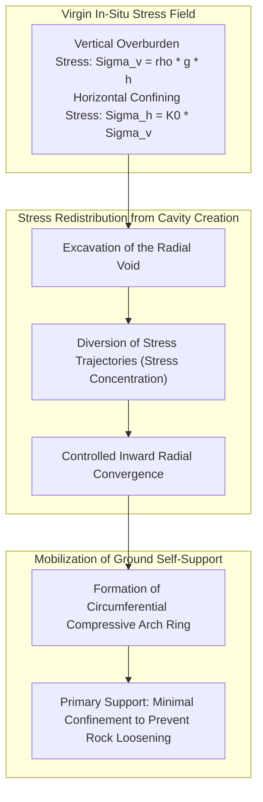
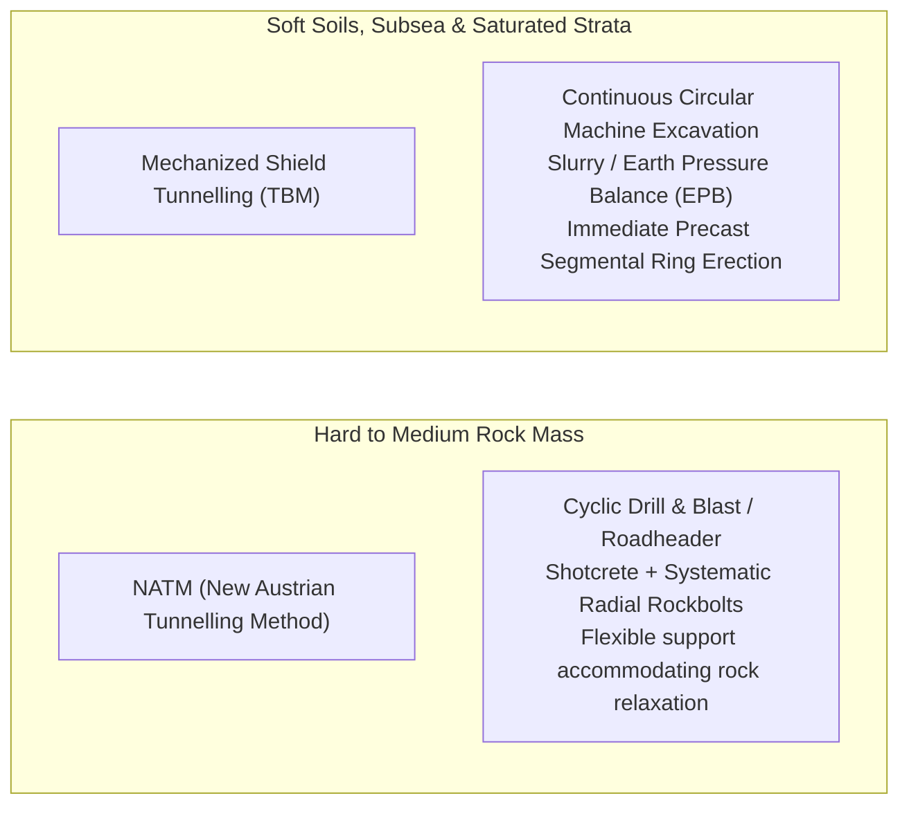
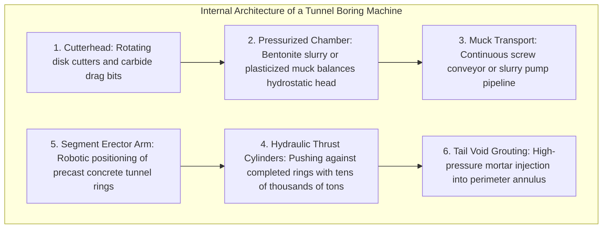
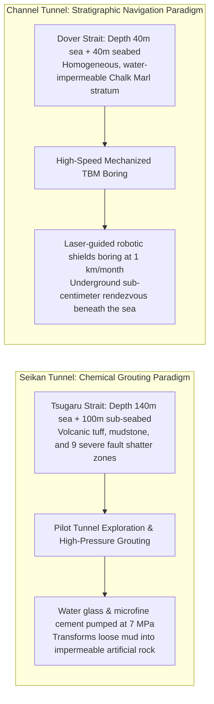
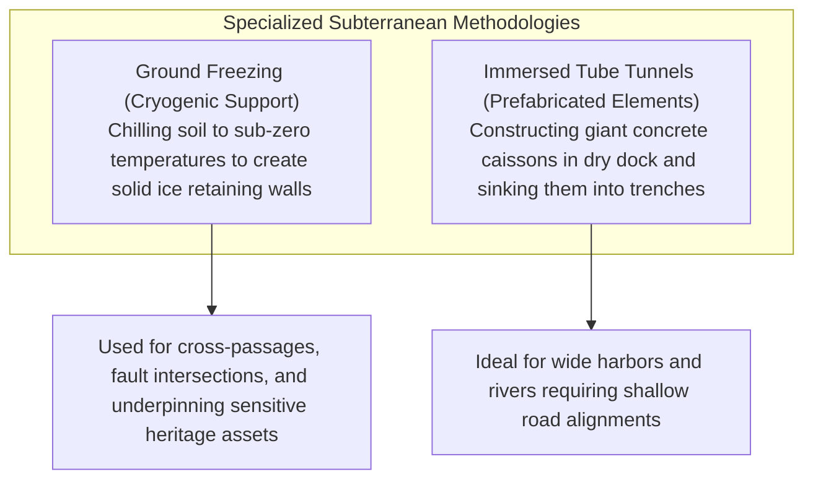
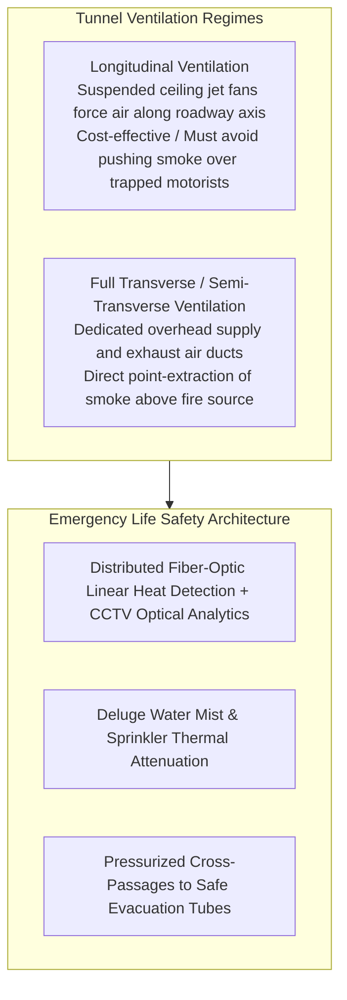
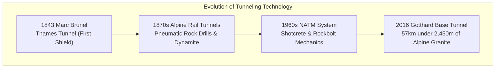

A yawning portal opens on the flank of a rugged mountain ridge. High-speed bullet trains plunge into its darkness at over 300 kilometers per hour, while beneath ocean straits, tens of thousands of motor vehicles cruise along multilane subsea expressways as marine life swims hundreds of meters overhead. In the modern global economy, tunnels represent some of the most critical yet invisible arteries of transportation, utility conveyance, and urban connectivity.

Yet, viewed through the lens of fundamental physics and soil mechanics, an unsettling question arises:
"Why doesn't the colossal weight of hundreds of meters of overhead mountain rock or oceanic water crush these hollow tubes into oblivion?"
"How can heavy industrial machinery excavate unstable, waterlogged silt beneath roaring ocean straits without suffering catastrophic cave-ins and immediate flooding?"

Subterranean excavation is an unrelenting battle against lethal geotechnical hazards. Tunnel engineers routinely confront geological fault fracture zones formed across millions of years, explosive high-pressure groundwater inflows, toxic gas pockets, and squeezing lithostatic ground stresses capable of buckling massive structural steel.

Tunnel engineering is fundamentally far more than simply digging a hole through dirt. It is <strong>"an extreme physical control system that harnesses the intrinsic mechanics of the ground itself (Soil & Rock Mechanics), manages hydrostatic pressure gradients, and instantaneously erects structural support as the excavation advances."</strong>

This comprehensive guide dissects the theoretical principles and practical applications of underground civil engineering: from ground arching mechanics and Kirsch's elastic stress distribution to the two foundational pillars of modern tunneling—the New Austrian Tunnelling Method (NATM) and mechanized Shield Tunnelling (TBM). We will also examine the harrowing sagas of the Seikan and Channel Tunnels, specialized methodologies such as ground freezing and immersed tube placement, and the fluid-mechanical ventilation systems that safeguard life deep below the Earth's crust.

---

## 1. Why Underground Cavities Do Not Collapse: Geomechanics and the "Ground Arch"

The fundamental paradox of tunneling is resolved by a single core geotechnical principle: <strong>"The tunnel lining (reinforced concrete or steel) is not designed to bear the total dead weight of the overlying mountain."</strong>

If a civil engineer attempted to support the entire lithostatic column above a tunnel at a depth of 500 meters using purely structural concrete walls, the compressive stresses would drastically exceed the ultimate compressive strength of any known building material. The tunnel would instantly suffer catastrophic crushing failure.

Tunnels remain standing because the surrounding rock mass and soil mass inherently support themselves through the <strong>"Ground Arching Effect"</strong> (also known as the soil-structure interaction arch).



### 1.1 Virgin Stress Fields and Kirsch's Elastic Stress Solution
Prior to any excavation, deep subterranean ground exists in a state of triaxial equilibrium. The vertical in-situ stress $\sigma_v$ is governed by the bulk density of the overburden material and depth:
$$\sigma_v = \rho g h$$

Meanwhile, the lateral horizontal stress $\sigma_h$ is constrained by Poisson's ratio $\nu$ and tectonic history, expressed via the coefficient of earth pressure at rest $K_0$:
$$\sigma_h = K_0 \sigma_v$$

When a circular void of radius $a$ is excavated within this homogeneous, isotropic elastic medium, the pristine stress trajectories are abruptly interrupted. The mathematical description of the resulting stress concentration was formulated by G. Kirsch in 1898. In polar coordinates $(r, \theta)$, the radial stress $\sigma_r$ and circumferential hoop stress $\sigma_\theta$ are expressed as:

$$\sigma_r = \frac{\sigma_v}{2} \left[ (1 + K_0)\left(1 - \frac{a^2}{r^2}\right) - (1 - K_0)\left(1 - 4\frac{a^2}{r^2} + 3\frac{a^4}{r^4}\right) \cos 2\theta \right]$$

$$\sigma_\theta = \frac{\sigma_v}{2} \left[ (1 + K_0)\left(1 + \frac{a^2}{r^2}\right) + (1 - K_0)\left(1 + 3\frac{a^4}{r^4}\right) \cos 2\theta \right]$$

At the unsupported boundary of the tunnel excavation ($r = a$), the radial stress drops to atmospheric zero:
$$\sigma_r(a) = 0$$

Simultaneously, the tangential hoop stress reaches its maximum at the boundary:
$$\sigma_\theta(a) = \sigma_v \left[ (1 + K_0) + 2(1 - K_0)\cos 2\theta \right]$$

In a hydrostatic stress field where $K_0 = 1$ (typical in soft rock, clay, or extreme depths), the equation simplifies dramatically:
$$\sigma_\theta(a) = 2\sigma_v$$

This reveals a profound mechanical truth: <strong>the excavation causes tangential hoop stresses to double, forming a circumferential ring of high compressive stress immediately behind the tunnel perimeter</strong>. This ring functions as a self-supporting stone arch, diverting the massive vertical overburden load around the perimeter and transferring it into the unyielding ground on either side of the tunnel.

### 1.2 The Ground Reaction Curve (GRC) and the Convergence-Confinement Method
The foundational theoretical framework of modern tunneling design is the <strong>Convergence-Confinement Method (CCM)</strong>, formulated through the concept of the <strong>Ground Reaction Curve (GRC)</strong> developed by Fenner, Pacher, and Lombardi.

```
Support Pressure pi
  ^
  |  \
  |   \   (1) Elastic Decompression: Wall displaces inward as support drops
  |    \
  |     \_______
  |             \  (2) Optimal Support Equilibrium: Ground arch mobilizes peak shear strength
  |              \______
  |                     \
  |                      \  (3) Plastic Disintegration: Excessive deformation causes unraveling
  +-----------------------------------> Radial Wall Convergence ur
```

1. **Immediate Pre-Deformation State ($u_r = 0$)**: To hold the ground rigidly in its pristine position without any radial displacement, an enormous internal support pressure $p_i = \sigma_0$ is theoretically required.
2. **Controlled Convergence (Optimal Mobilization)**: As the tunnel wall is permitted to deform slightly inward into the excavated void (on the order of millimeters to several centimeters), the rock mass mobilizes its internal shear strength (cohesion $c$ and internal friction angle $\phi$). The ground absorbs its own load, causing the required external support pressure $p_i$ to plummet dramatically to a minimal safe threshold.
3. **Over-Deformation and Plastic Ravelling**: If displacement is allowed to proceed unchecked beyond the critical yield strain, the rock mass exceeds its peak strength. Microcracks coalesce, brittle failure occurs, and loosened dead weight begins to detach. The required support pressure surges upward as the tunnel must now bear unraveling debris.

The ultimate objective of geotechnical tunnel engineering is to <strong>install primary support at precisely the optimal point along the Ground Reaction Curve, allowing the ground to mobilize its maximum self-supporting capacity while preventing brittle structural disintegration</strong>.

---

## 2. The Twin Pillars of Modern Tunneling: NATM and Mechanized Shielding

Depending on the lithology, hydrology, and environmental constraints, virtually all modern tunnels are constructed via one of two dominant methodologies:



### 2.1 Conquering Mountains: The NATM Revolution
Codified in the 1960s by Austrian engineers Ladislaus von Rabcewicz, Leopold Müller, and Franz Pacher, the <strong>New Austrian Tunnelling Method (NATM)</strong>—also referred to globally as the Conventional Tunnelling Method or Sprayed Concrete Tunnelling Method (SCLM)—revolutionized alpine construction.

Prior to NATM, traditional mountain tunneling relied on massive timber balks or rigid structural steel arches. Engineers fought ground pressure with sheer brute rigidity. In squeezing alpine rock, these rigid timber and steel supports inevitably buckled, twisted, and collapsed under overwhelming lithostatic loads, triggering horrific cave-ins.

NATM inverted this paradigm completely: <strong>Do not fight the mountain with rigid force; rather, transform the surrounding rock mass into its own primary load-bearing structural component</strong>.

```
[Typical NATM Operational Cycle]
1. Heading Excavation (Controlled Drill & Blast or Mechanical Roadheader)
       │
       ▼
2. Primary Shotcrete Application (100–250 mm fiber-reinforced sprayed concrete)
       │ ── Rapid-setting accelerators seal rock fissures, halting atmospheric weathering
       ▼
3. Radial Rockbolt Installation (2 to 6 meter high-tensile steel tendon anchors)
       │ ── Tendons bonded with resin or cement grout, knitting loose blocks into a monolithic arch
       ▼
4. Systematic Convergence Monitoring (3D Total Station Geodetic Targets)
       │ ── Millimeter-precision daily tracking: Confirm that radial convergence has reached full asymptote
       ▼
5. Geotextile Membrane & Secondary Cast-in-Place Concrete Lining
```

#### Rockbolt Mechanics: Stitching and Beam Formation
Rockbolts are not merely passive nails. When installed in systematic radial arrays around the tunnel perimeter, they perform three vital geomechanical functions:
- **Suspension Effect**: Anchoring loose, fractured outer rock strata to solid, undisturbed competent bedrock located deeper within the mountain.
- **Beam Building (Lamination Effect)**: In stratified sedimentary rock, bolts clamp multiple horizontal layers tightly together, transforming thin, flexible rock sheets into a thick, composite structural beam with vastly higher bending resistance.
- **Rock Mass Confinement**: Under tension $T$, rockbolts induce compressive normal stresses across natural joints and fissures, preventing shear slippage according to the Mohr-Coulomb failure criterion:
$$\tau = c + \sigma_n \tan \phi$$

#### Invert Closure in Squeezing Ground
In heavy squeezing ground, high lithostatic pressures force the tunnel floor upward in a destructive failure mode known as floor heave. NATM solves this by casting an inverted arch (an "invert") of concrete across the bottom of the excavation, closing the horseshoe shape into a continuous structural ring. Closing the ring dramatically enhances three-dimensional stiffness, halting runaway deformation.

---

### 2.2 Subduing Silt and Water: Mechanized Shield Tunnelling (TBM)
While NATM dominates stable to medium-fractured rock mountains, it cannot easily excavate through unconsolidated, water-saturated sand, silt, or permeable gravel beneath congested cities and oceans. In these fluid, collapse-prone environments, <strong>Mechanized Shield Tunnelling</strong> represents the pinnacle of civil engineering.

A shield machine is essentially an autonomous, hermetically sealed subterranean factory. At its front, a circular rotating cutterhead carves through soil; inside its cylindrical steel hull, personnel work under atmospheric pressure; and at its rear, a hydraulic erector arm bolts together heavy precast concrete segments into a permanent, watertight tube.



#### Face Pressure Equilibrium: The Slurry vs. EPB Dichotomy
The catastrophic failure mode in shield tunneling is the collapse of the excavation face (the *heading*), which instantaneously propagates upward to form catastrophic sinkholes on the surface. To maintain face stability, the pressure exerted within the machine's forward chamber $p_s$ must precisely match the natural pore water pressure $u$ and effective horizontal soil stress $\sigma'_h$:
$$p_s \approx K_0 \sigma'_v + u$$

Modern TBMs achieve this delicate thermodynamic and hydraulic balance via two primary systems:

1. **Earth Pressure Balance (EPB) Shields**:
   EPB machines are deployed predominantly in cohesive clays, silts, and soft soils. The excavated soil itself serves as the balancing medium. As the cutterhead rotates, conditioning agents (biodegradable foams, polymers, and bentonite) are injected into the cutterhead and chamber. This transforms stiff dirt into a plastic, toothpaste-like muck with controlled shear strength. Hydraulic thrust rams push the machine forward, compressing this paste against the face. The rate of soil discharge via the variable-speed Archimedean screw conveyor is electronically throttled via feedback loops from pressure transducers, maintaining chamber pressure within razor-thin tolerances of $\pm 10\text{ kPa}$.
2. **Slurry Pressure Balance Shields**:
   In coarse sands, gravels, and fractured rock under extreme hydrostatic head (such as subsea passages), soil cannot be easily plasticized. Slurry shields fill the excavation chamber with a dense thixotropic bentonite slurry. Under hydrostatic pressure, bentonite penetrates several millimeters into the ground pores, depositing a dynamic impermeable membrane known as a **"mudcake"** or filter cake. This cake completely seals the face, transferring fluid pressure directly onto the ground skeleton to resist collapse. The muck-laden slurry is pumped via pipelines to a massive surface separation plant, where hydrocyclones and centrifuges extract the solids before recycling the clean bentonite back underground.

#### Tail Void Grouting and Peck's Surface Settlement Trough
As the cylindrical steel shield slides forward, an annular void is created between the outside perimeter of the precast concrete segment rings and the excavated soil boundary. This gap, termed the <strong>tail void</strong>, corresponds to the thickness of the steel shell plus the clearance required for segment erection.

If this void is left unfilled for even minutes, surrounding ground rapidly relaxes into the empty space, causing catastrophic ground subsidence above. Modern shields utilize **continuous two-component tail void grouting (A: cementitious bentonite slurry, B: chemical accelerator)** injected directly through the tail skin seals under high pressure. The grout sets into a load-bearing gel within 10 to 15 seconds, locking the surrounding earth in place before deformation can initiate.

The surface settlement profile perpendicular to the tunnel alignment is mathematically characterized by <strong>Peck's Empirical Settlement Trough</strong>, described by a Gaussian error curve:

$$S(x) = S_{\max} \exp\left( -\frac{x^2}{2i^2} \right)$$

where $x$ represents the transverse distance from the tunnel centerline, $S_{\max}$ is the maximum center-line settlement, and $i$ is the trough width parameter (distance from the center to the inflection point), typically expressed as:
$$i = K \cdot z_0$$
($z_0$ = depth to tunnel axis; $K$ = ground-dependent trough parameter, typically 0.4 to 0.6 for clay).
By maintaining ground volume loss $V_L$ below 0.5% through precision face pressure and immediate tail grouting, engineers routinely bore massive tunnels mere centimeters beneath historic buildings, operating subway lines, and active utility mains without producing a single visible hairline crack on the surface.

#### Disc Cutter Rock Fragmentation Mechanics
When a Hard Rock TBM attacks competent rock, it does not grind rock like sandpaper. It relies on heavy alloy steel <strong>rolling disc cutters</strong> (typically 17 to 19 inches in diameter) mounted across the cutterhead face.
Under hydraulic thrust exceeding 250 kN per cutter, the hardened steel edge is forced into the rock face, creating an intense triaxial compressive stress bulb directly beneath the blade tip. When this compressive stress surpasses the rock's unconfined compressive strength, a localized crushed zone develops.
As adjacent cutters roll across the face, tensile microcracks propagate laterally from the crushed zones toward one another. When neighboring cracks intersect, an entire slab of rock spalls off cleanly in large chips—a process known as <strong>mechanical chipping</strong>. Chipping requires far less energy than total pulverization, enabling TBMs to slice through solid granite at rates of tens of meters per day.

---

## 3. Subsea Tunneling: The Ultimate Battle with Water Pressure

Subsea tunnels represent the pinnacle of geotechnical daring. Unlike mountain excavations where ground water can eventually be drained, subsea tunnels face an essentially inexhaustible reservoir of overhead water. A hydrostatic pressure of 1.0 MPa (approx. 10 atmospheres) acts at a depth of 100 meters, exerting an unrelenting 100 tons of force on every square meter of exposed perimeter.

Should an excavation intersect an open fault connected directly to the seabed, seawater would surge inward with unstoppable hydraulic head, drowning machines and personnel within minutes.

Two monumental engineering achievements—Japan's <strong>Seikan Tunnel</strong> and Europe's <strong>Channel Tunnel</strong>—illustrate fundamentally divergent, yet equally brilliant, strategic responses to this subsea threat.



### 3.1 The Seikan Tunnel: The Epic of High-Pressure Chemical Grouting
Connecting Japan's main island of Honshu with the northern island of Hokkaido beneath the turbulent Tsugaru Strait, the <strong>Seikan Tunnel</strong> (completed in 1988, total length 53.85 km, undersea section 23.3 km) stands as one of the most perilous construction undertakings in human history.

The Tsugaru Strait sits atop an active volcanic arc crosshatched with complex geological fault zones. During its 24-year construction, catastrophic flooding struck the tunnel four times. In May 1976, an unexpected water burst unleashed 85 tons of high-pressure seawater per minute into the main heading. Only heroic around-the-clock bulkhead sealing and continuous drainage pumping saved the tunnel from total loss.

The definitive breakthrough that made the Seikan Tunnel possible was the perfection of <strong>Deep Grouting Technology</strong>:
1. **The Pilot Bore (Advanced Heading)**: A small pilot tunnel was excavated hundreds of meters ahead of the main alignment. Long-range horizontal core borings were drilled forward like sensory antennae, mapping water pressures, fault zones, and rock mechanics ahead of the cutting face.
2. **Multi-Stage Grouting Arrays**: When a fault zone was identified, drilling rigs drove a conical umbrella of grout holes radiating outward into the rock mass surrounding the future tunnel boundary.
3. **High-Pressure Chemical Injection**: Engineers pumped sodium silicate (water glass) and ultra-fine Portland cement into the fissured rock at staggering pressures of up to **$7.0\text{ MPa}$ (70 atmospheres)**. The slurry penetrated micro-fractures as small as fractions of a millimeter, displacing seawater and setting into an impenetrable, concrete-like matrix.
4. **Excavation under Artificial Bedrock**: Once the perimeter was verified to be completely dry and impervious, workers safely excavated the core using drill-and-blast methods, spraying shotcrete immediately to secure the opening.

The Seikan methodology proved to the global engineering community that even fractured, ocean-fed fault zones can be tamed through disciplined chemical ground modification.

### 3.2 The Channel Tunnel: Geostratigraphic Precision and TBM Speed
Opened in 1994 to link Folkestone, England with Coquelles, France across the English Channel (total length 50.45 km, subsea section 37.9 km), the Eurotunnel took an entirely different engineering approach.

Rather than fighting chaotic geology with chemical grout, Eurotunnel engineers conducted exhaustive offshore marine seismic surveys to identify a single, ideal geological stratum: the <strong>Chalk Marl (Cenomanian stage)</strong>.
The Chalk Marl is a unique geological formation containing approximately 70% chalk and 30% clay minerals. It possesses ideal engineering characteristics: it is impermeable to water, ductile enough not to crack under tectonic movement, yet soft enough to allow rapid mechanical cutting without blasting.

Eleven custom-built TBMs were deployed simultaneously from both the English and French coasts. The machines bored day and night, guided by sophisticated laser navigation and satellite-synchronized gyroscopic compasses. By remaining strictly within the ribbon of Chalk Marl, the British and French tunneling crews achieved unprecedented advance rates exceeding **1,000 meters per month**. On December 1, 1990, an Englishman and a Frenchman shook hands through a small opening cut between the two headings deep beneath the seabed, uniting Britain and mainland Europe for the first time since the last Ice Age 8,000 years ago.

---

## 4. Specialized Civil Engineering: Immersed Tubes and Ground Freezing

When conventional NATM or shield techniques are rendered unfeasible by extreme geotechnical conditions or rivermouth geometry, engineers deploy radically innovative alternatives.



### 4.1 Ground Freezing: The Cryogenic Armor
When excavating through fluid running silt, water-logged sand, or when constructing cross-passages between twin shield tunnels mere meters below active rail foundations, chemical grouting may fail due to high ground water velocities washing the grout away. Under such conditions, <strong>Artificial Ground Freezing (AGF)</strong> provides the ultimate structural shield.

Engineers drill an array of freezing pipes into the unstable perimeter. A coolant—either chilled calcium chloride brine at $-30^\circ\text{C}$ or liquid nitrogen at $-196^\circ\text{C}$—is continuously circulated through closed loops. Over weeks of thermal conduction, pore water freezes, expanding into solid ice that cements the soil grains together.

The resulting **frozen soil wall** exhibits compressive strengths exceeding 20 to 30 MPa, comparable to structural concrete, while remaining 100% watertight. Workers excavate safely inside this temporary cryogenic cavern, erect the permanent lining, and then deactivate the refrigeration plant, allowing the ground to slowly thaw back to its ambient state.

### 4.2 Immersed Tube Tunnels: Sinking Highway Caissons
In wide estuaries, shallow shipping channels, or harbor entrances where boring deep shield tunnels would necessitate impractically long approach ramps, the <strong>Immersed Tube Tunnel</strong> is the premier engineering solution.

1. **Dry-Dock Fabrication**: Massive hollow reinforced concrete tunnel segments—often 100 to 150 meters long, 40 meters wide, and weighing upwards of 50,000 tons—are constructed inside a coastal dry dock. Each segment accommodates multi-lane highways or railway tracks, with temporary steel bulkheads sealing both ends to make the units buoyant.
2. **Flotation and Towing**: The dry dock is flooded, and the buoyant concrete elements are towed by tugboats out to the designated marine channel.
3. **Controlled Submersion**: Positioned over a pre-dredged seafloor trench, water is pumped into internal ballast tanks. The massive element descends slowly through the water column under the control of specialized placement pontoons.
4. **Hydraulic Jointing (The Gina Gasket Vacuum Seal)**: As the new element is positioned against the previously installed segment, their matching end frames engage a massive elastomeric rubber gasket (the Gina gasket). The small volume of water trapped between the temporary bulkheads is pumped out. The crushing hydrostatic pressure of the open sea on the far end of the element pushes the entire 50,000-ton concrete mass forward, compressing the rubber gasket with hundreds of tons of force. This water-pressure seal achieves an instantaneous, permanent, watertight joint without requiring a single external bolt.

Prominent examples include the Tokyo Bay Aqua-Line, the Øresund Bridge-Tunnel between Denmark and Sweden, and the record-breaking Hong Kong-Zhuhai-Macau link.

---

## 5. Subterranean Life Support: Ventilation, Fire Dynamics, and Escape

Constructing a stable tunnel is only half the battle. Once vehicles enter and burn fossil fuels, an enclosed subterranean void becomes an environment of severe atmospheric and thermal hazard. Without sophisticated active life-support systems, a single vehicle collision can transform a multi-kilometer tunnel into a lethal, toxic furnace.

The 1999 catastrophe inside the <strong>Mont Blanc Tunnel</strong> between France and Italy—where a burning transport truck sparked an inferno that killed 39 people and burned at temperatures exceeding $1,000^\circ\text{C}$ for 53 hours—fundamentally rewrote international tunnel safety standards.



### 5.1 Fluid Dynamics of Tunnel Ventilation
Under ordinary traffic operations, ventilation systems dilute hazardous automotive pollutants: carbon monoxide ($\text{CO}$), nitrogen oxides ($\text{NO}_x$), and particulate diesel soot. In an emergency fire event, however, the ventilation system becomes the primary tool for life preservation.
- **Longitudinal Jet Fan Systems**: High-thrust axial fans suspended from the tunnel ceiling accelerate the tunnel air column, driving air downstream like a giant wind tunnel. The critical engineering parameter is the <strong>Critical Velocity ($v_c$)</strong>—the precise minimum air speed required to prevent smoke from flowing backward along the ceiling above fleeing victims (a phenomenon known as *backlayering*):
$$v_c \propto \left( \frac{g \cdot \dot{Q}}{\rho c_p T W} \right)^{1/3}$$
where $\dot{Q}$ is the convective fire heat release rate, $W$ is the tunnel width, and $T$ is absolute temperature.
- **Transverse Smoke Extraction**: For ultra-long or subsea tunnels, transverse systems utilize a false ceiling divided into parallel air supply and smoke exhaust ducts. In a fire, motorized smoke dampers directly above the blaze are opened via remote control, while all other dampers remain shut. Powerful centrifugal exhaust fans suck toxic smoke directly out of the roadway ceiling at rates exceeding $200\text{ m}^3/\text{s}$, maintaining a clear, breathable air layer near the pavement for evacuation.

### 5.2 Positive-Pressure Escape Cross-Passages
Modern tunnel designs never rely on a single, isolated tube. Long tunnels are constructed as twin parallel bores linked every 250 to 300 meters by fire-resistant **cross-passages**, or alongside a dedicated central service tunnel.

The critical aerodynamic defense is <strong>Positive Pressure Cascading</strong>. The service or escape tunnel is continuously pumped with fresh air from surface shafts, maintaining an internal air pressure approximately 20 to 50 Pa higher than the roadway tunnel. When an evacuee opens an emergency fire door, the pressure differential creates a stiff outward blast of clean air into the traffic bore, physically preventing lethal carbon monoxide, smoke, and superheated gases from entering the evacuation conduit.

---

## 6. The Great Pioneers: How Humanity Mastered the Abyss

The history of subterranean engineering is a testament to inventive audacity over seemingly insurmountable natural forces.



### 6.1 Marc Brunel and the Shipworm (1843)
The inception of the tunneling shield arose from biomimetic observation. In the early 19th century, French-British engineer Marc Isambard Brunel was inspecting rotting timber in a naval shipyard when he observed the marine mollusk *Teredo navalis* (the naval shipworm).
Brunel noted that the creature possessed two microscopic calcified shells on its head, which it used to rasp mechanical grooves into hard oak. As it ingested and excreted the wood pulp, it lined the resulting bore with an impervious calcium carbonate excretion, constructing a smooth, stable tunnel behind it.

Inspired by this miniature subterranean miner, Brunel patented the <strong>Tunneling Shield</strong> in 1818. Between 1825 and 1843, he used a massive cast-iron rectangular shield to bore the Thames Tunnel in London through waterlogged silt. Divided into 36 individual compartments across three tiers, human miners manually excavated the mud face by hand, while bricklayers immediately laid mortar rings behind the advancing iron shield. Despite five catastrophic riverbed inundations, the Thames Tunnel opened in 1843 as the world's first underwater tunnel—the direct ancestor of every modern TBM.

### 6.2 The Gotthard Base Tunnel (2016): The Alpine Masterpiece
The undisputed modern summit of subterranean achievement is Switzerland's <strong>Gotthard Base Tunnel</strong>. Opened in 2016 with a continuous rail length of **57.1 kilometers** and reaching an unprecedented overburden depth of **2,450 meters**, it cuts cleanly through the colossal crystalline core of the European Alps.

At these staggering depths, virgin rock temperatures soared past $45^\circ\text{C}$, requiring massive subterranean chilling plants circulating ice water to keep miners alive. Overburden pressures exceeded 100 MPa, triggering violent **rockbursts**—explosive self-fragmentation where rock walls spontaneously ruptured like artillery shells.
At the dreaded *Piora Basin*, geologists encountered an 800-meter-wide zone of pulverized dolomite marble saturated with high-pressure water, which flowed like quicksand. Engineers conquered this geologic deathtrap through extensive forward diamond drilling and deep chemical freezing. Over 17 years, four mammoth 9.5-meter-diameter Herrenknecht hard rock TBMs extracted 28 million tons of alpine rock, completing the longest, deepest transit corridor on Earth with millimeter-accurate borehole breakthroughs.

---

## 7. The 21st Century Frontier: Deep Underground Infrastructure & Digital Asset Health

As urban metropolises expand and surface land becomes saturated, subterranean engineering is pivoting into "Deep Underground Space" (depths exceeding 40 to 50 meters below private property lines) alongside AI-driven structural health management.

### 7.1 Deep Shield Mining & Squeezing Rock Formations
In mega-projects such as Japan's Chuo Shinkansen Maglev line—which must cross the Southern Alps through overburdens exceeding 1,400 meters and navigate the massive Itoigawa-Shizuoka Tectonic Line—engineers deploy **yielding support systems**. Rather than fighting the immense lithostatic convergence with rigid steel, sliding friction arches and compressible lining elements deform plastically under predetermined peak loads, bleeding off dangerous tectonic energy while maintaining cavity stability.

Simultaneously, cutting-edge mega-TBMs now incorporate <strong>Autonomous Real-Time Cutter Health Sensing</strong>. Ultrasonic thickness transponders and eddy-current sensors embedded directly into the hardened tungsten carbide cutter rings transmit wear telemetry wirelessly through the rotating cutterhead to machine operators, eliminating the extreme danger of human divers entering hyperbaric slurry chambers to physically inspect cutter rings under multi-bar hydrostatic pressures.

### 7.2 The Digital Twin and Robotic Infrastructure Inspection
To guarantee that subsea and alpine tunnels remain safe across 100-to-200-year design lifespans, traditional hammer-sounding inspection is being augmented by autonomous digital monitoring:
1. **High-Speed Mobile Mapping Systems (MMS)**: Inspection trains fitted with 3D LiDAR arrays and high-resolution thermal cameras cruise at 80 km/h, generating point clouds with sub-millimeter geometric fidelity. The system automatically cross-references seasonal scans, detecting subtle millimetric joint offsets, micro-cracking, and water seepage patterns.
2. **Acoustic AI Strike Robotics**: Automated robotic crawlers gently strike concrete lining segments with instrumented mechanical hammers. Deep learning convolutional neural networks analyze the acoustic frequency spectrograms, instantaneously differentiating between solid bonding and internal concrete delamination with accuracy surpassing human auditory perception.
3. **Subsurface Ground-Penetrating Radar (GPR)**: High-frequency radar antennas penetrate the concrete shell to map the integrity of the annular grout layer and identify void formation behind the lining before ground subsidence can propagate.

---

## 8. Conclusion: The Masterwork of Invisible Intellect

To bore straight through the granite roots of continental mountains and pierce the saturated ocean bed without letting in a single drop of seawater is among civilization's most triumphant structural feats.

When travelers pass effortlessly through a tunnel at hundreds of kilometers per hour, surrounded by illuminated tile walls and clean air, it is easy to forget that mere inches away lies the crushing pressure of millions of tons of primordial rock and the immense hydrostatic weight of the sea.

<strong>"Civil engineering does not conquer nature through brute confrontation. Rather, it listens to the stresses of the earth, coaxes the rock into supporting itself, and threads human pathways through the living forces of our planet."</strong>

From Marc Brunel's humble shipworm to the colossal robotic TBMs carving through alpine mountains, every subterranean passage stands as an enduring monument to scientific courage, geomechanical mastery, and the quiet triumph of civil engineering.
