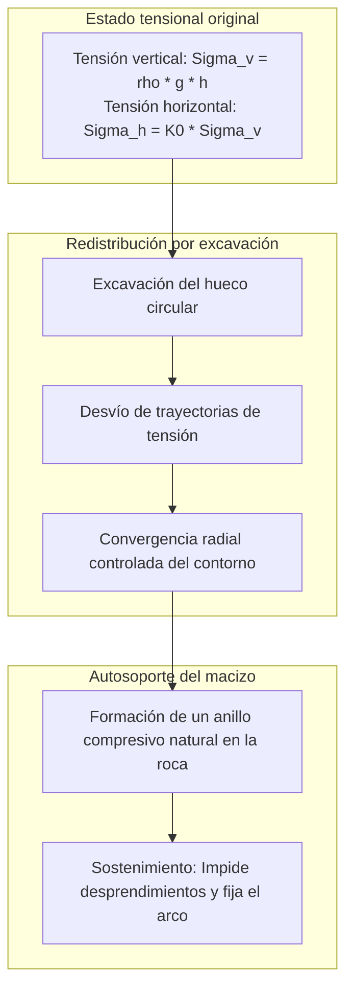
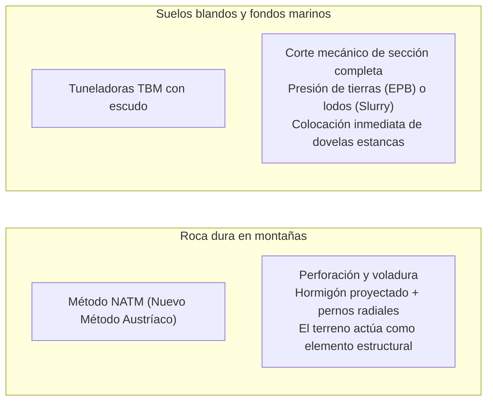

Un imponente portal se abre en la ladera de una cordillera escarpada. Trenes de alta velocidad se adentran en su oscuridad a más de 300 kilómetros por hora, mientras que bajo el lecho marino miles de automóviles cruzan a salvo autopistas sumergidas. Los túneles representan arterias vitales del mundo contemporáneo.

Sin embargo, desde la perspectiva de la física y la geomecánica, surge una pregunta inquietante:
"¿Por qué el descomunal peso de cientos de metros de montaña o mar no aplasta estas cavidades al instante?"
"¿Cómo es posible excavar en arenas y lodos saturados de agua a presión sin provocar una inundación mortal?"

Excavar bajo tierra es una batalla contra colapsos y fallas tectónicas. La ingeniería de túneles no consiste simplemente en abrir un agujero: es <strong>«un sistema de control físico extremo que aprovecha la mecánica del terreno (Suelos y Rocas) para que este se sostenga a sí mismo, equilibrando presiones hidroestáticas e instalando soporte estructural inmediato.»</strong>

---

## 1. Por qué los túneles no colapsan: El efecto de arco del terreno

El principio rector de la ingeniería subterránea afirma: <strong>El revestimiento de hormigón del túnel no está diseñado para soportar todo el peso de la montaña por sí solo.</strong>

A 500 metros de profundidad, resistir la carga litostática pura con un muro de hormigón pulverizaría el material en segundos. El túnel permanece en pie gracias al <strong>efecto de arco del terreno (Ground Arching Effect)</strong>.

### 1.1 Solución elástica de Kirsch y el Método de Convergencia-Confinamiento
La solución de Kirsch (1898) describe matemáticamente que en el borde del túnel ($r = a$), la tensión radial se anula ($\sigma_r = 0$), mientras que la tensión tangencial $\sigma_\theta$ se duplica en régimen hidrostático ($\sigma_\theta = 2\sigma_v$).
Este anillo de alta compresión transfiere el peso superior hacia los laterales estables.

El método de **Convergencia-Confinamiento** establece:
1. **Soporte rígido nulo**: Intentar contener el terreno sin deformación exige presiones astronómicas.
2. **Deformación óptima**: Permitir una convergencia controlada de milímetros moviliza la resistencia al corte del macizo ($c$ y $\phi$), reduciendo drásticamente la presión necesaria de sostenimiento.
3. **Descompresión excesiva**: Si no se coloca sostenimiento a tiempo, la roca se agrieta y colapsa bajo peso suelto.

---

## 2. Los dos grandes métodos: NATM y Tuneladoras (TBM)

### 2.1 El Nuevo Método Austríaco (NATM)
Sistematizado en la década de 1960 por Rabcewicz, convirtió el terreno circundante en su propio soporte mediante:
- **Hormigón proyectado (Gunita) y pernos de anclaje**: Sellado inmediato contra la meteorización y anclaje profundo para coser fracturas rocosas.
- **Instrumentación y monitoreo continuo**: Mediciones de convergencia hasta la estabilización total antes del revestimiento final.

### 2.2 Tuneladoras Mecanizadas (TBM)
En suelos urbanos y lechos marinos, la tuneladora opera como una factoría subterránea presurizada:
- **Escudos EPB y de Lodos**: La presión en la cámara de corte se equilibra en tiempo real con el agua subterránea para evitar socavones.
- **Inyección de trasdós**: Sellado inmediato con mortero tras la cola del escudo para minimizar los asientos según la curva de Peck:
$$S(x) = S_{\max} \exp\left( -\frac{x^2}{2i^2} \right)$$

---

## 3. Hitos de la ingeniería submarina y alpina

- **Túnel de Seikan (53,85 km)**: Triunfo sobre fallas volcánicas bajo el estrecho de Tsugaru mediante inyecciones químicas a 70 bares de presión.
- **Eurotúnel bajo el Canal de la Mancha (50,45 km)**: Récord de perforación guiada por láser a través de la formación de marga cretácica impermeable.
- **Túnel de Base de San Gotardo (57,1 km)**: Récord mundial a 2.450 m bajo los Alpes suizos, excavado por 4 megatuneladoras a más de 45 °C de temperatura de roca.

---

## 4. Conclusión

Perforar las entrañas de montañas y mares no es un acto de fuerza bruta, sino una sinfonía de geomecánica e inteligencia ingenieril que permite a la humanidad abrir caminos a través de las fuerzas vivas de nuestro planeta.
