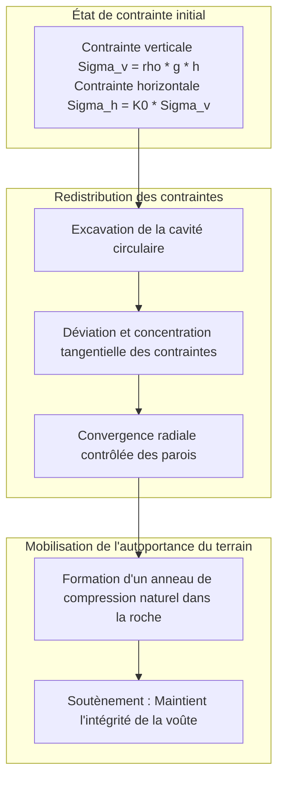
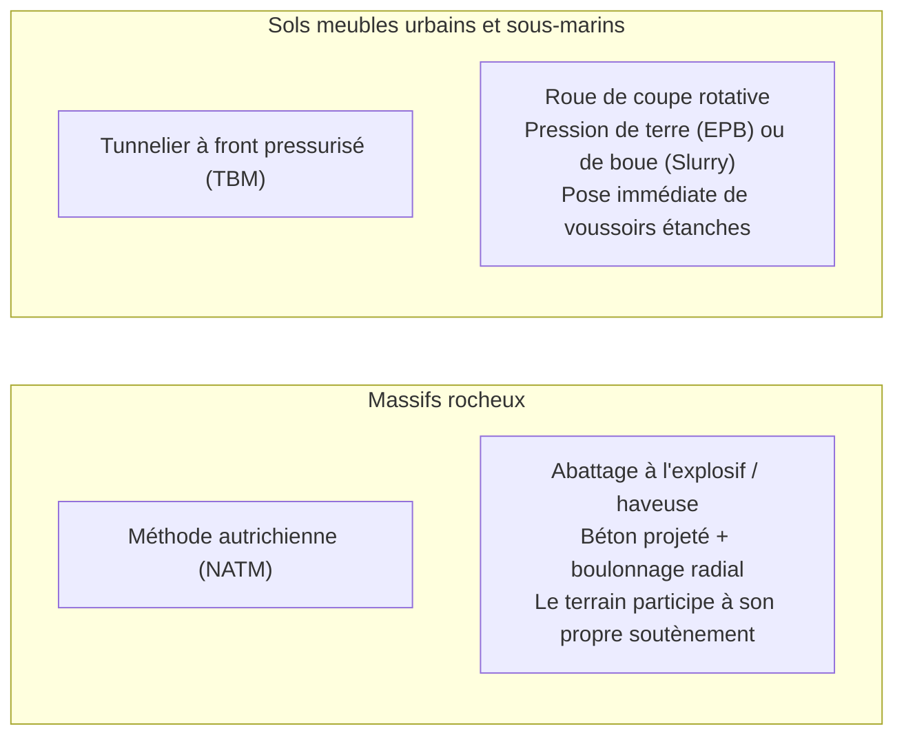

Un portail sombre s'ouvre au flanc d'une imposante montagne. Des trains à grande vitesse s'y engouffrent à plus de 300 kilomètres par heure, tandis que sous le plancher océanique, des milliers de véhicules circulent sous des dizaines de mètres d'eau de mer. Le tunnel est aujourd'hui l'un des piliers invisibles de la civilisation moderne.

Cependant, du point de vue de la physique et de la géotechnique :
« Pourquoi ces cavités ne sont-elles pas instantanément broyées par les millions de tonnes de roche ou l'écrasante masse de l'océan ? »
« Comment creuser dans des sables gorgés d'eau sous pression sans provoquer d'inondation catastrophique ? »

Le creusement souterrain est un combat permanent contre les venues d'eau et les failles tectoniques. Le génie tunnelier n'est pas un simple travail de terrassement : c'est <strong>« un système de contrôle physique extrême qui mobilise la mécanique des sols et des roches pour transformer le terrain en élément porteur, tout en équilibrant rigoureusement les pressions hydrostatiques. »</strong>

---

## 1. Pourquoi le tunnel ne s'effondre pas : L'effet de voûte de décharge

Le principe fondamental de la géotechnique souterraine est le suivant : <strong>Le revêtement en béton du tunnel n'est pas conçu pour supporter à lui seul tout le poids de la montagne.</strong>

À 500 mètres de profondeur, supporter le poids brut de la colonne de roche avec une simple paroi de béton pulvériserait instantanément le matériau. Si le tunnel tient, c'est grâce à <strong>l'effet de voûte de décharge (Ground Arching Effect)</strong>.

### 1.1 Solution élastique de Kirsch et méthode convergence-confinement
La célèbre solution de Kirsch (1898) démontre qu'à la périphérie d'une excavation circulaire de rayon $a$, la contrainte radiale devient nulle ($\sigma_r = 0$), tandis que la contrainte tangentielle orthoradiale double en régime hydrostatique ($\sigma_\theta = 2\sigma_v$).
Cette concentration crée un **anneau de compression** qui canalise les forces verticales pour les transférer de part et d'autre du tunnel.

La méthode **Convergence-Confinement** formalise cette dynamique :
1. **Confinement rigide initial** : Empêcher toute déformation exigerait une pression de soutènement théorique colossale $p_i = \sigma_0$.
2. **Convergence optimale** : En autorisant une déformation de quelques millimètres à quelques centimètres, le terrain mobilise sa résistance au cisaillement ($\phi$ et $c$). La pression nécessaire chute à son minimum.
3. **Décompression excessive** : Si l'on tarde à poser le soutènement, la roche se désagrège et s'effondre sous son propre poids.

---

## 2. Les deux piliers : Méthode NATM et Tunnelier mécanisé (TBM)

### 2.1 La révolution de la NATM
Développée en Autriche dans les années 1960 par Rabcewicz, la NATM substitue aux soutènements rigides un anneau composite flexible :
- **Béton projeté et boulons d'ancrage** : Le béton projeté scelle instantanément la roche contre l'altération atmosphérique, tandis que les boulons serrent les strates pour créer une arche monolithique.
- **Auscultation en temps réel** : La convergence est mesurée au millimètre près jusqu'à stabilisation avant de couler le béton final.

### 2.2 Le bouclier mécanisé et la maîtrise des tassements
Dans les terrains meubles et sous les fleuves, le tunnelier pressurise le front de taille :
- **Pression de terre (EPB) et bouclier à boue bentonitique** : La pression de la chambre d'abattage équilibre parfaitement la poussée des terres et de l'eau.
- **Injection du vide annulaire (Bourrage de queue)** : Un coulis de ciment à prise rapide est injecté instantanément à l'arrière pour limiter les tassements en surface conformément à la courbe de Peck :
$$S(x) = S_{\max} \exp\left( -\frac{x^2}{2i^2} \right)$$

---

## 3. Les exploits sous-marins et alpins

- **Le Tunnel du Seikan (53,85 km)** : Vainqueur des failles volcaniques du détroit de Tsugaru grâce à l'injection chimique à haute pression (70 bars), figeant les boues en roche imperméable.
- **Le Tunnel sous la Manche (50,45 km)** : Guidage laser millimétrique au cœur de la craie bleue imperméable (Chalk Marl), permettant une jonction historique en 1990.
- **Le Tunnel de base du Saint-Gothard (57,1 km)** : Record mondial à 2 450 m sous les Alpes suisses, traversé par 4 tunneliers géants dans des roches à plus de 45 °C.

---

## 4. Conclusion

Qu'il s'agisse de franchir les Alpes ou de relier des continents sous la mer, le génie civil souterrain ne s'oppose pas violemment aux forces de la planète : il dialogue avec les contraintes du sol pour ouvrir les voies de la civilisation moderne.
