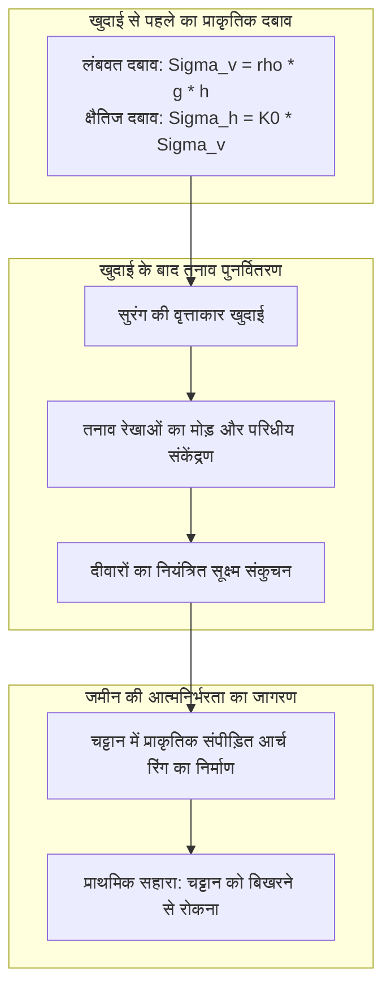
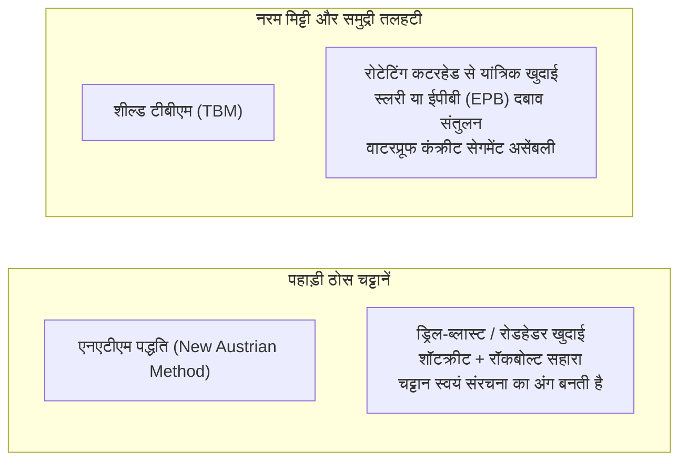

पहाड़ों के सीने को चीरकर बनी सुरंगों में 300 किमी/घंटा की रफ्तार से बुलेट ट्रेनें गुजरती हैं, और समुद्र के नीचे बनी सड़कों पर लाखों वाहन बेखौफ दौड़ते हैं। आधुनिक युग में सुरंगें हमारे परिवहन की जीवनरेखा बन चुकी हैं।

परंतु भौतिकी और भू-यांत्रिकी (Soil Mechanics) के नजरिए से देखें तो एक बड़ा सवाल उठता है:
"सैकड़ों मीटर ऊंचे पहाड़ों और अगाध समुद्र का भारी वजन इन सुरंगों को तुरंत दबाकर नष्ट क्यों नहीं कर देता?"
"पानी और कीचड़ से भरी समुद्री तलहटी में बिना पानी भरे सुरक्षित खुदाई कैसे की जाती है?"

भूमिगत खुदाई ढहने और जलभराव के भयानक खतरों से भरा क्षेत्र है। सुरंग इंजीनियरिंग केवल गड्ढा खोदना नहीं है, बल्कि यह <strong>«चट्टान और मिट्टी की यांत्रिकी (Soil & Rock Mechanics) का उपयोग करके जमीन को स्वयं का भार उठाने के लिए प्रेरित करने, जलदाब को संतुलित करने और तत्काल सुरक्षा संरचना तैयार करने की चरम नियंत्रण प्रणाली»</strong> है।

---

## 1. भूमिगत सुरंगें ढहती क्यों नहीं: भू-आर्च प्रभाव (Ground Arching Effect)

सुरंग इंजीनियरिंग का पहला नियम यह है: <strong>सुरंग की कंक्रीट की दीवारें अकेले पूरे पहाड़ का भार उठाने के लिए नहीं बनाई जातीं।</strong>

यदि 500 मीटर गहरे पहाड़ का पूरा वजन कंक्रीट की दीवारों पर डाला जाए, तो कोई भी ज्ञात निर्माण सामग्री उस दबाव को सहन नहीं कर पाएगी। सुरंग के टिके रहने का वास्तविक रहस्य चट्टान के प्राकृतिक <strong>«भू-आर्च प्रभाव (Ground Arching Effect)»</strong> में छिपा है।

### 1.1 किर्श का समाधान (Kirsch's Solution) और अभिसरण-नियंत्रण विधि
किर्श के समीकरणों (1898) के अनुसार, सुरंग की परिधि पर रेडियल तनाव शून्य ($\sigma_r = 0$) हो जाता है, जबकि परिधीय तनाव ($\sigma_\theta$) दोगुना हो जाता है ($\sigma_\theta = 2\sigma_v$)। यह उच्च संपीड़न रिंग पहाड़ के वजन को सुरंग के अगल-बगल की मजबूत चट्टानों पर स्थानांतरित कर देती है।

**अभिसरण-नियंत्रण विधि (Convergence-Confinement Method)** के अनुसार:
1. **शून्य विकृति का प्रयास**: पहाड़ को बिना हिले रोकने के लिए अत्यधिक अवास्तविक बल की आवश्यकता होती है।
2. **नियंत्रित सूक्ष्म विस्थापन**: यदि सुरंग की दीवारों को कुछ मिलीमीटर या सेंटीमीटर दबने दिया जाए, तो चट्टान की आंतरिक कतरनी शक्ति ($c$ और $\phi$) सक्रिय हो जाती है और बाहरी सहारे की आवश्यकता न्यूनतम हो जाती है।
3. **अत्यधिक ढीलापन**: देर करने पर चट्टानें टूटकर भरभराकर गिर जाती हैं।

---

## 2. आधुनिक सुरंग निर्माण की दो प्रमुख प्रणालियां: NATM और शील्ड टीबीएम

### 2.1 पहाड़ों को वश में करने वाली एनएटीएम (NATM)
1960 के दशक में ऑस्ट्रिया में विकसित एनएटीएम प्रणाली ने भारी लोहे के ढांचों के स्थान पर लचीला सहारा दिया:
- **शॉटक्रीट और रॉकबोल्ट**: खुदाई के तुरंत बाद कंक्रीट का छिड़काव करके चट्टान को सील किया जाता है और गहरे रॉकबोल्ट लगाकर चट्टानों को आपस में सिल दिया जाता है।
- **सटीक दैनिक निगरानी**: सेंसरों द्वारा दीवारों का सिकुड़ना रुकने की पुष्टि होने के बाद ही अंतिम कंक्रीट ढाला जाता है।

### 2.2 शील्ड टनल बोरिंग मशीन (Shield TBM)
नरम मिट्टी और समुद्र तल के नीचे टीबीएम एक चलती-फिरती भूमिगत फैक्ट्री की तरह काम करती है:
- **अर्थ प्रेशर बैलेंस (EPB) और स्लरी शील्ड**: मशीन के सामने के चैंबर में दबाव बनाकर भूजल और मिट्टी के दबाव को संतुलित किया जाता है ताकि जमीन न धंसे।
- **टेल वॉयड ग्राउटिंग**: शील्ड के आगे बढ़ते ही पीछे बने खाली स्थान में तुरंत ग्राउट भरकर पेक (Peck) के धंसने के प्रभाव को रोका जाता है:
$$S(x) = S_{\max} \exp\left( -\frac{x^2}{2i^2} \right)$$

---

## 3. समुद्र के नीचे इंजीनियरिंग के चमत्कार

- **सीकन सुरंग (जापान, 53.85 किमी)**: त्सुगारू जलडमरूमध्य के नीचे 70 बार के अत्यधिक दबाव पर केमिकल ग्राउटिंग इंजेक्ट करके रिसती चट्टानों को अभेद्य कंक्रीट जैसा बनाकर फतह हासिल की गई।
- **चैनल टनल (इंग्लैंड-फ्रांस, 50.45 किमी)**: चाक मार्ल नामक जल-अभेद्य मिट्टी की परत में लेजर-निर्देशित टीबीएम मशीनों द्वारा रिकॉर्ड गति से समुद्र के नीचे सटीक मिलन कराया गया।
- **गोथार्ड बेस टनल (स्विट्जरलैंड, 57.1 किमी)**: आल्प्स पर्वत के 2,450 मीटर नीचे 45 °C से अधिक गर्म चट्टानों को चीरकर बनी दुनिया की सबसे लंबी रेल सुरंग।

---

## 4. निष्कर्ष

पहाड़ों और समुद्रों के सीने में सुरंग बनाना प्रकृति से जबरन लड़ने का नाम नहीं है, बल्कि पृथ्वी के भौतिकी नियमों को समझकर जमीन को ही मानव पथ का संरक्षक बनाने का सर्वोच्च इंजीनियरिंग कौशल है।
