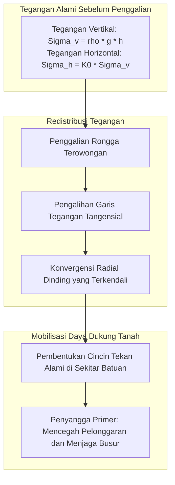
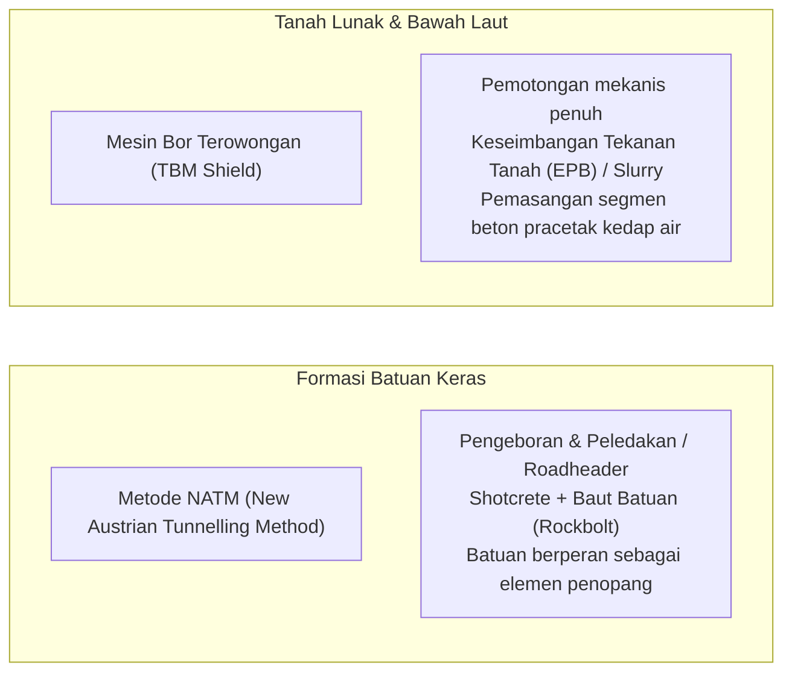

Sebuah mulut terowongan raksasa terbuka di kaki lereng pegunungan curam. Kereta cepat melesat ke dalam kegelapan dengan kecepatan lebih dari 300 km/jam, sementara jauh di bawah dasar samudra, puluhan ribu kendaraan melaju mulus di jalan tol bawah laut. Terowongan adalah urat nadi penting dalam peradaban modern.

Namun, dari kacamata ilmu fisika dan mekanika tanah:
"Mengapa beban jutaan ton batuan gunung atau tekanan samudra di atasnya tidak menghancurkan rongga terowongan tersebut seketika?"
"Bagaimana mesin bor mampu menggali tanah berlumpur jenuh air tanpa mengalami keruntuhan dan banjir fatal?"

Pekerjaan bawah tanah adalah pertarungan melawan keruntuhan dan semburan air bertekanan tinggi. Rekayasa terowongan bukanlah sekadar membuat lubang: ini adalah <strong>«sistem kontrol fisik ekstrem yang memanfaatkan mekanika tanah dan batuan (Soil & Rock Mechanics) agar massa tanah menopang dirinya sendiri, menyeimbangkan tekanan hidrostatik, dan memasang struktur penahan secara instan.»</strong>

---

## 1. Mengapa Terowongan Bawah Tanah Tidak Runtuh: Efek Busur Tanah (Ground Arch)

Prinsip fundamental rekayasa bawah tanah menyatakan: <strong>Dinding beton terowongan tidak dirancang untuk menahan seluruh beban mati gunung di atasnya secara mandiri.</strong>

Jika pada kedalaman ratusan meter dinding beton setebal beberapa puluh sentimeter dipaksa menahan berat total kolom tanah, tegangan tekan akan melampaui batas kekuatan material dan hancur seketika. Terowongan tetap kokoh berkat <strong>efek busur tanah (Ground Arching Effect)</strong>.

### 1.1 Solusi Elastis Kirsch dan Kurva Reaksi Tanah (GRC)
Menurut solusi Kirsch (1898), pada batas terowongan lingkaran ($r = a$), tegangan radial menjadi nol ($\sigma_r = 0$), sementara tegangan tangensial $\sigma_\theta$ meningkat dua kali lipat pada kondisi hidrostatik ($\sigma_\theta = 2\sigma_v$). Cincin tegangan tekan ini mengalirkan beban di atas terowongan ke batuan stabil di kedua sisi.

Metode **Konvergensi-Penahanan (Convergence-Confinement Method)** menunjukkan:
1. **Penahanan kaku tanpa deformasi**: Menahan tanah tanpa pergerakan membutuhkan tekanan sangat tinggi.
2. **Deformasi mikro terarah**: Mengizinkan dinding menyusut beberapa milimeter hingga sentimeter akan mengaktifkan kuat geser tanah ($c$ dan $\phi$), sehingga tekanan penyangga yang dibutuhkan turun ke titik minimum.
3. **Pelonggaran berlebih**: Menunda pemasangan penyangga menyebabkan batuan retak dan runtuh akibat beban gravitasi lepas.

---

## 2. Dua Metode Utama: NATM dan Shield TBM

### 2.1 Metode NATM untuk Pegunungan
Dikembangkan di Austria pada 1960-an oleh Rabcewicz, NATM mengubah batuan sekeliling menjadi cincin struktural penopang melalui penyemprotan beton (shotcrete) berakselerator dan pemasangan baut batuan (rockbolts) yang mengunci lapisan batuan.

### 2.2 Mesin Bor Terowongan (Shield TBM)
Pada tanah lunak perkotaan dan dasar laut, TBM bertindak sebagai pabrik berjalan bawah tanah:
- **Tekanan Tanah Seimbang (EPB) dan Slurry**: Mengontrol tekanan di ruang pemotong agar seimbang dengan tekanan tanah dan air tanah untuk mencegah amblasan di permukaan.
- **Grouting Ruang Belakang (Tail Void Grouting)**: Injeksi mortar instan di celah segmen guna meminimalkan penurunan tanah permukaan sesuai kurva penurunan Peck:
$$S(x) = S_{\max} \exp\left( -\frac{x^2}{2i^2} \right)$$

---

## 3. Mahakarya Bawah Laut dan Pegunungan

- **Terowongan Seikan (Jepang, 53,85 km)**: Menaklukkan zona patahan vulkanik Selat Tsugaru melalui injeksi kimia bertekanan tinggi 70 bar yang membekukan rekahan batuan menjadi kedap air.
- **Terowongan Channel (Eurotunnel, 50,45 km)**: Menavigasi formasi lempung kapur (Chalk Marl) yang kedap air dengan presisi laser tingkat tinggi.
- **Terowongan Dasar Gotthard (Swiss, 57,1 km)**: Terowongan rel terpanjang di dunia di bawah 2.450 meter batuan granit Alpen.

---

## 4. Kesimpulan

Membangun terowongan di bawah gunung dan lautan membuktikan bahwa rekayasa manusia tidak melawan alam secara membabi buta, melainkan bekerja selaras dengan hukum mekanika bumi untuk menciptakan jalur transportasi yang aman dan abadi.
