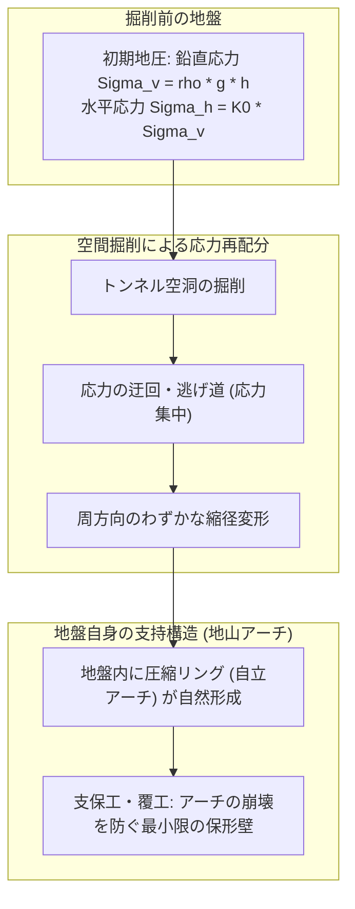
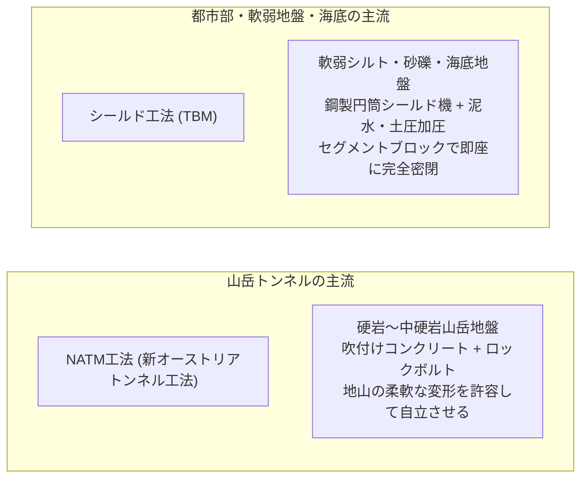
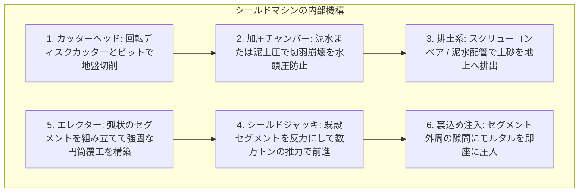
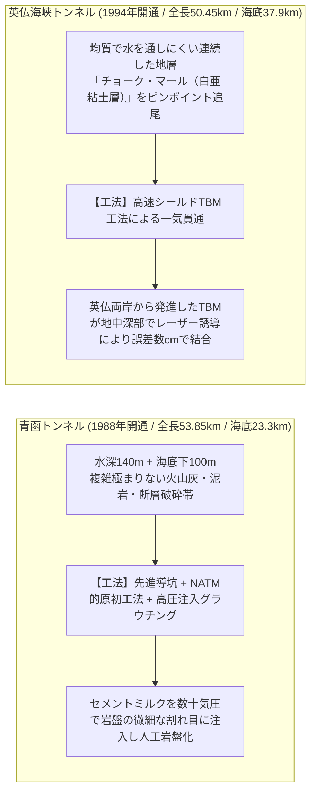
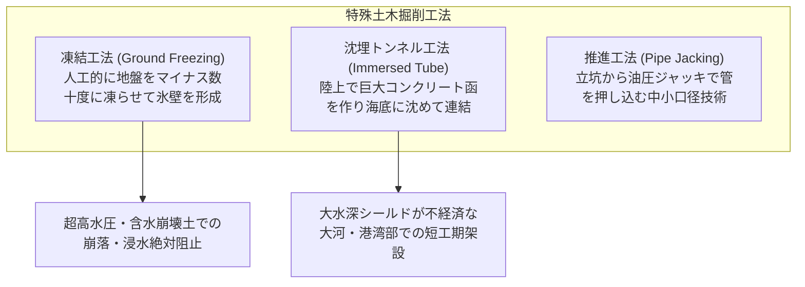
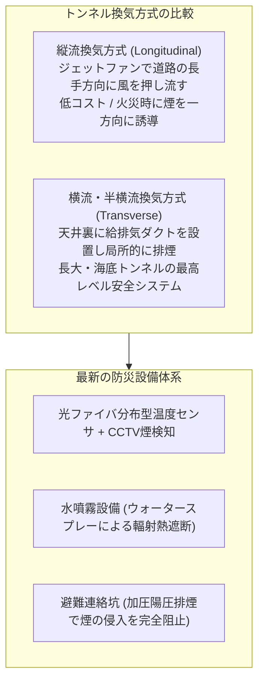
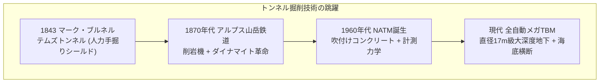

山肌にぽっかりと開いた暗黒の坑口。そこへ突入した新幹線は時速数百キロで突き抜け、海底深く掘られたハイウェイでは何万台もの自動車が魚の泳ぐ海面下を何事もなく走り抜けていきます。現代社会において、トンネルは私たちが日常的に利用する最も身近なインフラの一つです。

しかし、冷静に物理の視点から考えてみてください。
「頭上に何百メートルもの山や海が存在しているのに、なぜトンネルは土砂の圧力で押し潰されないのか？」
「軟らかい泥や水が充満する海底の砂地を、一体どうやって水浸しにならずに掘り進めるのか？」

崩落と出水の恐怖が常に付きまとう地底空間。そこには、地球の地殻変動が数百万年かけて生み出した断層破砕帯、致死性の高圧地下水、有毒ガス、そして計り知れない地圧が待ち構えています。

トンネル工学とは、単に穴を掘る技術ではありません。それは、<strong>「地盤の力学（Soil & Rock Mechanics）を味方につけ、地下水と圧力をコントロールし、掘削した瞬間に構造体を組み上げる極限の物理制御システム」</strong>です。

本稿では、地下空間が崩壊しない力学的メカニズムから、現代トンネル工法の二大巨頭である「NATM（ナタム工法）」と「シールド工法」、青函トンネルや英仏海峡トンネルに挑んだ先人たちの死闘、特殊な凍結工法・沈埋工法、そして地底を安全に保つ最新の防災・維持管理システムまでを徹底的に解明します。

---

## 1. なぜ地下空間は崩れないのか：地盤力学と「アーチ作用」

トンネルを理解するための第一歩は、<strong>「トンネルの壁（覆工コンクリート）だけで山全体の重量を支えているわけではない」</strong>という事実を知ることにあります。

もし仮に、深さ300メートルの山岳トンネルの真上にあるすべての岩盤の重さを、厚さ数十センチのコンクリート壁だけで支えようとすれば、必要な圧縮力は材料の破壊限度をはるかに超え、トンネルは瞬時に圧壊します。

トンネルが自立できる真の理由は、地盤そのものが持っている<strong>「グラウンド・アーチ作用（Ground Arching Effect：地山アーチ）」</strong>にあります。



### 1.1 初期応力場とキルシュの弾性応力解
掘削前の地中深部には、上載土被り圧による鉛直応力 $\sigma_v$ と、側方変形が拘束されることによる水平応力 $\sigma_h$ が作用しています。
$$\sigma_v = \rho g h$$
$$\sigma_h = K_0 \sigma_v$$
（$\rho$: 土の密度、$g$: 重力加速度、$h$: 深さ、$K_0$: 静止土圧係数）

この均一な応力場の中に突然、半径 $a$ の円形トンネルを掘削した際の応力状態は、弾性力学における著名な<strong>「キルシュの解（Kirsch's Solution）」</strong>によって厳密に記述されます。
極座標系 $(r, \theta)$ における応力成分は以下の通りです。

$$\sigma_r = \frac{\sigma_v}{2} \left[ (1 + K_0)\left(1 - \frac{a^2}{r^2}\right) - (1 - K_0)\left(1 - 4\frac{a^2}{r^2} + 3\frac{a^4}{r^4}\right) \cos 2\theta \right]$$

$$\sigma_\theta = \frac{\sigma_v}{2} \left[ (1 + K_0)\left(1 + \frac{a^2}{r^2}\right) + (1 - K_0)\left(1 + 3\frac{a^4}{r^4}\right) \cos 2\theta \right]$$

空洞の境界（壁面 $r = a$）において、半径方向の応力 $\sigma_r$ はゼロ（大気圧）に開放されます。
一方、周方向（接線方向）の応力 $\sigma_\theta$ は以下のようになります。
$$\sigma_\theta = \sigma_v \left[ (1 + K_0) + 2(1 - K_0)\cos 2\theta \right]$$

静水圧応力場（$K_0 = 1$）の場合、トンネル壁面全周において $\sigma_\theta = 2\sigma_v$ となり、<strong>初期応力のちょうど2倍の圧縮応力が壁面の周囲をリング状に取り囲む</strong>ことになります。
このリング状の応力集中こそが、上方の岩盤荷重を両側の不動地盤へと橋渡しする「地山アーチ」の正体です。

### 1.2 地盤特性曲線（Ground Reaction Curve）と最適支保理論
トンネル工学において最も重要な力学的概念が、フェンナー（Fenner）とパッヒャー（Pacher）によって提唱された<strong>「地盤特性曲線（Ground Reaction Curve / 収束・拘束法 Convergence-Confinement Method）」</strong>です。

```
支保圧 pi
  ^
  |  \
  |   \   (1) 弾性変形領域：支保圧を下げると壁面が内空へ変位
  |    \
  |     \_______
  |             \  (2) 最適支保領域：地山アーチが完成し、最小支保圧で自立
  |              \______
  |                     \
  |                      \  (3) 塑性崩壊領域：変位を放置しすぎると岩盤が破砕し圧力が急増
  +-----------------------------------> トンネル壁面の半径方向変位 ur
```

1. **掘削直後（変位ゼロ）**：掘削前の初期地圧をそのまま支えようとすれば、極めて高い支保圧 $p_i = \sigma_0$ が必要になります。
2. **制御された変位の許容（最適領域）**：壁面が内空に向かってわずかに変形（ミリ〜数センチメートル）することを許容すると、岩盤内部でせん断抵抗が発現し、地山が自ら荷重を負担するため、外部から支えるべき必要な支保圧 $p_i$ は劇的に低下します。
3. **過剰な変位の放置（塑性崩壊）**：しかし、変位を放置しすぎると、岩盤の内部強度が破壊限度を超えてバラバラに粉砕（脆性破壊）し、緩んだ土砂の重量が直接のしかかってくるため、必要な支保力は再び急上昇します。

トンネル技術者の使命は、<strong>「地山が自らの強度を最大限に発揮して安定する絶妙なタイミングで支保工を打設し、地圧を最小化すること」</strong>にあります。

---

## 2. 現代トンネル工法の2大巨頭：NATM と シールド工法

世界中のあらゆるトンネルは、地質条件と環境に応じて、主に以下の2つの工法のいずれか、あるいはその組み合わせによって掘削されています。



### 2.1 山岳地盤を制する「NATM（ナタム工法）」
1960年代にオーストリアのラドスラフ・フォン・ラブチェヴィッツ（Ladislaus von Rabcewicz）らによって体系化された<strong>NATM（New Austrian Tunnelling Method：新オーストリアトンネル工法）</strong>は、山岳トンネルの概念を根底から覆しました。

それまでの旧式山岳工法では、坑木（丸太）や鉄骨で強固な枠を組み、地盤が少しでも動かないように力尽くで突っ張っていました。しかし、山全体の凄まじい地圧に対して剛体で対抗しようとすると、支保工は簡単に折れ曲がり、頻繁な大崩落事故を招いていました。

NATMの思想は正反対です。<strong>「地盤を適度に変形させ、地圧を逃がしながら、地山自身に耐力を発揮させる」</strong>という画期的な力学哲学に基づいています。

```
【NATM工法の施工サイクル】
1. 切羽の掘削（発破・自由断面掘削機ロードヘッダー）
       │
       ▼
2. 吹付けコンクリート（一次覆工：厚さ10〜25cm）
       │ ── 急結剤入りコンクリートを岩盤露出面に即座に吹付け、風化と微小崩落を防止
       ▼
3. ロックボルトの打設（長さ2〜4mの高張力鋼棒）
       │ ── 岩盤深くに孔をあけてボルトを定着・緊張させ、緩み岩盤を奥の健全岩盤に縫合
       ▼
4. 計測（デイリーモニタリング）
       │ ── 内空変位計・沈下計でミリ単位の縮径を監視。「変形が収束したか」を厳密に判定
       ▼
5. 防水シート敷設 ＆ 二次覆工コンクリート打設
```

- **ロックボルトの「縫合効果」と「梁形成効果」**：
  岩盤に多数のロックボルトを放射状に打ち込むと、個別の岩片が一体化し、トンネル周囲に厚さ数メートルの<strong>「強固な岩盤補強リング」</strong>が人工的に構築されます。ボルト軸力 $T$ によって岩盤にプレストレスが与えられ、岩盤の内部摩擦角 $\phi$ と粘着力 $c$ を最大限に引き出します。
- **変形制御の美学**：
  地盤がトンネルの内側に向かって数センチメートル縮径するのを許容することで、岩盤内部の応力ピークが解放され、地山アーチが安定します。変形が完全に止まった（収束した）ことを確認してから、内側に仕上げのコンクリート（二次覆工）を打ち込みます。
- **インバート（Invert）の閉合**：
  軟弱地盤や膨張性地盤では、壁面だけでなくトンネルの底面（インバート）にも逆アーチ状のコンクリートを早期に打設し、断面を完全な「閉断面リング」に閉じることが極めて重要です。これにより、底面からの盤ぶくれ（ヒービング）を抑え込み、トンネル全体の耐荷力を飛躍的に向上させます。

### 2.2 都市・海底の軟弱地盤をくり抜く「シールド工法」
一方、山のように固い岩盤ではなく、地下水を含んだ軟弱な砂・粘土層、あるいは過密化した大都市の地下鉄、道路、共同溝、海底横断などで圧倒的な威力を発揮するのが<strong>「シールド工法（Shield Tunnelling Method）」</strong>です。

シールド工法は、先端に回転する丸いカッターヘッドを備えた巨大な鋼鉄の円筒（シールドマシン / TBM）を地中に押し込み、先端で土砂を削りながら、機内の安全な空間で工場製品のコンクリートブロック（<strong>セグメント</strong>）をリング状に組み立て、一歩一歩前進していく工法です。



#### 切羽水土圧バランスの制御力学
シールド工法の成否を分ける最大の急所は、<strong>「掘削面（切羽：きりは）の土圧・水圧のバランスをどう保つか」</strong>です。
もし機械の前方の土を押さえる支持圧 $p_s$ が、自然の地圧・水圧 $p_0$ より小さければ（$p_s < p_0$）、切羽が崩壊して地上が陥没（シンクホール）します。逆に大きすぎれば（$p_s > p_0$）、地表面が隆起して構造物を破壊します。

現代のシールドマシンは、以下の2つの高度な密閉加圧システムによって切羽の安定を完全制御しています。

1. **土圧バランス（EPB: Earth Pressure Balance）シールド**：
   掘削した土砂に特殊な気泡（フォーム）や水溶性高分子ポリマーを注入して泥状化（塑性流動化）させ、加圧チャンバー内に充満させます。その土圧をシールドマシンの推進速度とスクリューコンベアの回転排土速度をインバータ制御でミリ秒単位で連動させ、自然土圧と完全に釣り合わせます。
2. **泥水加圧（Slurry）シールド**：
   チャンバー内に高比重のベントナイト泥水を高圧で満たし、切羽の土粒子間に「マッドケーキ（不透水膜）」を形成させて高水圧を物理的に遮断します。土砂は泥水とともに配管を通じて地上プラントへ流体輸送され、遠心分離機で土粒子と泥水に分離処理されます。

#### 裏込め注入（Tail Void Grouting）とペックの沈下トラフ理論
シールドマシンが前進すると、鋼製シールドフレームの厚みと余掘り（オーバーカット）により、掘削された地盤の内径とセグメント外径との間に数センチから十数センチの隙間（**テールボイド：Tail Void**）が生じます。
この隙間を放置すると、周囲の地盤が即座に緩んで落ち込み、地表面の大規模な沈下を引き起こします。

そのため、シールドマシンの最後尾（テール部）から、セグメントの背面に高圧で特殊モルタル（A液：主材スラリ、B液：急結剤）を注入する<strong>「同時裏込め注入」</strong>が行われます。注入材はわずか数秒から数十秒でゲル化・固結し、周囲地盤をミリ秒単位で完全に支持します。

地表面沈下の広がりは、土質力学における<strong>「ペック（Peck）の沈下トラフ理論」</strong>により、正規分布（ガウス分布）曲線として正確に予測・管理されます。

$$S(x) = S_{\max} \exp\left( -\frac{x^2}{2i^2} \right)$$

ここで $x$ はトンネル中心軸からの水平距離、$S_{\max}$ は直上の最大沈下量、$i$ は変曲点距離（沈下トラフの幅パラメータ）であり、トンネル深さ $z_0$ と地盤の内部摩擦角 $\phi$ に依存します。
技術者は地表面に設置した無数の測量プリズムと自動トータルステーションにより、地盤損失（Ground Loss）が許容値（通常0.5〜1.0%以下）に収まっているかを常時監視し、都市の構造物をミリ単位の沈下から護り抜きます。

#### ディスクカッターによる岩盤破砕メカニズム
硬い岩盤を掘削するTBM（トンネルボーリングマシン）の先端には、数十個の「ディスクカッター（回転式円盤刃）」が同心円状に配置されています。
ディスクカッターは岩を削るのではなく、数万トンの油圧推力で<strong>岩盤に押し付けられながら転動</strong>します。
円盤の刃先が岩盤に数百メガパスカルの集中圧縮応力を与えると、刃先直下に微小破砕領域が形成され、隣接する刃先との間に放射状の引張亀裂（ラジアルクラック）が走ります。この亀裂同士が合体することで、岩盤が板状に剥離（チッピング破砕）し、驚異的な掘進速度を生み出します。

---

## 3. 海底トンネルの極限工学：水圧と破砕帯との死闘

山岳トンネルも過酷ですが、海底トンネルの難易度は次元が異なります。
頭上には底知れぬ海水が無限に広がり、<strong>数メガパスカル（水深100mで約10気圧、1平方メートルあたり100トンの力）</strong>という凄まじい水圧が岩盤の隙間から常に侵入を狙っています。万が一、海と直結する大破砕帯を撃ち抜けば、海水が無制限に坑内へ突入し、全線水没の壊滅的惨事となります。

世界を代表する2大海底トンネル――日本の「青函トンネル」と欧州の「英仏海峡トンネル」――は、対照的な工学的アプローチによってこの極限海峡を克服しました。



### 3.1 青函トンネル：グラウチング注入工法の金字塔
本州と北海道を結ぶ津軽海峡の下、水深140mの海底からさらに100m潜った地点を掘り進んだ青函トンネルの建設（1964年着工〜1988年開通）は、24年的歳月と34名の尊い犠牲を払った、人類土木史上の最も壮絶な戦いでした。

津軽海峡の地質は、無数の活断層によってズタズタに引き裂かれた火山性の破砕帯であり、掘削した瞬間に高圧の海水を含んだ土砂が鉄砲水のように噴出する「出水事故」が4度も発生しました。特に1976年5月、異常出水によって毎分85トンもの海水が噴出し、本坑が水没の危機に瀕した際、決死の防水扉閉鎖と連続水抜きボーリングによって奇跡的に坑道が奪還されました。

青函トンネルを勝利に導いた決定打は、<strong>「注入工法（グラウチング：Chemical Grouting）」</strong>の極限的進化でした。
1. **先進導坑による探査**：
   本坑を掘る前に、先行して細いパイロットトンネル（先進導坑・作業坑）を掘り進め、前方に数百メートルにおよぶ長尺水平ボーリングロッドを突き出して、前方の地質と水圧を常に探査。
2. **高圧グラウチング（セメントミルク圧入）**：
   前方に軟弱破砕帯を検知すると、切羽の周囲から扇状に無数の孔を穿ち、水ガラス（ケイ酸ナトリウム）や超微粒子セメントミルクを最大<strong>$7\text{ MPa}$（約70気圧）</strong>もの超高圧で岩盤の微細な亀裂に注入。
3. **岩盤の自己止水・強化**：
   岩盤の割れ目を固めることで、水みちを完全に封鎖し、脆い破砕帯をコンクリート並みの強度を持つ<strong>「止水パッカブル岩盤」</strong>へと人工的に作り変えてから、ダイナマイトとショートクリートリグで慎重に掘削しました。

この「前もって地盤を固めてから掘る」という青函トンネルで確立された注入技術は、現代の世界中の海底・地下水プロジェクトの世界的標準教科書となっています。

### 3.2 英仏海峡トンネル：地質選定とTBM超速施工の勝利
イギリスのドーバーとフランスのカレーを結ぶ英仏海峡トンネル（ユーロトンネル）は、青函トンネルとは全く異なる戦略で成功を収めました。

地質調査の結果、海底下深くに<strong>「チョーク・マール（Chalk Marl：白亜粘土層）」</strong>と呼ばれる、粘土を20〜30%含み、水を通さず、適度な柔らかさで掘削しやすい奇跡のような理想地層が連続して存在することが判明しました。

英仏のエンジニア陣は、このチョーク・マール層から絶対に逸脱しないよう最新の音波探査と衛星測位で三次元ルートを精密に設計。英国側6台、フランス側5台の専用シールドマシン（TBM）を投入し、掘削と同時にセグメントを連続架設することで、<strong>月進1キロメートルを超える驚異的なスピード</strong>で掘り進めました。1990年12月1日、英仏両側から掘進したサービス坑の先端が、海底下数十メートルの暗黒の中で貫通した瞬間、イギリスとヨーロッパ大陸は氷河期以来8000年ぶりに陸続きとなりました。

---

## 4. 水と土を操る先端特殊工法

地盤条件が極限に達した都市部や特殊な地形横断では、NATMやシールド以外の独創的な土木技術が動員されます。



### 4.1 凍結工法（Ground Freezing）：氷の鎧で地圧を止める
崩壊しやすい含水砂層や、既存の地下鉄トンネル直下を数センチの隙間でアンダーパスする際、いかなる薬液注入でも水が止まらない超高難度箇所で採用される究極の工法が<strong>「地盤凍結工法」</strong>です。

地中に数十本の凍結管を一定間隔で打ち込み、その内部に<strong>マイナス30℃に冷却した塩化カルシウム水溶液（ブライン）やマイナス196℃の液体窒素</strong>を循環させます。
数週間から数ヶ月かけて周囲の土壌中の水分を凍結させ、トンネル周囲に厚さ数メートルの<strong>「凍土壁（Frozen Earth Wall）」</strong>を成長させます。

氷で満たされた土は、強固な花崗岩に匹敵する圧縮強度（数十MPa）と完全な不透水性を獲得します。この天然の氷のドームの中で安全にトンネルを掘削・覆工した後、凍結管を停止して地盤を自然解凍させます。

### 4.2 沈埋トンネル工法（Immersed Tube Tunnel）：海に沈めて繋ぐ
大河の河口や港湾部のように、海底地盤が極端に軟弱で、かつトンネルの取り付け道路を短くするために浅い深度を通したい場合、シールド工法よりも<strong>「沈埋（ちんまい）工法」</strong>が圧倒的に有利となります。

1. **陸上ドックでの函体製作**：
   ドライドック内で、長さ100〜150m、幅30〜40m、重量数万トンにおよぶ巨大な中空鉄筋コンクリート製ブロック（沈埋函）を複数個まとめて製造し、両端を仮隔壁で密閉。
2. **曳航と沈設**：
   ドックに注水して函体を水に浮かべ、タグボートで設置海域まで曳航。あらかじめ海底に掘削しておいたトレンチ（溝）の直上で、函体内部のバラストタンクに注水してゆっくりと海底へと沈下させます。
3. **水圧接合（ゴムガスケットの真空圧着）**：
   既設の函体と新設の函体を接近させると、接合面に取り付けられた巨大な特殊ゴム（ジーナガスケット）が接触します。両函体の間の狭い空間から排水すると、<strong>外側の水圧（数百〜数千トンの水圧）によって函体同士が自動的に強烈に押し付けられ（水圧密着）</strong>、ボルト締めすることなく完全な水密接合が完了します。

東京湾アクアラインの川崎側海底トンネル部や、香港・珠海・マカオを結ぶ港珠澳大橋の海底トンネル部などで大規模に採用されています。

---

## 5. 地下空間の生命線：換気・防災・避難システム

どんなに頑丈なトンネルを完成させても、そこに人が入り、車両が走る限り、内部環境の維持と火災対策がなされていなければ巨大な「密室の罠」と化してしまいます。

1999年にフランスとイタリアを結ぶ<strong>モンブラントンネルで発生した火災事故（死者39名）</strong>は、地下空間における煙の致死性と換気制御の難しさを世界に知らしめました。



### 5.1 換気システムの力学
自動車の排気ガス（一酸化炭素 CO、窒素酸化物 NOx、微粒子スス）を希釈し、火災時に有毒ガスを制御するため、トンネル換気には流体力学に基づく精密な設計がなされています。
- **縦流換気**：トンネル天井に巨大な送風機（ジェットファン）を多数配置し、トンネル全体を一本の風洞として交通流と同じ方向に空気を送る方式。
- **横流換気**：道路上部にダクト板を設け、給気ダクトと排気ダクトを独立して走らせる方式。火災が発生した際、火災地点の直上にある排気ダンパーだけを遠隔開放し、煙を天井裏から直接吸い出すことで、避難者の頭上に煙が降下するのを防ぎます。

### 5.2 避難連絡坑と陽圧システム
海底トンネルや数キロメートルを超える長大トンネルでは、本坑（車道）と平行して細い<strong>「避難誘導坑（サービス坑）」</strong>が必ず掘られています。
本坑と避難坑は数百メートルおきに「避難連絡口」で結ばれており、車道で大火災が発生した際、ドライバーは数十メートル歩くだけで防火扉を開けて避難坑へと脱出できます。

特筆すべきは、<strong>避難坑内の気圧を本坑よりも常に高く保つ「陽圧（Positive Pressure）制御」</strong>です。避難扉を開けた瞬間、避難坑から車道側へと強い風が吹き出すため、煙や有毒ガスが避難坑の内部へ絶対に入り込めない空気力学的バリアが形成されています。

---

## 6. 人類と地下掘削の歴史：闇を克服したエンジニアたち

地底を征服する技術の歩みは、産業革命以降の機械技術の進化そのものです。



### 6.1 マーク・ブルネルとフナクイムシの奇跡（1843年）
世界最初のシールド工法の着想は、驚くべきことに生物の観察から生まれました。
フランス出身の天才エンジニア、マーク・イザムバード・ブルネルは、木造船の船底を食い荒らす貝<strong>「フナクイムシ（Teredo navalis）」</strong>の生態を観察していました。フナクイムシは頭部にある強靭な二枚の貝殻で硬い木を削り進み、削り取った木屑を排泄しながら、自分の通ったトンネルの内壁に分泌物を塗りたくって強固なチューブ状の殻を形成していました。

「この生物の行動を機械で模倣すれば、軟弱地盤の下を安全に掘り進めるのではないか？」

ブルネルはこの着想をもとに、鋳鉄製の枠（シールドフレーム）を開発。1843年、ロンドンの泥水が滴るテムズ川の川底をくぐり抜ける世界初の水中トンネル「テムズトンネル」を完成させました。これが現代のすべてのシールドマシンの始祖です。

### 6.2 スイス・ゴッタルド基底トンネル（2016年）――アルプスを貫く57kmの極致
そして現代、人類の地下掘削技術の頂点に立つのが、スイスのアルプス山脈直下を貫く<strong>「ゴッタルド基底トンネル（Gotthard Base Tunnel）」</strong>です。
全長<strong>57.1キロメートル</strong>は鉄道トンネルとして世界最長であり、最大土被りは<strong>2,450メートル（富士山の7合目以上の深さ）</strong>に達します。

坑内温度は地熱によって45℃を超え、岩盤には100MPa以上の超高地圧が作用し、トンネルが数メートルも押し縮められる極限環境でした。特に「ピオラ破砕帯（Piora Basin）」と呼ばれる、砂糖のように破砕された白雲岩（ドロマイト）と高圧水が充満した致死トラップ地帯では、事前の長尺ボーリングと特殊注入によって地盤を硬化させ、見事に貫通を果たしました。多国籍のエンジニア軍団は、直径近10メートルの巨大TBM4台を投入し、17年の歳月をかけて2,800万トンもの岩石を掘削。アルプスの南北をわずか20分で結ぶ平坦な高速鉄道路線を完成させました。

---

## 7. 21世紀のフロンティア：超大深度地下とメンテナンス工学

地下土木技術は現在、地上空間の過密化を背景に「大深度地下（地下40m以深の公有空間）」の開拓と、経年劣化した長大インフラのモニタリング・延命という新たな局面を迎えています。

### 7.1 超大深度シールドとリニア南アルプスの極限環境
日本の三大都市圏を結ぶリニア中央新幹線では、南アルプス直下において土被り約1,400メートル、高圧湧水と複雑な地殻変動破砕帯（糸魚川-静岡構造線等）を貫く超難関工事が進められています。
このような超深地圧下では、岩盤が突然爆発的に弾け飛ぶ<strong>「岩盤破壊現象（ロックバースト：Rockburst）」</strong>や、塑性流動によってトンネル断面が急速に閉塞する<strong>「押し出し性地盤（Squeezing Ground）」</strong>が発生します。

これに対処するため、最新工法では以下の先端技術が実用化されています：
- **可縮支保工（Yielding Support Elements）**：
  強大な地圧に対して完全に抵抗するのではなく、一定の荷重（降伏点）に達すると計画的に収縮・変形する特殊スチールジョイントを支保工に組み込み、破壊エネルギーを吸収しながら地山アーチの自己安定を促すシステム。
- **カッタービット摩耗の電磁モニタリング**：
  泥水シールドの内部からカッターヘッドを交換することは、超高水圧下での潜水作業（飽和潜水）を伴う命がけの危険作業です。現在では、ビット内部に埋め込まれた超音波・渦電流センサが摩耗限界をリアルタイムで検知し、最適なビット交換時期をAIが自動予測する技術が標準化されつつあります。

### 7.2 インフラの長寿命化とデジタルツイン点検
完成したトンネルの健全性を100年以上にわたって維持するため、維持管理（アセットマネジメント）の技術も激変しています。
2012年の笹子トンネル天井板落下事故を契機に、全国のトンネルから吊り下げ構造の天井板が撤去され、ジェットファンを中心とする縦流換気への更新が進められました。

さらに近年では：
1. **レーザー走査型点検車両（MMS）**：
   時速50〜80kmで走行しながら、毎秒数十万点のレーザーパルスと高解像度カメラでトンネル全周をスキャン。0.1ミリ幅の微細なひび割れや漏水跡を三次元点検マップとして自動抽出。
2. **打音検査ロボットと音響AI解析**：
   従来は熟練検査官がテストハンマーで覆工コンクリートを叩いて判別していた「浮き・剥離」の音を、高精度マイクロフォンとAIスペクトログラム解析で定量評価。
3. **電磁波レーダによる空洞探査**：
   覆工コンクリートの背面に発生した空洞（裏込め不良や地下水による土砂流出）を、非破壊の地中レーダによって透視検知し、崩壊のリスクを未然に排除。

---

## 8. 結論：見えない空間を切り拓く知性

巨大な山脈を迂回することなく直線で突き抜け、荒れ狂う海を渡ることなく海底の岩盤をくぐり抜ける。トンネルは、人類が獲得した最も劇的な「距離と時間の短縮装置」です。

しかし、ひとたび開通してしまえば、コンクリートで覆われたその壁の向こう側に、数千万トンの岩盤がひしめき、何気圧もの海水が押し寄せていることを意識する人はいません。

<strong>「自然の力を真正面から拒絶するのではなく、地盤そのものに自らを支えさせ、水圧を物理的に遮断して調和する」</strong>。

泥水の中に屹立するシールドマシンの精密な回転刃から、山岳を縫い止める無数のロックボルトに至るまで、トンネルの壁一枚の向こう側には、見えない暗黒の地底と対話し続けた人類のエンジニアリングの粋が静かに息づいています。
