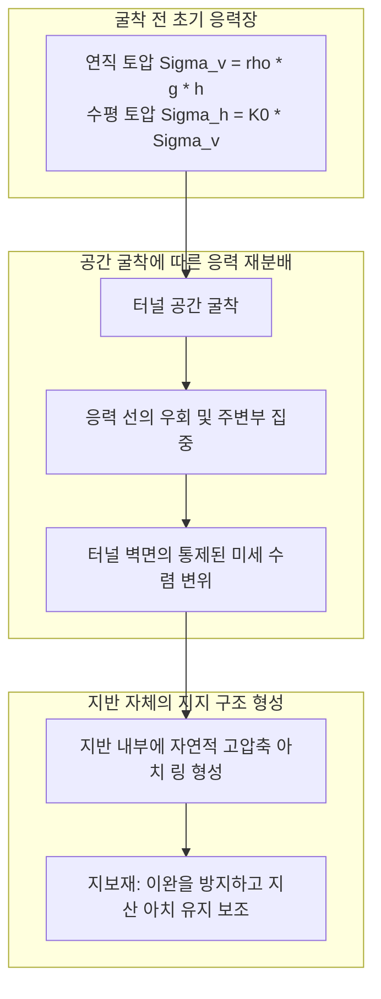
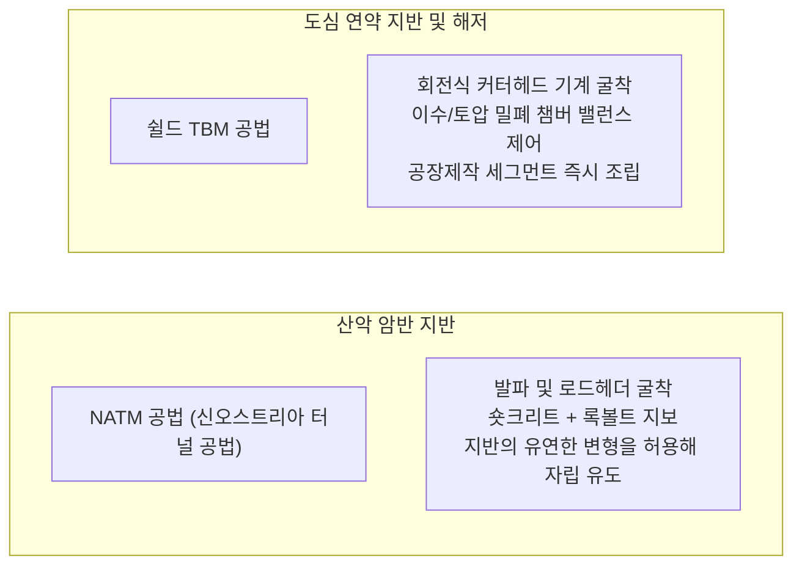

우뚝 솟은 험준한 산악 한가운데 뚫린 터널 입구로 시속 300km가 넘는 고속철도가 질주하고, 바다 밑 수십 미터 암반을 관통하는 해저 고속도로에는 매일 수만 대의 자동차가 수면 아래를 유유히 통과합니다. 터널은 현대 문명에서 가장 친숙하면서도 필수적인 핵심 인프라입니다.

하지만 물리학과 토질역학의 관점에서 차분히 생각해보면 놀라운 의문이 생깁니다:
"수백 미터 높이의 거대한 산과 바다가 머리 위에 있는데, 터널은 왜 그 무게에 짓눌려 붕괴하지 않는가?"
"물과 진흙으로 가득 찬 연약한 해저 지반을 도대체 어떻게 침수되지 않고 안전하게 파고 들어가는가?"

지하 굴착은 붕락과 침수의 공포가 끊임없이 도사리는 극한의 전장입니다. 수백만 년에 걸쳐 형성된 단층 파쇄대, 고압의 지하수, 미지의 지압이 버티고 있습니다.

터널 공학은 단순히 땅을 파내는 기술이 아닙니다. 그것은 <strong>「지반 자체의 역학적 특성(Soil & Rock Mechanics)을 극대화하여 아치 구조를 유도하고, 지하수압을 물리적으로 제어하며 굴착과 동시에 지지 구조를 완성하는 극한의 물리 제어 시스템」</strong>입니다.

---

## 1. 지하 공간은 왜 무너지지 않는가: 지반역학 및 '지산 아치(Ground Arch)' 작용

터널 역학을 이해하기 위한 첫걸음은 <strong>"터널의 콘크리트 라이닝 벽체만으로 산 전체의 무게를 지탱하는 것이 아니다"</strong>라는 사실을 인식하는 것입니다.

깊이 수백 미터 지하에서 터널 상부의 모든 암반 하중을 수십 센티미터 두께의 콘크리트 벽으로만 버티려 한다면, 요구되는 압축 응력은 현존하는 모든 구조 재료의 파괴 한도를 초과하여 즉시 파쇄될 것입니다.

터널이 자립할 수 있는 근본적인 원리는 지반 자체가 가진 <strong>「지산 아치 효과(Ground Arching Effect)」</strong>에 있습니다.

### 1.1 키르쉬의 탄성 응력 해석 (Kirsch's Solution)
등방성 탄성 지반 내에 반경 $a$의 원형 터널을 굴착할 때, 응력 재분배는 탄성역학의 고전인 키르쉬의 해(Kirsch's Solution)로 설명됩니다. 터널 벽면($r = a$)에서 반경 방향 응력은 대기압으로 개방되어 $\sigma_r = 0$이 되며, 접선 방향(원주 방향) 응력 $\sigma_\theta$는 극적으로 집중됩니다:
$$\sigma_\theta = \sigma_v \left[ (1 + K_0) + 2(1 - K_0)\cos 2\theta \right]$$

정수압 응력장($K_0 = 1$)의 경우 터널 벽면 전둘레에서 $\sigma_\theta = 2\sigma_v$가 되어 초기 연직 지압의 정확히 2배에 달하는 압축 응력이 원주 링 형태로 집중됩니다. 이 압축 응력 링이 상부 암반 하중을 양측의 견고한 비굴착 지반으로 분산시켜 지탱하는 거대한 자연 아치 역할을 수행합니다.

### 1.2 지반 반응 곡선 (Ground Reaction Curve, GRC)
지반-지보재 상호작용 이론(Convergence-Confinement Method)의 핵심인 지반 반응 곡선은 다음과 같은 단계를 보여줍니다:
1. **변위 제로 상태**: 초기 지압을 변위 없이 100% 강체로 막으려면 천문학적인 지보압 $p_i = \sigma_0$이 필요합니다.
2. **통제된 미세 변위 허용 (최적 영역)**: 벽면이 안쪽으로 수 밀리미터에서 수 센티미터가량 미세하게 수렴 변형되도록 허용하면, 암반 내부의 전단강도(점착력 $c$와 내부마찰각 $\phi$)가 발현되면서 지반이 하중을 스스로 부담하여 필요한 지보압이 최저치로 떨어집니다.
3. **과도한 변위 방치 (소성 붕괴)**: 변위가 한계치를 넘으면 암반이 파쇄되어 헐거워진 토사의 자중이 붕락 하중으로 작용하여 요구 지보압이 급증합니다.

공학적 목표는 <strong>지반이 스스로 지지력을 최대로 발휘하는 최적 시점에 록볼트와 숏크리트를 타설하여 최소 지보압으로 안전을 확보하는 것</strong>입니다.

---

## 2. 현대 터널 공학의 양대 산맥: NATM과 쉴드 TBM 공법

### 2.1 산악 지반을 정복하는 NATM 공법
1960년대 오스트리아의 랍체비츠(Rabcewicz) 등이 체계화한 NATM(New Austrian Tunnelling Method)은 강체 지보재로 지압에 맞서던 과거 방식에서 벗어나 <strong>"지반 자체를 주요 구조 부재로 전환"</strong>시켰습니다.
- **록볼트(Rockbolt)의 봉합 및 보 형성 효과**: 방사상으로 타설된 강철 록볼트는 암반의 층리를 조여 일체화된 압축 링을 형성합니다.
- **계측 모니터링**: 3차원 내공변위 계측을 통해 변형이 완전히 수렴(Convergence)하여 멈춘 것을 확인한 후 최종 2차 콘크리트 라이닝을 시공합니다.

### 2.2 도심 연약층과 해저를 뚫는 쉴드 TBM 공법
붕괴하기 쉬운 모래, 점토, 고수압 해저에서는 강철 원통형 쉴드 머신(TBM)이 투입됩니다.
- **토압 밸런스(EPB) 및 이수(Slurry) 쉴드**: 굴착 챔버 내부에 가압된 토사나 벤토나이트 이수를 채워 막장(Face)의 수토압을 실시간 제어함으로써 지표면 침하를 원천 차단합니다.
- **테일 보이드 그라우팅과 펙(Peck)의 침하 트러프**: 쉴드 후방의 틈새에 급결성 시멘트 모르타르를 즉시 고압 주입하여 주변 지반의 이완을 방지하고 상부 구조물을 완벽히 보호합니다.

---

## 3. 해저 터널의 극한 공학: 세이칸 터널과 영불 해협 터널

- **일본 세이칸 터널 (53.85km)**: 쓰가루 해협의 극심한 단층 파쇄대와 고압 해수를 돌파하기 위해 선진도갱을 통한 전방 탐사와 최대 $7\text{ MPa}$에 달하는 초고압 약액 주입(Chemical Grouting) 공법을 확립하여 암반을 인공적으로 불투수층으로 개량한 후 완공했습니다.
- **영불 해협 터널 (Eurotunnel, 50.45km)**: 정밀 지질 탐사를 통해 불투수성이 우수하고 굴착이 용이한 초크 마를(Chalk Marl) 백악점토층을 따라 레이저 유도 TBM 11대를 투입, 월 1km 이상의 경이적인 속도로 해저에서 완벽히 관통했습니다.

---

## 4. 결론

스위스 알프스를 관통하는 57.1km의 고트하르트 베이스 터널부터 도심 대심도를 관통하는 첨단 TBM에 이르기까지, 터널 공학은 자연에 힘으로 대항하는 것이 아니라 지반의 역학적 잠재력을 극대화하여 안전한 통로를 구축하는 인간 지성의 금자탑입니다.
