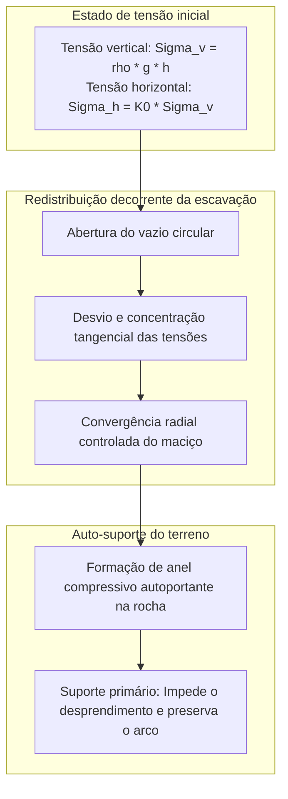
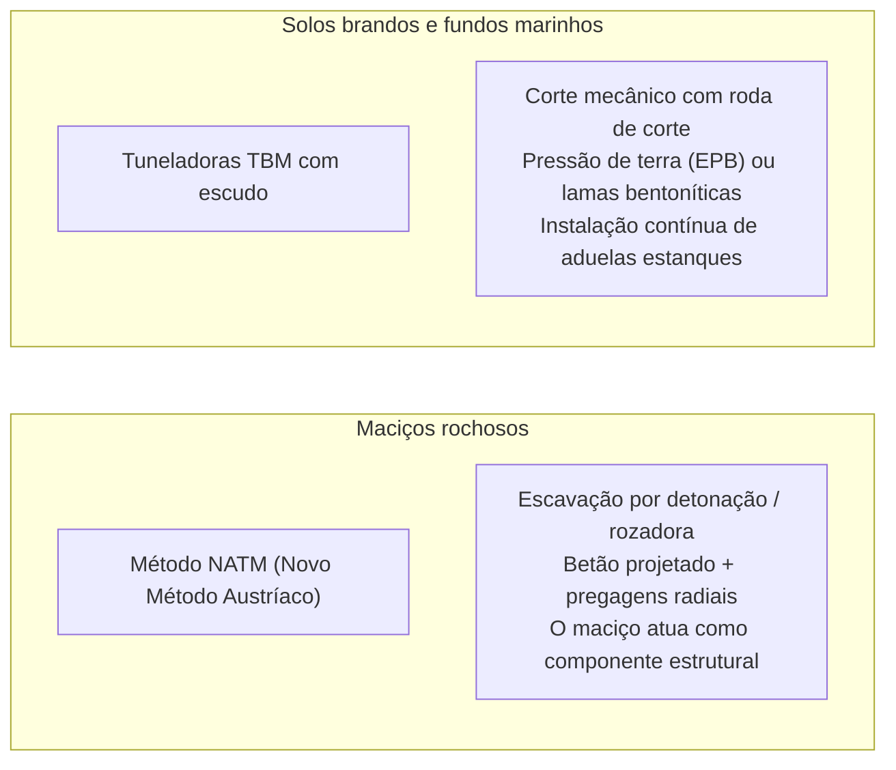

Um túnel monumental abre-se na encosta de uma montanha escarpada. Comboios de alta velocidade penetram na sua escuridão a mais de 300 quilómetros por hora, enquanto sob o fundo do mar milhares de veículos circulam em autoestradas submersas com total segurança. Os túneis modernos constituem verdadeiras artérias invisíveis do progresso humano.

No entanto, sob a perspetiva da física e da geotecnia, coloca-se uma questão perturbadora:
"Por que razão o peso colossal de centenas de metros de rocha ou a massa do oceano não esmagam estas cavidades instantaneamente?"
"Como conseguem as máquinas perfurar lamas e areias saturadas de água a alta pressão sem que ocorra uma inundação catastrófica?"

A escavação subterrânea é uma batalha diária contra colapsos e falhas tectónicas. A engenharia de túneis não consiste apenas em furar a terra: é <strong>«um sistema extremo de controlo físico que mobiliza a mecânica dos solos e das rochas (Soil & Rock Mechanics) para transformar o próprio maciço num elemento de suporte, equilibrando pressões de fluidos e erguendo suporte estrutural imediato.»</strong>

---

## 1. Por que as cavidades não desabam: O efeito de arco do maciço

O axioma primordial da engenharia subterrânea determina: <strong>O revestimento de betão do túnel não foi concebido para suportar sozinho todo o peso morto da montanha.</strong>

Se a 500 metros de profundidade um engenheiro tentasse suster a coluna litostática com uma mera parede de betão, as tensões de compressão ultrapassariam a resistência do material, causando esmagamento imediato. O túnel mantém-se estável graças ao <strong>efeito de arco do terreno (Ground Arching Effect)</strong>.

### 1.1 Solução elástica de Kirsch e Método Convergência-Confinamento
A clássica solução analítica de Kirsch (1898) demonstra que no bordo de uma escavação circular ($r = a$), a tensão radial desce a zero ($\sigma_r = 0$), enquanto a tensão tangencial $\sigma_\theta$ duplica num campo hidrostático ($\sigma_\theta = 2\sigma_v$).
Este anel de alta compressão funciona como um arco estrutural natural, desviando a carga da coluna vertical para as rochas sãs adjacentes.

O método de **Convergência-Confinamento** resume a filosofia do projeto:
1. **Suporte perfeitamente rígido inicial**: Conter o maciço sem qualquer deformação exige pressões astronómicas $p_i = \sigma_0$.
2. **Convergência controlada ótima**: Permitir uma ligeira deformação interna de milímetros a centímetros faz com que o maciço mobilize a sua resistência ao corte ($c$ e $\phi$), reduzindo a pressão de suporte ao mínimo.
3. **Descompressão excessiva**: Atrasar o suporte provoca fraturação, transformando a rocha em blocos soltos que desabam.

---

## 2. As duas grandes abordagens: NATM e Tatuzões Mecanizados (TBM)

### 2.1 O Novo Método Austríaco (NATM)
Codificado na década de 1960 por Rabcewicz, revolucionou a engenharia alpina:
- **Betão projetado e cavilhas de ancoragem**: Aplicação imediata de betão com acelerador de presa para selar fendas, combinada com pregagens profundas que costuram os blocos de rocha num anel resistente.
- **Instrumentação sistemática**: Monitorização diária da convergência tridimensional até estabilização total antes de aplicar o revestimento secundário.

### 2.2 Tuneladoras mecanizadas (TBM)
Em solos brandos saturados e sob o oceano, o escudo atua como uma fábrica estanque:
- **Equilíbrio por Pressão de Terra (EPB) e Lamas**: A câmara de escavação é mantida à pressão exata dos solos e água para evitar abatimentos superficiais.
- **Injeção de calda na cauda do escudo**: Preenchimento imediato do vazio anelar para mitigar recalques segundo a curva de Peck:
$$S(x) = S_{\max} \exp\left( -\frac{x^2}{2i^2} \right)$$

---

## 3. Grandes marcos da engenharia subterrânea

- **Túnel Seikan (Japão, 53,85 km)**: Superou perigosas falhas submarinas no estreito de Tsugaru graças a injeções químicas a 70 bar, transformando argilas instáveis em rocha maciça impermeável.
- **Eurotúnel no Canal da Mancha (50,45 km)**: Perfuração com escudo em estrato contínuo de marga calcária impermeável, alcançando avanços recorde com alinhamento a laser.
- **Túnel de Base de São Gotardo (Suíça, 57,1 km)**: O mais longo túnel ferroviário do mundo sob 2.450 m de granito alpino a mais de 45 °C de temperatura ambiente.

---

## 4. Conclusão

Construir túneis sob montanhas e mares é uma das maiores expressões da inteligência humana: não pela força bruta, mas pela maestria de fazer com que a própria Terra coopere na abertura dos caminhos da civilização.
