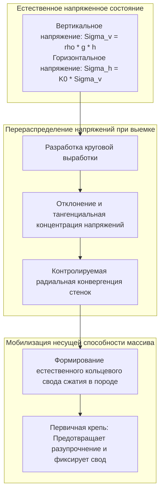
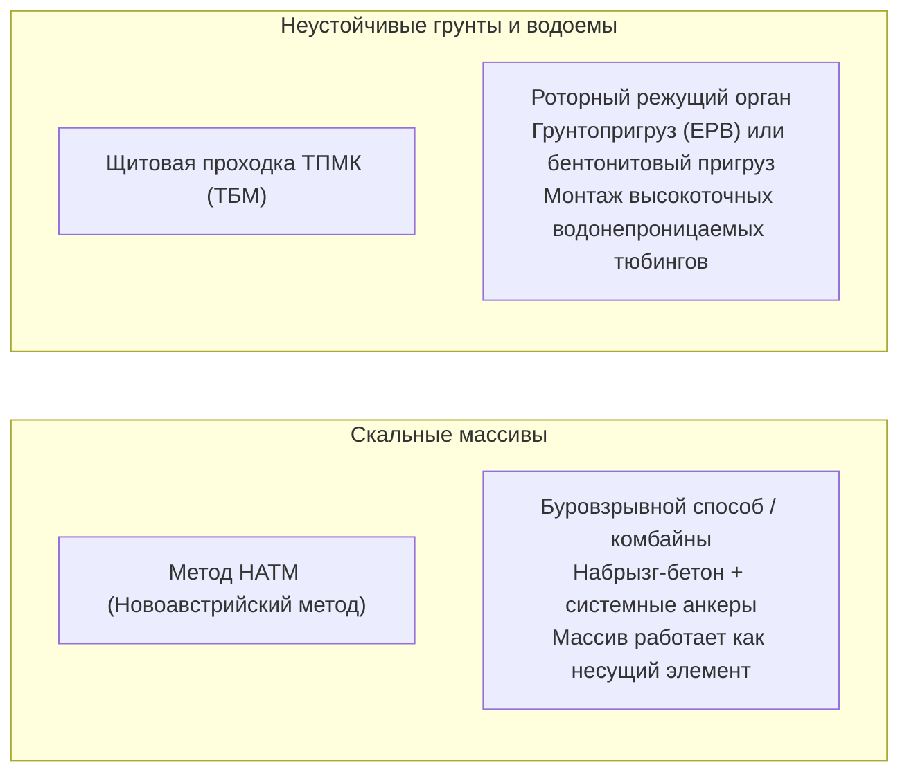

Массивный портал тоннеля врезается в склон скалистого хребта. Высокоскоростные поезда устремляются в темноту на скорости более 300 км/ч, а глубоко под морским дном тысячи автомобилей безопасно преодолевают километры подводных автомагистралей. Тоннели стали незаменимыми артериями современной цивилизации.

Однако с точки зрения физики и геомеханики возникает фундаментальный вопрос:
«Почему колоссальный вес сотен метров горных пород или бездонного океана не раздавливает тоннель в мгновение ока?»
«Как строителям удается прокладывать путь сквозь насыщенные водой плывуны и тектонические разломы без катастрофического затопления?»

Строительство тоннелей — это не просто выемка грунта. Это <strong>«экстремальная система физического контроля, использующая законы механики грунтов и скальных пород (Soil & Rock Mechanics), чтобы заставить массив нести собственный вес, точно балансируя поровое давление и мгновенно возводя несущую крепь.»</strong>

---

## 1. Почему подземное пространство не обрушается: Эффект сводообразования

Ключевая истина подземного строительства гласит: <strong>Бетонная обделка тоннеля не рассчитывается на восприятие полного гравитационного веса вышележащей горы.</strong>

Если бы на глубине 500 метров инженер попытался удержать вес всей толщи пород только лишь бетонными стенами толщиной 30–50 см, напряжения сжатия многократно превысили бы предел прочности любого материала. Тоннель сохраняет устойчивость благодаря <strong>эффекту сводообразования (Ground Arching Effect)</strong>.

### 1.1 Аналитическое решение Кирша и метод конвергенции-удержания
Согласно классическому решению Кирша (1898), на контуре выработки радиуса $a$ радиальные напряжения падают до нуля ($\sigma_r = 0$), а тангенциальные напряжения $\sigma_\theta$ возрастают. В гидростатическом поле ($K_0 = 1$):
$$\sigma_\theta = 2\sigma_v$$

Вокруг выработки образуется кольцо высокого сжатия, которое перераспределяет вертикальную нагрузку в массив по бокам тоннеля.

**Метод конвергенции-удержания (Convergence-Confinement Method)** демонстрирует:
1. **Жесткое удержание без деформаций**: Требует колоссального начального давления крепи $p_i = \sigma_0$.
2. **Оптимальная контролируемая деформация**: Допуская смещение контура на несколько миллиметров или сантиметров, массив мобилизует силы внутреннего сцепления $c$ и трения $\phi$, а требуемое давление крепи падает до минимального значения.
3. **Чрезмерное разупрочнение**: Если крепь установлена слишком поздно, порода растрескивается и обрушивается под действием собственного веса.

---

## 2. Два столпа современного тоннелестроения: НАТМ и ТПМК

### 2.1 Революция Новоавстрийского метода (НАТМ)
Разработанный в 1960-х годах австрийскими инженерами (Рабцевич и др.), метод заменил жесткие деревянные и стальные рамы на гибкую податливую крепь:
- **Набрызг-бетон и анкерное крепление**: Мгновенное запечатывание микротрещин набрызг-бетоном и установка радиальных анкеров, сшивающих расслоившиеся пласты в прочное монолитное кольцо.
- **Геотехнический мониторинг**: Непрерывные замеры конвергенции до полной стабилизации массива перед укладкой постоянной вторичной бетонной обделки.

### 2.2 Механизированная щитовая проходка (ТПМК)
В плывунах, глинах и под дном морей тоннелепроходческий механизированный комплекс действует как автономная подземная фабрика:
- **Щиты с грунтопригрузом (EPB) и гидропригрузом (Slurry)**: Давление в призабойной камере компенсирует внешнее давление грунта и грунтовых вод, предотвращая просадки поверхности.
- **Нагнетание тампонажного раствора**: Заполнение зазора между грунтом и тюбингами позади щита сводит к минимуму оседание поверхности по закону кривой Пека:
$$S(x) = S_{\max} \exp\left( -\frac{x^2}{2i^2} \right)$$

---

## 3. Легендарные проекты: Сэйкан, Евротоннель и Готард

- **Тоннель Сэйкан (Япония, 53,85 км)**: Преодоление тяжелейших разломов под проливом Цугару благодаря нагнетанию химических растворов и микроцемента под давлением до 70 бар, создавшему вокруг выработки водонепроницаемый монолит.
- **Евротоннель под Ла-Маншем (50,45 км)**: Скоростная щитовая проходка в водоупорном пласте мелового мергеля (Chalk Marl) со сбойкой под морем с миллиметровой точностью.
- **Готардский базисный тоннель (Швейцария, 57,1 км)**: Самый длинный ж/д тоннель в мире под толщей Альп до 2 450 м при температуре пород свыше 45 °C.

---

## 4. Заключение

Строительство тоннелей сквозь гранитные толщи гор и морские глубины — это триумф научной мысли, где инженеры побеждают колоссальное давление природы не грубой силой, а глубоким пониманием геомеханики.
