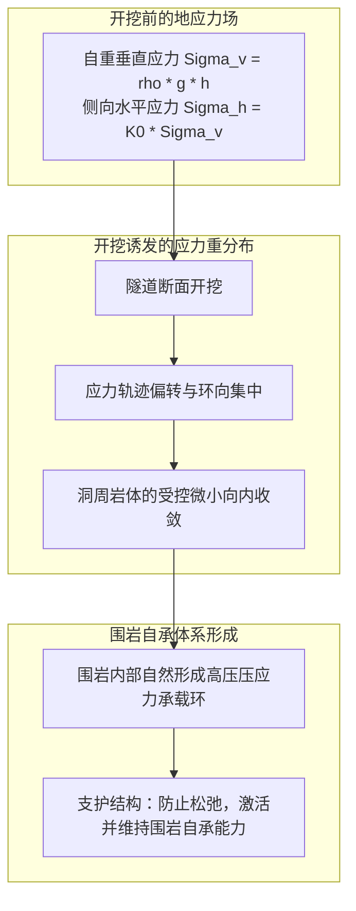
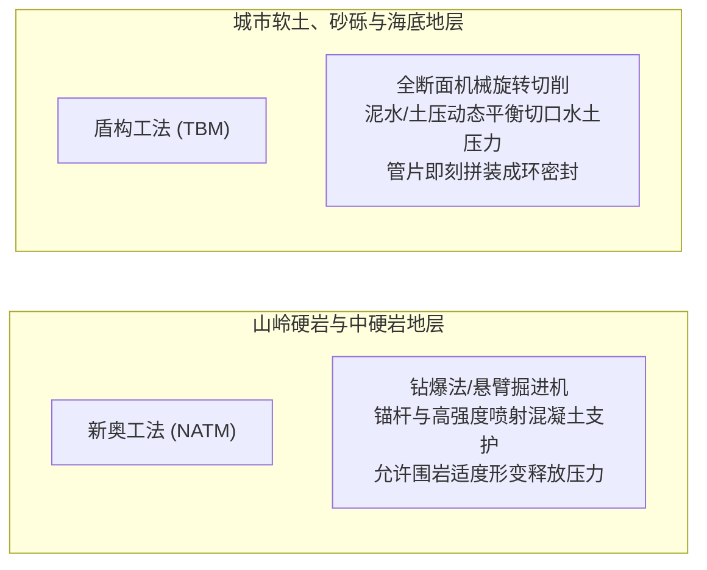

在崇山峻岭间，漆黑的隧道洞口赫然敞开；高速列车以数百公里时速呼啸而过，跨海大桥下的水底公路中，成千上万的车辆在鱼群游弋的海床之下平稳飞驰。在现代社会中，隧道已成为人类文明不可或缺的交通命脉。

然而，从物理学与力学的角度冷静审视，我们不禁会问：
「头顶上方承受着数百米厚的重叠岩山或无边深海，隧道为何不会被千万吨泥土彻底压塌？」
「在充满高压地下水和松软淤泥的恶劣海床中，工人们究竟如何做到滴水不漏地开挖推进？」

地底开挖是一场直面崩塌、突泥和高压涌水致命威胁的科学较量。隧道工程绝非简单的“地底挖洞”，而是<strong>「巧妙借用岩土力学（Soil & Rock Mechanics）的内在规律，精密控制地下水力平衡，并在开挖瞬间即刻构建承载体系的极限物理控制系统」</strong>。

---

## 1. 地下空洞为何不坍塌：岩土力学与「地层压力自承拱」

理解隧道力学的首要关键在于破除一个常见误区：<strong>隧道衬砌（混凝土墙）并不是单凭自身强度硬抗整座大山的重量</strong>。

若要在数百米深的地底，纯靠数十厘米厚的钢筋混凝土硬生生顶住上方数十万吨的重力荷载，任何已知的工程材料都会在瞬间被压得粉碎。隧道能够长期稳固屹立的根本奥秘，在于围岩地层自身形成的<strong>「地层压力自承拱（Ground Arching Effect）」</strong>。

### 1.1 基尔施弹性应力解析解（Kirsch's Solution）
在均质弹性介质中开挖半径为 $a$ 的圆形孔洞时，地应力重分布由著名的基尔施公式严格描述。在洞壁边界（$r = a$），径向应力释放为零（$\sigma_r = 0$），而环向切向应力 $\sigma_\theta$ 显著集中：
$$\sigma_\theta = \sigma_v \left[ (1 + K_0) + 2(1 - K_0)\cos 2\theta \right]$$

在静水应力状态下（$K_0 = 1$），洞壁周围的环向压应力恰好变为初始垂直应力的 2 倍（$\sigma_\theta = 2\sigma_v$）。正是这种应力转移机制，将洞顶原本由下落岩体承受的重力，沿环向安全地疏导转移至隧道两侧深部稳固的地层中，形成了坚固的地层承载拱。

### 1.2 地层特征曲线（Ground Reaction Curve）与收敛约束法
隧道工程设计的核心理论基础是<strong>地层特征曲线（GRC）与收敛约束法（Convergence-Confinement Method）</strong>：
1. **未变形初始状态**：若要完全遏止围岩发生任何位移，需要极其巨大的理论支护压力 $p_i = \sigma_0$。
2. **受控允许微小变形**：允许洞壁产生微小的塑性收敛位移（数毫米至数厘米），岩体内部的抗剪强度（内摩擦角 $\phi$ 与黏聚力 $c$）得以充分激发，围岩“自己承担自身重量”，所需支护压力急剧降至极低值。
3. **过度变形与松动破坏**：若不及时进行支护，任由变形无休止扩大，岩体内部裂隙将贯通粉碎，转化为散体崩塌荷载，支护压力将重新暴增。

工程的核心精髓在于：<strong>在围岩释放自身变形应力、激发自承能力的最优时刻施加支护，实现工程经济与结构安全的完美平衡</strong>。

---

## 2. 现代隧道建设的双子星：新奥工法（NATM）与盾构工法

根据不同的地质水文条件，现代隧道主要依托两大王牌工法建造：

### 2.1 山岭隧道革新：新奥工法（NATM）
由奥地利学者在20世纪60年代奠基的新奥工法（New Austrian Tunnelling Method），彻底颠覆了以往依靠巨型木撑、厚重型钢硬顶硬抗地压的旧思路。
- **锚杆与喷射混凝土的协同机制**：岩面开挖后立即喷射掺有速凝剂的高标号混凝土封闭裂隙，防止风化剥落；随后向深部打入数米长的高强锚杆，产生“悬吊”、“组合梁”与“挤压加固环”效应，将破碎围岩整体缝合成一体。
- **全过程监控量测**：在洞内布置收敛计与全站仪反射靶标，日夜监测洞周毫米级形变速率。只有确认围岩变形完全平敛收敛，才浇筑内层永久二次混凝土衬砌。

### 2.2 城市软土与越海利器：盾构工法（Shield Tunnelling）
在富含高压地下水的城市淤泥层、细砂层或深海海床中，盾构机（TBM）如同在地下穿行的巨型全自动“钢铁潜艇”。
- **泥水平衡（Slurry Shield）与土压平衡（EPB Shield）**：通过向前部密封舱内注入膨润土泥浆或改性泡沫塑料土体，使舱内压力以毫秒级精度动态匹配外部水土压力，杜绝洞门坍塌或地面沉降。
- **壁后注浆与佩克沉降槽理论**：盾构壳体前移留下的环形空隙（建筑间隙），必须在数秒内通过盾尾高压注入双液注浆硬化材料。根据岩土工程著名的<strong>佩克沉降槽（Peck's Settlement Trough）</strong>理论：
$$S(x) = S_{\max} \exp\left( -\frac{x^2}{2i^2} \right)$$
严格将地面沉降体积损失率控制在 0.5% 以内，确保上方高楼大厦、历史古迹与地下管线毫发无损。

---

## 3. 海底极限界域的较量：青函隧道与英法海峡隧道

海底隧道工程最大的敌人是头顶无限量供给的致命高压海水。水深每增加 100 米，每平方米暴露岩面就要承受 100 吨的巨大静水推力。

### 3.1 日本青函隧道：超高压全断面注浆硬化传奇
全长 53.85 公里的青函隧道穿越津轻海峡百米海水及复杂火山碎屑断层带。日本工程师开创了<strong>「超前地质预报导坑 + 超高压化学注浆（Chemical Grouting）」</strong>体系，将水玻璃和超细水泥浆以高达 $7\text{ MPa}$ 的极高压力灌注至前方岩石微细裂隙中，人工创造出数十米厚的坚硬不透水岩体后再行开挖，战胜了多次突水危机。

### 3.2 英法海峡隧道：地质追踪与盾构急速推进
英法海峡隧道则采取了截然不同的优雅策略：利用精准三维地震勘探，将隧道严密锁定在海底下厚度仅数米的<strong>白垩泥灰岩层（Chalk Marl）</strong>之中。该地层兼具不透水性与易切削性，英法双方投入 11 台巨型盾构机对向飞速掘进，创下月掘进超 1 公里的人类纪录，于 1990 年在海底下以数厘米极小误差精准会师。

---

## 4. 极端地下工程特殊工法与生命保障体系

### 4.1 人工冻结法（Ground Freezing）与沉管工法（Immersed Tube）
- **人工地层冻结法**：向不稳定含水饱和地层打入循环冷冻管，通入 $-30^\circ\text{C}$ 的盐水或液氮，将软弱泥土人工冻结成抗压强度堪比花岗岩的巨型“冻土冰穹”，在绝对无水环境中安全施工作业。
- **沉管隧道工法**：在干坞中预制数万吨重的巨型箱型混凝土管节，浮运至水面后下沉至基槽内，利用吉娜橡胶止水带（Gina Gasket）两端数千吨天然水压差实现自动“水压真空压接”，滴水不漏。

### 4.2 防灾通风与正压安全逃生通道
1999 年勃朗峰隧道特大火灾后，地下防灾体系全面升华。
- **临界风速（Critical Velocity）控制**：纵向射流风机保持气流速度严格大于烟气逆流蔓延临界值，迫使有毒高温浓烟单向排除。
- **逃生横通道正压送风系统**：疏散通道与服务导坑内的空气压力始终保持高于行车主洞 30 至 50 Pa，确保群众推门逃生时，清风向主洞喷涌，彻底阻断有毒烟气入侵。

---

## 5. 结语

在现代工程科技的加持下，从瑞士阿尔卑斯山下深达 2450 米的圣哥达基线隧道，到纵横都市地底的超大直径智能盾构网，人类从未真正战胜大自然的磅礴重力，而是以极致的物理智慧，化解地应力、引导水流、借力地层，在不可见的地底深处筑就了无坚不摧的现代文明动脉。
