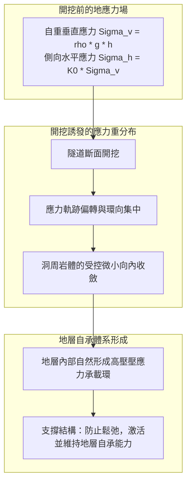
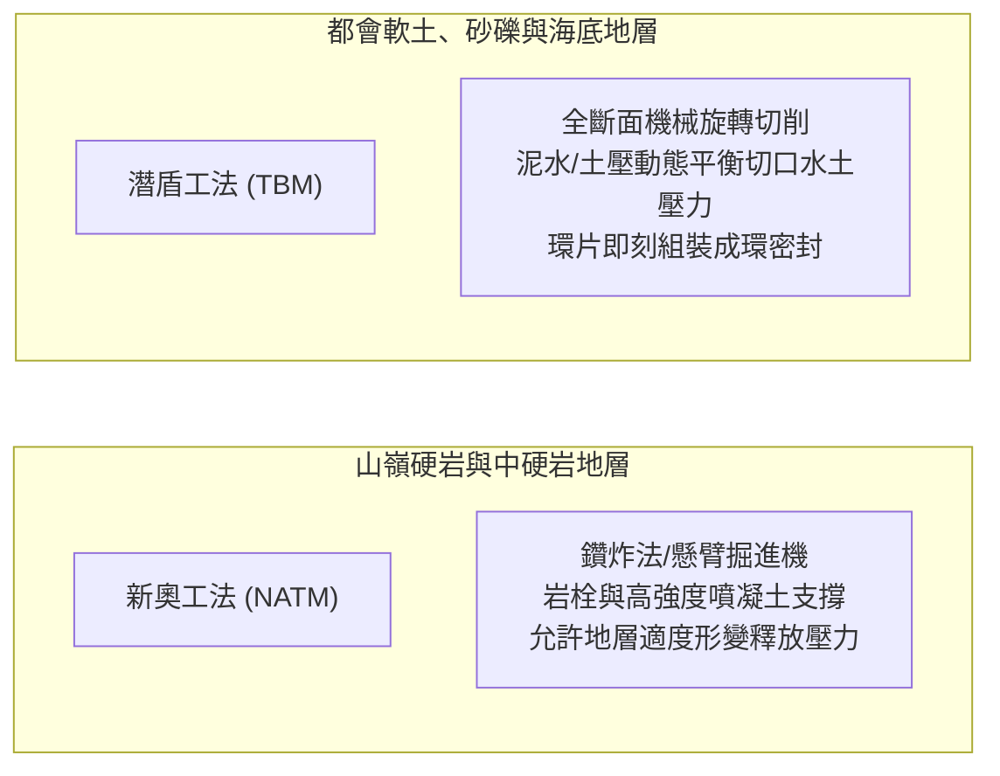

在崇山峻嶺間，漆黑的隧道洞口赫然敞開；高鐵列車以數百公里時速呼嘯而過，跨海大橋下的水底公路中，成千上萬的車輛在魚群游弋的海床之下平穩飛馳。在現代社會中，隧道已成為人類文明不可或缺的交通命脈。

然而，從物理學與力學的角度冷靜審視，我們不禁會問：
「頭頂上方承受著數百米厚的大山或無邊深海，隧道為何不會被千萬噸泥土徹底壓垮？」
「在充滿高壓地下水和鬆軟淤泥的惡劣海床中，工程師究竟如何做到滴水不漏地開挖推進？」

地底開挖是一場直面崩塌、突泥和高壓湧水致命威脅的科學較量。隧道工程絕非簡單的“地底挖洞”，而是<strong>「巧妙借用大地力學（Soil & Rock Mechanics）的內在規律，精密控制地下水力平衡，並在開挖瞬間即刻構建承載體系的極限物理控制系統」</strong>。

---

## 1. 地下空洞為何不坍塌：大地力學與「地層自承拱」

理解隧道力學的首要關鍵在於破除一個常見誤區：<strong>隧道襯砌（混凝土牆）並不是單憑自身強度硬抗整座大山的重量</strong>。

若要在數百米深的地底，純靠數十公分厚的鋼筋混凝土硬生生頂住上方數十萬噸的重力載重，任何已知的工程材料都會在瞬間被壓得粉碎。隧道能夠長期穩固屹立的根本奧秘，在於地層本身形成的<strong>「地層壓力自承拱（Ground Arching Effect）」</strong>。

### 1.1 基爾施彈性應力解析解（Kirsch's Solution）
在均質彈性介質中開挖半徑為 $a$ 的圓形孔洞時，地應力重分布由著名的基爾施公式嚴格描述。在洞壁邊界（$r = a$），徑向應力釋放為零（$\sigma_r = 0$），而環向切向應力 $\sigma_\theta$ 顯著集中：
$$\sigma_\theta = \sigma_v \left[ (1 + K_0) + 2(1 - K_0)\cos 2\theta \right]$$

在靜水應力狀態下（$K_0 = 1$），洞壁周圍的環向壓應力恰好變為初始垂直應力的 2 倍（$\sigma_\theta = 2\sigma_v$）。正是這種應力轉移機制，將洞頂原本由下落岩體承受的重力，沿環向安全地疏導轉移至隧道兩側深部穩固的地層中，形成了堅固的地層承載拱。

### 1.2 地層特徵曲線（Ground Reaction Curve）與收斂約束法
隧道工程設計的核心理論基礎是<strong>地層特徵曲線（GRC）與收斂約束法（Convergence-Confinement Method）</strong>：
1. **未變形初始狀態**：若要完全遏止圍岩發生任何位移，需要極其巨大的理論支撐壓力 $p_i = \sigma_0$。
2. **受控允許微小變形**：允許洞壁產生微小的塑性收斂位移（數毫米至數公分），岩體內部的抗剪強度（內摩擦角 $\phi$ 與凝聚力 $c$）得以充分激發，地層“自己承擔自身重量”，所需支撐壓力急劇降至極低值。
3. **過度變形與鬆動破壞**：若不及時進行支撐，任由變形無休止擴大，岩體內部裂隙將貫通粉碎，轉化為散體崩塌載重，支撐壓力將重新暴增。

工程的核心精髓在於：<strong>在地層釋放自身變形應力、激發自承能力的最優時刻施加支撐，實現工程經濟與結構安全的完美平衡</strong>。

---

## 2. 現代隧道建設的雙子星：新奧工法（NATM）與潛盾工法

根據不同的地質水文條件，現代隧道主要依託兩大王牌工法建造：

### 2.1 山嶺隧道革新：新奧工法（NATM）
由奧地利學者在20世紀60年代奠基的新奧工法（New Austrian Tunnelling Method），徹底顛覆了以往依靠巨型木撐、厚重型鋼硬頂硬抗地壓的舊思路。
- **岩栓與噴凝土的協同機制**：岩面開挖後立即噴射摻有速凝劑的高標號噴凝土封閉裂隙，防止風化剝落；隨後向深部打入數米長的高強岩栓，產生“懸吊”、“組合梁”與“擠壓加固環”效應，將破碎岩盤整體縫合成一體。
- **全過程監控量測**：在洞內布置收斂計與全站儀反射標靶，日夜監測洞周毫米級形變速率。只有確認圍岩變形完全平斂收斂，才澆築內層永久二次混凝土襯砌。

### 2.2 都市軟土與越海利器：潛盾工法（Shield Tunnelling）
在富含高壓地下水的都市淤泥層、細砂層或深海海床中，潛盾機（TBM）如同在地下穿行的巨型全自動“鋼鐵潛水艇”。
- **泥水平衡（Slurry Shield）與土壓平衡（EPB Shield）**：通過向前部密封艙內注入膨潤土泥漿或改性泡沫塑料土體，使艙內壓力以毫秒級精度動態匹配外部水土壓力，杜絕洞門坍塌或地面沈陷。
- **背填灌漿與佩克沈陷槽理論**：潛盾殼體前移留下的環形空隙（尾隙），必須在數秒內通過盾尾高壓注入雙液灌漿硬化材料。根據大地工程著名的<strong>佩克沈陷槽（Peck's Settlement Trough）</strong>理論：
$$S(x) = S_{\max} \exp\left( -\frac{x^2}{2i^2} \right)$$
嚴格將地面沈陷體積損失率控制在 0.5% 以內，確保上方高樓大廈、歷史古蹟與地下管線毫髮無損。

---

## 3. 海底極限界域的較量：青函隧道與英法海峽隧道

海底隧道工程最大的敵人是頭頂無限量供給的致命高壓海水。水深每增加 100 米，每平方公尺暴露岩面就要承受 100 噸的巨大靜水推力。

### 3.1 日本青函隧道：超高壓全斷面灌漿硬化傳奇
全長 53.85 公里的青函隧道穿越津輕海峽百米海水及複雜火山碎屑斷層帶。日本工程師開創了<strong>「先進導坑地質探查 + 超高壓化學灌漿（Chemical Grouting）」</strong>體系，將水玻璃和超細水泥漿以高達 $7\text{ MPa}$ 的極高壓力灌注至前方岩石微細裂隙中，人工創造出數十米厚的堅硬不透水岩體後再行開挖，戰勝了多次突水危機。

### 3.2 英法海峽隧道：地質追蹤與潛盾急速推進
英法海峽隧道則採取了截然不同的優雅策略：利用精準三維震測勘探，將隧道嚴密鎖定在海底下厚度僅數米的<strong>白堊泥灰岩層（Chalk Marl）</strong>之中。該地層兼具不透水性與易切削性，英法雙方投入 11 台巨型潛盾機對向飛速掘進，創下月掘進超 1 公里的人類紀錄，於 1990 年在海底下以數公分極小誤差精準會師。

---

## 4. 結語

在現代工程科技的加持下，從瑞士阿爾卑斯山下深達 2450 米的聖哥達基線隧道，到縱橫都市地底的超大直徑智慧潛盾網，人類從未真正戰勝大自然的磅礴重力，而是以極致的物理智慧，化解地應力、引導水流、借力地層，在不可見的地底深處構築了無堅不摧的現代文明命脈。
