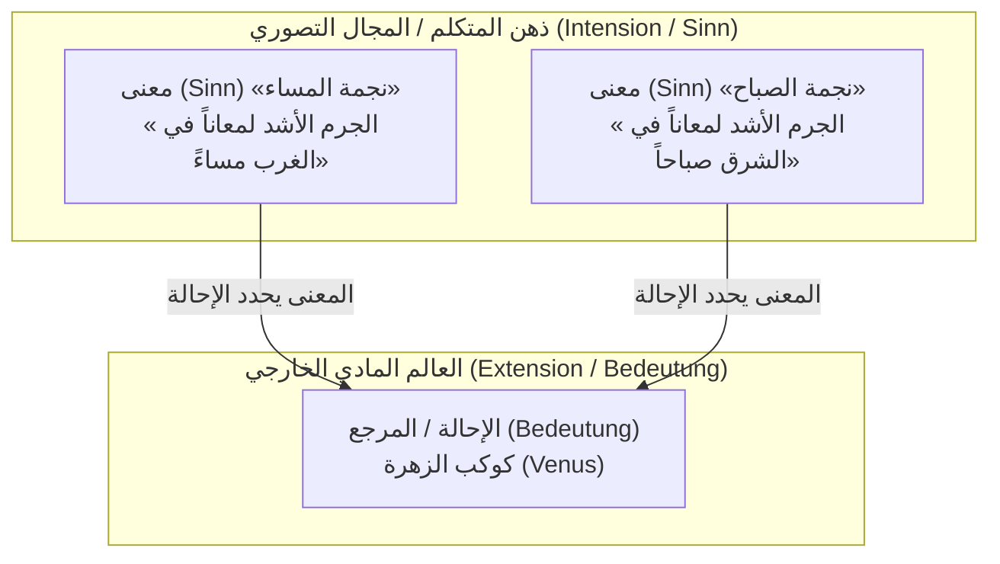
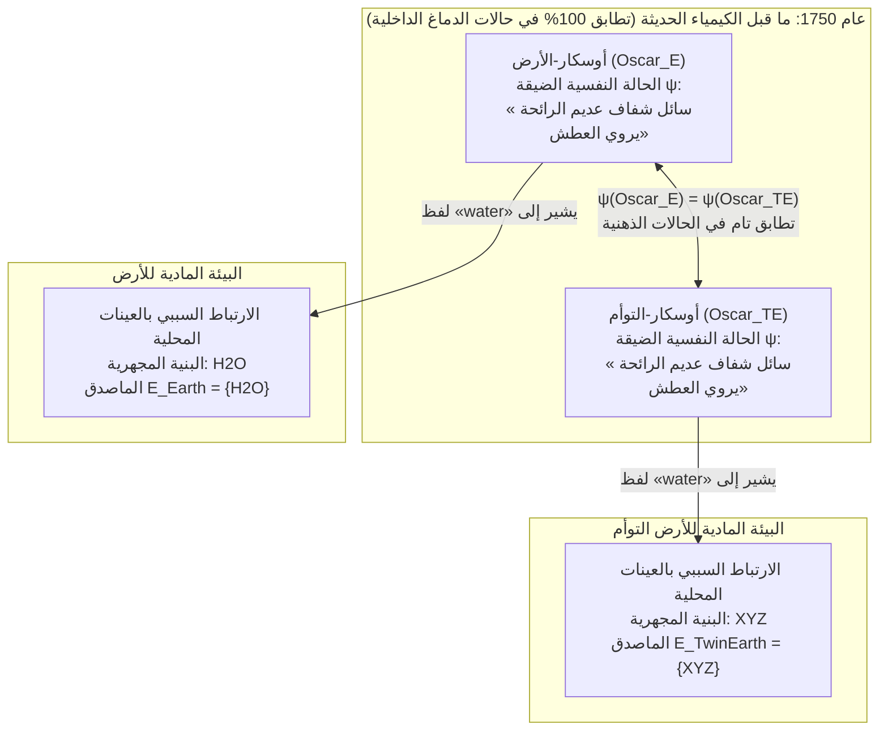

## 1. مقدمة: أين يكمن «معنى» الكلمة؟

عندما ننطق بكلمات مألوفة مثل *«ماء»* أو *«ذهب»* أو *«أرسطو»*، كيف تتمكن هذه الأصوات أو الحروف المكتوبة من تجاوز حدود أذهاننا لتشير بدقة إلى مواد كيميائية بعينها أو أشخاص تاريخيين في العالم المادي؟

منذ أطروحة جون لوك في القرن السابع عشر بأن الكلمات هي علامات تدل على «الأفكار الموجودة في ذهن المتكلم»، مروراً بالفلسفة التحليلية عند غوتلوب فريجه وبيرتراند راسل ورودولف كارناب وجون سيرل في القرن العشرين، هيمنت على فلسفة اللغة عقيدة راسخة هي <strong>الداخلية الدلالية (Semantic Internalism)</strong> و<strong>النظرية الوصفية (Descriptivism)</strong>. وفقاً لهذا التصور، فإن فهم معنى الكلمة (المفهوم أو القصد Intension) لا يعدو كونه امتلاك تصور ذهني أو قائمة من الأوصاف المميزة داخل رأس المتكلم؛ وهذا المضمون الذهني الداخلي هو الذي يحدد بمفرده الأشياء التي تشير إليها الكلمة في العالم الخارجي (الماصدق أو الامتداد Extension).

غير أن مطلع السبعينيات من القرن العشرين شهد صدور عملين ثوريين قوضا هذا الصرح الكلاسيكي من أساسه: محاضرات سول كريبكي <strong>«التسمية والضرورة» (*Naming and Necessity*, 1972/1980)</strong>، ومقال هيلاري بوتنام الشهير <strong>«معنى "المعنى"» (*The Meaning of "Meaning"*, 1975)</strong>.

من خلال <strong>تجربة «الأرض التوأم» الفكرية (Twin Earth: $\text{H}_2\text{O}$ مقابل $\text{XYZ}$)</strong>، أثبت بوتنام مفارقة مذهلة: في عام 1750 (قبل نشأة الكيمياء الحديثة)، يمكن لمتحدث على الأرض (أوسكار) ونسخته المطابقة جزيئاً بجزيء على الأرض التوأم (أوسكار التوأم) أن يكونا في <strong>حالات نفسية وعصبية ضيقة متطابقة بنسبة 100%</strong>، ومع ذلك فإن كلمة *«ماء» (water)* التي ينطقان بها تشير إلى مادتين كيميائيتين مختلفتين تماماً ($\text{H}_2\text{O}$ مقابل $\text{XYZ}$)، وبالتالي تحمل معنيين مختلفين! وقد لخص بوتنام ذلك في عبارته الشهيرة:

> <strong>«قطّع الفطيرة كيفما شئت، فإن "المعاني" ببساطة ليست في الرأس! (Cut the pie any way you like, 'meanings' just ain't in the head!)»</strong>

يستعرض هذا المقال المسار الفلسفي من الوصفية الكلاسيكية (فريجه، راسل، سيرل) إلى <strong>الدالات الصلبة (Rigid Designators)</strong> و<strong>الحقائق الضرورية البعدية (*A Posteriori*)</strong> عند كريبكي، و<strong>الأرض التوأم</strong> و<strong>تقسيم العمل اللغوي</strong> عند بوتنام، و<strong>الخارجية الاجتماعية</strong> عند تايلر بيرج (تجربة التهاب المفاصل)، وصولاً إلى تطبيقاتها المعاصرة على <strong>نماذج اللغة الكبيرة (LLMs)</strong> ومشكلة تأريض الرموز.

---

## 2. التقليد الداخلي والوصفي الكلاسيكي: فريجه، راسل، وسيرل

### 2.1 لغز فريجه ومقال *«في المعنى والإحالة»* (1892)

في عام 1892، افتتح غوتلوب فريجه مقاله الكلاسيكي *«Über Sinn und Bedeutung»* بطرح لغز حول قضايا الهوية يُعرف باسم <strong>لغز فريجه (Frege's Puzzle)</strong>. لنقارن بين الجملتين الآتيتين:

1. <strong>$a = a$: «نجمة المساء هي نجمة المساء (Hesperus is Hesperus)».</strong>
2. <strong>$a = b$: «نجمة المساء هي نجمة الصباح (Hesperus is Phosphorus)».</strong>

من الناحية الفلكية، يشير كل من اسم «نجمة المساء» (*Hesperus*) واسم «نجمة الصباح» (*Phosphorus*) إلى الجرم السماوي ذاته، وهو كوكب <strong>الزهرة (Venus)</strong>:

$$\llbracket \text{Hesperus} \rrbracket = \llbracket \text{Phosphorus} \rrbracket = \text{Venus}$$

لو كان معنى الاسم يقتصر على <strong>إحالته / مرجعه الخارجي (*Bedeutung* / Reference)</strong>، لكان للجملة $a = b$ نفس القيمة المعرفية التي للجملة التحصيلية التافهة $a = a$. لكن $a = a$ حقيقة تحليلية تُعرف <strong>قبلياً (*a priori*)</strong>، بينما $a = b$ اكتشاف فلكي تجريبي يُعرف <strong>بعدياً (*a posteriori*)</strong>.

لحل هذا اللغز، ميّز فريجه بين مستويين دلاليين:
- <strong>الإحالة / الماصدق (*Bedeutung* / Extension)</strong>: الكيان الفعلي في العالم الخارجي (كوكب الزهرة).
- <strong>المعنى / المفهوم (*Sinn* / Sense / Intension)</strong>: <strong>«طريقة تقديم الموضوع» (*Art des Gegebenseins*)</strong>، أي المعيار التصوري الذي يدركه ذهن المتكلم.

عند فريجه، يدرك المتكلم *المعنى* (*Sinn*) ذهنياً، و<strong>المعنى هو الذي يحدد الإحالة (*Bedeutung*) بصورة فريدة</strong>.

### 2.2 نظرية الأوصاف المحددة عند راسل (1905) والوصفية العنقودية عند سيرل (1958)

في مقاله *«On Denoting»* (1905)، حلل بيرتراند راسل <strong>الأوصاف المحددة</strong> من قبيل «إن $F$ هو $G$» ($\iota x\, F(x)$) باستخدام سور الوجود وشرط الوحدانية في منطق الرتبة الأولى:

$$\text{The } F \text{ is } G \iff \exists x \Big( F(x) \land \forall y \big(F(y) \to y = x\big) \land G(x) \Big)$$

ورأى راسل أن أسماء الأعلام العادية («أرسطو») وألفاظ الأنواع الطبيعية («ماء»، «ذهب») هي في الحقيقة <strong>أوصاف محددة مضمرة أو مختصرة</strong>. ولتفادي صعوبات الوصف الواحد، اقترح جون سيرل (1958) <strong>الوصفية العنقودية (Cluster Descriptivism)</strong>: يرتبط الاسم بحزمة موزونة من الأوصاف $\{D_1, D_2, \dots, D_n\}$ في ذهن المتكلم، ويشير إلى الشيء $x$ الذي يحقق أغلبية موزونة كافية من تلك الأوصاف:

$$\llbracket N \rrbracket = \iota x \left( \sum_{i=1}^{n} w_i \cdot \mathbb{I}\big[D_i(x)\big] \ge \theta \right)$$

### 2.3 العقيدتان الأساسيتان للدلالة التقليدية: (A1) و (A2)

لخص هيلاري بوتنام هذا التراث الكلاسيكي في افتراضين أساسيين:

- <strong>الافتراض (A1) الأنا وحدية المنهجية (Methodological Solipsism)</strong>: إن معرفة معنى (مفهوم $I(t)$) لفظ ما $t$ تكمن بالكامل في الوجود في <strong>حالة نفسية ضيقة ($\psi \in \mathcal{S}_{\text{narrow}}$)</strong> داخل رأس المتكلم بمعزل عن العالم الخارجي.
- <strong>الافتراض (A2) المفهوم يحدد الماصدق (Intension Determines Extension)</strong>: المفهوم الذهني $I(t)$ يحدد بصورة قاطعة الماصدق الخارجي $E(t)$:

$$\psi(S_1, t) = \psi(S_2, t) \stackrel{\text{(A1)}}{\implies} I_1(t) = I_2(t) \stackrel{\text{(A2)}}{\implies} E_1(t) = E_2(t)$$

---

## 3. سول كريبكي و«التسمية والضرورة»: الدالات الصلبة والنظرية السببية

### 3.1 تجربة غودل / شميت الفكرية ودحض النظرية الوصفية

وجه سول كريبكي ثلاث حجج قاضية ضد النظرية الوصفية:

1. <strong>الحجة الجهوية (Modal Argument)</strong>: لو كان اسم «أرسطو» مرادفاً لوصف «معلم الإسكندر الأكبر»، لأصبحت العبارة الصادقة $\Diamond(\neg \text{Taught}(\text{Aristotle}, \text{Alexander}))$ متناقضة في عالم ممكن آخر $w'$ لم يعلّم فيه أرسطو الإسكندر.
2. <strong>الحجة المعرفية والدلالية — حالة غودل وشميت (The Gödel / Schmidt Case)</strong>:
   لنفترض أن الوصف الوحيد في ذهن المتكلم العادي لاسم «كورت غودل» هو $D_{\text{Gödel}} =$ <strong>«مكتشف مبرهنة عدم الاكتمال في الحساب»</strong>. ولنتخيل أن عالماً فييناوياً يُدعى <strong>شميت (Schmidt)</strong> هو من برهن المبرهنة فعلياً لكنه مات في ظروف غامضة، فسرق <strong>غودل</strong> المخطوطة ونشرها باسمه.
   بحسب النظرية الوصفية، بما أن شميت هو الوحيد الذي يحقق الوصف $D_{\text{Gödel}}$ ($\iota x\, D_{\text{Gödel}}(x) = \text{Schmidt}$)، فعندما نقول «غودل» فإننا نشير إلى <strong>شميت</strong>! يوضح كريبكي تهافت هذه النتيجة: نحن نشير قطعاً إلى <strong>غودل نفسه</strong> (وسنقول: *«غودل لم يبرهن المبرهنة بل سرقها من شميت!»*). إذن، الأوصاف الذهنية لا تحدد الإحالة.

### 3.2 الدالات الصلبة (Rigid Designators) والنظرية السببية التاريخية للإحالة

في دلاليات العوالم الممكنة $\mathcal{M} = \langle \mathcal{W}, \mathcal{D}, w_0, \mathcal{I} \rangle$، يعرّف كريبكي:

- <strong>الدال غير الصلب (العرضي)</strong>: وصف محدد مثل «مخترع النظارات ثنائية البؤرة» يشير إلى أشخاص مختلفين باختلاف العوالم الممكنة.
- <strong>الدال الصلب (Rigid Designator)</strong>: يكون الدال $d_{\text{rigid}}$ <strong>صلباً</strong> إذا وفقط إذا كان يعيّن <strong>نفس الموضوع بالضبط $o_{\text{actual}}$ في كل عالم ممكن $w \in \mathcal{W}$</strong> يوجد فيه ذلك الموضوع:
  $$\forall w \in \mathcal{W}, \quad \llbracket d_{\text{rigid}} \rrbracket_w = \llbracket d_{\text{rigid}} \rrbracket_{w_0} = o_{\text{actual}}$$

أسماء الأعلام («أرسطو»، «نجمة المساء») وألفاظ الأنواع الطبيعية («ماء»، «ذهب») هي <strong>دالات صلبة</strong>. وتتحدد إحالتها عبر (1) <strong>تعميد أولي (Initial Baptism)</strong> بالإشارة الحسية المباشرة، متبوعاً بـ (2) <strong>سلسلة سببية تاريخية للتواصل ($S_0 \to S_1 \to \dots \to S_n$)</strong> عبر المجتمع اللغوي.

### 3.3 تحطيم العقيدة الكانطية: الحقائق الضرورية البعدية (*Necessary A Posteriori*)

لما كان كل من «نجمة المساء» و«نجمة الصباح»، وكذلك «الماء» و«$\text{H}_2\text{O}$»، دالاً صلباً، فإن هويتهما المكتشفة تجريبياً في العالم الفعلي $w_0$ تظل صادقة بالضرورة في <strong>جميع العوالم الممكنة</strong>:

$$(\text{Water} = \text{H}_2\text{O}) \implies \Box(\text{Water} = \text{H}_2\text{O}), \quad (\text{Hesperus} = \text{Phosphorus}) \implies \Box(\text{Hesperus} = \text{Phosphorus})$$

وبذلك فصل كريبكي بين الضرورة الميتافيزيقية ($\Box$) والقبلية المعرفية (*A Priori*)، مثبتاً وجود <strong>حقائق ضرورية بعدية</strong>.

---

## 4. تجربة «الأرض التوأم» الفكرية عند هيلاري بوتنام (1975)

### 4.1 الأرض والأرض التوأم في عام 1750: $\text{H}_2\text{O}$ مقابل $\text{XYZ}$

في مقال *«معنى "المعنى"»* (1975)، صاغ بوتنام سيناريو <strong>الأرض التوأم (Twin Earth)</strong>:

1. <strong>التطابق العياني والنفسي</strong>: الأرض التوأم مطابقة للأرض في كل الخصائص الظاهرية، ولكل إنسان على الأرض مثل <strong>أوسكار-الأرض ($\text{Oscar}_E$)</strong> توأم مطابق جزيئياً على الأرض التوأم هو <strong>أوسكار-التوأم ($\text{Oscar}_{TE}$)</strong> يماثله تماماً في حالات الدماغ والخبرات الشعورية.
2. <strong>الاختلاف الكيميائي المجهري الوحيد</strong>: على <strong>الأرض</strong>، السائل الشفاف العديم الرائحة المسمى `"water"` تركيبه الكيميائي هو <strong>$\text{H}_2\text{O}$</strong>. أما على <strong>الأرض التوأم</strong>، فالسائل المطابق له ظاهرياً والمسمى `"water"` <strong>ليس $\text{H}_2\text{O}$</strong>، بل مركب كيميائي معقد مختلف يُرمز إليه بـ <strong>$\text{XYZ}$</strong>!
3. <strong>إرجاع الزمن إلى عام 1750</strong>: قبل لافوازييه ودالتون، لم يكن أحد على الكوكبين يعرف شيئاً عن $\text{H}_2\text{O}$ أو $\text{XYZ}$. لذا في عام 1750، كان $\text{Oscar}_E$ و$\text{Oscar}_{TE}$ في <strong>حالات نفسية ضيقة متطابقة بنسبة 100%</strong>:

$$\text{State}_{\text{narrow}}\big(\text{Oscar}_E, 1750\big) \equiv \text{State}_{\text{narrow}}\big(\text{Oscar}_{TE}, 1750\big)$$

### 4.2 لماذا يُعد $\text{XYZ}$ «ماء الحمقى» وانهيار (A1) و (A2)

في عام 1750، هل كان لكلمة `"water"` نفس الماصدق (الإحالة) على لسان $\text{Oscar}_E$ و$\text{Oscar}_{TE}$؟ <strong>كلا على الإطلاق!</strong>
إن لفظ النوع الطبيعي `"water"` يتضمن مكوناً <strong>إشارياً (Indexical)</strong> مضمراً: فهو يشير إلى أي مادة تشترك في البنية المجهرية الجوهرية للسوائل ($\text{same}_L$) مع *هذه* العينة المحلية المحيطة بنا:

$$\forall x, \quad x \in \llbracket \text{water} \rrbracket_{\text{Earth}} \iff \text{same}_L\big(x, \text{sample}_{\text{Earth}}\big) \iff \text{Microstructure}(x) = \text{H}_2\text{O}$$
$$\forall x, \quad x \in \llbracket \text{water} \rrbracket_{\text{TwinEarth}} \iff \text{same}_L\big(x, \text{sample}_{\text{TwinEarth}}\big) \iff \text{Microstructure}(x) = \text{XYZ}$$

وكما أن <strong>البيريت ($\text{FeS}_2$، «ذهب الحمقى»)</strong> لم يكن ذهباً حقيقياً ($\text{Au}$) حتى في العصور القديمة، فإن $\text{XYZ}$ على الأرض التوأم ليس ماءً، بل هو <strong>«ماء الحمقى» (Fool's Water)</strong>.

بما أن $\psi(\text{Oscar}_E) = \psi(\text{Oscar}_{TE})$ مع اختلاف الماصدق ($\{\text{H}_2\text{O}\} \neq \{\text{XYZ}\}$)، يستحيل الجمع بين (A1) و (A2): <strong>إن المعاني ليست في الرأس!</strong>

---

## 5. تقسيم العمل اللغوي، والخارجية الاجتماعية عند بيرج، والذكاء الاصطناعي (LLMs)

### 5.1 تقسيم العمل اللغوي (الدردار والزان) ومتجه المعنى عند بوتنام

يعترف بوتنام بأنه لا يستطيع التمييز بين شجر <strong>الدردار (Elm, *Ulmus*)</strong> وشجر <strong>الزان (Beech, *Fagus*)</strong>؛ فمفهومه الذهني عن الكلمتين متطابق ($\psi(\text{Putnam}, \text{``elm''}) = \psi(\text{Putnam}, \text{``beech''})$). ومع ذلك تشير كلمته `"elm"` إلى الدردار وحده بفضل <strong>تقسيم العمل اللغوي (Division of Linguistic Labor)</strong>، حيث يفوّض المتحدث العادي تحديد الماصدق الدقيق إلى <strong>الخبراء</strong> (علماء النبات والكيمياء) في مجتمعه.

يمثل بوتنام معنى الكلمة عبر <strong>متجه المعنى (Meaning Vector)</strong> الرباعي:

$$\vec{M}(\text{``water''}) = \big\langle \text{المحددات النحوية},\, \text{المحددات الدلالية},\, \text{الصورة النمطية (Stereotype)},\, \text{الماصدق (Extension)} \big\rangle$$

### 5.2 الخارجية الاجتماعية عند تايلر بيرج (1979): تجربة «التهاب المفاصل»

في مقاله *«Individualism and the Mental»* (1979)، أثبت <strong>تايلر بيرج</strong> أن مضمون <strong>اعتقاداتنا الذهنية (Beliefs)</strong> نفسها يتحدد خارجياً:
- <strong>بيرت (في العالم الفعلي)</strong> يعتقد: *«لقد امتد التهاب المفاصل لدي إلى فخذي»*. وبما أن التهاب المفاصل طبياً يقتصر على <strong>المفاصل</strong> وحدها، فإن اعتقاد بيرت <strong>كاذب</strong>.
- <strong>بيرت التوأم (في عالم مضاد للواقع)</strong> يمتلك نفس التاريخ الجسدي وحالات الدماغ تماماً، لكن الأطباء في مجتمعه اللغوي يستخدمون `"arthritis"` (مفهوم `tharthritis`) ليشمل آلام الروماتيزم في <strong>عضلات الفخذ</strong>. ومن ثم فإن اعتقاد بيرت التوأم <strong>صادق</strong>!
- اعتقادان لهما شروط صدق متضادة لا يمكن أن يكونا نفس الفكرة: <strong>حتى أفكارنا الذهنية تتحدد عبر بيئتنا الاجتماعية!</strong>

### 5.3 الدلالات المعاصرة لنماذج اللغة الكبيرة (LLMs) وتأريض الرموز

تتقن نماذج اللغة الكبيرة (LLMs) المدربة على النصوص عبر التنبؤ بالرمز التالي $P_\theta(w_t \mid w_{1:t-1})$ <strong>الصور النمطية (Stereotypes)</strong> ببراعة فائقة. وكما توضح <strong>تجربة الأخطبوط لبيندر وكولر (2020)</strong> وتجربة <strong>الأدمغة في حوض لبوتنام (1981)</strong>، فإن الإحالة لا تكمن ذاتياً داخل أوزان الشبكة العصبية $\Theta$. غير أن بيانات تدريب النماذج الحقيقية كتبها بشر يتفاعلون سببياً مع $\text{H}_2\text{O}$ الفعلي والعالم المادي، مما يجعل هذه النماذج ترتبط بـ <strong>السلسلة السببية التاريخية</strong> و<strong>تقسيم العمل اللغوي</strong> البشري، فتكتسب بذلك <strong>إحالة مشتقة أو طفيلية</strong> على العالم الواقعي.

| وجه المقارنة | الداخلية الكلاسيكية والنظرية الوصفية (Frege, Russell, Searle) | الخارجية الدلالية والاجتماعية (Kripke, Putnam, Burge) |
| :--- | :--- | :--- |
| <strong>الأطروحة المركزية</strong> | المعنى (المفهوم) وصف ذهني داخل الرأس وهو الذي يحدد الماصدق. | <strong>«المعاني ليست في الرأس.»</strong> تتحدد الإحالة والفكر بالبيئة المادية والمجتمع اللغوي. |
| <strong>أسماء الأعلام والأنواع الطبيعية</strong> | أوصاف محددة مختصرة أو حزم أوصاف (دالات غير صلبة). | <strong>دالات صلبة (Rigid Designators)</strong> ($\forall w \in \mathcal{W}, \llbracket d \rrbracket_w = o_{\text{actual}}$) تعيّن نفس الجوهر في كل العوالم. |
| <strong>حالة غودل / شميت</strong> | تتنبأ خطأً بأن اسم «غودل» يشير إلى شميت. | يشير الاسم بدقة إلى غودل عبر السلسلة السببية التاريخية. |
| <strong>الأرض التوأم عام 1750</strong> | تطابق حالات الدماغ $\implies$ تطابق المعنى والماصدق. | رغم تطابق الدماغ 100%، تشير `"water"` على الأرض إلى $\text{H}_2\text{O}$ وعلى الأرض التوأم إلى $\text{XYZ}$. |
| <strong>الجهة ونظرية المعرفة</strong> | الضروري $\iff$ القبلي (*a priori*)؛ «الماء $=\text{H}_2\text{O}$» قضية عرضية. | إثبات <strong>الحقائق الضرورية البعدية</strong>: $\Box(\text{Water} = \text{H}_2\text{O})$ و $\Box(\text{Hesperus} = \text{Phosphorus})$. |
