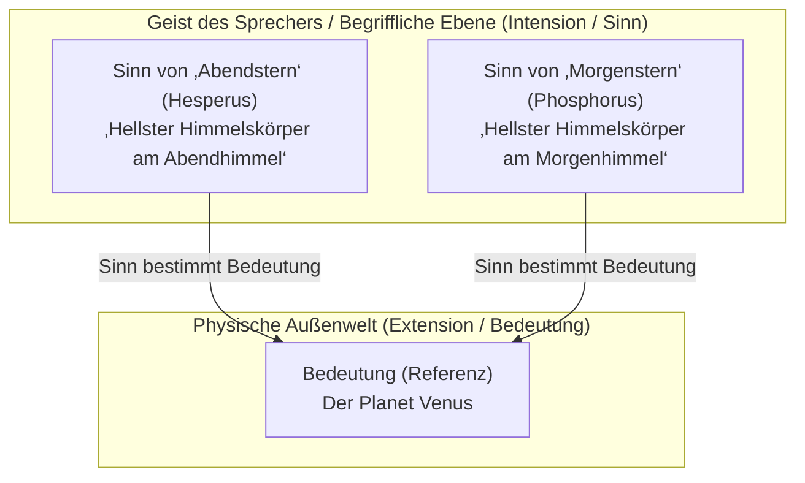
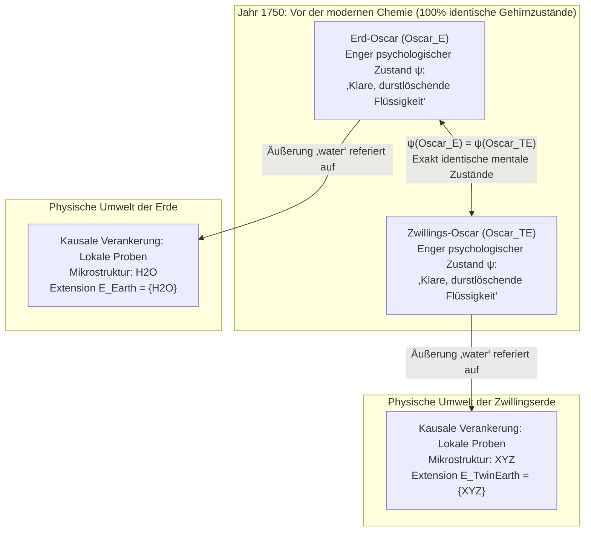

## 1. Einleitung: Wo befindet sich die „Bedeutung“ eines Wortes?

Wenn wir im Alltag Wörter wie *„Wasser“*, *„Gold“* oder *„Aristoteles“* aussprechen, wie gelingt es diesen Lautfolgen oder Schriftzeichen, über unser Bewusstsein hinauszuweisen und sich präzise auf bestimmte Substanzen oder historische Personen in der physischen Welt zu beziehen?

Seit John Lockes These im 17. Jahrhundert, dass Wörter Zeichen für „Ideen im Geist des Sprechers“ seien, bis hin zur analytischen Philosophie des frühen 20. Jahrhunderts bei Gottlob Frege, Bertrand Russell, Rudolf Carnap und John Searle herrschte in der Sprachphilosophie ein scheinbar unerschütterlicher Konsens: der <strong>semantische Internalismus</strong> und der <strong>Deskriptivismus</strong>. Demnach besteht das Verstehen der Bedeutung (Intension) eines Wortes darin, im eigenen Kopf (Gehirn oder Bewusstsein) einen bestimmten Begriff oder eine Liste identifizierender Beschreibungen zu speichern; und dieser mentale Begriff legt eindeutig fest, welche Gegenstände in der Außenwelt unter das Wort fallen (seine Extension oder Referenz).

In den frühen 1970er Jahren brachten jedoch zwei bahnbrechende Werke dieses klassische Gebäude zum Einsturz: Saul Kripkes Vorlesungen <strong>*Name und Notwendigkeit* (*Naming and Necessity*, 1972/1980)</strong> und Hilary Putnams berühmter Aufsatz <strong>*„Die Bedeutung von ‚Bedeutung‘“* (*The Meaning of "Meaning"*, 1975)</strong>.

Mit seinem berühmten <strong>Zwillingserde-Gedankenexperiment (Twin Earth: $\text{H}_2\text{O}$ vs. $\text{XYZ}$)</strong> bewies Putnam: Im Jahr 1750 (vor der Entdeckung der modernen Chemie) können ein Sprecher auf der Erde (Oscar) und sein exaktes, Molekül für Molekül identisches Doppelgänger-Pendant auf der Zwillingserde (Zwillings-Oscar) in <strong>100 % identischen engen psychologischen und neuronalen Zuständen</strong> sein – und dennoch bezieht sich ihr Wort *„Wasser“* auf völlig unterschiedliche chemische Substanzen ($\text{H}_2\text{O}$ bzw. $\text{XYZ}$) und hat somit eine unterschiedliche Bedeutung! Putnam fasste dies in seinem berühmten Diktum zusammen:

> <strong>„Wie immer man den Kuchen auch anschneidet, ‚Bedeutungen‘ sind einfach nicht im Kopf! (Cut the pie any way you like, 'meanings' just ain't in the head!)“</strong>

Dieser Artikel rekonstruiert den Paradigmenwechsel vom klassischen Deskriptivismus (Frege, Russell, Searle) über Kripkes <strong>starre Designatoren (Rigid Designators)</strong> und <strong>notwendige Wahrheiten *a posteriori*</strong>, Putnams <strong>Zwillingserde</strong> und die <strong>sprachliche Arbeitsteilung</strong> sowie Tyler Burges <strong>sozialen Externalismus (Arthritis-Gedankenexperiment)</strong> bis hin zu den Konsequenzen für moderne <strong>Large Language Models (LLMs)</strong>.

---

## 2. Die klassische internalistische und deskriptivistische Tradition: Frege, Russell und Searle

### 2.1 Freges Puzzle und *„Über Sinn und Bedeutung“* (1892)

Im Jahr 1892 eröffnete Gottlob Frege seinen Aufsatz *„Über Sinn und Bedeutung“* mit einem berühmten Rätsel über Identitätsaussagen (<strong>Freges Puzzle</strong>). Man vergleiche die beiden Sätze:

1. <strong>$a = a$: „Der Abendstern ist der Abendstern (Hesperus is Hesperus).“</strong>
2. <strong>$a = b$: „Der Abendstern ist der Morgenstern (Hesperus is Phosphorus).“</strong>

Astronomisch gesehen beziehen sich sowohl „der Abendstern“ (*Hesperus*) als auch „der Morgenstern“ (*Phosphorus*) auf denselben physischen Himmelskörper: den Planeten <strong>Venus</strong>:

$$\llbracket \text{Abendstern (Hesperus)} \rrbracket = \llbracket \text{Morgenstern (Phosphorus)} \rrbracket = \text{Venus}$$

Bestünde die Bedeutung eines Namens allein in seinem <strong>Bezugsobjekt / seiner Referenz (*Bedeutung* / Extension)</strong>, müsste Satz (2) denselben Erkenntniswert besitzen wie die triviale Tautologie (1). Tatsächlich ist $a = a$ jedoch eine analytische Wahrheit <strong>*a priori*</strong>, während $a = b$ eine bedeutende empirische Entdeckung <strong>*a posteriori*</strong> darstellt.

Zur Lösung führte Frege zwei semantische Ebenen ein:
- <strong>Bedeutung (Referenz / Extension)</strong>: Der reale Gegenstand in der Welt (der Planet Venus).
- <strong>Sinn (Intension)</strong>: Die <strong>„Art des Gegebenseins“</strong> des Gegenstands – das begriffliche Kriterium im Geist des Sprechers (z. B. *der hellste Himmelskörper am westlichen Abendhimmel* vs. *am östlichen Morgenhimmel*).

Bei Frege erfasst der Geist den *Sinn*, und <strong>der Sinn legt die Bedeutung (Referenz) eindeutig fest</strong>.

### 2.2 Russells Kennzeichnungstheorie (1905) und Searles Bündeltheorie (1958)

Bertrand Russell analysierte in *„On Denoting“* (1905) <strong>definite Kennzeichnungen</strong> der Form „das $F$ ist $G$“ ($\iota x\, F(x)$) mittels Existenzquantor und Eindeutigkeitsbedingung in der Prädikatenlogik erster Stufe:

$$\text{Das } F \text{ ist } G \iff \exists x \Big( F(x) \land \forall y \big(F(y) \to y = x\big) \land G(x) \Big)$$

Russell behauptete, gewöhnliche Eigennamen (wie „Aristoteles“) und Ausdrücke für natürliche Arten (wie „Wasser“ oder „Gold“) seien in Wahrheit <strong>verkappte oder abgekürzte Kennzeichnungen (Disguised Definite Descriptions)</strong>. John Searle (*„Proper Names“*, 1958) verfeinerte dies zur <strong>Bündeltheorie (Cluster Descriptivism)</strong>: Ein Name ist mit einem gewichteten Bündel von Beschreibungen $\{D_1, D_2, \dots, D_n\}$ im Kopf des Sprechers verknüpft und referiert auf dasjenige Objekt $x$, das eine hinreichende gewichtete Mehrheit dieser Beschreibungen erfüllt:

$$\llbracket N \rrbracket = \iota x \left( \sum_{i=1}^{n} w_i \cdot \mathbb{I}\big[D_i(x)\big] \ge \theta \right)$$

### 2.3 Die zwei Grunddogmen der traditionellen Semantik: (A1) und (A2)

Hilary Putnam destillierte diese gesamte Tradition in zwei fundamentale Annahmen:

- <strong>Annahme (A1) Methodologischer Solipsismus</strong>: Die Bedeutung (Intension $I(t)$) eines Ausdrucks $t$ zu kennen heißt schlicht, sich in einem <strong>engen psychologischen Zustand ($\psi \in \mathcal{S}_{\text{narrow}}$)</strong> im Inneren des eigenen Kopfes zu befinden (völlig unabhängig von der Existenz oder Beschaffenheit der Außenwelt).
- <strong>Annahme (A2) Die Intension bestimmt die Extension</strong>: Die mentale Intension $I(t)$ legt die Extension $E(t)$ in der Welt eindeutig fest:

$$\psi(S_1, t) = \psi(S_2, t) \stackrel{\text{(A1)}}{\implies} I_1(t) = I_2(t) \stackrel{\text{(A2)}}{\implies} E_1(t) = E_2(t)$$

---

## 3. Saul Kripkes *Name und Notwendigkeit*: Starre Designatoren und Kausaltheorie

### 3.1 Das Gödel/Schmidt-Gedankenexperiment und die Widerlegung des Deskriptivismus

Saul Kripke widerlegte den Deskriptivismus durch drei berühmte Argumente:

1. <strong>Das modale Argument</strong>: Wäre „Aristoteles“ synonym mit „der Lehrer Alexanders des Großen“, dann wäre der Satz *„Aristoteles hätte möglicherweise nicht der Lehrer Alexanders sein können“* ($\Diamond \neg \text{Taught}(\text{Aristotle}, \text{Alexander})$) widersprüchlich. Doch es ist eine kontingente Tatsache, dass Aristoteles Alexander unterrichtete; selbst in einer möglichen Welt $w'$, in der er Fischer wurde, bleibt er <strong>Aristoteles</strong>.
2. <strong>Das Gödel/Schmidt-Gedankenexperiment (Epistemisches & Semantisches Argument)</strong>:
   Nehmen wir an, die einzige Beschreibung, die ein normaler Sprecher mit dem Namen „Kurt Gödel“ verbindet, lautet $D_{\text{Gödel}} =$ <strong>„der Entdecker des Unvollständigkeitssatzes der Arithmetik“</strong>. Stellen wir uns nun vor, dass in Wahrheit ein unbekannter Wiener Mathematiker namens <strong>Schmidt</strong> den Satz bewiesen hat, aber vor der Veröffentlichung mysteriös verstarb; sein Freund <strong>Gödel</strong> stahl das Manuskript und veröffentlichte es unter eigenem Namen.
   Nach dem Deskriptivismus müsste unser Wort „Gödel“ auf <strong>Schmidt</strong> referieren, da allein Schmidt die Beschreibung $D_{\text{Gödel}}$ erfüllt ($\iota x\, D_{\text{Gödel}}(x) = \text{Schmidt}$)! Kripke zeigt, wie absurd dies ist: Wenn wir „Gödel“ sagen, beziehen wir uns eindeutig auf <strong>Gödel</strong> (und würden sagen: *„Gödel hat den Satz gar nicht bewiesen, sondern von Schmidt gestohlen!“*). Mentale Beschreibungen im Kopf legen die Referenz also nicht fest.

### 3.2 Starre Designatoren (Rigid Designators) und die kausal-historische Referenztheorie

In der Mögliche-Welten-Semantik $\mathcal{M} = \langle \mathcal{W}, \mathcal{D}, w_0, \mathcal{I} \rangle$ definiert Kripke:

- <strong>Nicht-starrer (akzidenteller) Designator</strong>: Eine Kennzeichnung wie „der Erfinder der Bifokalbrille“ bezeichnet in verschiedenen möglichen Welten unterschiedliche Personen (in $w_0$ Benjamin Franklin, in $w_1$ etwa Thomas Edison).
- <strong>Starrer Designator (Rigid Designator)</strong>: Ein Designator $d_{\text{rigid}}$ ist <strong>starr</strong> genau dann, wenn er <strong>in jeder möglichen Welt $w \in \mathcal{W}$, in der das Objekt existiert, exakt dasselbe Objekt $o_{\text{actual}}$ bezeichnet</strong>:
  $$\forall w \in \mathcal{W}, \quad \llbracket d_{\text{rigid}} \rrbracket_w = \llbracket d_{\text{rigid}} \rrbracket_{w_0} = o_{\text{actual}}$$

Eigennamen („Aristoteles“, „Hesperus“) und Ausdrücke für natürliche Arten („Wasser“, „Gold“, „Tiger“) sind <strong>starre Designatoren</strong>. Ihre Referenz wird laut Kripkes <strong>kausal-historischer Theorie</strong> durch zwei Schritte gesichert: (1) eine <strong>ursprüngliche Taufe (Initial Baptism)</strong> durch direkten Hinweis (Ostension) und (2) eine <strong>kausal-historische Kommunikationskette ($S_0 \to S_1 \to \dots \to S_n$)</strong> innerhalb der Sprachgemeinschaft.

### 3.3 Notwendige Wahrheiten *a posteriori* ($\Box(\text{Wasser} = \text{H}_2\text{O})$)

Da sowohl „Hesperus“ und „Phosphorus“ als auch „Wasser“ und „$\text{H}_2\text{O}$“ starre Designatoren sind, gilt ihre in der aktualen Welt $w_0$ empirisch entdeckte Identität in <strong>allen möglichen Welten</strong>:

$$(\text{Wasser} = \text{H}_2\text{O}) \implies \Box(\text{Wasser} = \text{H}_2\text{O}), \quad (\text{Hesperus} = \text{Phosphorus}) \implies \Box(\text{Hesperus} = \text{Phosphorus})$$

Kripke durchbrach damit die seit Kant herrschende Gleichsetzung von metaphysischer Notwendigkeit ($\Box$) und epistemischer Apriorität: Dass Wasser $\text{H}_2\text{O}$ ist, ist eine <strong>notwendige Wahrheit *a posteriori*</strong>!

---

## 4. Hilary Putnams Zwillingserde-Gedankenexperiment (1975)

### 4.1 Erde und Zwillingserde im Jahr 1750: $\text{H}_2\text{O}$ vs. $\text{XYZ}$

In *„Die Bedeutung von ‚Bedeutung‘“* (1975) entwarf Putnam das berühmte <strong>Zwillingserde-Szenario (Twin Earth)</strong>:

1. <strong>Makroskopische Identität</strong>: Die Zwillingserde gleicht der Erde bis ins Detail; dort lebt zu jedem Erdenbürger wie <strong>Erd-Oscar ($\text{Oscar}_E$)</strong> ein mikroskopisch und psychologisch identischer Doppelgänger <strong>Zwillings-Oscar ($\text{Oscar}_{TE}$)</strong>.
2. <strong>Der einzige chemische Unterschied</strong>: Auf der <strong>Erde</strong> hat die farblose, geruchlose, durstlöschende Flüssigkeit in Flüssen und Meeren, die `"water"` genannt wird, die chemische Struktur <strong>$\text{H}_2\text{O}$</strong>. Auf der <strong>Zwillingserde</strong> besteht die äußerlich völlig ununterscheidbare Flüssigkeit namens `"water"` nicht aus $\text{H}_2\text{O}$, sondern aus einer komplexen Verbindung <strong>$\text{XYZ}$</strong>!
3. <strong>Das Jahr 1750</strong>: Vor der Entwicklung der modernen Chemie wissen weder die Menschen auf der Erde noch die auf der Zwillingserde etwas von $\text{H}_2\text{O}$ oder $\text{XYZ}$. Im Jahr 1750 befinden sich $\text{Oscar}_E$ und $\text{Oscar}_{TE}$ daher in <strong>100 % identischen engen psychologischen Zuständen</strong>:

$$\text{State}_{\text{narrow}}\big(\text{Oscar}_E, 1750\big) \equiv \text{State}_{\text{narrow}}\big(\text{Oscar}_{TE}, 1750\big)$$

### 4.2 Warum $\text{XYZ}$ kein Wasser ist („Narrenwasser“) und der Kollaps von (A1) & (A2)

Bezieht sich das Wort `"water"` im Jahr 1750 im Mund von $\text{Oscar}_E$ und $\text{Oscar}_{TE}$ auf dasselbe? <strong>Nein!</strong>
Der Ausdruck für eine natürliche Art `"water"` ist implizit <strong>indexikalisch</strong> an die Mikrostruktur der lokalen Umweltproben gebunden ($\text{same}_L$: „dieselbe Flüssigkeit wie *dieses* hiesige Vorkommen“):

$$\forall x, \quad x \in \llbracket \text{water} \rrbracket_{\text{Erde}} \iff \text{same}_L\big(x, \text{sample}_{\text{Erde}}\big) \iff \text{Microstructure}(x) = \text{H}_2\text{O}$$
$$\forall x, \quad x \in \llbracket \text{water} \rrbracket_{\text{Zwillingserde}} \iff \text{same}_L\big(x, \text{sample}_{\text{Zwillingserde}}\big) \iff \text{Microstructure}(x) = \text{XYZ}$$

Genauso wie <strong>Pyrit ($\text{FeS}_2$, „Katzengold / Fool's Gold“)</strong> schon in der Antike kein echtes Gold ($\text{Au}$) war, ist $\text{XYZ}$ kein Wasser, sondern bloßes <strong>„Narrenwasser“ (Fool's Water)</strong>.

Da beide Oscars im selben engen psychologischen Zustand sind ($\psi(\text{Oscar}_E) = \psi(\text{Oscar}_{TE})$), ihre Wörter aber verschiedene Extensionen haben ($\{\text{H}_2\text{O}\} \neq \{\text{XYZ}\}$), können (A1) und (A2) nicht beide wahr sein: <strong>Bedeutungen sind nicht im Kopf!</strong>

---

## 5. Sprachliche Arbeitsteilung, Burges sozialer Externalismus und moderne KI (LLMs)

### 5.1 Sprachliche Arbeitsteilung (Ulmen vs. Buchen) und Putnams Bedeutungsvektor

Putnam gesteht, dass er eine <strong>Ulme (*Ulmus*)</strong> nicht von einer <strong>Buche (*Fagus*)</strong> unterscheiden kann: Seine internen Begriffe von `"elm"` und `"beech"` sind völlig identisch ($\psi(\text{Putnam}, \text{``elm''}) = \psi(\text{Putnam}, \text{``beech''})$). Dennoch bezeichnet sein Wort `"elm"` ausschließlich Ulmen, weil in einer Sprachgemeinschaft eine <strong>sprachliche Arbeitsteilung (Division of Linguistic Labor)</strong> herrscht: Laiensprecher delegieren die exakte Referenzbestimmung an <strong>Experten</strong> (Botaniker, Chemiker).

Putnam beschreibt Wortbedeutung daher als vierkomponentigen <strong>Bedeutungsvektor (Meaning Vector)</strong>:

$$\vec{M}(\text{``water''}) = \big\langle \text{Syntaktische Marker},\, \text{Semantische Marker},\, \text{Stereotyp},\, \text{Extension} \big\rangle$$

### 5.2 Tyler Burges sozialer Externalismus (1979): Das „Arthritis“-Gedankenexperiment

In *„Individualism and the Mental“* (1979) zeigte <strong>Tyler Burge</strong>, dass selbst <strong>mentale Überzeugungen (Beliefs)</strong> externalistisch bestimmt sind:
- <strong>Bert in der aktualen Welt</strong> glaubt: *„Meine Arthritis hat sich auf meinen Oberschenkel ausgebreitet.“* Da „Arthritis“ medizinisch strikt auf <strong>Gelenkentzündungen</strong> beschränkt ist, hat Bert eine <strong>falsche Überzeugung</strong> über Arthritis.
- <strong>Zwillings-Bert (Twin Bert)</strong> besitzt exakt dieselbe physische Geschichte und dieselben Gehirnzustände, lebt aber in einer Sprachgemeinschaft, in der Ärzte das Wort `"arthritis"` (Begriff `tharthritis`) auch für <strong>Muskelschmerzen im Oberschenkel</strong> verwenden. Zwillings-Berts Überzeugung ist daher <strong>wahr</strong>!
- Da eine Überzeugung falsch und die andere wahr ist, haben Bert und Zwillings-Bert trotz identischer Gehirne <strong>unterschiedliche Gedankeninhalte</strong>!

### 5.3 Konsequenzen für Large Language Models (LLMs) und das Symbol-Grounding-Problem

Reine Text-LLMs lernen über Next-Token-Prediction $P_\theta(w_t \mid w_{1:t-1})$ perfekte <strong>Stereotype</strong> im hochdimensionalen Vektorraum $\mathbb{R}^d$. Wie Bender & Kollers <strong>Oktopus-Gedankenexperiment (2020)</strong> und Putnams <strong>Gehirne im Tank (Brains in a Vat, 1981)</strong> zeigen, liegt die Referenz nicht isoliert in den Gewichtsmatrizen $\Theta$ des Netzes. Da reale LLMs jedoch auf Texten trainiert wurden, die von Menschen in kausaler Interaktion mit realem $\text{H}_2\text{O}$ und realen Objekten verfasst wurden, partizipieren LLMs über <strong>kausal-historische Ketten</strong> und die <strong>sprachliche Arbeitsteilung</strong> parasitär an der Referenz der menschlichen Sprachgemeinschaft.

| Dimension | Klassischer Internalismus & Deskriptivismus (Frege, Russell, Searle) | Semantischer & Sozialer Externalismus (Kripke, Putnam, Burge) |
| :--- | :--- | :--- |
| <strong>Kernthese</strong> | Bedeutung (Intension) ist eine mentale Beschreibung im Kopf und legt die Extension fest. | <strong>„Bedeutungen sind nicht im Kopf.“</strong> Referenz und Gedankeninhalt hängen von physischer Umwelt und Sprachgemeinschaft ab. |
| <strong>Eigennamen & natürliche Arten</strong> | Abgekürzte Kennzeichnungen oder Bündel (nicht-starre Designatoren). | <strong>Starre Designatoren (Rigid Designators)</strong>; bezeichnen in allen möglichen Welten dieselbe Entität/Mikrostruktur. |
| <strong>Gödel/Schmidt-Fall</strong> | Sagt fälschlich voraus, dass „Gödel“ auf Schmidt referiert. | Referiert über die kausal-historische Kette korrekt auf Gödel. |
| <strong>Zwillingserde im Jahr 1750</strong> | Identische Gehirnzustände $\implies$ identische Bedeutung und Extension. | Trotz identischer Gehirne bezeichnet `"water"` auf der Erde $\text{H}_2\text{O}$ und auf der Zwillingserde $\text{XYZ}$. |
| <strong>Modalität & Epistemologie</strong> | Notwendig $\iff$ *a priori*; „Wasser $=\text{H}_2\text{O}$“ gilt als kontingent. | Beweist <strong>notwendige Wahrheiten *a posteriori*</strong>: $\Box(\text{Wasser} = \text{H}_2\text{O})$, $\Box(\text{Hesperus} = \text{Phosphorus})$. |
