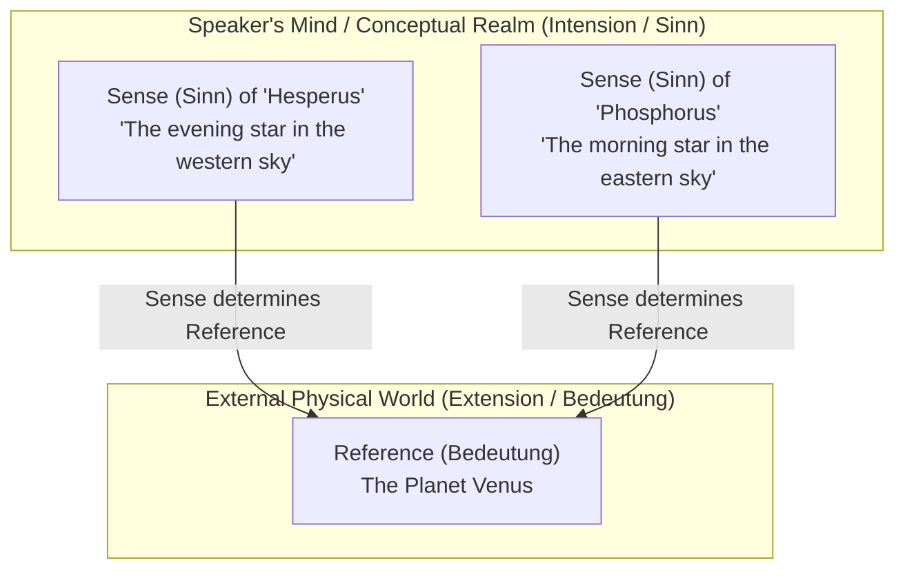
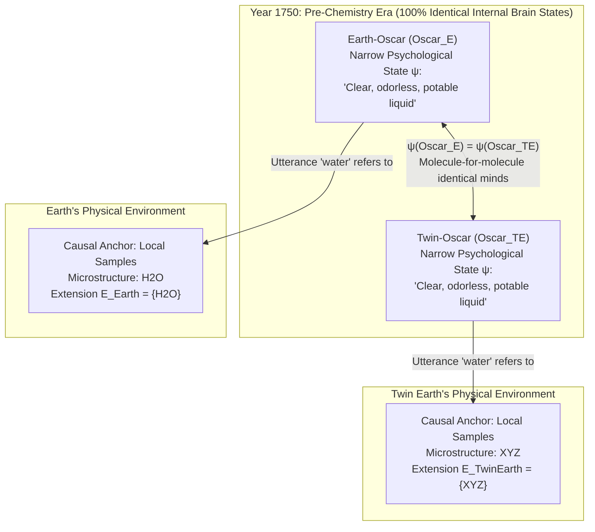

## 1. Introduction: Where Does the "Meaning" of a Word Live?

When we utter ordinary words like *"water"*, *"gold"*, *"tiger"*, or *"Aristotle"*, how do those acoustic blasts or ink marks reach out beyond our mouths and minds to hook onto specific substances and individuals in the physical universe?

From John Locke's 17th-century dictum in *An Essay Concerning Human Understanding* (1689) that *"words, in their primary or immediate signification, stand for nothing but the ideas in the mind of him that uses them"*, down through the foundational work of Gottlob Frege, Bertrand Russell, Rudolf Carnap, and John Searle in the 19th and 20th centuries, philosophy of language was governed by a powerful, deeply intuitive orthodoxy. That orthodoxy is known as <strong>Semantic Internalism</strong> and <strong>Descriptivism</strong>:

1. <strong>Meaning is an internal mental state</strong>: To understand the meaning (or *intension*) of a word is simply to possess a specific concept, mental image, or set of identifying descriptions inside your head.
2. <strong>Mental meaning determines external reference</strong>: A word refers to whatever object or substance in the external world happens to satisfy the descriptive criteria stored in the speaker's mind.

Consider the word `"water"`. Under the internalist view, a speaker knows the meaning of `"water"` by grasping a mental checklist of observational properties: *a clear, colorless, odorless, tasteless, thirst-quenching liquid that falls from the sky as rain and fills rivers, lakes, and oceans*. Whenever the speaker encounters any liquid anywhere in the cosmos that satisfies this mental checklist, that liquid automatically falls into the extension of their word `"water"`. Conversely, as long as two speakers are in the exact same internal brain state and have the exact same subjective experiences, they must mean and refer to the exact same things.

Yet in the early 1970s, two landmark works shattered this centuries-old consensus: Saul Kripke's Princeton lectures <strong>*Naming and Necessity* (1972/1980)</strong> and Hilary Putnam's monumental essay <strong>*"The Meaning of 'Meaning'"* (1975)</strong>.

Through his celebrated <strong>Twin Earth Thought Experiment ($\text{H}_2\text{O}$ vs. $\text{XYZ}$)</strong>, Putnam demonstrated a stunning paradox: in the year 1750 (before the discovery of modern chemistry), an English speaker on Earth (Oscar) and his molecule-for-molecule duplicate on Twin Earth (Twin Oscar) can be in <strong>100% identical narrow psychological and neurophysiological states</strong> inside their skulls, and yet when they utter the word `"water"`, they refer to completely different chemical substances and therefore mean different things! As Putnam famously declared:

> <strong>"Cut the pie any way you like, 'meanings' just ain't in the head!"</strong>

In this comprehensive article, we will trace the intellectual trajectory from the classical internalist semantics of Frege, Russell, and Searle to the Kripke-Putnam externalist revolution. We will examine the formal logic of <strong>Rigid Designators</strong> in possible-worlds semantics, Kripke's discovery of <strong>Necessary *A Posteriori* Truths</strong>, Putnam's <strong>Twin Earth</strong> and the <strong>Linguistic Division of Labor</strong>, Tyler Burge's 1979 <strong>Social Externalism ("Arthritis" in the thigh)</strong>, and finally the profound implications of semantic externalism for <strong>Large Language Models (LLMs)</strong> and the <strong>Symbol Grounding Problem</strong> in contemporary artificial intelligence.

---

## 2. The Classical Internalist and Descriptivist Tradition: Frege, Russell, and Searle

To appreciate why the externalist revolution of the 1970s sent shockwaves through analytic philosophy, we must first examine the elegance and explanatory power of the classical internalist architecture it overthrew.

### 2.1 Gottlob Frege's 1892 *"Über Sinn und Bedeutung" (On Sense and Reference)*

In 1892, the founder of modern mathematical logic, Gottlob Frege, opened his classic paper *"Über Sinn und Bedeutung"* by posing a deceptively simple puzzle about identity statements—now known universally as <strong>Frege's Puzzle</strong>.

Compare the following two identity sentences:

1. <strong>$a = a$: "Hesperus is Hesperus"</strong> (or "Venus is Venus").
2. <strong>$a = b$: "Hesperus is Phosphorus"</strong> ("The Evening Star is the Morning Star").

Suppose we adopt a naive direct-reference view (often associated with John Stuart Mill, called *Millianism*), according to which the meaning of a proper name is nothing more than the physical object it designates in the world—its <strong>Reference / Extension (*Bedeutung*)</strong>. Astronomically, both `"Hesperus"` (the bright celestial body visible in the western sky after sunset) and `"Phosphorus"` (the bright celestial body visible in the eastern sky before sunrise) refer to the exact same physical object: the planet <strong>Venus</strong>.

$$\llbracket \text{Hesperus} \rrbracket = \llbracket \text{Phosphorus} \rrbracket = \text{Venus}$$

If the semantic content of a name were exhausted by its referent, then substituting `"Phosphorus"` for `"Hesperus"` in sentence (1) could not alter the cognitive content of the sentence. Yet the epistemic difference between (1) and (2) is vast:

- Sentence (1), $a = a$, is a trivial, analytic, <strong>*a priori* tautology</strong> knowable merely by understanding the language; it conveys zero new astronomical information.
- Sentence (2), $a = b$, represents a major <strong>*a posteriori* empirical discovery</strong> made by ancient Babylonian astronomers through painstaking observation of planetary orbits. It possesses high <strong>cognitive value (*Erkenntniswert*)</strong>.

To resolve this puzzle, Frege proposed that every meaningful singular term possesses two distinct semantic dimensions:

- <strong>Reference / Extension (*Bedeutung*)</strong>: The actual concrete object or entity in the world that the term picks out (in both cases, the planet Venus).
- <strong>Sense / Intension (*Sinn*)</strong>: The <strong>"mode of presentation" (*Art des Gegebenseins*)</strong> of the referent—the conceptual criterion or identifying condition through which the speaker's mind grasps the object. The *Sinn* of `"Hesperus"` is *the brightest celestial body appearing in the western sky at dusk*, whereas the *Sinn* of `"Phosphorus"` is *the brightest celestial body appearing in the eastern sky at dawn*.

In Frege's two-tiered architecture, a speaker understands a word by mentally grasping its <strong>Sense (*Sinn*)</strong>, and <strong>Sense uniquely determines Reference (*Bedeutung*)</strong>. Just as two travelers climbing a mountain from the western ridge and the eastern ridge arrive at the exact same summit via different paths, two terms can share a single *Bedeutung* while expressing completely different *Sinne*. Learning that $a = b$ is informative because we discover that two distinct conceptual routes converge on the same worldly object.

### 2.2 Bertrand Russell's Theory of Definite Descriptions (1905) and Searle's Cluster Theory (1958)

In his landmark 1905 essay *"On Denoting"*, Bertrand Russell went even further in reducing reference to descriptive quantification. Russell analyzed <strong>definite descriptions</strong>—phrases of the form `"the F"` (denoted $\iota x\, F(x)$, such as `"the present King of France"` or `"the author of Waverley"`)—not as genuine referring terms, but as quantified existential claims asserting uniqueness. Formally, a sentence `"The F is G"` translates into first-order predicate logic as the conjunction of three clauses:

$$\text{The } F \text{ is } G \iff \exists x \Big( F(x) \land \forall y \big(F(y) \to y = x\big) \land G(x) \Big)$$

1. <strong>Existence</strong>: At least one entity has property $F$ ($\exists x\, F(x)$).
2. <strong>Uniqueness</strong>: At most one entity has property $F$ ($\forall y(F(y) \to y = x)$).
3. <strong>Predication</strong>: Whatever entity uniquely has $F$ also has property $G$ ($G(x)$).

Crucially, Russell argued that <strong>ordinary proper names</strong> (like `"Aristotle"`, `"Socrates"`, or `"Homer"`) and <strong>natural kind terms</strong> (like `"water"` or `"gold"`) are not logically simple labels at all, but <strong>"disguised" or "abbreviated" definite descriptions</strong>! When a speaker uses the name `"Aristotle"`, what is actually in their mind is a definite description such as *"the pupil of Plato and teacher of Alexander the Great who wrote the Metaphysics"*. The name `"Aristotle"` simply refers to whichever individual in the world uniquely satisfies that mental description.

Later philosophers, notably Ludwig Wittgenstein (*Philosophical Investigations*, 1953) and <strong>John Searle (*"Proper Names"*, 1958)</strong>, recognized a technical flaw in equating a name with a *single* description: if `"Aristotle"` literally meant *"the teacher of Alexander the Great"*, then the historical statement *"Aristotle taught Alexander the Great"* would become an analytic tautology (*"The teacher of Alexander taught Alexander"*), and discovering that Aristotle never actually taught Alexander would absurdly entail that Aristotle never existed!

To salvage descriptivism, Searle formulated <strong>Cluster Descriptivism</strong>. Instead of a single description, a speaker associates a name $N$ (or a natural kind term $K$) with a weighted <strong>cluster (or disjunction) of descriptions</strong> $\{D_1, D_2, \dots, D_n\}$. The term refers to whatever object $x$ in the world satisfies a <strong>"sufficient weighted majority"</strong> of the descriptions in the cluster:

$$\llbracket N \rrbracket = \iota x \left( \sum_{i=1}^{n} w_i \cdot \mathbb{I}\big[D_i(x)\big] \ge \theta \right)$$

Applied to a natural kind term like `"water"`, Descriptivism holds that a speaker's mental lexicon contains a cluster of observational and functional properties: *clear, colorless, odorless, tasteless, liquid at room temperature, boils at $100^\circ\text{C}$, freezes at $0^\circ\text{C}$, falls as rain, quenches thirst*. Anything in the universe that satisfies a sufficient majority of these superficial properties is, by definition, in the extension of `"water"`.

### 2.3 The Two Foundational Dogmas of Traditional Semantics: (A1) and (A2)

In *"The Meaning of 'Meaning'"* (1975), Hilary Putnam diagnosed the entire Fregean-Russellian-Carnapian tradition as resting on two unexamined foundational axioms connecting <strong>Intension</strong> (mental meaning/concept) and <strong>Extension</strong> (the set of things in the world the word applies to):

- <strong>Assumption (A1) — Methodological Solipsism (Psychological Internalism)</strong>:
  Knowing the meaning (intension $I(t)$) of a term $t$ consists entirely in being in a <strong>narrow psychological state ($\psi \in \mathcal{S}_{\text{narrow}}$)</strong> inside the speaker's head. A psychological state is "narrow" if it presupposes nothing whatsoever about the existence or nature of anything outside the subject's skin and brain (just as Descartes' thinker could have the exact same narrow mental states even if deceived by an Evil Demon).
- <strong>Assumption (A2) — Intension Determines Extension</strong>:
  The meaning (intension $I(t)$) of a term uniquely determines its extension $E(t)$ (in the sense that two terms with the exact same intension must share the exact same extension).

Taken together, Assumptions (A1) and (A2) entail an ironclad theorem:

$$\psi(S_1, t) = \psi(S_2, t) \stackrel{\text{(A1)}}{\implies} I_1(t) = I_2(t) \stackrel{\text{(A2)}}{\implies} E_1(t) = E_2(t)$$

In plain English: <strong>If two speakers $S_1$ and $S_2$ are in the exact same narrow psychological/brain state when they use a term $t$, then their utterances of $t$ must have the exact same meaning and MUST pick out the exact same extension in the world.</strong>

For nearly a century, no philosopher questioned that (A1) and (A2) were mutually consistent. Then came Kripke and Putnam.

---

## 3. Saul Kripke's *Naming and Necessity* (1972/1980): Rigid Designators and the Causal Theory

In January 1970, a 29-year-old Saul Kripke delivered three lectures at Princeton University without written notes, later published as *Naming and Necessity*. Armed with the formal machinery of <strong>Possible Worlds Semantics</strong> for modal logic (which Kripke himself had invented as a teenager), he launched a three-pronged assault—Modal, Epistemic, and Semantic—that demolished both classical Russellian descriptivism and Searle's cluster descriptivism.

### 3.1 Three Devastating Arguments Against Descriptivism

#### (1) The Modal Argument
Suppose the name `"Aristotle"` were synonymous with the description (or cluster of descriptions) *"the pupil of Plato, teacher of Alexander the Great, and author of the Metaphysics"*.
Now consider a counterfactual possible world $w'$. Clearly, doing philosophy and teaching Alexander were <strong>contingent</strong> facts about Aristotle's life: Aristotle could have died in infancy, or he could have chosen to become a humble fisherman in Stagira who never met Plato, never taught Alexander, and never wrote a single book. Thus, the modal statement:

$$\Diamond \big(\text{Aristotle existed} \land \neg \text{Taught}(\text{Aristotle}, \text{Alexander}) \land \neg \text{Philosopher}(\text{Aristotle})\big)$$

("It is metaphysically possible that Aristotle never went into philosophy and never taught Alexander") is undeniably <strong>TRUE</strong>.

Yet if `"Aristotle"` meant *"the philosopher who taught Alexander and wrote the Metaphysics"*, then in world $w'$, either that description picks out someone else entirely (say, Xenocrates), or it picks out nobody, rendering the statement contradictory on a *de dicto* reading! Why do we effortlessly recognize that in world $w'$, it is <strong>still Aristotle himself</strong> who became a fisherman? Because when we evaluate what might have happened to Aristotle in another possible world $w'$, we do not go looking in $w'$ for whoever satisfies a checklist of philosophical achievements; we hold the individual <strong>Aristotle</strong> fixed from our actual world $w_0$ and ask what happens to *him* in $w'$!

#### (2) The Epistemic & Semantic Argument: The Gödel / Schmidt Thought Experiment
A descriptivist might retreat: *"Granted, descriptions do not give a name's modal profile across other possible worlds. But surely descriptions inside the speaker's head are what fix the reference of the name in our <strong>actual world $w_0$</strong>!"*

To refute even this weaker claim, Kripke introduced the famous <strong>Gödel / Schmidt Thought Experiment</strong>.

Suppose that for most ordinary educated speakers, the <em>only</em> identifying description they associate with the name `"Kurt Gödel"` is:

$$D_{\text{Gödel}} = \text{``the man who discovered the Incompleteness Theorem of arithmetic.''}$$

They do not know what Gödel looked like, when he was born, or where he lived. Now imagine that unknown to the world, the following historical scandal actually occurred: a brilliant Viennese mathematician named <strong>Schmidt</strong> actually did all the work and proved the Incompleteness Theorem in 1930. However, before Schmidt could publish, he died under mysterious circumstances. His acquaintance, a man named <strong>Kurt Gödel</strong>, got hold of Schmidt's manuscript, put his own name on it, published it, and received global acclaim as the author of the theorem.

Now Kripke asks: on this hypothesis, when we ordinary speakers utter the name `"Gödel"` (e.g., *"Gödel was a genius"* or *"Gödel lived in Princeton"*), <strong>to whom are we referring—Gödel or Schmidt?</strong>

- <strong>What Descriptivism Predicts</strong>: The only description in our heads associated with `"Gödel"` is $D_{\text{Gödel}}$ (*"the man who proved the Incompleteness Theorem"*). In the actual world, the unique human being who satisfies $D_{\text{Gödel}}$ is <strong>Schmidt</strong> ($\iota x\, D_{\text{Gödel}}(x) = \text{Schmidt}$), while Gödel does not satisfy it at all. Therefore, Descriptivism forces us to say that whenever we say `"Gödel"`, we are actually referring to a dead Viennese man named <strong>Schmidt</strong> whom we have never heard of! Even worse, on Descriptivism, the sentence *"Gödel proved the Incompleteness Theorem"* remains trivially true even if Gödel stole it!
- <strong>Our Unshakeable Semantic Intuition (Kripke's Verdict)</strong>: This prediction is preposterous. When we say `"Gödel"`, we are referring to <strong>Kurt Gödel</strong>, the man who published the paper, <em>not</em> to Schmidt! Indeed, if the scandal came to light, we would say: <strong>"Shocking news! Gödel did NOT prove the Incompleteness Theorem—he stole it from Schmidt!"</strong>

The lesson is devastating for internalism: <strong>A speaker can successfully refer to an object $x$ even if the speaker's internal mental description fails to be true of $x$, and even if a completely different object $y$ uniquely satisfies the speaker's mental description!</strong> Mental descriptions inside the head neither constitute meaning nor determine reference.

### 3.2 Formal Definition of Rigid Designators in Possible Worlds Semantics

To replace descriptivism, Kripke formulated a rigorous modal distinction using a Kripke model $\mathcal{M} = \langle \mathcal{W}, \mathcal{D}, w_0, \mathcal{I} \rangle$, where $\mathcal{W}$ is the set of all metaphysically possible worlds, $\mathcal{D}$ is the domain of individuals, $w_0 \in \mathcal{W}$ is the actual world, and $\llbracket d \rrbracket_w$ denotes the referent (extension) of designator $d$ evaluated at world $w \in \mathcal{W}$.

- <strong>Non-Rigid (Accidental / Flaccid) Designator</strong>:
  A designator $d$ is <em>non-rigid</em> if its referent varies from one possible world to another depending on contingent facts in each world. Standard definite descriptions like `"the inventor of bifocals"` or `"the tallest person in the room"` are non-rigid:
  $$\llbracket \text{the inventor of bifocals} \rrbracket_{w_0} = \text{Benjamin Franklin} \neq \text{Thomas Edison} = \llbracket \text{the inventor of bifocals} \rrbracket_{w_1}$$

- <strong>Rigid Designator (固定指示子)</strong>:
  A designator $d_{\text{rigid}}$ is <strong>rigid</strong> if and only if it designates the <strong>exact same object in every possible world $w \in \mathcal{W}$</strong> in which that object exists (and never designates anything else in worlds where the object fails to exist; if the object exists necessarily, $d$ is *obstinately rigid*):
  $$\forall w \in \mathcal{W}, \quad \llbracket d_{\text{rigid}} \rrbracket_w = \llbracket d_{\text{rigid}} \rrbracket_{w_0} = o_{\text{actual}}$$

Kripke's central semantic thesis is that <strong>all proper names</strong> (`"Aristotle"`, `"Gödel"`, `"Hesperus"`, `"Phosphorus"`) and <strong>all natural kind terms</strong> (`"water"`, `"gold"`, `"tiger"`, `"heat"`, `"light"`) function in natural language as <strong>Rigid Designators</strong>, not as abbreviated descriptions.

### 3.3 The Causal-Historical Theory of Reference

If reference is not secured by a mental checklist inside the speaker's head, what connects my utterance of `"Aristotle"` or `"Gödel"` to a specific human being centuries or miles away? Kripke proposed the <strong>Causal-Historical Picture of Reference</strong>, consisting of two stages:

1. <strong>Initial Baptism (*Taufe* / Reference Fixing)</strong>:
   A name is introduced into the language through an initial naming ceremony. Typically, the namer fixes the referent via direct perception and <strong>ostension</strong> (*"Let this infant right here be called 'Aristotle'"*, or *"Let the substance instantiated by this liquid sample be called 'water'"*), or occasionally via an initial reference-fixing description that points out the referent in $w_0$ without ever becoming a synonym for the name.
2. <strong>Causal-Historical Chain of Communication</strong>:
   Once baptized, the name is passed down from link to link across a linguistic community ($S_0 \to S_1 \to S_2 \to \dots \to S_n$). When speaker $S_k$ learns the name `"Gödel"` from $S_{k-1}$, all that is required for $S_k$ to refer to Gödel is the pragmatic intention to use the name with the same reference as the person from whom $S_k$ learned it. Even if false rumors and mistaken descriptions accumulate along the chain, the <strong>causal-historical link</strong> anchors the utterance directly to the original individual baptized at $S_0$.

### 3.4 Shattering the Kantian Dogma: Necessary *A Posteriori* Truths

Kripke's theory of rigid designation produced an immediate earthquake in metaphysics and epistemology. From Immanuel Kant through Gottlob Frege and the 20th-century Logical Positivists (Vienna Circle), philosophers had conflated two completely distinct dimensions of truth:

- <strong>The Epistemic Dimension (How a truth is known)</strong>:
  - <strong>*A Priori*</strong>: Knowable independently of empirical experience through pure reason or conceptual reflection alone.
  - <strong>*A Posteriori* (Empirical)</strong>: Knowable only through empirical observation and scientific investigation of the world.
- <strong>The Metaphysical / Modal Dimension (How a truth holds across possible worlds)</strong>:
  - <strong>Necessary ($\Box P$)</strong>: True in <em>all</em> metaphysically possible worlds ($\forall w \in \mathcal{W},\, \llbracket P \rrbracket_w = 1$); could not possibly have been false.
  - <strong>Contingent ($\Diamond P \land \Diamond \neg P$)</strong>: True in the actual world $w_0$, but false in at least one other possible world $w'$.

Before 1970, it was treated as an inviolable philosophical dogma that $\text{Necessary} \iff \text{A Priori}$ and $\text{Contingent} \iff \text{A Posteriori}$. Because identity statements like `"Hesperus is Phosphorus"` and theoretical identifications like `"Water is H2O"`, `"Gold is the element with atomic number 79"`, and `"Heat is the mean kinetic energy of molecules"` could only be discovered through empirical science (*a posteriori*), philosophers universally assumed they had to be <em>contingent</em> truths!

Kripke proved that this assumption is a logical fallacy. Let $a$ (`"Hesperus"` or `"Water"`) and $b$ (`"Phosphorus"` or `"H2O"`) be two <strong>rigid designators</strong>.

1. In the actual world $w_0$, empirical science discovers that $a$ and $b$ pick out the exact same entity/essence:
   $$\llbracket a \rrbracket_{w_0} = \llbracket b \rrbracket_{w_0} = o_{\text{actual}}$$
2. Because $a$ is a rigid designator, $\forall w \in \mathcal{W},\, \llbracket a \rrbracket_w = \llbracket a \rrbracket_{w_0} = o_{\text{actual}}$.
3. Because $b$ is a rigid designator, $\forall w \in \mathcal{W},\, \llbracket b \rrbracket_w = \llbracket b \rrbracket_{w_0} = o_{\text{actual}}$.
4. Therefore, by the transitivity of identity, in <strong>every possible world $w \in \mathcal{W}$</strong>, $\llbracket a \rrbracket_w = \llbracket b \rrbracket_w$! Formally:
   $$(a = b) \implies \Box(a = b)$$
   $$\Box(\text{Hesperus} = \text{Phosphorus}) \quad \text{and} \quad \Box(\text{Water} = \text{H}_2\text{O})$$

Thus, `"Hesperus is Phosphorus"` and `"Water is H2O"` are <strong>Necessary *A Posteriori* Truths</strong>! Even though it required empirical astronomy and chemistry to discover them (*a posteriori*), once we discover that water is $\text{H}_2\text{O}$ in the actual world, water could not have failed to be $\text{H}_2\text{O}$ in *any* possible world (*metaphysically necessary*).

Why, then, did it *seem* to us before doing chemistry that water "might have turned out not to be $\text{H}_2\text{O}$"? Kripke diagnoses this as an <strong>epistemic illusion</strong>: we confuse the *metaphysical* possibility that water itself is not $\text{H}_2\text{O}$ (which is impossible: $\neg \Diamond(\text{Water} \neq \text{H}_2\text{O})$) with the *epistemic* possibility of a counterfactual world in which our lakes and oceans are filled with a different colorless, odorless liquid that <strong>fools our senses</strong> into looking and tasting just like water! And that brings us directly to Hilary Putnam's Twin Earth.

---

## 4. Hilary Putnam's 1975 *"The Meaning of 'Meaning'"* and the Twin Earth Thought Experiment

While Kripke developed his externalist semantics starting from proper names and modal logic, his colleague Hilary Putnam independently arrived at a parallel breakthrough focusing on natural kind terms and the philosophy of mind in his 1975 landmark paper *"The Meaning of 'Meaning'"*. To prove that Assumptions (A1) and (A2) of traditional semantics cannot both hold, Putnam devised one of the most famous thought experiments in the history of philosophy: <strong>Twin Earth (双子の地球)</strong>.

### 4.1 Setting Up the Twin Earth Scenario: $\text{H}_2\text{O}$ vs. $\text{XYZ}$

Imagine a planet somewhere in the galaxy (or in a counterfactual possible world) that we shall call <strong>Twin Earth</strong>.

1. <strong>Macroscopic and Phenomenal Identity</strong>:
   Twin Earth is almost completely identical to our Earth. It has identical continents, cities, and history, and its inhabitants speak a language syntactically and phonetically indistinguishable from English. Moreover, every person on Earth—say, a normal English speaker named <strong>Earth-Oscar ($\text{Oscar}_E$)</strong>—has an exact microphysical duplicate on Twin Earth called <strong>Twin-Oscar ($\text{Oscar}_{TE}$)</strong> (setting aside the water molecules in their bodies, or treating their neurofunctional and subjective states as 100% isomorphic).
2. <strong>The Single Microstructural Difference ($\text{H}_2\text{O}$ vs. $\text{XYZ}$)</strong>:
   There is only one systematic physical difference between the two planets:
   - On <strong>Earth</strong>, the clear, odorless, tasteless, thirst-quenching liquid that falls from clouds as rain, fills rivers, lakes, and seas, boils at $100^\circ\text{C}$ and freezes at $0^\circ\text{C}$ at $1\text{ atm}$, and is called `"water"` by English speakers is composed of molecules of <strong>$\text{H}_2\text{O}$</strong>.
   - On <strong>Twin Earth</strong>, the clear, odorless, tasteless, thirst-quenching liquid that falls from clouds as rain, fills rivers, lakes, and seas, is macroscopically indistinguishable from $\text{H}_2\text{O}$ at normal temperatures and pressures, and is called `"water"` by Twin Earthians is <strong>NOT $\text{H}_2\text{O}$</strong>. Instead, it is composed of a completely different, highly complex chemical compound abbreviated as <strong>$\text{XYZ}$</strong>!

### 4.2 The Crucial Temporal Constraint: Rolling the Clock Back to 1750

If a spaceship from Earth travels to Twin Earth today (in 2026), at first the astronauts might think `"water"` has the exact same meaning on both planets. Once their onboard chemical laboratory analyzes the liquid from a Twin Earth lake and discovers that it consists of $\text{XYZ}$ rather than $\text{H}_2\text{O}$, what will the Earth astronauts report back to headquarters? They will report:

> <strong>"On Twin Earth, the word 'water' means $\text{XYZ}$!"</strong> (Or equivalently: *"There is no actual water on Twin Earth; what they call 'water' is actually a different chemical called $\text{XYZ}$!"*)

However, in 2026, educated speakers on Earth know the formula `"H2O"`, while educated speakers on Twin Earth know `"XYZ"`, so their internal mental states differ. To eliminate this difference completely, Putnam rolls the clock back to the year <strong>1750</strong>—half a century before Antoine Lavoisier and John Dalton developed modern atomic chemistry!

In the year <strong>1750</strong>:
- Neither anyone on Earth nor anyone on Twin Earth has the slightest idea of modern chemistry, molecules, $\text{H}_2\text{O}$, or $\text{XYZ}$.
- When <strong>Earth-Oscar ($\text{Oscar}_E$)</strong> in 1750 looks at a glass of clear liquid and thinks *"Water is refreshing"*, and <strong>Twin-Oscar ($\text{Oscar}_{TE}$)</strong> in 1750 looks at his glass of clear liquid and thinks *"Water is refreshing"*, the two Oscars have the <strong>exact same visual, gustatory, and tactile experiences, the exact same beliefs and mental images, and the exact same narrow psychological/neural states</strong> inside their heads:

$$\text{State}_{\text{narrow}}\big(\text{Oscar}_E, 1750\big) \equiv \text{State}_{\text{narrow}}\big(\text{Oscar}_{TE}, 1750\big)$$

### 4.3 The Semantic Verdict: Why $\text{XYZ}$ Is "Fool's Water"

Now we ask the decisive question: <strong>In 1750, when $\text{Oscar}_E$ and $\text{Oscar}_{TE}$ utter the word `"water"`, does the word `"water"` have the same extension (reference) in both of their mouths?</strong>

Putnam demonstrates that the answer is unequivocally <strong>NO</strong>:

- In 1750, just as in 1950 or 2026, the word `"water"` as used on Earth by $\text{Oscar}_E$ refers exclusively to <strong>$\text{H}_2\text{O}$</strong> ($\llbracket \text{water} \rrbracket_{\text{Earth}, 1750} = \{\text{H}_2\text{O}\}$). A lake of $\text{XYZ}$ was never in the extension of Earth-English `"water"`, even in 1750 when no Earthling could tell $\text{XYZ}$ apart from $\text{H}_2\text{O}$!
- Conversely, in 1750, the word `"water"` as used on Twin Earth by $\text{Oscar}_{TE}$ refers exclusively to <strong>$\text{XYZ}$</strong> ($\llbracket \text{water} \rrbracket_{\text{TwinEarth}, 1750} = \{\text{XYZ}\}$).

Why didn't the discovery of $\text{H}_2\text{O}$ around 1800 *change* the meaning of `"water"` from *"whatever liquid looks and tastes like water ($\text{H}_2\text{O} \cup \text{XYZ}$)"* to *"$\text{H}_2\text{O}$ only"*? Because natural kind terms like `"water"` and `"gold"` possess an implicit <strong>indexical / ostensive component</strong>! When speakers on Earth use `"water"`, they implicitly fix its extension via an ostensive cross-world equivalence relation $\text{same}_L$ ("is the same liquid as"):

$$\forall x, \quad x \in \llbracket \text{water} \rrbracket_{\text{Earth}} \iff \text{same}_L\big(x, \text{this}_{\text{Earth}}\big) \iff \text{Microstructure}(x) = \text{H}_2\text{O}$$

$$\forall x, \quad x \in \llbracket \text{water} \rrbracket_{\text{TwinEarth}} \iff \text{same}_L\big(x, \text{this}_{\text{TwinEarth}}\big) \iff \text{Microstructure}(x) = \text{XYZ}$$

Consider the parallel case of <strong>Gold ($\text{Au}$, atomic number 79)</strong> vs. <strong>Fool's Gold (Iron Pyrite, $\text{FeS}_2$)</strong>. In ancient times, before Archimedes or modern atomic physics, ordinary people could not reliably distinguish a lump of iron pyrite from a lump of gold. Did that mean iron pyrite was actually gold in 500 BCE, and only ceased to be gold when chemistry was invented? Of course not! Iron pyrite was always <em>counterfeit / fool's gold</em>, because it lacked the underlying physical essence of the local gold samples to which the word `"gold"` was causally anchored. By the exact same logic, $\text{XYZ}$ on Twin Earth is not water; it is <strong>"fool's water"</strong>!

### 4.4 The Collapse of (A1) & (A2): *"Meanings Just Ain't in the Head!"*

We now have an airtight *reductio ad absurdum* of traditional internalist semantics:

1. In 1750, $\text{Oscar}_E$ and $\text{Oscar}_{TE}$ are in the exact same narrow psychological state inside their heads:
   $$\psi\big(\text{Oscar}_E\big) = \psi\big(\text{Oscar}_{TE}\big)$$
2. Yet the extension of `"water"` in $\text{Oscar}_E$'s mouth is $\{\text{H}_2\text{O}\}$, whereas the extension of `"water"` in $\text{Oscar}_{TE}$'s mouth is $\{\text{XYZ}\}$:
   $$\llbracket \text{water} \rrbracket_{\text{Oscar}_E, 1750} = \{\text{H}_2\text{O}\} \neq \{\text{XYZ}\} = \llbracket \text{water} \rrbracket_{\text{Oscar}_{TE}, 1750}$$
3. Therefore, two speakers in the <strong>exact same narrow psychological state</strong> use a word with <strong>different extensions</strong>!
4. By Modus Tollens, <strong>Assumption (A1) (knowing the meaning of a term is just being in a narrow psychological state) and Assumption (A2) (meaning determines extension) CANNOT both be true!</strong>

If we retain the core semantic insight that the meaning of a word determines what it refers to in the world (A2), we are forced to abandon Methodological Solipsism (A1). What a speaker means by a word is not determined solely by what is inside their skull; it is constitutively determined by the <strong>actual physical environment</strong> with which the speaker (and their linguistic community) causally interacts. As Putnam memorably concluded: <strong>"Cut the pie any way you like, 'meanings' just ain't in the head!"</strong>

---

## 5. The Linguistic Division of Labor and Tyler Burge's Social Externalism

Putnam's Twin Earth case demonstrated <strong>Physical Externalism</strong>: how the microstructure of the natural environment outside the speaker's head fixes semantic reference. Yet Putnam and, shortly thereafter, <strong>Tyler Burge (1979)</strong> showed that externalism has a second, equally powerful dimension: <strong>Social Externalism</strong>. Our meanings and even our private thoughts depend on the linguistic community and experts around us.

### 5.1 Putnam's Linguistic Division of Labor: Elms vs. Beeches

In *"The Meaning of 'Meaning'"*, Putnam confessed a personal botanical ignorance: he cannot tell an <strong>Elm tree (*Ulmus*)</strong> from a <strong>Beech tree (*Fagus*)</strong>.
Consequently, the internal mental concept (descriptive cluster / stereotype) inside Putnam's head associated with the word `"elm"` is <strong>100% identical</strong> to the mental concept inside his head associated with the word `"beech"`—namely, *"a common deciduous tree growing in North America and Europe"*:

$$\psi\big(\text{Putnam}, \text{``elm''}\big) = \psi\big(\text{Putnam}, \text{``beech''}\big)$$

Even we do not need to travel to Twin Earth here: within <em>one and the same person on Earth</em>, two different words (`"elm"` and `"beech"`) share the exact same narrow psychological state, yet they have <strong>completely disjoint extensions</strong>! The extension of `"elm"` in Putnam's mouth is strictly the set of elm trees (*Ulmus*), and the extension of `"beech"` in Putnam's mouth is strictly the set of beech trees (*Fagus*). If Putnam points to a beech tree in his yard and says *"That is an elm"*, he has said something false.

How can an ignorant layperson successfully refer to elms vs. beeches when their own head lacks any criterion to distinguish them? Putnam explains this through the <strong>Division of Linguistic Labor (言語的労働の分業)</strong>:

- Every human society relies on a division of labor. Just as not everyone needs to know how to smelt iron to use steel tools, not every speaker of English needs to acquire the botanical criteria for distinguishing elms from beeches or the metallurgical assays for distinguishing gold ($\text{Au}$) from pyrite ($\text{FeS}_2$).
- Within the linguistic community, there exists a subclass of <strong>experts</strong> (botanists, chemists, jewelers) who possess the precise scientific criteria for fixing the extension.
- Ordinary <strong>lay speakers</strong> participate in a collective social enterprise: when Putnam uses `"elm"`, he semantically <strong>defers</strong> to the experts in his community. Reference is achieved not by isolated individuals, but by the <em>sociolinguistic community as a collective body</em>.

### 5.2 Tyler Burge's 1979 Social Externalism: The "Arthritis" Thought Experiment

Faced with Kripke and Putnam's arguments, many philosophers of mind attempted a tactical retreat: *"Very well, let us concede that the reference of <strong>public language words</strong> depends on external chemistry and social experts. Surely, however, a person's <strong>internal mental beliefs, desires, and thoughts</strong> (propositional attitudes) are purely internal to the individual's brain!"*

In his landmark 1979 paper <strong>*"Individualism and the Mental"*</strong>, <strong>Tyler Burge</strong> demolished this last bastion of internalism with his famous <strong>"Arthritis" Thought Experiment</strong>, establishing <strong>Anti-Individualism (Social Externalism)</strong> in the philosophy of mind. Crucially, Burge's argument does not rely on natural kinds ($\text{H}_2\text{O}$ vs. $\text{XYZ}$) or indexicals at all; it applies to everyday artifactual, medical, and theoretical concepts!

#### Step 1: The Actual Situation (Bert on Earth)
Imagine a patient named <strong>Bert</strong> who has suffered from arthritis in his wrists and ankles for years. Bert holds many true beliefs about his condition (*"I have had arthritis for five years"*, *"Stiff joints are a symptom of arthritis"*).
One morning, Bert wakes up with a sharp pain in his <strong>thigh muscle</strong>. Because Bert is a layperson whose medical understanding of `"arthritis"` is slightly incomplete, he forms the sincere mental belief—and says aloud to his doctor:

> <strong>"Doctor, my arthritis has spread to my thigh!"</strong>

In standard English medical usage, however, `"arthritis"` is defined strictly as an <strong>inflammation of the joints</strong>; it cannot occur in muscles or thighs outside the joints. The doctor corrects Bert, explaining that arthritis cannot occur in the thigh. Thus, in the actual world, Bert held a <strong>FALSE belief about arthritis</strong> ($\text{Bel}(\text{Bert}, \text{Arthritis}(\text{thigh}))$).

#### Step 2: The Counterfactual Situation (Twin Bert)
Now imagine a counterfactual possible world containing <strong>Twin Bert</strong>.
From the moment of his birth up to the exact second he utters *"My arthritis has spread to my thigh"*, Twin Bert's <strong>physical history, bodily physiology, sensory inputs, pain sensations, brain chemistry, and neural firing patterns are 100% molecule-for-molecule identical</strong> to Actual Bert's. Even the physical diseases in both worlds are identical.

The <em>only</em> difference is sociolinguistic: in Twin Bert's linguistic community, doctors, lexicographers, and standard speakers have always defined and used the word `"arthritis"` (let us call their concept <strong>`tharthritis`</strong>) more broadly to cover <strong>all rheumatoid aches and inflammations in both joints AND muscles/thighs</strong>!

#### Step 3: Comparing Their Mental Contents (Beliefs)
Now compare the mental states (beliefs) of Actual Bert and Twin Bert just before the doctor speaks:

1. <strong>Identical Narrow Physical/Brain States</strong>: Inside their skins and skulls, Actual Bert and Twin Bert are 100% physically, functionally, and phenomenally identical.
2. <strong>Opposite Truth Values of Their Beliefs</strong>:
   - Actual Bert's belief (*"I have arthritis in my thigh"*) is <strong>FALSE</strong>, because arthritis is restricted to joints.
   - Twin Bert's belief (*"I have arthritis in my thigh"*) is <strong>TRUE</strong>, because in his community's language and conceptual scheme, the condition in his thigh literally <em>is</em> `tharthritis`!
3. <strong>Different Propositional Attitudes (Different Thoughts)</strong>:
   By Leibniz's Law, two beliefs that have different truth conditions (one false, one true in the exact same bodily state) <strong>cannot have the same propositional content</strong>! Actual Bert possesses the concept $\text{ARTHRITIS}$ and holds a false belief about arthritis; Twin Bert lacks the concept $\text{ARTHRITIS}$ altogether, possesses the concept $\text{THARTHRITIS}$, and holds a true belief about tharthritis:

$$\text{Belief}\big(\text{Bert}_{\text{actual}}\big) = \langle \text{Arthritis}(\text{thigh}) \rangle \neq \langle \text{Tharthritis}(\text{thigh}) \rangle = \text{Belief}\big(\text{Bert}_{\text{twin}}\big)$$

Burge's result is profound: <strong>Even the contents of our private thoughts and beliefs inside our minds are individuated externally by the social norms and expert conventions of our linguistic community!</strong>

### 5.3 Putnam's Four-Part "Meaning Vector" (Normal Form Description)

If meaning is not a mental description inside the head, how should semantics represent the meaning of a word so as to capture both everyday linguistic competence and externalist reference? At the end of *"The Meaning of 'Meaning'"*, Putnam proposed representing the meaning of any term as a 4-component <strong>Meaning Vector</strong>:

$$\vec{M}(\text{``water''}) = \big\langle \text{Syntactic Markers},\, \text{Semantic Markers},\, \text{Stereotype},\, \text{Extension} \big\rangle$$

| Vector Component | Definition & Theoretical Role | Example for `"water"` | Internal or External? |
| :--- | :--- | :--- | :--- |
| <strong>1. Syntactic Markers</strong> | Grammatical category and part-of-speech features | Mass noun, concrete noun | Structural / Linguistic |
| <strong>2. Semantic Markers</strong> | High-level ontological category indicators | Natural kind, liquid | Conceptual / Shared |
| <strong>3. Stereotype</strong> | Conventional, socially standardized ideas about normal/paradigm members (need not be analytically true) | Colorless, transparent, tasteless, thirst-quenching, falls as rain | <strong>Social & Psychological</strong> (Ensures everyday communicative competence) |
| <strong>4. Extension</strong> | The actual set of things in the world picked out by the causal/microstructural essence | <strong>$\text{H}_2\text{O}$</strong> (chemical microstructure) | <strong>Physical & External</strong> (Determines reference and truth-conditions) |

Putnam's Meaning Vector brilliantly reconciles two intuitions that Descriptivism conflated:
- Why do we say a child or a 1750 speaker "knows what the word `'water'` means"? Because to be accepted as a competent speaker in a linguistic community, one only needs to master the <strong>Stereotype</strong> (component 3)—the conventional social beliefs about what typical water looks and acts like.
- Why does `"water"` nevertheless fail to apply to $\text{XYZ}$? Because the <strong>Stereotype does NOT fix the Extension</strong>! The Extension (component 4) is fixed directly by the external world ($\text{H}_2\text{O}$) and the linguistic division of labor.

---

## 6. Contemporary Implications: Large Language Models (LLMs), the Octopus Test, and Symbol Grounding

Half a century after Kripke, Putnam, and Burge, semantic externalism has become the centerpiece of one of the fiercest debates in contemporary cognitive science and artificial intelligence: <strong>Do Large Language Models (LLMs) actually understand the meanings of the words they generate, or do they manipulate ungrounded syntax?</strong>

### 6.1 Putnam's "Brains in a Vat" (1981) and Next-Token Prediction

In Chapter 1 of *Reason, Truth and History* (1981), Putnam extended semantic externalism to his famous <strong>Brain in a Vat (BIV)</strong> argument against radical skepticism. Imagine a disembodied brain kept alive in a vat of nutrients by a mad scientist, fed simulated sensory inputs by a supercomputer. When the envatted brain thinks *"There is a tree in front of me"*, Putnam argues that its word `"tree"` has never stood in any causal-historical relation to real biological trees—it has only ever been caused by computer voltage states. Therefore, by semantic externalism, `"tree"` in BIV-English refers not to real trees, but to computer impulses or simulated images!

Now consider a pure text-only <strong>Large Language Model (LLM)</strong> trained via self-supervised learning to minimize cross-entropy loss over next-token prediction:

$$\mathcal{L}(\theta) = -\sum_{t=1}^{T} \log P_\theta(w_t \mid w_1, w_2, \dots, w_{t-1})$$

Through training on trillions of tokens, the LLM builds an extraordinarily rich geometric representation in its high-dimensional embedding space $\mathbb{R}^d$. Around the token `"water"`, it encodes the entire web of co-occurrence relationships with `"liquid"`, `"clear"`, `"drink"`, `"ocean"`, `"rain"`, and `"H2O"`. In Putnam's terminology, the LLM has mastered the <strong>Syntactic Markers, Semantic Markers, and Stereotype</strong> of every word in the dictionary to a superhuman degree!

### 6.2 Bender and Koller's "Octopus Thought Experiment" (2020)

Yet does mastering internal co-occurrence stereotypes suffice for genuine meaning and reference? In their influential ACL 2020 paper *"Climbing towards NLU: On Meaning, Form, and Understanding in the Age of Data"*, computational linguists <strong>Emily Bender and Alexander Koller</strong> formulated the <strong>Octopus Thought Experiment</strong>, which is essentially a modern computational version of Twin Earth and the Symbol Grounding Problem (Stevan Harnad, 1990):

- Two humans stranded on separate uninhabited islands communicate via an underwater telegraph cable transmitting pure text strings (linguistic <strong>form</strong>).
- A hyper-intelligent deep-sea <strong>Octopus $O$</strong>, who has never been to the surface and has never perceived land objects, taps into the cable. By observing millions of text exchanges, the octopus builds a perfect statistical model of token transitions.
- Eventually, the octopus cuts the cable and impersonates Person B. When Person A chats about everyday topics, the octopus replies fluently using learned stereotypes.
- However, because the octopus sits entirely outside the physical causal environment of the island, its internal statistical model of `"coconut"` or `"rope"` lacks direct ostensive grounding in physical reality.

### 6.3 Two Externalist Perspectives on LLMs: Twin-Earth Weights vs. Parasitic Social Reference

When we apply the full Kripke-Putnam-Burge framework to modern LLMs, two nuanced philosophical conclusions emerge:

1. <strong>Why Meaning Cannot Reside Inside the Model's Weights Alone</strong>:
   Imagine training an LLM ($\text{LLM}_E$) on all human text written on Earth in 1750, and training an identical architecture ($\text{LLM}_{TE}$) with the exact same random seed on all text written on Twin Earth in 1750. The resulting parameter weight matrices will be <strong>bit-for-bit identical</strong> ($\Theta_E \equiv \Theta_{TE}$). Yet $\text{LLM}_E$'s outputs about `"water"` are deployed in an $\text{H}_2\text{O}$ world, while $\text{LLM}_{TE}$'s are deployed in an $\text{XYZ}$ world. Thus, <strong>meaning and reference are not intrinsic properties of neural network weights any more than they are intrinsic properties of biological brain states</strong>.
2. <strong>How Real-World LLMs Acquire Reference via Causal Chains and the Division of Linguistic Labor</strong>:
   At the same time, Kripke's <strong>Causal-Historical Theory</strong> and Putnam and Burge's <strong>Social Externalism</strong> explain why actual LLMs deployed in our society are <em>not</em> isolated octopuses or brains in a vat!
   The training corpus of GPT-4, Claude, or Gemini was not generated by random noise in a vacuum; it was written by <strong>embodied human beings on Earth whose words were causally anchored through initial baptisms to real $\text{H}_2\text{O}$, real Venus, and the real Kurt Gödel</strong>.
   When a human user prompts an LLM about `"Kurt Gödel"` or `"elm trees"`, the LLM's tokens stand as the latest link in a <strong>causal-historical chain of communication</strong> ($S_0 \to \dots \to \text{Human Authors} \to \text{Training Corpus} \to \text{LLM} \to \text{Human Reader}$). Just as Hilary Putnam himself could successfully refer to elm trees (*Ulmus*) without being able to identify an elm tree in the wild—by participating in the <strong>Division of Linguistic Labor</strong> and deferring to botanists—an LLM embedded within the human sociolinguistic community inherits <strong>derivative / parasitic reference</strong> to the real world through its causal-historical and social coupling with human speakers!

---

## 7. Summary Comparison: Internalist Descriptivism vs. Semantic Externalism

The table below synthesizes the transformation of philosophy of language and mind from classical internalism to the Kripke-Putnam-Burge externalist paradigm:

| Dimension | Classical Internalism & Descriptivism (Frege, Russell, Carnap, Searle) | Semantic & Social Externalism (Kripke, Putnam, Burge) |
| :--- | :--- | :--- |
| <strong>Core Thesis</strong> | Meaning (intension) is an internal mental concept/description inside the speaker's head, and intension uniquely determines extension. | <strong>"Meanings just ain't in the head."</strong> Meaning and mental content are constitutively determined by the external physical environment and social community. |
| <strong>Modal Status of Names & Natural Kinds</strong> | Abbreviated or clustered definite descriptions ($\iota x \sum w_i D_i(x)$). Non-rigid designators whose referent varies across possible worlds. | <strong>Rigid Designators</strong> ($\forall w \in \mathcal{W}, \llbracket d \rrbracket_w = o_{\text{actual}}$). Designate the exact same individual or microstructural essence in all possible worlds. |
| <strong>Mechanism of Reference</strong> | Descriptive satisfaction: the referent is whatever object in the world best fits the mental checklist inside the speaker's head. | <strong>Initial Baptism</strong> (ostension / sample) followed by a <strong>Causal-Historical Chain of Communication</strong> across the linguistic community. |
| <strong>The Gödel / Schmidt Case</strong> | Predicts that ordinary speakers saying `"Gödel"` are actually referring to <strong>Schmidt</strong> (the true prover of the theorem). | Correctly predicts that speakers refer to <strong>Gödel</strong>, the man at the origin of their causal chain, even if their only mental description of him is false. |
| <strong>Twin Earth in 1750 ($\text{H}_2\text{O}$ vs. $\text{XYZ}$)</strong> | Since $\text{Oscar}_E$ and $\text{Oscar}_{TE}$ have identical brain states, their words `"water"` have the exact same meaning and include both $\text{H}_2\text{O}$ and $\text{XYZ}$. | Despite 100% identical narrow brain states, $\text{Oscar}_E$'s `"water"` refers exclusively to $\text{H}_2\text{O}$, while $\text{Oscar}_{TE}$'s `"water"` refers exclusively to $\text{XYZ}$. |
| <strong>Necessity vs. Apriority</strong> | Conflates metaphysical necessity ($\Box$) with epistemic apriority. Treats `"Water = H2O"` as a contingent truth. | Separates metaphysics from epistemology. Proves that `"Hesperus = Phosphorus"` and `"Water = H2O"` are <strong>Necessary *A Posteriori* Truths</strong>. |
| <strong>Lay Ignorance (Elms/Beeches & Arthritis)</strong> | A speaker who cannot tell an elm from a beech has the same meaning for both; Bert's belief depends only on his internal brain state. | Via the <strong>Division of Linguistic Labor</strong> and <strong>Social Externalism</strong>, lay speakers defer to experts; Bert and Twin Bert hold different beliefs despite identical brains. |

By liberating meaning from the Cartesian theater of the isolated skull, Kripke, Putnam, and Burge revealed that language and thought are fundamentally ecological and social phenomena. Whenever we speak of water, gold, stars, or illnesses, our minds are anchored by invisible threads of causal history to the deep physical structure of the universe and the cooperative wisdom of our fellow human beings.
