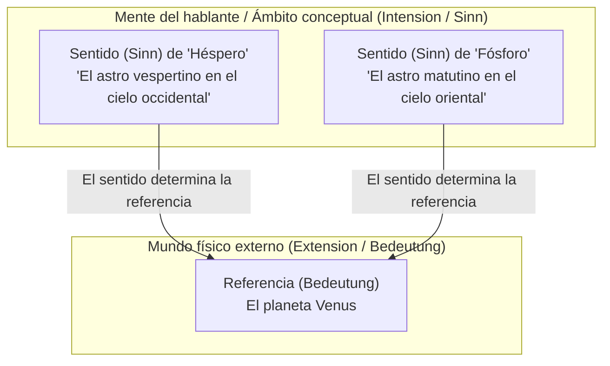
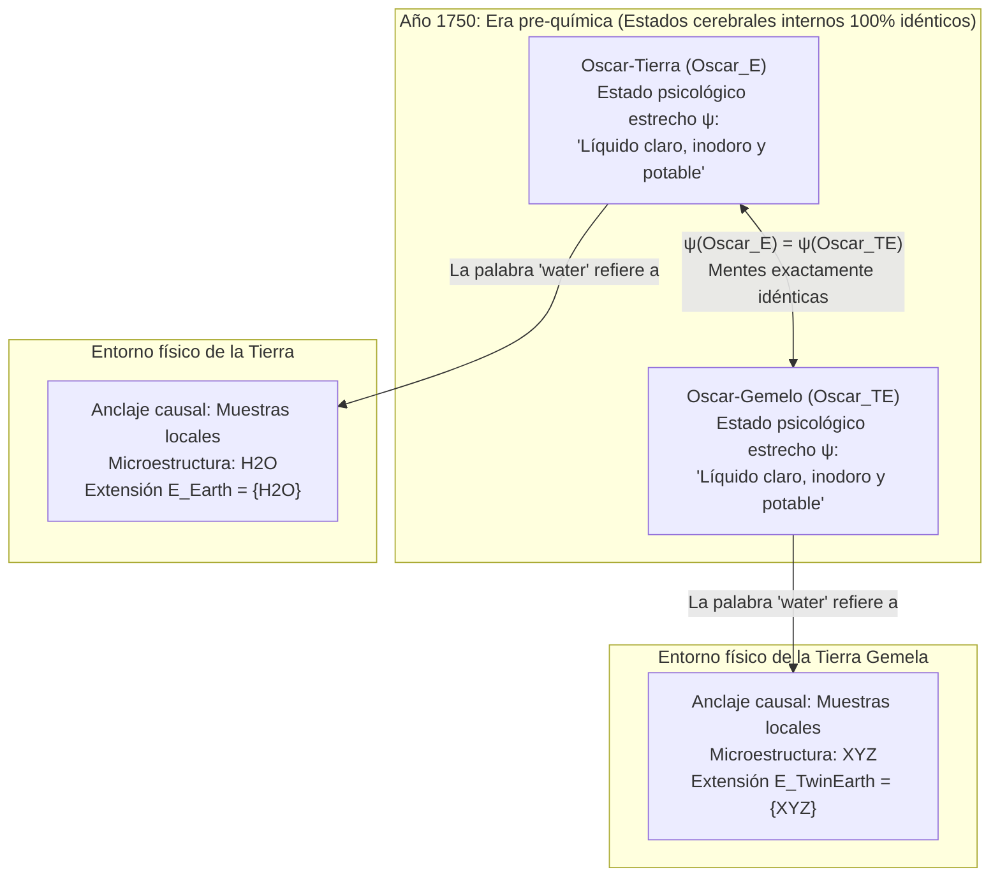

## 1. Introducción: ¿Dónde reside el «significado» de una palabra?

Cuando pronunciamos palabras cotidianas como *«agua»*, *«oro»* o *«Aristóteles»*, ¿cómo logran esos sonidos o marcas de tinta trascender nuestra mente para referirse con exactitud a sustancias químicas o individuos históricos en el mundo físico?

Desde la tesis de John Locke en el siglo XVII de que las palabras son signos de las «ideas en la mente del hablante», hasta la filosofía analítica de Gottlob Frege, Bertrand Russell, Rudolf Carnap y John Searle en el siglo XX, la filosofía del lenguaje estuvo dominada por una ortodoxia profundamente intuitiva: el <strong>internalismo semántico</strong> y el <strong>descriptivismo</strong>. Según esta postura, comprender el significado (la intensión) de un término consiste simplemente en poseer dentro de la cabeza (el cerebro o la conciencia) un concepto o una lista de descripciones identificadoras; y ese estado mental interno determina por sí solo qué objetos del mundo exterior conforman la referencia (la extensión) de la palabra.

Sin embargo, a principios de la década de 1970, dos obras revolucionarias derribaron este edificio clásico: las conferencias de Saul Kripke <strong>*El nombrar y la necesidad* (*Naming and Necessity*, 1972/1980)</strong> y el célebre ensayo de Hilary Putnam <strong>*«El significado de "significado"»* (*The Meaning of "Meaning"*, 1975)</strong>.

Mediante su famoso <strong>experimento mental de la Tierra Gemela (Twin Earth: $\text{H}_2\text{O}$ frente a $\text{XYZ}$)</strong>, Putnam demostró una paradoja asombrosa: en el año 1750 (antes del nacimiento de la química moderna), un hablante en la Tierra (Oscar) y su duplicado molécula por molécula en la Tierra Gemela (Oscar Gemelo) pueden encontrarse en <strong>estados psicológicos y neurofisiológicos estrechos 100 % idénticos</strong>, y sin embargo su palabra *«agua»* se refiere a sustancias químicas completamente distintas ($\text{H}_2\text{O}$ frente a $\text{XYZ}$), teniendo por tanto significados distintos. Como concluyó Putnam en su célebre sentencia:

> <strong>«Cortes el pastel como lo cortes, ¡los "significados" simplemente no están en la cabeza! (Cut the pie any way you like, 'meanings' just ain't in the head!)»</strong>

En este artículo examinamos la transición desde el descriptivismo clásico (Frege, Russell, Searle) hasta los <strong>designadores rígidos</strong> y las <strong>verdades necesarias *a posteriori*</strong> de Kripke, la <strong>Tierra Gemela</strong> y la <strong>división del trabajo lingüístico</strong> de Putnam, el <strong>externalismo social</strong> de Tyler Burge (el experimento de la artritis) y sus implicaciones actuales para los <strong>Grandes Modelos de Lenguaje (LLM)</strong> y el problema del anclaje de símbolos (*Symbol Grounding Problem*).

---

## 2. La tradición internalista y descriptivista clásica: Frege, Russell y Searle

### 2.1 El rompecabezas de Frege y *«Sobre el sentido y la referencia»* (1892)

En 1892, Gottlob Frege abrió su clásico ensayo *«Über Sinn und Bedeutung»* planteando un enigma sobre los enunciados de identidad (<strong>el rompecabezas de Frege</strong>). Compárense estas dos oraciones:

1. <strong>$a = a$: «Héspero es Héspero»</strong> («El lucero de la tarde es el lucero de la tarde»).
2. <strong>$a = b$: «Héspero es Fósforo»</strong> («El lucero de la tarde es el lucero del alba»).

Astronómicamente, tanto `"Héspero"` como `"Fósforo"` designan exactamente el mismo cuerpo celeste: el planeta <strong>Venus</strong>:

$$\llbracket \text{Héspero} \rrbracket = \llbracket \text{Fósforo} \rrbracket = \text{Venus}$$

Si el significado de un nombre se agotara en su <strong>referencia / extensión (*Bedeutung*)</strong>, entonces $a = b$ tendría el mismo valor cognitivo que la tautología trivial $a = a$. No obstante, $a = a$ es una verdad analítica cognoscible <strong>*a priori*</strong>, mientras que $a = b$ fue un descubrimiento astronómico empírico <strong>*a posteriori*</strong> de enorme valor informativo.

Para resolver esta paradoja, Frege dividió el contenido semántico en dos niveles:
- <strong>Referencia / Extensión (*Bedeutung*)</strong>: el objeto concreto en el mundo físico (el planeta Venus).
- <strong>Sentido / Intensión (*Sinn*)</strong>: el <strong>«modo de presentación» (*Art des Gegebenseins*)</strong> del objeto, es decir, el criterio conceptual captado por la mente del hablante (*el astro más brillante al atardecer en el oeste* frente a *el astro más brillante al amanecer en el este*).

Según Frege, el hablante comprende un término al captar mentalmente su *sentido* (*Sinn*), y <strong>el sentido determina de manera única la referencia (*Bedeutung*)</strong>.

### 2.2 La teoría de las descripciones definidas de Russell (1905) y el descriptivismo de cúmulos de Searle (1958)

En *«On Denoting»* (1905), Bertrand Russell analizó las <strong>descripciones definidas</strong> de la forma «el $F$ es $G$» ($\iota x\, F(x)$) mediante cuantificación existencial y unicidad en lógica de primer orden:

$$\text{El } F \text{ es } G \iff \exists x \Big( F(x) \land \forall y \big(F(y) \to y = x\big) \land G(x) \Big)$$

Russell sostuvo que los nombres propios ordinarios («Aristóteles») y los términos de clases naturales («agua», «oro») son en realidad <strong>descripciones definidas encubiertas o abreviadas</strong>. Posteriormente, John Searle (1958) propuso el <strong>descriptivismo de cúmulos (Cluster Descriptivism)</strong>: un nombre se asocia con un cúmulo ponderado de descripciones $\{D_1, D_2, \dots, D_n\}$ en la mente del hablante y se refiere al objeto $x$ que satisface una mayoría ponderada suficiente de dichas propiedades:

$$\llbracket N \rrbracket = \iota x \left( \sum_{i=1}^{n} w_i \cdot \mathbb{I}\big[D_i(x)\big] \ge \theta \right)$$

### 2.3 Los dos dogmas fundamentales de la semántica tradicional: (A1) y (A2)

Hilary Putnam sintetizó toda esta tradición clásica en dos supuestos fundamentales:

- <strong>Supuesto (A1) Solipsismo metodológico</strong>: Conocer el significado (la intensión $I(t)$) de un término $t$ consiste exclusivamente en estar en un <strong>estado psicológico estrecho ($\psi \in \mathcal{S}_{\text{narrow}}$)</strong> dentro de la cabeza del hablante (sin presuponer nada sobre el mundo exterior).
- <strong>Supuesto (A2) La intensión determina la extensión</strong>: La intensión mental $I(t)$ fija de manera única la extensión $E(t)$ en el mundo:

$$\psi(S_1, t) = \psi(S_2, t) \stackrel{\text{(A1)}}{\implies} I_1(t) = I_2(t) \stackrel{\text{(A2)}}{\implies} E_1(t) = E_2(t)$$

---

## 3. Saul Kripke y *El nombrar y la necesidad*: Designadores rígidos y teoría causal

### 3.1 El experimento mental Gödel / Schmidt y la refutación del descriptivismo

Saul Kripke demolió el descriptivismo mediante tres argumentos decisivos:

1. <strong>El argumento modal</strong>: Si «Aristóteles» significara «el maestro de Alejandro Magno», entonces en un mundo posible contrafáctico $w'$ donde Aristóteles nunca enseñó a Alejandro, el enunciado verdadero $\Diamond(\neg \text{Taught}(\text{Aristotle}, \text{Alexander}))$ sería contradictorio.
2. <strong>El argumento epistémico y semántico — El caso Gödel / Schmidt</strong>:
   Supongamos que la única descripción que un hablante común asocia con «Kurt Gödel» es $D_{\text{Gödel}} =$ <strong>«el descubridor del teorema de incompletitud de la aritmética»</strong>. Imaginemos que, en realidad, un matemático vienés llamado <strong>Schmidt</strong> demostró el teorema pero murió misteriosamente antes de publicarlo, y <strong>Gödel</strong> robó el manuscrito y lo publicó bajo su nombre.
   Según el descriptivismo, dado que Schmidt es el único que satisface $D_{\text{Gödel}}$ ($\iota x\, D_{\text{Gödel}}(x) = \text{Schmidt}$), cuando decimos «Gödel» nos estaríamos refiriendo a <strong>Schmidt</strong>. Kripke señala que esto es absurdo: al decir «Gödel» nos referimos sin duda a <strong>Gödel mismo</strong> (y diríamos: *«¡Gödel no demostró el teorema, se lo robó a Schmidt!»*). Las descripciones en la cabeza no determinan la referencia.

### 3.2 Designadores rígidos y la teoría causal-histórica de la referencia

En la semántica de mundos posibles $\mathcal{M} = \langle \mathcal{W}, \mathcal{D}, w_0, \mathcal{I} \rangle$, Kripke define:

- <strong>Designador no rígido (accidental)</strong>: Una descripción definida como «el inventor de los lentes bifocales» designa distintos individuos en diferentes mundos posibles (Benjamin Franklin en $w_0$, Thomas Edison en $w_1$).
- <strong>Designador rígido (Rigid Designator)</strong>: Un designador $d_{\text{rigid}}$ es <strong>rígido</strong> si y solo si designa <strong>exactamente el mismo objeto $o_{\text{actual}}$ en todos los mundos posibles $w \in \mathcal{W}$</strong> en los que dicho objeto existe:
  $$\forall w \in \mathcal{W}, \quad \llbracket d_{\text{rigid}} \rrbracket_w = \llbracket d_{\text{rigid}} \rrbracket_{w_0} = o_{\text{actual}}$$

Los nombres propios («Aristóteles», «Héspero») y los términos de clases naturales («agua», «oro», «tigre») son <strong>designadores rígidos</strong>. Su referencia se fija mediante (1) un <strong>bautismo inicial (Initial Baptism)</strong> por ostensión directa y (2) una <strong>cadena causal-histórica de comunicación ($S_0 \to S_1 \to \dots \to S_n$)</strong> a través de la comunidad lingüística.

### 3.3 El fin del dogma kantiano: Verdades necesarias *a posteriori*

Dado que «Héspero» y «Fósforo», así como «Agua» y «$\text{H}_2\text{O}$», son designadores rígidos, su identidad descubierta empíricamente en el mundo actual $w_0$ se mantiene necesariamente en <strong>todos los mundos posibles</strong>:

$$(\text{Agua} = \text{H}_2\text{O}) \implies \Box(\text{Agua} = \text{H}_2\text{O}), \quad (\text{Héspero} = \text{Fósforo}) \implies \Box(\text{Héspero} = \text{Fósforo})$$

Kripke separa así la necesidad metafísica ($\Box$) de la aprioridad epistémica, demostrando la existencia de <strong>verdades necesarias *a posteriori*</strong>.

---

## 4. El experimento mental de la Tierra Gemela de Hilary Putnam (1975)

### 4.1 La Tierra y la Tierra Gemela en 1750: $\text{H}_2\text{O}$ frente a $\text{XYZ}$

En *«El significado de "significado"»* (1975), Putnam concibió el célebre escenario de la <strong>Tierra Gemela (Twin Earth)</strong>:

1. <strong>Identidad macroscópica y psicológica</strong>: La Tierra Gemela es macroscópicamente idéntica a la Tierra.Cada habitante terrestre como <strong>Oscar-Tierra ($\text{Oscar}_E$)</strong> tiene un duplicado exacto <strong>Oscar-Gemelo ($\text{Oscar}_{TE}$)</strong> con idénticos estados cerebrales y experiencias subjetivas.
2. <strong>La única diferencia química microscópica</strong>: En la <strong>Tierra</strong>, el líquido incoloro, inodoro y potable llamado `"water"` que llena ríos y océanos tiene la estructura química <strong>$\text{H}_2\text{O}$</strong>. En la <strong>Tierra Gemela</strong>, el líquido macroscópicamente indistinguible llamado `"water"` <strong>no es $\text{H}_2\text{O}$</strong>, sino un compuesto químico distinto abreviado como <strong>$\text{XYZ}$</strong>.
3. <strong>El año 1750</strong>: Antes de Lavoisier y Dalton, nadie en la Tierra ni en la Tierra Gemela sabe nada de $\text{H}_2\text{O}$ ni de $\text{XYZ}$. En 1750, $\text{Oscar}_E$ y $\text{Oscar}_{TE}$ se encuentran en <strong>estados psicológicos estrechos 100 % idénticos</strong>:

$$\text{State}_{\text{narrow}}\big(\text{Oscar}_E, 1750\big) \equiv \text{State}_{\text{narrow}}\big(\text{Oscar}_{TE}, 1750\big)$$

### 4.2 Por qué $\text{XYZ}$ es «agua de los tontos» y el colapso de (A1) y (A2)

En 1750, ¿tiene la palabra `"water"` la misma extensión en boca de $\text{Oscar}_E$ y de $\text{Oscar}_{TE}$? <strong>¡Rotundamente no!</strong>
El término de clase natural `"water"` posee un componente <strong>indexical</strong> implícito: designa toda sustancia que guarde la relación $\text{same}_L$ (misma microestructura líquida) con *esta* muestra local de nuestro entorno:

$$\forall x, \quad x \in \llbracket \text{water} \rrbracket_{\text{Tierra}} \iff \text{same}_L\big(x, \text{sample}_{\text{Tierra}}\big) \iff \text{Microstructure}(x) = \text{H}_2\text{O}$$
$$\forall x, \quad x \in \llbracket \text{water} \rrbracket_{\text{TierraGemela}} \iff \text{same}_L\big(x, \text{sample}_{\text{TierraGemela}}\big) \iff \text{Microstructure}(x) = \text{XYZ}$$

Así como la <strong>pirita de hierro ($\text{FeS}_2$, «el oro de los tontos»)</strong> jamás fue oro ($\text{Au}$) ni siquiera en la Antigüedad, el $\text{XYZ}$ de la Tierra Gemela no es agua, sino <strong>«agua de los tontos» (Fool's Water)</strong>.

Dado que $\psi(\text{Oscar}_E) = \psi(\text{Oscar}_{TE})$ pero sus extensiones difieren ($\{\text{H}_2\text{O}\} \neq \{\text{XYZ}\}$), (A1) y (A2) no pueden ser ambos verdaderos: <strong>¡los significados no están en la cabeza!</strong>

---

## 5. División del trabajo lingüístico, externalismo social de Burge e IA (LLM)

### 5.1 La división del trabajo lingüístico (Olmos frente a Hayas) y el vector de significado

Putnam confiesa no saber distinguir un <strong>olmo (*Ulmus*)</strong> de un <strong>haya (*Fagus*)</strong>: sus conceptos internos de `"elm"` y `"beech"` son idénticos ($\psi(\text{Putnam}, \text{``elm''}) = \psi(\text{Putnam}, \text{``beech''})$). Sin embargo, su palabra `"elm"` se refiere exclusivamente a los olmos gracias a la <strong>división del trabajo lingüístico</strong>: los hablantes legos delegan la fijación exacta de la extensión en los <strong>expertos</strong> (botánicos, químicos) de su comunidad.

Putnam representa el significado mediante un <strong>vector de significado</strong> de cuatro componentes:

$$\vec{M}(\text{``water''}) = \big\langle \text{Marcadores sintácticos},\, \text{Marcadores semánticos},\, \text{Estereotipo},\, \text{Extensión} \big\rangle$$

### 5.2 El externalismo social de Tyler Burge (1979): El experimento de la «artritis»

En *«Individualism and the Mental»* (1979), <strong>Tyler Burge</strong> demostró que incluso el contenido de nuestras <strong>creencias mentales</strong> es externo:
- <strong>Bert (mundo real)</strong> cree: *«Mi artritis se ha extendido a mi muslo»*. Como la artritis se define médicamente solo como inflamación de las <strong>articulaciones</strong>, Bert tiene una <strong>creencia falsa</strong> sobre la artritis.
- <strong>Bert Gemelo (mundo contrafáctico)</strong> tiene exactamente la misma historia física y estados cerebrales, pero en su comunidad los médicos usan `"arthritis"` (concepto `tharthritis`) para incluir dolores reumáticos en los <strong>músculos del muslo</strong>. ¡La creencia de Bert Gemelo es <strong>verdadera</strong>!
- Dos creencias con valores de verdad opuestos no pueden tener el mismo contenido proposicional: <strong>¡nuestros propios pensamientos están individuados por el entorno social!</strong>

### 5.3 Implicaciones para los Grandes Modelos de Lenguaje (LLM) y el anclaje de símbolos

Los LLM entrenados solo con texto mediante predicción del siguiente token $P_\theta(w_t \mid w_{1:t-1})$ dominan a la perfección los <strong>estereotipos</strong> (componente 3 de Putnam). Como muestran la <strong>prueba del pulpo de Bender y Koller (2020)</strong> y los <strong>cerebros en una cubeta de Putnam (1981)</strong>, la referencia no reside intrínsecamente en los pesos $\Theta$ de la red. Sin embargo, dado que los corpus de entrenamiento fueron escritos por seres humanos en interacción causal con el $\text{H}_2\text{O}$ real y el mundo físico, los LLM se integran en la <strong>cadena causal-histórica</strong> y en la <strong>división del trabajo lingüístico</strong> humana, adquiriendo así una <strong>referencia derivada o parasitaria</strong>.

| Dimensión | Internalismo clásico y Descriptivismo (Frege, Russell, Searle) | Externalismo semántico y social (Kripke, Putnam, Burge) |
| :--- | :--- | :--- |
| <strong>Tesis central</strong> | El significado (intensión) es una descripción mental en la cabeza y determina la extensión. | <strong>«Los significados no están en la cabeza.»</strong> La referencia y el pensamiento dependen del entorno físico y social. |
| <strong>Nombres propios y clases naturales</strong> | Descripciones definidas abreviadas o cúmulos (designadores no rígidos). | <strong>Designadores rígidos</strong> ($\forall w \in \mathcal{W}, \llbracket d \rrbracket_w = o_{\text{actual}}$) que designan la misma esencia en todo mundo posible. |
| <strong>Caso Gödel / Schmidt</strong> | Predice erróneamente que «Gödel» refiere a Schmidt. | Refiere correctamente a Gödel mediante la cadena causal-histórica. |
| <strong>Tierra Gemela en 1750</strong> | Estados cerebrales idénticos $\implies$ mismo significado y extensión. | Pese a cerebros idénticos, `"water"` designa $\text{H}_2\text{O}$ en la Tierra y $\text{XYZ}$ en la Tierra Gemela. |
| <strong>Modalidad y Epistemología</strong> | Necesario $\iff$ *a priori*; «Agua $=\text{H}_2\text{O}$» se considera contingente. | Establece <strong>verdades necesarias *a posteriori*</strong>: $\Box(\text{Agua} = \text{H}_2\text{O})$, $\Box(\text{Héspero} = \text{Fósforo})$. |
