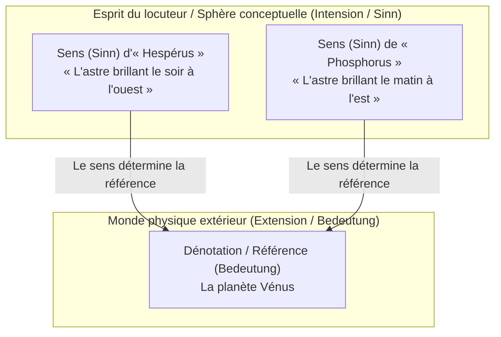
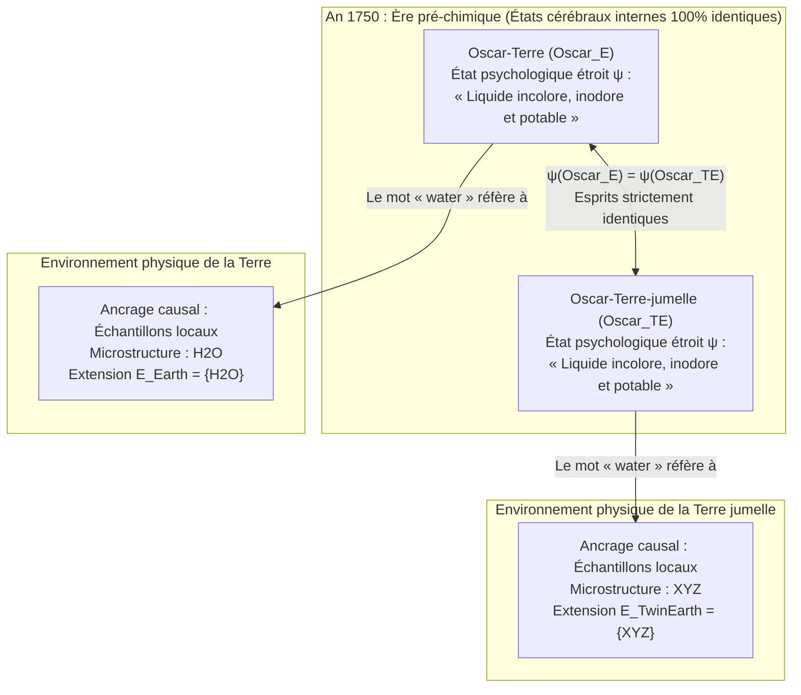

## 1. Introduction : Où réside la « signification » d'un mot ?

Lorsque nous prononçons des mots courants comme *« eau »*, *« or »* ou *« Aristote »*, comment ces sons ou ces tracés d'encre parviennent-ils à franchir les frontières de notre esprit pour désigner des substances chimiques ou des individus précis dans l'univers physique ?

Depuis la thèse de John Locke au XVIIe siècle selon laquelle les mots sont les signes des « idées dans l'esprit de celui qui les emploie », jusqu'à la philosophie analytique de Gottlob Frege, Bertrand Russell, Rudolf Carnap et John Searle au XXe siècle, la philosophie du langage a été dominée par un consensus puissant : <strong>l'internalisme sémantique</strong> et le <strong>descriptivisme</strong>. Selon cette doctrine, comprendre la signification (l'intension) d'un terme consiste simplement à posséder dans sa tête (son cerveau ou sa conscience) un concept ou une liste de descriptions identifiantes ; et cet état mental interne détermine à lui seul quels objets du monde extérieur constituent la référence (l'extension) du mot.

Au début des années 1970, deux œuvres majeures ont fait voler en éclats cet édifice séculaire : les conférences de Saul Kripke <strong>*La Logique des noms propres* (*Naming and Necessity*, 1972/1980)</strong> et l'article monumental de Hilary Putnam <strong>*« La signification de "signification" »* (*The Meaning of "Meaning"*, 1975)</strong>.

Grâce à sa célèbre <strong>expérience de pensée de la Terre jumelle (Twin Earth : $\text{H}_2\text{O}$ vs $\text{XYZ}$)</strong>, Putnam a démontré un paradoxe saisissant : en l'an 1750 (avant l'essor de la chimie moderne), un locuteur terrestre (Oscar) et son double molécule pour molécule sur la Terre jumelle (Oscar jumeau) peuvent se trouver dans des <strong>états psychologiques et neurophysiologiques étroits 100 % identiques</strong>, tout en désignant par le mot *« eau »* des substances chimiques totalement différentes ($\text{H}_2\text{O}$ contre $\text{XYZ}$) ! Comme le résuma Putnam dans une formule restée célèbre :

> <strong>« Coupez la tarte comme bon vous semble, les "significations" ne sont tout simplement pas dans la tête ! (Cut the pie any way you like, 'meanings' just ain't in the head!) »</strong>

Cet article retrace cette révolution théorique : de la sémantique descriptiviste classique (Frege, Russell, Searle) aux <strong>désignateurs rigides</strong> et aux <strong>vérités nécessaires *a posteriori*</strong> de Kripke, de la <strong>Terre jumelle</strong> et de la <strong>division du travail linguistique</strong> de Putnam à <strong>l'externalisme social</strong> de Tyler Burge (l'expérience de l'arthrite), jusqu'aux implications contemporaines pour les <strong>grands modèles de langage (LLM)</strong> et l'ancrage des symboles (*Symbol Grounding Problem*).

---

## 2. La tradition internaliste et descriptiviste classique : Frege, Russell et Searle

### 2.1 Le puzzle de Frege et *« Sens et dénotation »* (1892)

En 1892, Gottlob Frege ouvre son célèbre article *« Über Sinn und Bedeutung »* par une énigme sur les énoncés d'identité (<strong>le puzzle de Frege</strong>). Comparons ces deux énoncés :

1. <strong>$a = a$ : « Hespérus est Hespérus »</strong> (« L'étoile du soir est l'étoile du soir »).
2. <strong>$a = b$ : « Hespérus est Phosphorus »</strong> (« L'étoile du soir est l'étoile du matin »).

Sur le plan astronomique, `"Hespérus"` et `"Phosphorus"` désignent exactement le même corps céleste : la planète <strong>Vénus</strong> :

$$\llbracket \text{Hespérus} \rrbracket = \llbracket \text{Phosphorus} \rrbracket = \text{Vénus}$$

Si la signification d'un nom se réduisait à sa seule <strong>dénotation / référence (*Bedeutung* / Extension)</strong>, l'énoncé $a = b$ devrait avoir la même valeur cognitive que la tautologie triviale $a = a$. Or, $a = a$ est une vérité analytique connue <strong>*a priori*</strong>, tandis que $a = b$ constitue une découverte astronomique empirique majeure connue <strong>*a posteriori*</strong>.

Pour résoudre ce paradoxe, Frege distingue deux niveaux sémantiques :
- <strong>La dénotation / référence (*Bedeutung* / Extension)</strong> : l'objet réel dans le monde (la planète Vénus).
- <strong>Le sens / l'intension (*Sinn*)</strong> : le <strong>« mode de donation » (*Art des Gegebenseins*)</strong> de l'objet, c'est-à-dire le critère conceptuel saisi par l'esprit du locuteur (*l'astre brillant le soir à l'ouest* vs *l'astre brillant le matin à l'est*).

Chez Frege, le locuteur saisit mentalement le *sens* (*Sinn*), et <strong>le sens détermine de manière unique la dénotation (*Bedeutung*)</strong>.

### 2.2 La théorie des descriptions définies de Russell (1905) et le descriptivisme en faisceau de Searle (1958)

Dans *« On Denoting »* (1905), Bertrand Russell analyse les <strong>descriptions définies</strong> de la forme « le $F$ est $G$ » ($\iota x\, F(x)$) au moyen de la quantification existentielle et d'une clause d'unicité en logique du premier ordre :

$$\text{Le } F \text{ est } G \iff \exists x \Big( F(x) \land \forall y \big(F(y) \to y = x\big) \land G(x) \Big)$$

Pour Russell, les noms propres ordinaires (« Aristote ») et les termes d'espèces naturelles (« eau », « or ») sont des <strong>descriptions définies déguisées ou abrégées</strong>. Afin d'éviter qu'une description unique ne rende analytiques les faits historiques concernant Aristote, John Searle (1958) proposa le <strong>descriptivisme en faisceau (Cluster Descriptivism)</strong> : un nom est associé dans l'esprit du locuteur à un faisceau pondéré de descriptions $\{D_1, D_2, \dots, D_n\}$ et désigne l'individu $x$ qui satisfait une majorité pondérée suffisante de ces propriétés :

$$\llbracket N \rrbracket = \iota x \left( \sum_{i=1}^{n} w_i \cdot \mathbb{I}\big[D_i(x)\big] \ge \theta \right)$$

### 2.3 Les deux dogmes fondamentaux de la sémantique traditionnelle : (A1) et (A2)

Hilary Putnam résume toute cette tradition classique en deux axiomes :

- <strong>Axiome (A1) Solipsisme méthodologique</strong> : Connaître la signification (l'intension $I(t)$) d'un terme $t$ consiste entièrement à se trouver dans un <strong>état psychologique étroit ($\psi \in \mathcal{S}_{\text{narrow}}$)</strong> à l'intérieur de sa tête (indépendamment de tout environnement extérieur).
- <strong>Axiome (A2) L'intension détermine l'extension</strong> : L'intension mentale $I(t)$ fixe de manière unique l'extension $E(t)$ dans le monde :

$$\psi(S_1, t) = \psi(S_2, t) \stackrel{\text{(A1)}}{\implies} I_1(t) = I_2(t) \stackrel{\text{(A2)}}{\implies} E_1(t) = E_2(t)$$

---

## 3. Saul Kripke et *La Logique des noms propres* : Désignateurs rigides et théorie causale

### 3.1 L'expérience de pensée Gödel / Schmidt et la réfutation du descriptivisme

Saul Kripke réfute le descriptivisme par trois arguments décisifs :

1. <strong>L'argument modal</strong> : Si « Aristote » signifiait « le précepteur d'Alexandre le Grand », alors dans un monde possible contrefactuel $w'$ où Aristote n'aurait jamais enseigné à Alexandre, l'énoncé modal $\Diamond(\neg \text{Taught}(\text{Aristotle}, \text{Alexander}))$ deviendrait contradictoire. Or il est contingent qu'Aristote ait été philosophe.
2. <strong>L'argument épistémique et sémantique — Le cas Gödel / Schmidt</strong> :
   Supposons que la seule description que le locuteur ordinaire associe à « Kurt Gödel » soit $D_{\text{Gödel}} =$ <strong>« l'homme qui a démontré le théorème d'incomplétude de l'arithmétique »</strong>. Imaginons qu'en réalité, un mathématicien viennois nommé <strong>Schmidt</strong> ait démontré le théorème avant de mourir mystérieusement, et que <strong>Gödel</strong> ait volé le manuscrit pour le publier sous son propre nom.
   Selon le descriptivisme, puisque Schmidt est l'unique individu satisfaisant $D_{\text{Gödel}}$ ($\iota x\, D_{\text{Gödel}}(x) = \text{Schmidt}$), lorsque nous disons « Gödel », nous ferions référence à <strong>Schmidt</strong> ! Kripke souligne l'absurdité de cette conséquence : nous faisons évidemment référence à <strong>Gödel lui-même</strong> (et nous dirions : *« Gödel n'a pas démontré le théorème, il l'a volé à Schmidt ! »*). Les descriptions dans notre tête ne déterminent donc pas la référence.

### 3.2 Désignateurs rigides et théorie causale-historique de la référence

Dans un modèle de mondes possibles $\mathcal{M} = \langle \mathcal{W}, \mathcal{D}, w_0, \mathcal{I} \rangle$, Kripke définit :

- <strong>Désignateur non rigide (accidentel)</strong> : Une description définie comme « l'inventeur des verres à double foyer » désigne différents individus selon les mondes possibles (Benjamin Franklin dans $w_0$, Thomas Edison dans $w_1$).
- <strong>Désignateur rigide (Rigid Designator)</strong> : Un terme $d_{\text{rigid}}$ est <strong>rigide</strong> si et seulement s'il désigne <strong>exactement le même objet $o_{\text{actual}}$ dans tous les mondes possibles $w \in \mathcal{W}$</strong> où cet objet existe :
  $$\forall w \in \mathcal{W}, \quad \llbracket d_{\text{rigid}} \rrbracket_w = \llbracket d_{\text{rigid}} \rrbracket_{w_0} = o_{\text{actual}}$$

Les noms propres (« Aristote », « Hespérus ») et les termes d'espèces naturelles (« eau », « or », « tigre ») sont des <strong>désignateurs rigides</strong>. Leur référence est fixée par (1) un <strong>baptême initial (Initial Baptism)</strong> par ostension directe, suivi d'une (2) <strong>chaîne causale-historique de communication ($S_0 \to S_1 \to \dots \to S_n$)</strong> au sein de la communauté linguistique.

### 3.3 L'effondrement du dogme kantien : Les vérités nécessaires *a posteriori*

Puisque « Hespérus » et « Phosphorus », ainsi que « Eau » et « $\text{H}_2\text{O}$ », sont des désignateurs rigides, leur identité découverte empiriquement dans le monde actuel $w_0$ vaut nécessairement dans <strong>tous les mondes possibles</strong> :

$$(\text{Eau} = \text{H}_2\text{O}) \implies \Box(\text{Eau} = \text{H}_2\text{O}), \quad (\text{Hespérus} = \text{Phosphorus}) \implies \Box(\text{Hespérus} = \text{Phosphorus})$$

Kripke dissocie ainsi la nécessité métaphysique ($\Box$) de l'apriorité épistémique, démontrant l'existence de <strong>vérités nécessaires *a posteriori*</strong>.

---

## 4. L'expérience de pensée de la Terre jumelle de Hilary Putnam (1975)

### 4.1 Terre et Terre jumelle en 1750 : $\text{H}_2\text{O}$ vs $\text{XYZ}$

Dans *« La signification de "signification" »* (1975), Putnam imagine une planète appelée <strong>Terre jumelle (Twin Earth)</strong> :

1. <strong>Identité macroscopique et psychologique</strong> : La Terre jumelle est en tout point semblable à la Terre. À chaque habitant terrestre comme <strong>Oscar-Terre ($\text{Oscar}_E$)</strong> correspond un double moléculaire exact <strong>Oscar-Terre-jumelle ($\text{Oscar}_{TE}$)</strong> doté des mêmes états cérébraux et expériences subjectives.
2. <strong>L'unique différence chimique microscopique</strong> : Sur <strong>Terre</strong>, le liquide incolore, inodore et désaltérant appelé `"water"` qui remplit les rivières et les océans possède la structure chimique <strong>$\text{H}_2\text{O}$</strong>. Sur la <strong>Terre jumelle</strong>, le liquide macroscopiquement indiscernable appelé `"water"` n'est <strong>pas $\text{H}_2\text{O}$</strong>, mais un composé chimique complexe différent abrégé en <strong>$\text{XYZ}$</strong> !
3. <strong>Le recul temporel en l'an 1750</strong> : Avant Lavoisier et Dalton, personne sur Terre ni sur la Terre jumelle ne connaît l'existence de $\text{H}_2\text{O}$ ou de $\text{XYZ}$. En 1750, $\text{Oscar}_E$ et $\text{Oscar}_{TE}$ sont donc dans des <strong>états psychologiques étroits 100 % identiques</strong> :

$$\text{State}_{\text{narrow}}\big(\text{Oscar}_E, 1750\big) \equiv \text{State}_{\text{narrow}}\big(\text{Oscar}_{TE}, 1750\big)$$

### 4.2 Pourquoi $\text{XYZ}$ est de « l'eau des fous » et la chute de (A1) & (A2)

En 1750, le mot `"water"` a-t-il la même extension dans la bouche d'$\text{Oscar}_E$ et d'$\text{Oscar}_{TE}$ ? <strong>Absolument pas !</strong>
Le terme d'espèce naturelle `"water"` comporte une dimension <strong>indexicale</strong> implicite : il désigne toute substance partageant la même microstructure essentielle (relation $\text{same}_L$) que *cet* échantillon liquide local :

$$\forall x, \quad x \in \llbracket \text{water} \rrbracket_{\text{Terre}} \iff \text{same}_L\big(x, \text{sample}_{\text{Terre}}\big) \iff \text{Microstructure}(x) = \text{H}_2\text{O}$$
$$\forall x, \quad x \in \llbracket \text{water} \rrbracket_{\text{TerreJumelle}} \iff \text{same}_L\big(x, \text{sample}_{\text{TerreJumelle}}\big) \iff \text{Microstructure}(x) = \text{XYZ}$$

Tout comme la <strong>pyrite de fer ($\text{FeS}_2$, « l'or des fous »)</strong> n'a jamais été de l'or ($\text{Au}$), même dans l'Antiquité avant la chimie moderne, $\text{XYZ}$ sur la Terre jumelle n'est pas de l'eau, mais de <strong>« l'eau des fous » (Fool's Water)</strong>.

Puisque $\psi(\text{Oscar}_E) = \psi(\text{Oscar}_{TE})$ mais que les extensions diffèrent ($\{\text{H}_2\text{O}\} \neq \{\text{XYZ}\}$), les axiomes (A1) et (A2) sont incompatibles : <strong>les significations ne sont pas dans la tête !</strong>

---

## 5. Division du travail linguistique, externalisme social de Burge et IA (LLM)

### 5.1 La division du travail linguistique (Orme vs Hêtre) et le vecteur de signification

Putnam avoue ne pas savoir distinguer un <strong>orme (*Ulmus*)</strong> d'un <strong>hêtre (*Fagus*)</strong> : ses concepts mentaux internes d'*« orme »* et de *« hêtre »* sont identiques ($\psi(\text{Putnam}, \text{``elm''}) = \psi(\text{Putnam}, \text{``beech''})$). Pourtant, son mot `"elm"` désigne exclusivement les ormes grâce à la <strong>division du travail linguistique</strong> : les locuteurs profanes s'en remettent aux <strong>experts</strong> (botanistes, chimistes) de leur communauté.

Putnam modélise la signification sous la forme d'un <strong>vecteur de signification</strong> à quatre composantes :

$$\vec{M}(\text{``water''}) = \big\langle \text{Marqueurs syntaxiques},\, \text{Marqueurs sémantiques},\, \text{Stéréotype},\, \text{Extension} \big\rangle$$

### 5.2 L'externalisme social de Tyler Burge (1979) : L'expérience de l'« arthrite »

Dans *« Individualism and the Mental »* (1979), <strong>Tyler Burge</strong> démontre que même le contenu de nos <strong>croyances mentales</strong> est externe :
- <strong>Bert (monde réel)</strong> croit : *« Mon arthrite s'est étendue à ma cuisse. »* Comme l'arthrite est médicalement définie comme une inflammation des seules <strong>articulations</strong>, Bert a une <strong>croyance fausse</strong> au sujet de l'arthrite.
- <strong>Bert jumeau (monde contrefactuel)</strong> possède exactement le même cerveau et la même histoire physique, mais dans sa communauté linguistique, les médecins emploient `"arthritis"` (concept `tharthritis`) pour désigner toute douleur rhumatismale, y compris dans les <strong>muscles de la cuisse</strong>. La croyance de Bert jumeau est donc <strong>vraie</strong> !
- Deux croyances ayant des valeurs de vérité opposées ne peuvent être le même contenu mental : <strong>nos pensées elles-mêmes sont individuées par notre environnement social !</strong>

### 5.3 Implications pour les grands modèles de langage (LLM) et l'ancrage des symboles

Les LLM entraînés uniquement sur du texte via la prédiction du jeton suivant $P_\theta(w_t \mid w_{1:t-1})$ acquièrent une maîtrise parfaite des <strong>stéréotypes</strong> (composante 3 de Putnam). Comme l'illustrent le <strong>test de la pieuvre de Bender et Koller (2020)</strong> et les <strong>cerveaux dans une cuve de Putnam (1981)</strong>, la référence n'est pas intrinsèque aux poids $\Theta$ du réseau. Toutefois, parce que les corpus d'entraînement ont été écrits par des humains en interaction causale avec le vrai $\text{H}_2\text{O}$ et le monde réel, les LLM s'insèrent dans la <strong>chaîne causale-historique</strong> et la <strong>division du travail linguistique</strong> humaine, héritant ainsi d'une <strong>référence dérivée / parasitaire</strong>.

| Dimension | Internalisme classique & Descriptivisme (Frege, Russell, Searle) | Externalisme sémantique & social (Kripke, Putnam, Burge) |
| :--- | :--- | :--- |
| <strong>Thèse centrale</strong> | La signification (intension) est une description dans la tête du locuteur et détermine l'extension. | <strong>« Les significations ne sont pas dans la tête. »</strong> La référence et la pensée dépendent de l'environnement physique et social. |
| <strong>Noms propres & espèces naturelles</strong> | Descriptions définies abrégées ou faisceaux (désignateurs non rigides). | <strong>Désignateurs rigides</strong> ($\forall w \in \mathcal{W}, \llbracket d \rrbracket_w = o_{\text{actual}}$) désignant la même essence dans tous les mondes possibles. |
| <strong>Cas Gödel / Schmidt</strong> | Prédit à tort que « Gödel » fait référence à Schmidt. | Fait correctement référence à Gödel via la chaîne causale-historique. |
| <strong>Terre jumelle en 1750</strong> | États cérébraux identiques $\implies$ même signification et même extension. | Malgré des cerveaux identiques, `"water"` désigne $\text{H}_2\text{O}$ sur Terre et $\text{XYZ}$ sur la Terre jumelle. |
| <strong>Modalité & Épistémologie</strong> | Nécessaire $\iff$ *a priori* ; « Eau $=\text{H}_2\text{O}$ » est jugé contingent. | Établit des <strong>vérités nécessaires *a posteriori*</strong> : $\Box(\text{Eau} = \text{H}_2\text{O})$, $\Box(\text{Hespérus} = \text{Phosphorus})$. |
