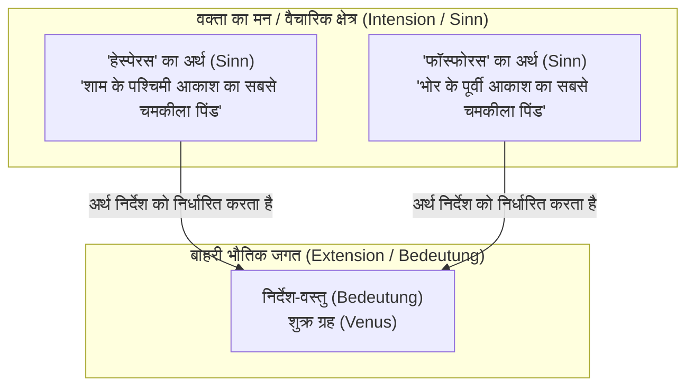
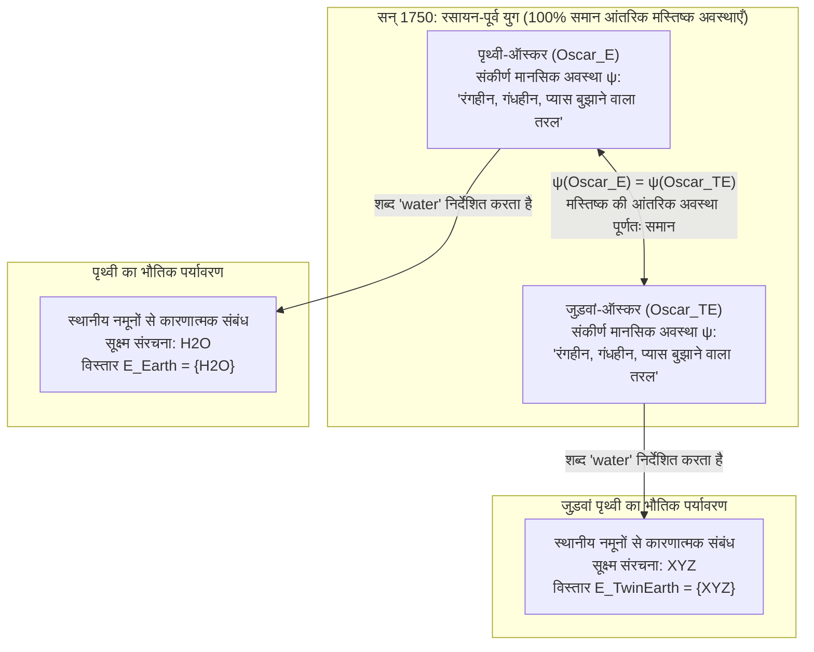

## 1. प्रस्तावना: किसी शब्द का 'अर्थ' कहाँ निवास करता है?

जब हम अपने दैनिक जीवन में *'पानी' (water)*, *'सोना' (gold)* या *'अरस्तू' (Aristotle)* जैसे साधारण शब्द बोलते हैं, तो ये ध्वनियाँ या स्याही के निशान हमारे मन की सीमाओं को पार करके भौतिक ब्रह्मांड के किसी विशिष्ट रासायनिक पदार्थ या ऐतिहासिक व्यक्ति की ओर सटीक संकेत (निर्देश/Reference) कैसे कर पाते हैं?

17वीं शताब्दी में जॉन लॉक (John Locke) के इस विचार से कि "शब्द वक्ता के मन में स्थित विचारों (Ideas) के चिह्न मात्र हैं", गॉटलोब फ्रेगे (Gottlob Frege), बर्ट्रेंड रसेल (Bertrand Russell), रुडोल्फ कारनाप और जॉन सर्ल (John Searle) के 20वीं सदी के विश्लेषणात्मक दर्शन तक, भाषा दर्शन पर एक अत्यंत प्रभावशाली परंपरा का शासन रहा: <strong>अर्थगत आंतरिकवाद (Semantic Internalism)</strong> और <strong>विवरणवाद (Descriptivism)</strong>। इस दृष्टिकोण के अनुसार, किसी शब्द के अर्थ (आशय/Intension) को समझने का मतलब केवल अपने मस्तिष्क या मन के भीतर एक विशेष अवधारणा या पहचानकारी विवरणों की सूची रखना है; और यही आंतरिक मानसिक अवस्था तय करती है कि बाहरी दुनिया की कौन सी वस्तुएँ उस शब्द के विस्तार (Extension/Reference) में आएँगी।

किंतु 1970 के दशक की शुरुआत में, दो क्रांतिकारी कृतियों ने इस सदियों पुरानी मान्यता को जड़ से हिला दिया: सॉल क्रिप्की (Saul Kripke) के व्याख्यान <strong>*नेमिंग एंड नेसेसिटी* (*Naming and Necessity*, 1972/1980)</strong> और हिलरी पटनम (Hilary Putnam) का ऐतिहासिक शोधपत्र <strong>*"द मीनिंग ऑफ 'मीनिंग'"* (*The Meaning of "Meaning"*, 1975)</strong>।

अपने प्रसिद्ध <strong>'जुड़वां पृथ्वी' (Twin Earth: $\text{H}_2\text{O}$ बनाम $\text{XYZ}$) विचार प्रयोग</strong> के माध्यम से पटनम ने एक चौंकाने वाला विरोधाभास सिद्ध किया: सन् 1750 में (आधुनिक रसायन विज्ञान की खोज से पहले), पृथ्वी पर रहने वाले ऑस्कर ($\text{Oscar}_E$) और जुड़वां पृथ्वी पर रहने वाले उसके अणु-दर-अणु जुड़वां प्रतिरूप ($\text{Oscar}_{TE}$) की <strong>आंतरिक मस्तिष्क अवस्थाएँ और मानसिक अनुभव 100% एक समान</strong> हो सकते हैं, फिर भी जब वे *'water' (पानी)* शब्द बोलते हैं, तो उनके शब्द बिल्कुल अलग रासायनिक पदार्थों ($\text{H}_2\text{O}$ बनाम $\text{XYZ}$) को निर्देशित करते हैं! पटनम ने इसे अपने प्रसिद्ध वाक्य में पिरोया:

> <strong>"पाई को चाहे जिस तरह काट लें, 'अर्थ' दिमाग के भीतर नहीं होते! (Cut the pie any way you like, 'meanings' just ain't in the head!)"</strong>

इस लेख में हम फ्रेगे, रसेल और सर्ल के शास्त्रीय विवरणवाद से लेकर क्रिप्की के <strong>दृढ़ निर्देशक (Rigid Designators)</strong> व <strong>अनुभवजन्य अनिवार्य सत्य (Necessary *A Posteriori* Truths)</strong>, पटनम के <strong>जुड़वां पृथ्वी प्रयोग</strong> व <strong>भाषाई श्रम विभाजन</strong>, टायलर बर्ज (Tyler Burge) के <strong>सामाजिक बाह्यवाद (गठिया विचार प्रयोग)</strong>, और आधुनिक <strong>लार्ज लैंग्वेज मॉडल्स (LLMs)</strong> की सिंबल ग्राउंडिंग समस्या तक की संपूर्ण यात्रा का विश्लेषण करेंगे।

---

## 2. शास्त्रीय आंतरिकवादी और विवरणवादी परंपरा: फ्रेगे, रसेल और सर्ल

### 2.1 फ्रेगे की पहेली और *'अर्थ तथा निर्देश पर'* (*Über Sinn und Bedeutung*, 1892)

1892 में आधुनिक तर्कशास्त्र के जनक गॉटलोब फ्रेगे ने अपने प्रसिद्ध निबंध *'Über Sinn und Bedeutung'* की शुरुआत तादात्म्य कथनों (Identity Statements) से जुड़ी एक पहेली से की, जिसे <strong>फ्रेगे की पहेली (Frege's Puzzle)</strong> कहा जाता है। इन दो वाक्यों की तुलना करें:

1. <strong>$a = a$: "हेस्पेरस (सांध्य तारा) हेस्पेरस है (Hesperus is Hesperus)।"</strong>
2. <strong>$a = b$: "हेस्पेरस (सांध्य तारा) फॉस्फोरस (भोर का तारा) है (Hesperus is Phosphorus)।"</strong>

खगोल विज्ञान की दृष्टि से, 'हेस्पेरस' (शाम को पश्चिम में चमकने वाला तारा) और 'फॉस्फोरस' (सुबह पूर्व में चमकने वाला तारा) दोनों एक ही खगोलीय पिंड — <strong>शुक्र ग्रह (Venus)</strong> — को निर्देशित करते हैं:

$$\llbracket \text{Hesperus} \rrbracket = \llbracket \text{Phosphorus} \rrbracket = \text{Venus}$$

यदि किसी नाम का अर्थ केवल उसकी बाहरी <strong>निर्देश-वस्तु (*Bedeutung* / Reference)</strong> तक सीमित होता, तो $a = b$ का संज्ञानात्मक मूल्य भी तुच्छ पुनरुक्ति $a = a$ के समान होना चाहिए था। परंतु $a = a$ एक <strong>प्रागनुभविक (*a priori*)</strong> विश्लेषणात्मक सत्य है, जबकि $a = b$ प्राचीन खगोलविदों द्वारा प्रेक्षण से खोजा गया एक <strong>अनुभवजन्य (*a posteriori*)</strong> सत्य है।

इस पहेली को सुलझाने के लिए फ्रेगे ने अर्थ के दो स्तर बताए:
- <strong>निर्देश / विस्तार (*Bedeutung* / Reference / Extension)</strong>: बाहरी दुनिया की वास्तविक वस्तु (शुक्र ग्रह)।
- <strong>अर्थ / आशय (*Sinn* / Sense / Intension)</strong>: वस्तु के <strong>'प्रस्तुतीकरण की रीति' (*Art des Gegebenseins*)</strong>, अर्थात् वक्ता के मन द्वारा पकड़ी गई वैचारिक कसौटी।

फ्रेगे के अनुसार, वक्ता का मन *अर्थ (Sinn)* को ग्रहण करता है, और <strong>अर्थ (Sinn) ही निर्देश (Bedeutung) को निर्धारित करता है</strong>।

### 2.2 रसेल का निश्चित विवरण सिद्धांत (1905) और सर्ल का गुच्छ विवरणवाद (1958)

बर्ट्रेंड रसेल ने *"On Denoting"* (1905) में "वह $F$, $G$ है" ($\iota x\, F(x)$) जैसे <strong>निश्चित विवरणों (Definite Descriptions)</strong> का प्रथम-कोटि तर्कशास्त्र में अस्तित्व और अद्वितीयता के रूप में विश्लेषण किया:

$$\text{The } F \text{ is } G \iff \exists x \Big( F(x) \land \forall y \big(F(y) \to y = x\big) \land G(x) \Big)$$

रसेल ने तर्क दिया कि साधारण व्यक्तिवाचक नाम ('अरस्तू') और प्राकृतिक प्रकार के शब्द ('पानी', 'सोना') वास्तव में <strong>छद्म या संक्षिप्त निश्चित विवरण</strong> हैं। बाद में जॉन सर्ल (1958) ने <strong>गुच्छ विवरणवाद (Cluster Descriptivism)</strong> प्रस्तुत किया: एक नाम वक्ता के मस्तिष्क में विवरणों के एक भारित गुच्छ $\{D_1, D_2, \dots, D_n\}$ से जुड़ा होता है और उस वस्तु $x$ को निर्देशित करता है जो उन विवरणों के पर्याप्त भारित बहुमत को संतुष्ट करती है:

$$\llbracket N \rrbracket = \iota x \left( \sum_{i=1}^{n} w_i \cdot \mathbb{I}\big[D_i(x)\big] \ge \theta \right)$$

### 2.3 पारंपरिक अर्थविज्ञान के दो मूल सिद्धांत: (A1) और (A2)

हिलरी पटनम ने इस संपूर्ण परंपरा को दो मूलभूत मान्यताओं में सूत्रबद्ध किया:

- <strong>मान्यता (A1) प्रणालीगत अहंवाद (Methodological Solipsism)</strong>: किसी शब्द $t$ का अर्थ (आशय $I(t)$) जानने का अर्थ केवल वक्ता के मस्तिष्क के भीतर एक <strong>संकीर्ण मनोवैज्ञानिक अवस्था ($\psi \in \mathcal{S}_{\text{narrow}}$)</strong> में होना है (जो बाहरी दुनिया से पूर्णतः स्वतंत्र है)।
- <strong>मान्यता (A2) आशय विस्तार को निर्धारित करता है (Intension Determines Extension)</strong>: मानसिक आशय $I(t)$ बाहरी दुनिया में शब्द के विस्तार $E(t)$ को विशिष्ट रूप से तय करता है:

$$\psi(S_1, t) = \psi(S_2, t) \stackrel{\text{(A1)}}{\implies} I_1(t) = I_2(t) \stackrel{\text{(A2)}}{\implies} E_1(t) = E_2(t)$$

---

## 3. सॉल क्रिप्की का *नेमिंग एंड नेसेसिटी*: दृढ़ निर्देशक और कारणात्मक सिद्धांत

### 3.1 गोडेल / श्मिट विचार प्रयोग और विवरणवाद का खंडन

सॉल क्रिप्की ने तीन शक्तिशाली तर्कों से विवरणवाद को ध्वस्त कर दिया:

1. <strong>रूपात्मक तर्क (Modal Argument)</strong>: यदि 'अरस्तू' का अर्थ 'सिकंदर महान का गुरु' होता, तो किसी अन्य संभावित विश्व $w'$ में जहाँ अरस्तू ने सिकंदर को कभी नहीं पढ़ाया, सत्य कथन $\Diamond(\neg \text{Taught}(\text{Aristotle}, \text{Alexander}))$ आत्म-विरोधाभासी हो जाता।
2. <strong>ज्ञानमीमांसीय और अर्थगत तर्क — गोडेल / श्मिट प्रकरण (The Gödel / Schmidt Case)</strong>:
   मान लीजिए कि सामान्य वक्ता गणितज्ञ 'कर्ट गोडेल' के बारे में केवल एक ही विवरण जानते हैं: $D_{\text{Gödel}} =$ <strong>'वह व्यक्ति जिसने अंकगणित की अपूर्णता प्रमेय सिद्ध की'</strong>। अब कल्पना करें कि वास्तव में वियना के <strong>श्मिट (Schmidt)</strong> नामक गणितज्ञ ने यह प्रमेय सिद्ध की थी, किंतु प्रकाशन से पूर्व उसकी रहस्यमय मृत्यु हो गई और <strong>गोडेल</strong> ने पांडुलिपि चुराकर अपने नाम से प्रकाशित कर दी।
   विवरणवाद के अनुसार, चूँकि केवल श्मिट ही विवरण $D_{\text{Gödel}}$ को संतुष्ट करता है ($\iota x\, D_{\text{Gödel}}(x) = \text{Schmidt}$), इसलिए जब हम 'गोडेल' कहते हैं तो हम वास्तव में <strong>श्मिट</strong> की बात कर रहे हैं! क्रिप्की बताते हैं कि यह निष्कर्ष हास्यास्पद है: हम निःसंदेह <strong>गोडेल</strong> को ही निर्देशित करते हैं (और सच पता चलने पर कहेंगे कि *"गोडेल ने प्रमेय सिद्ध नहीं की थी, उसने श्मिट से चुराई थी!"*)। अतः मस्तिष्क के विवरण निर्देश तय नहीं करते।

### 3.2 दृढ़ निर्देशक (Rigid Designators) और निर्देश का कारणात्मक-ऐतिहासिक सिद्धांत

संभावित विश्व अर्थविज्ञान $\mathcal{M} = \langle \mathcal{W}, \mathcal{D}, w_0, \mathcal{I} \rangle$ में क्रिप्की परिभाषित करते हैं:

- <strong>अदृढ़ निर्देशक (Non-Rigid Designator)</strong>: 'द्विफोकसी लेंस का आविष्कारक' जैसा विवरण अलग-अलग संभावित विश्वों में अलग-अलग व्यक्तियों को इंगित करता है।
- <strong>दृढ़ निर्देशक (Rigid Designator)</strong>: एक निर्देशक $d_{\text{rigid}}$ <strong>दृढ़</strong> कहलाता है यदि और केवल यदि वह <strong>प्रत्येक संभावित विश्व $w \in \mathcal{W}$ में (जहाँ वह वस्तु अस्तित्व में है) बिल्कुल उसी समान वस्तु $o_{\text{actual}}$ को निर्देशित करता है</strong>:
  $$\forall w \in \mathcal{W}, \quad \llbracket d_{\text{rigid}} \rrbracket_w = \llbracket d_{\text{rigid}} \rrbracket_{w_0} = o_{\text{actual}}$$

सभी व्यक्तिवाचक नाम ('अरस्तू', 'हेस्पेरस') और प्राकृतिक प्रकार के शब्द ('पानी', 'सोना', 'बाघ') <strong>दृढ़ निर्देशक</strong> हैं। उनका निर्देश (1) प्रत्यक्ष संकेत द्वारा <strong>प्रारंभिक नामकरण संस्कार (Initial Baptism)</strong> और (2) भाषाई समुदाय में <strong>संचार की कारणात्मक-ऐतिहासिक श्रृंखला ($S_0 \to S_1 \to \dots \to S_n$)</strong> द्वारा स्थापित होता है।

### 3.3 कांटियन हठधर्मिता का अंत: अनुभवजन्य अनिवार्य सत्य (*Necessary A Posteriori*)

चूँकि 'हेस्पेरस' और 'फॉस्फोरस', तथा 'पानी' और '$\text{H}_2\text{O}$', दोनों दृढ़ निर्देशक हैं, इसलिए वास्तविक विश्व $w_0$ में खोजी गई उनकी एकता <strong>सभी संभावित विश्वों में अनिवार्य रूप से सत्य</strong> है:

$$(\text{Water} = \text{H}_2\text{O}) \implies \Box(\text{Water} = \text{H}_2\text{O}), \quad (\text{Hesperus} = \text{Phosphorus}) \implies \Box(\text{Hesperus} = \text{Phosphorus})$$

इस प्रकार क्रिप्की ने तत्वमीमांसीय अनिवार्यता ($\Box$) को ज्ञानमीमांसीय प्रागनुभविकता (*A Priori*) से अलग करके <strong>अनुभवजन्य अनिवार्य सत्यों</strong> का अस्तित्व सिद्ध किया।

---

## 4. हिलरी पटनम का 'जुड़वां पृथ्वी' (Twin Earth) विचार प्रयोग (1975)

### 4.1 सन् 1750 में पृथ्वी और जुड़वां पृथ्वी: $\text{H}_2\text{O}$ बनाम $\text{XYZ}$

*"द मीनिंग ऑफ 'मीनिंग'"* (1975) में पटनम ने <strong>जुड़वां पृथ्वी (Twin Earth)</strong> की कल्पना की:

1. <strong>स्थूल और मनोवैज्ञानिक समानता</strong>: जुड़वां पृथ्वी हर स्थूल रूप में पृथ्वी जैसी ही है। पृथ्वी के प्रत्येक निवासी जैसे <strong>पृथ्वी-ऑस्कर ($\text{Oscar}_E$)</strong> का जुड़वां पृथ्वी पर एक हूबहू प्रतिरूप <strong>जुड़वां-ऑस्कर ($\text{Oscar}_{TE}$)</strong> है जिसकी मस्तिष्क अवस्थाएँ और अनुभव समान हैं।
2. <strong>एकमात्र सूक्ष्म रासायनिक अंतर</strong>: <strong>पृथ्वी</strong> पर नदियों और समुद्रों को भरने वाले रंगहीन, गंधहीन पेय तरल `'water'` की रासायनिक संरचना <strong>$\text{H}_2\text{O}$</strong> है। किंतु <strong>जुड़वां पृथ्वी</strong> पर बिल्कुल वैसा ही दिखने वाला तरल `'water'` $\text{H}_2\text{O}$ नहीं, बल्कि एक जटिल रासायनिक यौगिक <strong>$\text{XYZ}$</strong> है!
3. <strong>सन् 1750 का समय</strong>: आधुनिक रसायन विज्ञान से पूर्व सन् 1750 में दोनों ग्रहों पर कोई भी $\text{H}_2\text{O}$ या $\text{XYZ}$ के बारे में नहीं जानता था। अतः 1750 में दोनों ऑस्कर की <strong>संकीर्ण मनोवैज्ञानिक अवस्थाएँ 100% समान</strong> हैं:

$$\text{State}_{\text{narrow}}\big(\text{Oscar}_E, 1750\big) \equiv \text{State}_{\text{narrow}}\big(\text{Oscar}_{TE}, 1750\big)$$

### 4.2 $\text{XYZ}$ 'मूर्खों का पानी' क्यों है और (A1) व (A2) का पतन

क्या सन् 1750 में दोनों ऑस्कर के मुख से निकले शब्द `"water"` का विस्तार (निर्देश) समान है? <strong>बिल्कुल नहीं!</strong>
प्राकृतिक प्रकार के शब्द `"water"` में एक अंतर्निहित <strong>सूचकांकित (Indexical)</strong> घटक होता है: वह उस प्रत्येक पदार्थ को इंगित करता है जो हमारे आस-पास के *इस* तरल नमूने के साथ समान सूक्ष्म संरचना ($\text{same}_L$) साझा करता है:

$$\forall x, \quad x \in \llbracket \text{water} \rrbracket_{\text{Earth}} \iff \text{same}_L\big(x, \text{sample}_{\text{Earth}}\big) \iff \text{Microstructure}(x) = \text{H}_2\text{O}$$
$$\forall x, \quad x \in \llbracket \text{water} \rrbracket_{\text{TwinEarth}} \iff \text{same}_L\big(x, \text{sample}_{\text{TwinEarth}}\big) \iff \text{Microstructure}(x) = \text{XYZ}$$

जिस प्रकार <strong>आयरन पाइराइट ($\text{FeS}_2$, 'मूर्खों का सोना / Fool's Gold')</strong> प्राचीन काल में भी असली सोना ($\text{Au}$) नहीं था, उसी प्रकार जुड़वां पृथ्वी का $\text{XYZ}$ पानी नहीं, बल्कि <strong>'मूर्खों का पानी' (Fool's Water)</strong> है।

चूँकि $\psi(\text{Oscar}_E) = \psi(\text{Oscar}_{TE})$ होने पर भी विस्तार भिन्न हैं ($\{\text{H}_2\text{O}\} \neq \{\text{XYZ}\}$), इसलिए मान्यताएँ (A1) और (A2) दोनों एक साथ सत्य नहीं हो सकतीं: <strong>अर्थ दिमाग के भीतर नहीं होते!</strong>

---

## 5. भाषाई श्रम विभाजन, बर्ज का सामाजिक बाह्यवाद और आधुनिक AI (LLMs)

### 5.1 भाषाई श्रम विभाजन (एल्म बनाम बीच वृक्ष) और पटनम का अर्थ सदिश

पटनम स्वीकार करते हैं कि वे <strong>एल्म (*Ulmus*)</strong> और <strong>बीच (*Fagus*)</strong> के पेड़ों में अंतर नहीं कर सकते ($\psi(\text{Putnam}, \text{``elm''}) = \psi(\text{Putnam}, \text{``beech''})$)। फिर भी उनका शब्द `"elm"` केवल एल्म वृक्षों को ही निर्देशित करता है क्योंकि समाज में <strong>भाषाई श्रम का विभाजन (Division of Linguistic Labor)</strong> होता है: सामान्य लोग सटीक पहचान के लिए समुदाय के <strong>विशेषज्ञों</strong> (वनस्पतिशास्त्रियों, रसायनज्ञों) पर निर्भर करते हैं।

पटनम ने शब्द के अर्थ को चार घटकों वाले <strong>अर्थ सदिश (Meaning Vector)</strong> के रूप में प्रस्तुत किया:

$$\vec{M}(\text{``water''}) = \big\langle \text{वाक्यविन्यास संकेतक},\, \text{अर्थगत संकेतक},\, \text{रूढ़िछवि (Stereotype)},\, \text{विस्तार (Extension)} \big\rangle$$

### 5.2 टायलर बर्ज का सामाजिक बाह्यवाद (1979): 'गठिया' (Arthritis) विचार प्रयोग

*"Individualism and the Mental"* (1979) में <strong>टायलर बर्ज</strong> ने सिद्ध किया कि हमारे <strong>मानसिक विश्वास (Beliefs)</strong> भी बाह्यवादी हैं:
- <strong>वास्तविक बर्ट (Bert)</strong> विश्वास करता है: *"मेरा गठिया (arthritis) मेरी जाँघ तक फैल गया है।"* चूँकि चिकित्सा विज्ञान में गठिया केवल <strong>जोड़ों (joints)</strong> की सूजन है, बर्ट का विश्वास <strong>असत्य (False)</strong> है।
- <strong>जुड़वां बर्ट (Twin Bert)</strong> की शारीरिक और मस्तिष्क अवस्थाएँ 100% समान हैं, किंतु उसके समाज में डॉक्टर `"arthritis"` (`tharthritis`) शब्द का प्रयोग <strong>जाँघ की मांसपेशियों के दर्द</strong> के लिए भी करते हैं। अतः जुड़वां बर्ट का विश्वास <strong>सत्य (True)</strong> है!
- विपरीत सत्य-मूल्य वाले दो विश्वास एक ही विचार नहीं हो सकते: <strong>हमारे मन के विचार भी सामाजिक समुदाय द्वारा निर्धारित होते हैं!</strong>

### 5.3 लार्ज लैंग्वेज मॉडल्स (LLMs) और सिंबल ग्राउंडिंग समस्या पर प्रभाव

केवल पाठ पर प्रशिक्षित लार्ज लैंग्वेज मॉडल्स (LLMs) अगले टोकन के पूर्वानुमान $P_\theta(w_t \mid w_{1:t-1})$ द्वारा पटनम के <strong>स्टीरियोटाइप (Stereotype)</strong> को पूरी तरह सीख लेते हैं। जैसा कि <strong>बेंडर और कोलर के ऑक्टोपस परीक्षण (2020)</strong> और पटनम के <strong>ब्रेन इन अ वैट (1981)</strong> से स्पष्ट होता है, केवल न्यूरल नेटवर्क के भार $\Theta$ के भीतर निर्देश निहित नहीं होता। तथापि, चूँकि वास्तविक LLMs का प्रशिक्षण उन मनुष्यों द्वारा लिखे गए पाठ पर हुआ है जो वास्तविक $\text{H}_2\text{O}$ और भौतिक जगत के साथ कारणात्मक संपर्क में हैं, इसलिए LLMs मानव समाज की <strong>कारणात्मक-ऐतिहासिक श्रृंखला</strong> और <strong>भाषाई श्रम विभाजन</strong> से जुड़कर बाहरी दुनिया के प्रति <strong>व्युत्पन्न / परजीवी निर्देश (Derivative Reference)</strong> प्राप्त कर लेते हैं।

| तुलना का आधार | शास्त्रीय आंतरिकवाद और विवरणवाद (Frege, Russell, Searle) | अर्थगत और सामाजिक बाह्यवाद (Kripke, Putnam, Burge) |
| :--- | :--- | :--- |
| <strong>मूल सिद्धांत</strong> | अर्थ (आशय) मस्तिष्क के भीतर स्थित मानसिक विवरण है जो विस्तार तय करता है। | <strong>"अर्थ दिमाग के भीतर नहीं हैं।"</strong> निर्देश और विचार भौतिक पर्यावरण व समाज द्वारा तय होते हैं। |
| <strong>व्यक्तिवाचक नाम व प्राकृतिक प्रकार</strong> | संक्षिप्त निश्चित विवरण या विवरणों का गुच्छ (अदृढ़ निर्देशक)। | <strong>दृढ़ निर्देशक (Rigid Designators)</strong> ($\forall w \in \mathcal{W}, \llbracket d \rrbracket_w = o_{\text{actual}}$) जो सभी संभावित विश्वों में एक ही तत्व को इंगित करते हैं। |
| <strong>गोडेल / श्मिट प्रकरण</strong> | गलत भविष्यवाणी करता है कि 'गोडेल' शब्द श्मिट को निर्देशित करता है। | कारणात्मक-ऐतिहासिक श्रृंखला के कारण सटीक रूप से गोडेल को ही निर्देशित करता है। |
| <strong>1750 की जुड़वां पृथ्वी</strong> | समान मस्तिष्क अवस्था $\implies$ समान अर्थ और समान विस्तार। | 100% समान मस्तिष्क के बावजूद पृथ्वी पर `"water"` का अर्थ $\text{H}_2\text{O}$ और जुड़वां पृथ्वी पर $\text{XYZ}$ है। |
| <strong>अनिवार्यता और ज्ञानमीमांसा</strong> | अनिवार्य सत्य $\iff$ प्रागनुभविक (*a priori*); 'पानी $=\text{H}_2\text{O}$' आकस्मिक है। | <strong>अनुभवजन्य अनिवार्य सत्य</strong> सिद्ध करता है: $\Box(\text{Water} = \text{H}_2\text{O})$, $\Box(\text{Hesperus} = \text{Phosphorus})$। |
