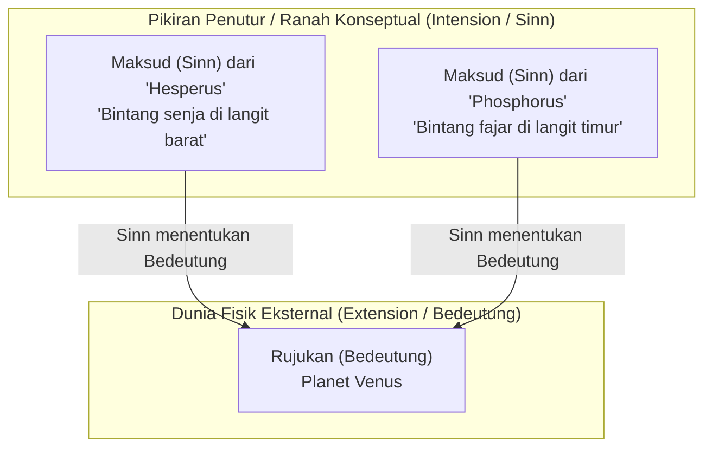
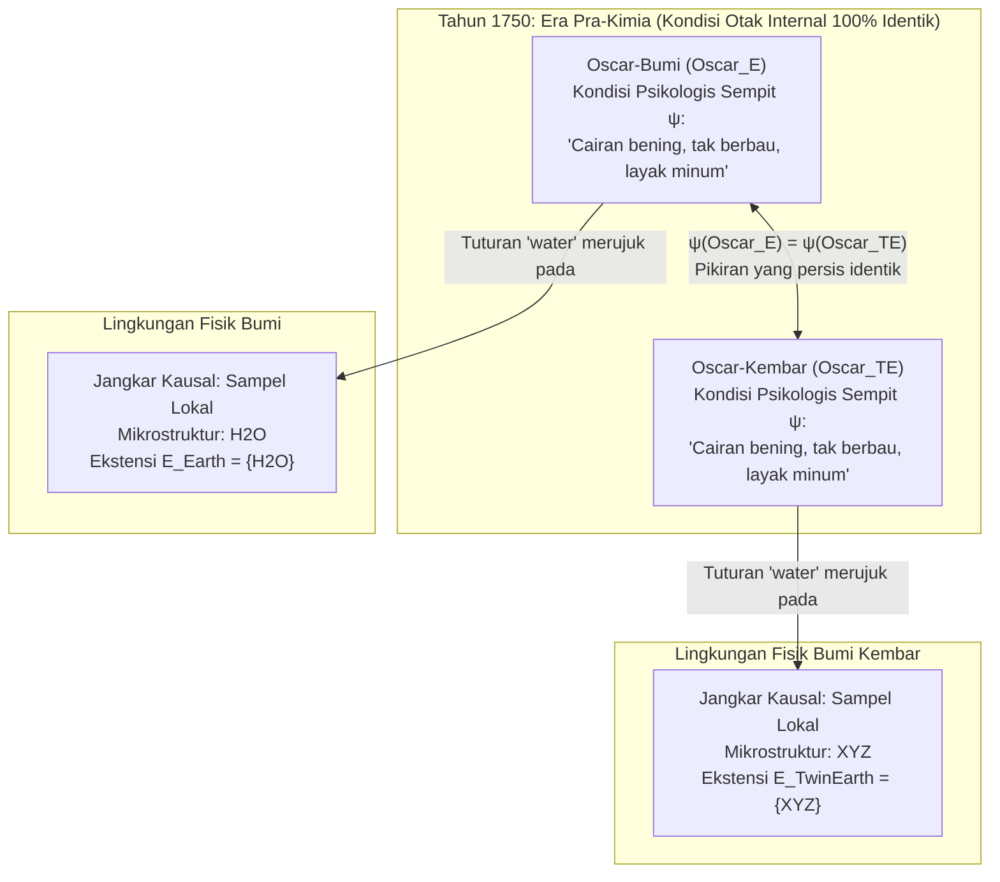

## 1. Pendahuluan: Di Mana Letak "Makna" Sebuah Kata?

Ketika kita mengucapkan kata-kata sehari-hari seperti *"air"*, *"emas"*, atau *"Aristoteles"*, bagaimana gelombang suara atau goresan tinta tersebut mampu melampaui batas pikiran kita untuk menunjuk secara tepat pada zat kimia atau tokoh sejarah tertentu di alam semesta fisik?

Sejak tesis John Locke pada abad ke-17 bahwa kata-kata adalah tanda dari "ide-ide di dalam pikiran penuturnya", hingga filsafat analitik Gottlob Frege, Bertrand Russell, Rudolf Carnap, dan John Searle pada abad ke-20, filsafat bahasa didominasi oleh ortodoksi yang sangat intuitif: <strong>Internalisme Semantik</strong> dan <strong>Deskriptivisme</strong>. Menurut pandangan ini, memahami makna (intensi) sebuah kata hanyalah memiliki konsep atau daftar deskripsi pengidentifikasi di dalam kepala (otak atau kesadaran); dan kondisi mental internal itulah yang sepenuhnya menentukan objek mana di dunia luar yang menjadi rujukan (ekstensi) kata tersebut.

Namun, pada awal dekade 1970-an, dua karya revolusioner meruntuhkan bangunan klasik ini: kuliah Saul Kripke <strong>*Naming and Necessity* (1972/1980)</strong> dan esai monumental Hilary Putnam <strong>*"The Meaning of 'Meaning'"* (1975)</strong>.

Melalui <strong>Eksperimen Pikiran Bumi Kembar (Twin Earth: $\text{H}_2\text{O}$ vs. $\text{XYZ}$)</strong> yang terkenal, Putnam membuktikan sebuah paradoks mencengangkan: pada tahun 1750 (sebelum kimia modern ditemukan), seorang penutur di Bumi (Oscar) dan duplikat molekul-demi-molekulnya di Bumi Kembar (Oscar Kembar) dapat berada dalam <strong>kondisi psikologis dan neurofisiologis sempit yang 100% identik</strong>, namun ketika mereka mengucapkan kata *"air" (water)*, kata tersebut merujuk pada zat kimia yang sama sekali berbeda ($\text{H}_2\text{O}$ vs. $\text{XYZ}$) dan karena itu memiliki makna yang berbeda! Sebagaimana disimpulkan Putnam dalam kalimat legendarisnya:

> <strong>"Potonglah kue itu sesuka Anda, 'makna' sama sekali tidak berada di dalam kepala! (Cut the pie any way you like, 'meanings' just ain't in the head!)"</strong>

Artikel ini menelusuri pergeseran paradigma dari deskriptivisme klasik (Frege, Russell, Searle) menuju <strong>designator kaku (rigid designators)</strong> dan <strong>kebenaran niscaya *a posteriori*</strong> Kripke, <strong>Bumi Kembar</strong> dan <strong>pembagian kerja linguistik</strong> Putnam, <strong>eksternalisme sosial</strong> Tyler Burge (eksperimen pikiran artritis), hingga implikasinya bagi <strong>Large Language Models (LLM)</strong> modern.

---

## 2. Tradisi Internalis dan Deskriptivis Klasik: Frege, Russell, dan Searle

### 2.1 Teka-teki Frege dan *"Über Sinn und Bedeutung"* (1892)

Pada tahun 1892, Gottlob Frege membuka makalah klasiknya *"Über Sinn und Bedeutung"* dengan mengajukan teka-teki tentang pernyataan identitas (<strong>Teka-teki Frege</strong>). Bandingkan dua kalimat berikut:

1. <strong>$a = a$: "Hesperus adalah Hesperus"</strong> ("Bintang Kejora adalah Bintang Kejora").
2. <strong>$a = b$: "Hesperus adalah Phosphorus"</strong> ("Bintang Senja adalah Bintang Fajar").

Secara astronomis, baik `"Hesperus"` maupun `"Phosphorus"` merujuk pada benda langit fisik yang persis sama, yaitu planet <strong>Venus</strong>:

$$\llbracket \text{Hesperus} \rrbracket = \llbracket \text{Phosphorus} \rrbracket = \text{Venus}$$

Jika makna sebuah nama hanya terdiri dari <strong>rujukan / ekstensinya (*Bedeutung*)</strong> di dunia luar, maka kalimat $a = b$ seharusnya memiliki nilai kognitif yang sama dengan tautologi trivial $a = a$. Padahal, $a = a$ adalah kebenaran analitik <strong>*a priori*</strong>, sedangkan $a = b$ merupakan penemuan astronomis empiris <strong>*a posteriori*</strong> yang sangat informatif.

Untuk memecahkan teka-teki ini, Frege membagi dimensi semantik menjadi dua tingkatan:
- <strong>Rujukan / Ekstensi (*Bedeutung* / Reference)</strong>: objek nyata di dunia fisik (planet Venus).
- <strong>Maksud / Intensi (*Sinn* / Sense)</strong>: <strong>"cara penyajian" (*Art des Gegebenseins*)</strong> objek tersebut—kriteria konseptual yang ditangkap oleh pikiran penutur (*benda langit paling terang di ufuk barat saat senja* vs. *di ufuk timur saat fajar*).

Menurut Frege, penutur memahami sebuah kata dengan menangkap *Sinn*-nya di dalam pikiran, dan <strong>*Sinn* secara unik menentukan *Bedeutung* (rujukan)</strong>.

### 2.2 Teori Deskripsi Pasti Russell (1905) dan Deskriptivisme Klaster Searle (1958)

Dalam *"On Denoting"* (1905), Bertrand Russell menganalisis <strong>deskripsi pasti (definite descriptions)</strong> berbentuk "sang $F$ adalah $G$" ($\iota x\, F(x)$) melalui kuantifikasi eksistensial dan syarat ketunggalan dalam logika predikat orde pertama:

$$\text{The } F \text{ is } G \iff \exists x \Big( F(x) \land \forall y \big(F(y) \to y = x\big) \land G(x) \Big)$$

Russell berpendapat bahwa nama diri biasa ("Aristoteles") dan istilah jenis alami ("air", "emas") sejatinya adalah <strong>deskripsi pasti yang terselubung atau disingkat</strong>. Kemudian, John Searle (1958) mengajukan <strong>Deskriptivisme Klaster (Cluster Descriptivism)</strong>: sebuah nama diasosiasikan dengan sekelompok (klaster) deskripsi berbobot $\{D_1, D_2, \dots, D_n\}$ di kepala penutur, dan merujuk pada objek $x$ yang memenuhi mayoritas berbobot yang memadai dari deskripsi tersebut:

$$\llbracket N \rrbracket = \iota x \left( \sum_{i=1}^{n} w_i \cdot \mathbb{I}\big[D_i(x)\big] \ge \theta \right)$$

### 2.3 Dua Dogma Fundamental Semantik Tradisional: (A1) dan (A2)

Hilary Putnam merangkum seluruh tradisi klasik ini ke dalam dua asumsi dasar:

- <strong>Asumsi (A1) Solipsisme Metodologis</strong>: Mengetahui makna (intensi $I(t)$) suatu istilah $t$ sepenuhnya berarti berada dalam <strong>kondisi psikologis sempit ($\psi \in \mathcal{S}_{\text{narrow}}$)</strong> di dalam kepala penutur (tanpa mengandaikan apa pun tentang dunia luar).
- <strong>Asumsi (A2) Intensi Menentukan Ekstensi</strong>: Intensi mental $I(t)$ secara unik menentukan ekstensi $E(t)$ di dunia:

$$\psi(S_1, t) = \psi(S_2, t) \stackrel{\text{(A1)}}{\implies} I_1(t) = I_2(t) \stackrel{\text{(A2)}}{\implies} E_1(t) = E_2(t)$$

---

## 3. Saul Kripke dan *Naming and Necessity*: Designator Kaku dan Teori Kausal

### 3.1 Eksperimen Pikiran Gödel / Schmidt dan Bantahan terhadap Deskriptivisme

Saul Kripke menghancurkan deskriptivisme melalui tiga argumen tajam:

1. <strong>Argumen Modal</strong>: Jika "Aristoteles" bersinonim dengan "guru Aleksander Agung", maka di dunia mungkin kontrafaktual $w'$ di mana Aristoteles tidak pernah mengajar Aleksander, pernyataan benar $\Diamond(\neg \text{Taught}(\text{Aristotle}, \text{Alexander}))$ akan menjadi kontradiktif.
2. <strong>Argumen Epistemik & Semantik — Kasus Gödel / Schmidt</strong>:
   Misalkan satu-satunya deskripsi yang diketahui penutur awam tentang "Kurt Gödel" adalah $D_{\text{Gödel}} =$ <strong>"orang yang membuktikan Teorema Ketidaklengkapan aritmetika"</strong>. Bayangkan bahwa sebenarnya seorang matematikawan Wina bernama <strong>Schmidt</strong> yang membuktikan teorema itu namun wafat secara misterius, lalu <strong>Gödel</strong> mencuri naskahnya dan menerbitkannya atas namanya sendiri.
   Menurut deskriptivisme, karena Schmidt adalah satu-satunya orang yang memenuhi $D_{\text{Gödel}}$ ($\iota x\, D_{\text{Gödel}}(x) = \text{Schmidt}$), ketika kita menyebut "Gödel", kita sebenarnya merujuk pada <strong>Schmidt</strong>! Kripke menunjukkan betapa absurdnya hal ini: ketika kita mengatakan "Gödel", kita jelas merujuk pada <strong>Gödel itu sendiri</strong> (dan kita akan berkata: *"Gödel tidak membuktikan teorema itu, ia mencurinya dari Schmidt!"*). Deskripsi di dalam kepala tidak menentukan rujukan.

### 3.2 Designator Kaku (Rigid Designators) dan Teori Rujukan Kausal-Historis

Dalam semantik dunia mungkin $\mathcal{M} = \langle \mathcal{W}, \mathcal{D}, w_0, \mathcal{I} \rangle$, Kripke mendefinisikan:

- <strong>Designator Tak-Kaku (Non-Rigid Designator)</strong>: Deskripsi pasti seperti "penemu kacamata bifokal" merujuk pada individu berbeda di dunia mungkin yang berbeda (Benjamin Franklin di $w_0$, Thomas Edison di $w_1$).
- <strong>Designator Kaku (Rigid Designator)</strong>: Sebuah designator $d_{\text{rigid}}$ bersifat <strong>kaku</strong> jika dan hanya jika ia menunjuk <strong>objek yang persis sama $o_{\text{actual}}$ di setiap dunia mungkin $w \in \mathcal{W}$</strong> tempat objek tersebut ada:
  $$\forall w \in \mathcal{W}, \quad \llbracket d_{\text{rigid}} \rrbracket_w = \llbracket d_{\text{rigid}} \rrbracket_{w_0} = o_{\text{actual}}$$

Nama diri ("Aristoteles", "Hesperus") dan istilah jenis alami ("air", "emas", "harimau") adalah <strong>designator kaku</strong>. Rujukannya ditetapkan melalui (1) <strong>Pembaptisan Awal (Initial Baptism)</strong> lewat penunjukan langsung (ostensi) dan (2) <strong>Rantai Komunikasi Kausal-Historis ($S_0 \to S_1 \to \dots \to S_n$)</strong> di dalam komunitas bahasa.

### 3.3 Runtuhnya Dogma Kantian: Kebenaran Niscaya *A Posteriori*

Karena "Hesperus" dan "Phosphorus", serta "Air" dan "$\text{H}_2\text{O}$", adalah designator kaku, identitas mereka yang ditemukan secara empiris di dunia aktual $w_0$ berlaku secara niscaya di <strong>semua dunia mungkin</strong>:

$$(\text{Air} = \text{H}_2\text{O}) \implies \Box(\text{Air} = \text{H}_2\text{O}), \quad (\text{Hesperus} = \text{Phosphorus}) \implies \Box(\text{Hesperus} = \text{Phosphorus})$$

Kripke memisahkan keniscayaan metafisik ($\Box$) dari keapriorian epistemik, membuktikan adanya <strong>kebenaran niscaya *a posteriori*</strong>.

---

## 4. Eksperimen Pikiran Bumi Kembar Hilary Putnam (1975)

### 4.1 Bumi dan Bumi Kembar pada Tahun 1750: $\text{H}_2\text{O}$ vs. $\text{XYZ}$

Dalam *"The Meaning of 'Meaning'"* (1975), Putnam merancang skenario terkenal <strong>Bumi Kembar (Twin Earth)</strong>:

1. <strong>Identitas Makroskopis dan Psikologis</strong>: Bumi Kembar identik secara makroskopis dengan Bumi. Setiap penduduk Bumi seperti <strong>Oscar-Bumi ($\text{Oscar}_E$)</strong> memiliki duplikat persis <strong>Oscar-Kembar ($\text{Oscar}_{TE}$)</strong> dengan kondisi otak dan pengalaman subjektif yang identik.
2. <strong>Satu-satunya Perbedaan Kimia Mikroskopis</strong>: Di <strong>Bumi</strong>, cairan bening, tak berbau, dan penghilang dahaga yang disebut `"water"` di sungai dan lautan memiliki rumus kimia <strong>$\text{H}_2\text{O}$</strong>. Di <strong>Bumi Kembar</strong>, cairan yang secara makroskopis tak terbedakan dan disebut `"water"` <strong>bukanlah $\text{H}_2\text{O}$</strong>, melainkan senyawa kimia berbeda yang disingkat <strong>$\text{XYZ}$</strong>!
3. <strong>Memutar Waktu ke Tahun 1750</strong>: Sebelum Lavoisier dan Dalton menemukan kimia modern, tak seorang pun di Bumi maupun Bumi Kembar mengetahui tentang $\text{H}_2\text{O}$ atau $\text{XYZ}$. Pada tahun 1750, $\text{Oscar}_E$ dan $\text{Oscar}_{TE}$ berada dalam <strong>kondisi psikologis sempit yang 100% identik</strong>:

$$\text{State}_{\text{narrow}}\big(\text{Oscar}_E, 1750\big) \equiv \text{State}_{\text{narrow}}\big(\text{Oscar}_{TE}, 1750\big)$$

### 4.2 Mengapa $\text{XYZ}$ Adalah "Air Palsu" dan Runtuhnya (A1) & (A2)

Pada tahun 1750, apakah kata `"water"` memiliki ekstensi yang sama di mulut $\text{Oscar}_E$ dan $\text{Oscar}_{TE}$? <strong>Tentu saja tidak!</strong>
Istilah jenis alami `"water"` mengandung komponen <strong>indeksikal</strong> implisit: ia menunjuk zat apa pun yang memiliki relasi $\text{same}_L$ (mikrostruktur cairan yang sama) dengan sampel cairan *ini* di sekitar kita:

$$\forall x, \quad x \in \llbracket \text{water} \rrbracket_{\text{Earth}} \iff \text{same}_L\big(x, \text{sample}_{\text{Earth}}\big) \iff \text{Microstructure}(x) = \text{H}_2\text{O}$$
$$\forall x, \quad x \in \llbracket \text{water} \rrbracket_{\text{TwinEarth}} \iff \text{same}_L\big(x, \text{sample}_{\text{TwinEarth}}\big) \iff \text{Microstructure}(x) = \text{XYZ}$$

Sama seperti <strong>pirit besi ($\text{FeS}_2$, "emas palsu / Fool's Gold")</strong> tidak pernah merupakan emas asli ($\text{Au}$) bahkan di zaman kuno, $\text{XYZ}$ di Bumi Kembar bukanlah air, melainkan <strong>"air palsu" (Fool's Water)</strong>.

Karena $\psi(\text{Oscar}_E) = \psi(\text{Oscar}_{TE})$ tetapi ekstensinya berbeda ($\{\text{H}_2\text{O}\} \neq \{\text{XYZ}\}$), asumsi (A1) dan (A2) tidak mungkin keduanya benar: <strong>makna tidak berada di dalam kepala!</strong>

---

## 5. Pembagian Kerja Linguistik, Eksternalisme Sosial Burge, dan AI (LLM)

### 5.1 Pembagian Kerja Linguistik (Pohon Elm vs. Beech) dan Vektor Makna Putnam

Putnam mengakui bahwa ia tidak bisa membedakan <strong>pohon Elm (*Ulmus*)</strong> dari <strong>pohon Beech (*Fagus*)</strong>: konsep internalnya tentang `"elm"` dan `"beech"` identik ($\psi(\text{Putnam}, \text{``elm''}) = \psi(\text{Putnam}, \text{``beech''})$). Namun kata `"elm"` miliknya tetap merujuk secara eksklusif pada pohon elm berkat <strong>pembagian kerja linguistik (Division of Linguistic Labor)</strong>: penutur awam menyerahkan penentuan ekstensi yang presisi kepada <strong>para ahli</strong> (ahli botani, kimiawan) di komunitasnya.

Putnam merepresentasikan makna kata sebagai <strong>Vektor Makna (Meaning Vector)</strong> empat komponen:

$$\vec{M}(\text{``water''}) = \big\langle \text{Penanda Sintaksis},\, \text{Penanda Semantik},\, \text{Stereotip},\, \text{Ekstensi} \big\rangle$$

### 5.2 Eksternalisme Sosial Tyler Burge (1979): Eksperimen Pikiran "Artritis"

Dalam *"Individualism and the Mental"* (1979), <strong>Tyler Burge</strong> membuktikan bahwa bahkan isi <strong>keyakinan mental (beliefs)</strong> kita bersifat eksternal:
- <strong>Bert (dunia nyata)</strong> yakin: *"Artritis saya telah menyebar ke paha saya"*. Karena artritis secara medis didefinisikan hanya sebagai peradangan <strong>sendi</strong>, Bert memiliki <strong>keyakinan yang salah</strong> tentang artritis.
- <strong>Bert Kembar (dunia kontrafaktual)</strong> memiliki sejarah fisik dan kondisi otak yang 100% sama, tetapi di komunitasnya para dokter menggunakan `"arthritis"` (konsep `tharthritis`) untuk mencakup nyeri rematik di <strong>otot paha</strong>. Keyakinan Bert Kembar <strong>benar</strong>!
- Dua keyakinan dengan nilai kebenaran berlawanan tidak mungkin merupakan pikiran yang sama: <strong>pikiran kita sendiri diindividuasi oleh lingkungan sosial!</strong>

### 5.3 Implikasi bagi Large Language Models (LLM) dan Symbol Grounding

LLM yang dilatih hanya pada teks melalui prediksi token berikutnya $P_\theta(w_t \mid w_{1:t-1})$ menguasai <strong>stereotip</strong> (komponen ke-3 Putnam) dengan sangat baik. Seperti ditunjukkan oleh <strong>Uji Gurita Bender & Koller (2020)</strong> dan <strong>Otak dalam Bejana Putnam (1981)</strong>, rujukan tidak berada secara intrinsik di dalam bobot $\Theta$ jaringan saraf. Akan tetapi, karena korpus pelatihan ditulis oleh manusia yang berinteraksi secara kausal dengan $\text{H}_2\text{O}$ nyata dan dunia fisik, LLM terhubung ke dalam <strong>rantai kausal-historis</strong> dan <strong>pembagian kerja linguistik</strong> masyarakat manusia, sehingga memperoleh <strong>rujukan turunan / parasitik</strong>.

| Dimensi | Internalisme Klasik & Deskriptivisme (Frege, Russell, Searle) | Eksternalisme Semantik & Sosial (Kripke, Putnam, Burge) |
| :--- | :--- | :--- |
| <strong>Tesis Utama</strong> | Makna (intensi) adalah deskripsi mental di dalam kepala dan menentukan ekstensi. | <strong>"Makna tidak berada di dalam kepala."</strong> Rujukan dan isi pikiran ditentukan oleh lingkungan fisik dan sosial. |
| <strong>Nama Diri & Jenis Alami</strong> | Deskripsi pasti yang disingkat atau klaster (designator tak-kaku). | <strong>Designator Kaku</strong> ($\forall w \in \mathcal{W}, \llbracket d \rrbracket_w = o_{\text{actual}}$) yang menunjuk esensi yang sama di semua dunia mungkin. |
| <strong>Kasus Gödel / Schmidt</strong> | Memprediksi secara keliru bahwa "Gödel" merujuk pada Schmidt. | Merujuk secara tepat pada Gödel melalui rantai kausal-historis. |
| <strong>Bumi Kembar Tahun 1750</strong> | Kondisi otak identik $\implies$ makna dan ekstensi identik. | Meski otak 100% identik, `"water"` di Bumi merujuk $\text{H}_2\text{O}$ dan di Bumi Kembar merujuk $\text{XYZ}$. |
| <strong>Modalitas & Epistemologi</strong> | Niscaya $\iff$ *a priori*; "Air $=\text{H}_2\text{O}$" dianggap kontingen. | Membuktikan <strong>kebenaran niscaya *a posteriori*</strong>: $\Box(\text{Air} = \text{H}_2\text{O})$, $\Box(\text{Hesperus} = \text{Phosphorus})$. |
