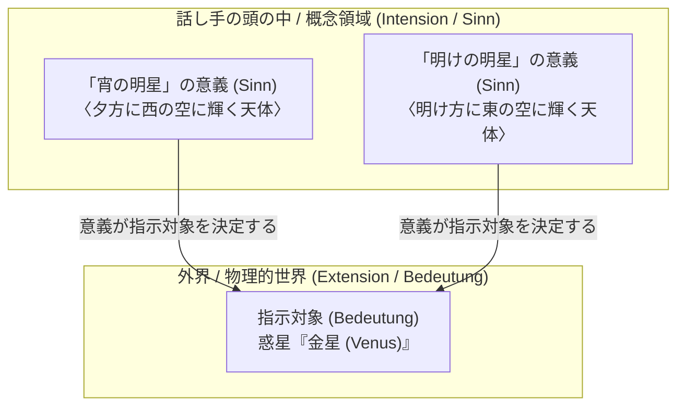
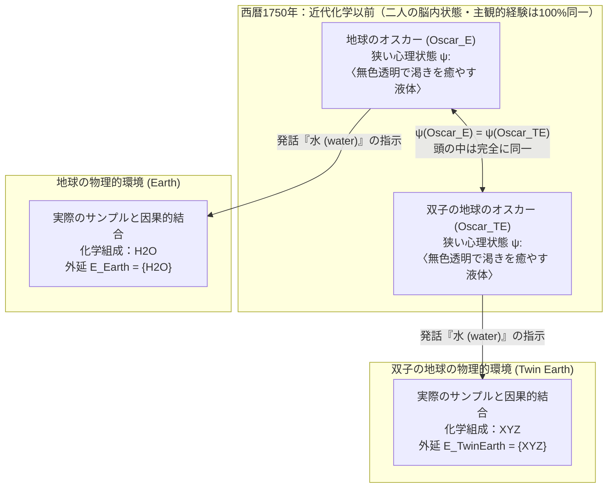

## 1. 導入：「言葉の意味」はどこにあるのか？

私たちが日常の中で「水（water）」「金（gold）」「アリストテレス（Aristotle）」といった言葉を発するとき、なぜその言葉は世界の中の特定の物質や人物を正確に指し示す（指示する）ことができるのだろうか。

17世紀のジョン・ロック（John Locke）による「言葉とは話し手の心の中にある観念（Ideas）の記号である」というテーゼ以来、近代哲学および20世紀前半の分析哲学においては、長らく一つの強固な常識が支配していた。それは、<strong>「言葉の意味を理解するとは、話し手の頭（心・脳）の中に特定の概念や記述的ルールを保持していることであり、その頭の中の意味が、外界のどの対象を指示するかを決定する」</strong>という見解である。哲学においてこの立場は<strong>意味の内在主義（Semantic Internalism）</strong>あるいは<strong>記述主義（Descriptivism）</strong>と呼ばれる。

たとえば、「水」という言葉の意味が私の頭の中にある「無色透明で、無味無臭で、渇きを癒やし、雨として降り、川や海を満たす液体」という概念リスト（記述）によって定義されているとしよう。もしそうなら、私が宇宙のどこへ行こうとも、そのチェックリストをすべて満たす液体に出会えば、それは定義上「水」であるはずだ。逆に言えば、私の脳の状態（ニューロンの発火パターンや主観的な意識体験）が今と寸分違わず同じである限り、私が「水」という言葉で意味しているものは決して変わらないはずである。

ところが1970年代初頭、ソール・クリプキ（Saul Kripke）の講演録『名指しと必然性（*Naming and Necessity*）』と、ヒラリー・パトナム（Hilary Putnam）の記念碑的論文『「意味」の意味（*The Meaning of "Meaning"*）』が相次いで発表されたことで、この数百年来の常識は根底から覆された。

パトナムは<strong>「双子の地球（Twin Earth）」</strong>という思考実験を通じて、驚くべき結論を導き出した。西暦1750年（近代化学が誕生する前）、地球に住むオスカーと、「双子の地球」に住む彼の分子レベルのコピーである双子のオスカーは、<strong>脳の内部状態も、主観的なイメージも、持っている知識も100%完全に同一であるにもかかわらず、二人が発する「水」という語はまったく異なる対象を指示しており、したがって異なる意味を持っている</strong>というのである。パトナムはこれを次の有名な一文で総括した。

> <strong>「パイをどう切り分けようとも、『意味』は頭の中にはないのだ！（"Cut the pie any way you like, 'meanings' just ain't in the head!"）」</strong>

本稿では、ゴットロープ・フレーゲの「意義と指示対象」およびバートランド・ラッセルの「確定記述理論」という古典的意味論の枠組みを数理的・論理的に整理した上で、クリプキの<strong>固定指示子（Rigid Designator）</strong>と<strong>ア・ポステリオリな必然的真理</strong>、パトナムの<strong>「双子の地球」思考実験（$\text{H}_2\text{O}$ と $\text{XYZ}$）</strong>と<strong>言語的労働の分業</strong>、タイラー・バージの<strong>社会的外在主義（関節炎の思考実験）</strong>、そして現代の<strong>大規模言語モデル（LLM）における記号接地問題（Symbol Grounding Problem）</strong>に至るまで、言語哲学と心の哲学における最大のパラダイムシフトを徹底的に解き明かす。

---

## 2. 古典的意味論と記述主義の伝統：フレーゲ、ラッセル、サール

クリプキとパトナムがいかに革命的であったかを理解するためには、まず彼らが打ち壊した標的——すなわちフレーゲとラッセルによって築かれた<strong>古典的記述主義（Classical Descriptivism）</strong>の精緻な体系を理解しなければならない。

### 2.1 フレーゲのパズルと「意義（Sinn）と指示対象（Bedeutung）」

1892年、近代論理学の父ゴットロープ・フレーゲ（Gottlob Frege）は、論文『意義と指示対象について（*Über Sinn und Bedeutung*）』の冒頭で、同一性言明（Identity Statement）に関する深刻なパズルを提示した。これを<strong>フレーゲのパズル（Frege's Puzzle）</strong>と呼ぶ。

次の二つの文を比較してみよう。

1. <strong>$a = a$：「宵の明星は宵の明星である（Hesperus is Hesperus）。」</strong>
2. <strong>$a = b$：「宵の明星は明けの明星である（Hesperus is Phosphorus）。」</strong>

もし固有名の意味（意味論的価値）が、その名前が指し示す現実世界の<strong>指示対象（Bedeutung / Reference：外延）</strong>そのものに尽きると仮定してみよう（これを素朴な直接指示理論あるいはミル主義と呼ぶ）。天文学的に言えば、「宵の明星（夕方、西の空に輝く星）」も「明けの明星（明け方、東の空に輝く星）」も、ともに同じ太陽系の惑星である<strong>金星（Venus）</strong>を指している。すなわち、指示対象としては完全に同一である。

$$\llbracket \text{宵の明星 (Hesperus)} \rrbracket = \llbracket \text{明けの明星 (Phosphorus)} \rrbracket = \text{金星 (Venus)}$$

もし言葉の意味が指示対象だけで決まるなら、「宵の明星」という表現を同じ指示対象を持つ「明けの明星」に置き換えても、文全体の意味や認識的価値（Erkenntniswert）は変わらないはずである。しかし実際には、<strong>(1)「宵の明星は宵の明星である」</strong>は経験的調査を一切必要としない自明な同語反復（ア・プリオリかつ分析的な真理）であるのに対し、<strong>(2)「宵の明星は明けの明星である」</strong>は古代バビロニアの天文学者が精密な天体観測の末にようやく突き止めた、情報量豊かな経験的発見（ア・ポステリオリかつ総合的な真理）である。

このパズルを解決するために、フレーゲは記号の意味論的側面に二つの階層を導入した。

- <strong>指示対象（Bedeutung / Reference / Extension）</strong>：その表現が世界の中で指し示す対象そのもの（この場合は惑星としての「金星」）。
- <strong>意義（Sinn / Sense / Intension）</strong>：その対象が提示される仕方、すなわち<strong>「対象の与えられ方（Art des Gegebenseins）」</strong>。「宵の明星」の意義は〈日没後に西の空で最も明るく輝く天体〉という概念的規定であり、「明けの明星」の意義は〈日の出前に東の空で最も明るく輝く天体〉という概念的規定である。

フレーゲによれば、話し手は語を学ぶとき、その語の<strong>意義（Sinn）</strong>を心の中で把握（fassen）する。そして、この<strong>意義こそが、世界のどの対象が指示対象（Bedeutung）であるかを一意に決定する関数</strong>として働く。同じ頂点（指示対象＝金星）に到達するにも、西側の登山道（宵の明星という意義）から登るか、東側の登山道（明けの明星という意義）から登るかによって「与えられ方」が異なるため、二つの登山道が同じ山頂に通じているという事実（$a = b$）は実質的な新知識となるのである。

### 2.2 ラッセルの確定記述理論とサールのクラスター記述理論

フレーゲの考え方をさらに論理的に徹底させたのが、1905年のバートランド・ラッセル（Bertrand Russell）の論文『表示について（*On Denoting*）』における<strong>確定記述理論（Theory of Definite Descriptions）</strong>である。

ラッセルは、「現在のフランス王は禿げている（The present King of France is bald）」のような、「その〜（The $F$ / $\iota x\, F(x)$）」という確定記述句を含む文を、単称命題ではなく一階述語論理の<strong>存在量化と一意性条件</strong>へと還元した。すなわち、「その $F$ は $G$ である」という文の論理形式は次の三つの連言として分析される。

$$\text{The } F \text{ is } G \iff \exists x \Big( F(x) \land \forall y \big(F(y) \to y = x\big) \land G(x) \Big)$$

1. 少なくとも一つのものが属性 $F$ を持つ（存在条件：$\exists x\, F(x)$）。
2. 高々一つのものしか属性 $F$ を持たない（一意性条件：$\forall y(F(y) \to y = x)$）。
3. そのものは属性 $G$ を持つ（述定条件：$G(x)$）。

その上でラッセルは、私たちが日常使う<strong>普通の固有名（Ordinary Proper Names）</strong>——たとえば「アリストテレス」「ソクラテス」「ビスマルク」——は、論理的な意味での真の固有名ではなく、実は<strong>「隠された確定記述（Disguised / Abbreviated Definite Descriptions）」</strong>にすぎないと主張した。つまり、私が「アリストテレス」と言うとき、その語の意味は私の心の中にある「プラトンの弟子であり、アレクサンドロス大王の家庭教師であり、『形而上学』を書いた古代ギリシアの哲学者」といった確定記述 $\iota x\, D(x)$ と同義なのである。

後にルートヴィヒ・ウィトゲンシュタイン（『哲学探究』）やジョン・サール（John Searle, 1958年『固有名』）は、単一の記述に頼ると不都合が生じることに気づいた。もし「アリストテレス」が「アレクサンドロス大王の教師」という単一の記述と同義なら、「アリストテレスはアレクサンドロス大王の教師だった」という歴史的事実の文が、単なる定義上の同語反復（分析命題）になってしまうからである。そこでサールは<strong>クラスター記述理論（Cluster Theory of Descriptions）</strong>を提唱した。

サールによれば、固有名や自然種語（「水」「金」など）は、単一の記述ではなく、<strong>記述の束（クラスター） $\{D_1, D_2, \dots, D_n\}$</strong> と結びついており、それぞれの記述に重み $w_i$ が与えられている。そして、世界の中でその記述の束の<strong>「十分な重み付き多数（Sufficient weighted majority）」</strong>を満たす対象 $x$ が、その語の指示対象として決定される。

$$\llbracket N \rrbracket = \iota x \left( \sum_{i=1}^{n} w_i \cdot \mathbb{I}\big[D_i(x)\big] \ge \theta \right)$$

この考え方によれば、自然種語である<strong>「水（water）」</strong>もまったく同様に分析される。「水」という語の意味（内包）とは、話し手の心の中にある〈無色である〉〈透明である〉〈無味無臭である〉〈渇きを癒やす〉〈雨として空から降り、川や湖を満たす〉〈沸点 $100^\circ\text{C}$、融点 $0^\circ\text{C}$ の液体である〉という記述のクラスターであり、世界のどこであれ、このクラスター条件を満たす液体が「水」の外延（指示対象）となる。

### 2.3 伝統的意味論の「二つのドグマ」：(A1) と (A2)

ヒラリー・パトナムは、フレーゲ、ラッセル、ルドルフ・カルナップ（Rudolf Carnap）らに連なるこの伝統的意味論の骨格を、<strong>「内包（Intension：概念的意味）」</strong>と<strong>「外延（Extension：指示対象の集合）」</strong>に関する次の<strong>二つの基本前提（Assumptions）</strong>として鮮やかに定式化した。

- <strong>前提 (A1) 方法論的独我論（Methodological Solipsism / 内在主義）</strong>：
  ある語 $t$ の意味（内包 $I(t)$）を理解しているということは、<strong>狭い意味での心理状態（Narrow psychological state $\psi \in \mathcal{S}_{\text{narrow}}$）</strong>にあることにほかならない。ここで「狭い心理状態」とは、デカルトの方法的懐疑のように、話し手の身体や脳の外部にどのような物理的世界が存在するか（あるいは外界がまったく存在しないか）という事実から完全に独立して、話し手の頭の中（脳内・主観的意識内）だけで完結して規定される状態を指す。
- <strong>前提 (A2) 内包は外延を決定する（Intension Determines Extension）</strong>：
  語の意味（内包 $I(t)$）は、その語の外延 $E(t)$（指示対象）を一意に決定する。したがって、もし二つの語（あるいは二人の話し手が使う同じ語）がまったく同じ内包を持つならば、それらは必然的にまったく同じ外延を持たなければならない。

この (A1) と (A2) を連立させると、直ちに次の系（Corollary）が導かれる。

$$\psi(S_1, t) = \psi(S_2, t) \stackrel{\text{(A1)}}{\implies} I_1(t) = I_2(t) \stackrel{\text{(A2)}}{\implies} E_1(t) = E_2(t)$$

すなわち、<strong>「もし二人の話し手 $S_1$ と $S_2$ の頭の中の状態（狭い心理状態 $\psi$）が完全に同一であるならば、二人が発する語 $t$ の指示対象（外延 $E$）も絶対に異なってはならない」</strong>。これは一見すると、反論の余地がないほど自明な原理に見える。頭の中が100%同じである二人が、同じ「水」という音を発しながら、異なるものを意味していることなどあり得るだろうか？

しかし、まさにこの一見盤石な土台こそが、クリプキとパトナムによって粉々に打ち砕かれることになる。

---

## 3. クリプキ『名指しと必然性』：固定指示子と因果的指示理論

1970年1月、当時わずか29歳だったソール・クリプキは、プリンストン大学で3回にわたる連続講演を行い、原稿なしで語り下ろした内容が後に『名指しと必然性（*Naming and Necessity*）』として出版された。クリプキはここで、自分が開拓した<strong>様相論理の可能世界意味論（Possible Worlds Semantics）</strong>を武器に、フレーゲ＝ラッセル＝サールの記述主義に対して三つの方向から壊滅的な批判を加えた。

### 3.1 記述主義を粉砕する三つの論証（様相的・認識的・意味論的論証）

#### (1) 様相的論証（The Modal Argument）
もし「アリストテレス」という名前が、〈アレクサンドロス大王の教師であり、『形而上学』の著者である哲学者〉という記述（あるいはクラスター）と同義であるとしよう。
しかし、考えてみてほしい。アリストテレスは偶然の成り行きで、幼少期に病気で亡くなっていたかもしれないし、哲学に興味を持たず靴職人として一生を終え、アレクサンドロス大王を教えなかった可能性も十分にある。すなわち、次の反事実的条件文（可能世界に関する様相文）は明らかに<strong>真（True）</strong>である。

$$\Diamond \big(\neg \text{Taught}(\text{Aristotle}, \text{Alexander})\big)$$
（「アリストテレスはアレクサンドロス大王を教えなかったこともあり得た。」）

ところが、もし「アリストテレス」の意味が「アレクサンドロス大王を教えた人物」という記述であるならば、上の文は「アレクサンドロス大王を教えた人物が、アレクサンドロス大王を教えなかったこともあり得た」という自己矛盾（言表様相 *de dicto* における偽）に陥ってしまう。ある可能世界 $w'$ でアリストテレスが誰の教師にもならなかったとしても、その可能世界 $w'$ で哲学をやらなかったその人物は、依然として<strong>アリストテレス本人</strong>なのである。

#### (2) 認識的・意味論的論証：ゲーデルとシュミットの思考実験（The Gödel / Schmidt Case）
記述主義者はこう反論するかもしれない。「仮に他の可能世界での振る舞いが違ったとしても、少なくとも<strong>この現実世界 $w_0$ において誰が指示対象かを決定するため</strong>には、話し手の頭の中の記述が使われているはずだ」と。
これを打ち砕くためにクリプキが提示したのが、有名な<strong>「ゲーデルとシュミットの思考実験」</strong>である。

私たち一般の話し手が、数学者「クルト・ゲーデル（Kurt Gödel）」について知っている唯一の知識（記述）が、$D_{\text{Gödel}} =$ <strong>〈算術の不完全性定理を証明した人物〉</strong>だけであるとしよう（彼の生年月日も顔も住んでいた場所も知らないとする）。
さて、実は歴史の裏に次のような隠された真相があったと想像してみよう。実際には、ウィーンに住む<strong>「シュミット（Schmidt）」</strong>という無名の天才数学者が独力で不完全性定理の証明を完成させたのだが、発表直前に謎の死を遂げた。友人の<strong>「ゲーデル」</strong>はその遺稿を偶然手に入れ、自分の名前で学会に発表し、不完全性定理の発見者としての世界的な名声を得たのだとする。

さて、この状況において、何も知らない私たちが「ゲーデルは偉大な論理学者だ」とか「ゲーデルはウィーンで生まれた」と言うとき、私たちの口にする<strong>「ゲーデル」という名前はいったい誰を指している（指示している）だろうか？</strong>

- <strong>記述主義（ラッセル・サール）の予測</strong>：私たちの頭の中で「ゲーデル」と結びついている唯一の識別記述は $D_{\text{Gödel}} =$〈不完全性定理を証明した人物〉である。そして現実世界において、この記述を一意に満たす人物は<strong>シュミット</strong>である（$\iota x\, D_{\text{Gödel}}(x) = \text{Schmidt}$）。したがって、記述主義が正しければ、私たちが「ゲーデル」と言うとき、私たちは実は<strong>シュミットのことを指して語っている</strong>ことになり、「ゲーデルは不完全性定理を証明した」という文は定義上真（実は「シュミットは不完全性定理を証明した」という意味）になってしまう！
- <strong>私たちの揺るぎない直観（クリプキの結論）</strong>：そんなはずはない！私たちが「ゲーデル」と言うとき、たとえ彼が定理を盗作した詐欺師であったとしても、私たちが指しているのは<strong>間違いなくゲーデル本人であり、断じてシュミットではない</strong>。実際、もしこの真相が発覚すれば、私たちは「なんと、<strong>ゲーデルは不完全性定理を証明していなかった</strong>（シュミットから盗んでいた）のか！」と驚くはずである。

この思考実験は決定的である。話し手の頭の中にある記述が、指示対象によって<strong>一つも満たされていなくても（偽であっても）</strong>、言葉は対象を正しく指示できるのである。逆に、見知らぬ他人がその記述を完璧に満たしていても、言葉がその見知らぬ他人を指すことはない。<strong>頭の中の記述は、指示対象を決定していないのだ。</strong>

### 3.2 固定指示子（Rigid Designator）の厳密な定義

では、固有名と確定記述の根本的な違いはどこにあるのか。クリプキは様相論理の<strong>可能世界意味論（Kripke Semantics）</strong>を用いて、<strong>固定指示子（Rigid Designator）</strong>という概念を導入した。

可能世界の集合を $\mathcal{W}$、現実世界を $w_0 \in \mathcal{W}$、各可能世界 $w \in \mathcal{W}$ における個体領域を $\mathcal{D}_w$ とし、表現 $d$ の可能世界 $w$ における外延（指示対象）を与える解釈関数を $\llbracket d \rrbracket_w$ と表記しよう。

- <strong>非固定指示子（Non-rigid / Accidental Designator：偶然的指示子）</strong>：
  「二焦点レンズの発明者（the inventor of bifocals）」や「合衆国第37代大統領」のような<strong>確定記述 $\iota x\, F(x)$</strong> は、評価される可能世界 $w$ ごとに、その世界でたまたま条件 $F$ を満たす異なる人物を指示する。現実世界 $w_0$ では二焦点レンズを発明したのはベンジャミン・フランクリンだが、別の可能世界 $w_1$ ではトーマス・エジソンが発明したかもしれない。
  $$\llbracket \text{二焦点レンズの発明者} \rrbracket_{w_0} = \text{Franklin} \neq \text{Edison} = \llbracket \text{二焦点レンズの発明者} \rrbracket_{w_1}$$

- <strong>固定指示子（Rigid Designator）</strong>：
  ある指示表現 $d$ が<strong>固定指示子</strong>であるとは、<strong>その対象が存在するすべての可能世界 $w \in \mathcal{W}$ において、常にまったく同一の対象 $o_{\text{actual}}$ を指示する</strong>ことである（さらに、対象が存在しない世界でも同じ対象を指す、あるいは他の何ものも指さないものを「強固な固定指示子」と呼ぶ）。
  $$\forall w \in \mathcal{W}, \quad \llbracket d_{\text{rigid}} \rrbracket_w = \llbracket d_{\text{rigid}} \rrbracket_{w_0} = o_{\text{actual}}$$

クリプキの核心的テーゼは、<strong>「自然言語における固有名（『アリストテレス』『金星』）および自然種語（『水』『金』『虎』『熱』）はすべて固定指示子である」</strong>というものである。

### 3.3 指示の因果・歴史的理論（Causal-Historical Theory of Reference）

頭の中の記述が指示を決定しないのだとすれば、なぜ私の発する「ゲーデル」や「アリストテレス」は、時空を超えて遠く離れた特定の人物を指すことができるのか？クリプキが記述主義に代わって提示したメカニズムが、<strong>指示の因果・歴史的理論（Causal-Historical Theory of Reference）</strong>である。これは二つの段階から構成される。

1. <strong>最初の命名儀式（Initial Baptism / 命名式）</strong>：
   まず最初に、対象に対して名前が与えられる。これは通常、対象を直接指し示す<strong>直示（Ostension）</strong>（「今ここにいるこの赤ん坊を『クルト・ゲーデル』と呼ぼう」「この目の前にある液体と同じ内的本性を持つ物質を『水』と呼ぼう」）か、あるいは参照固定のための記述によって行われる。
2. <strong>コミュニケーションの因果的連鎖（Causal Chain of Communication）</strong>：
   命名式に立ち会った話し手 $S_0$ から、その名前が別の話し手 $S_1$ へと伝えられ、さらに $S_1 \to S_2 \to \dots \to S_n$（現在の私）へと、社会的なコミュニケーションの歴史的・因果的ネットワークを通じてバトンのように受け渡されていく。このとき、受け手 $S_k$ は「私がこの名前を教わった先輩の話し手 $S_{k-1}$ が指していたのと同じ対象を、私も指すつもりでこの名前を使う」という語用論的意図（指示保持の意図）を持っていればよい。

私がゲーデルについて誤った記述〈不完全性定理の真の発見者〉しか持っていなくても、私の使う「ゲーデル」という語が、歴史的な因果の鎖を遡って1906年にブルノで生まれたクルト・ゲーデル本人の命名式へと繋がっているからこそ、私の言葉はゲーデル本人を固定的に指示するのである。

### 3.4 カント以来のドグマの崩壊：「ア・ポステリオリな必然的真理」

固定指示子の理論は、近代哲学の根幹にあった認識論と形而上学の分類図式に劇的な変革をもたらした。イマヌエル・カント（Immanuel Kant）から20世紀の論理実証主義（ウィーン学団）に至るまで、哲学者たちは次の二つの区別を事実上同一視していた。

- <strong>認識論的区別（どう知るか）</strong>：<strong>ア・プリオリ（A Priori：経験に先立って思考だけで知り得る）</strong> vs. <strong>ア・ポステリオリ（A Posteriori：経験的・科学的調査によってのみ知り得る）</strong>。
- <strong>形而上学的・様相的区別（どう在るか）</strong>：<strong>必然的真理（Necessary Truth, $\Box P$：すべての可能世界で真であり、偽であることがあり得ない）</strong> vs. <strong>偶然的真理（Contingent Truth, $\Diamond P \land \Diamond \neg P$：現実世界では真だが、別の可能世界では偽であり得た）</strong>。

従来の常識では、「すべての必然的真理はア・プリオリであり、すべてのア・ポステリオリな経験的真理は偶然的である」と信じられていた。たとえば、「宵の明星は明けの明星である（$\text{Hesperus} = \text{Phosphorus}$）」や「水は $\text{H}_2\text{O}$ である（$\text{Water} = \text{H}_2\text{O}$）」「熱とは分子運動の平均運動エネルギーである」といった科学的発見は、経験的観測によって初めてわかった<strong>ア・ポステリオリな真理</strong>であるため、当然「偶然的真理」だと考えられていたのである。

しかし、クリプキの論理はこれを鮮やかに覆す。

1. 「宵の明星（$a$）」と「明けの明星（$b$）」はどちらも固有名であり、<strong>固定指示子</strong>である。
2. 現実世界 $w_0$ において、経験的天文学の調査により、両者が同じ惑星（金星）を指していることが判明した（$\llbracket a \rrbracket_{w_0} = \llbracket b \rrbracket_{w_0} = \text{Venus}$）。
3. 固定指示子の定義により、すべての可能世界 $w \in \mathcal{W}$ において、$\llbracket a \rrbracket_w = \text{Venus}$ であり、かつ $\llbracket b \rrbracket_w = \text{Venus}$ である。
4. ゆえに、<strong>すべての可能世界 $w \in \mathcal{W}$ において $\llbracket a \rrbracket_w = \llbracket b \rrbracket_w$ が成り立つ！</strong> すなわち、
   $$\llbracket a = b \rrbracket_{w_0} = 1 \implies \forall w \in \mathcal{W},\, \llbracket a = b \rrbracket_w = 1 \implies \Box(\text{Hesperus} = \text{Phosphorus})$$

同様に、自然種語である「水」と化学式「$\text{H}_2\text{O}$」もともに固定指示子であるため、現実世界で水が $\text{H}_2\text{O}$ であるならば、<strong>いかなる可能世界においても水は必然的に $\text{H}_2\text{O}$ である（$\Box(\text{Water} = \text{H}_2\text{O})$）</strong>！もしある可能世界で $\text{H}_2\text{O}$ でない液体が湖を満たしていたとしても、それは「水が $\text{H}_2\text{O}$ でなくなった」のではなく、「水に似た別の物質がそこにある」にすぎない。

こうしてクリプキは、<strong>「ア・ポステリオリでありながら形而上学的に必然的な真理（Necessary A Posteriori Truths）」</strong>（および、「標準メートル原器 $S$ の長さは時刻 $t_0$ において1メートルである」のような<strong>「ア・プリオリでありながら偶然的な真理（Contingent A Priori Truths）」</strong>）が存在することを証明し、認識論と形而上学を切り離したのである。

---

## 4. ヒラリー・パトナムの「双子の地球（Twin Earth）」思考実験（1975年）

クリプキが主に固有名から出発して自然種語へと議論を広げたのに対し、1975年の論文『「意味」の意味（*The Meaning of "Meaning"*）』において、自然種語と心の哲学の観点から伝統的意味論の前提 (A1)・(A2) にとどめを刺したのが、ヒラリー・パトナムの<strong>「双子の地球（Twin Earth）」思考実験</strong>である。

### 4.1 思考実験の設定：地球と双子の地球（H2O と XYZ）

銀河系のどこか遥か彼方に、私たちの地球（Earth）とほぼ完全に瓜二つの惑星が存在すると想像してほしい。これを<strong>「双子の地球（Twin Earth）」</strong>と呼ぼう。

1. <strong>マクロな環境の完全な一致</strong>：
   双子の地球には、地球と同じ大陸や都市があり、人々も地球の英語と音韻論的・統語論的に寸分違わない「英語」を話している。さらに、地球に住むすべての人間——たとえば<strong>地球のオスカー（$\text{Oscar}_E$）</strong>——に対して、双子の地球には分子レベルで（身体の水分を除き、あるいは神経回路の機能的・現象的状態において）寸分違わないドッペルゲンガーである<strong>双子のオスカー（$\text{Oscar}_{TE}$）</strong>が存在し、まったく同じ人生履歴を歩んでいる。
2. <strong>唯一のミクロな化学的相違（$\text{H}_2\text{O}$ vs. $\text{XYZ}$）</strong>：
   地球と双子の地球の間には、ただ一つだけ決定的な違いがある。
   - <strong>地球（Earth）</strong>では、川や海や湖を満たし、空から雨として降り、無色透明・無味無臭で渇きを癒やし、常圧で $0^\circ\text{C}$ で凍り $100^\circ\text{C}$ で沸騰する、「水（water）」と呼ばれている液体の化学組成は <strong>$\text{H}_2\text{O}$</strong> である。
   - <strong>双子の地球（Twin Earth）</strong>では、川や海や湖を満たし、空から雨として降り、無色透明・無味無臭で渇きを癒やし、常圧・常温でマクロな物理的・感覚的性質が $\text{H}_2\text{O}$ とまったく区別がつかない、「水（water）」と呼ばれている液体の化学組成は、$\text{H}_2\text{O}$ ではなく、非常に複雑で異なる化学構造を持つ物質 <strong>$\text{XYZ}$</strong> である！

### 4.2 決定的な時間設定：なぜ時計を「西暦1750年」に戻すのか？

もし話が現代（たとえば2026年）であれば、地球のオスカーは学校で「水は $\text{H}_2\text{O}$ だ」と習っており、双子の地球のオスカーは「水は $\text{XYZ}$ だ」と習っているため、二人の頭の中の知識は異なっている。

そこでパトナムは、思考実験の時計の針を<strong>西暦1750年</strong>——アントワーヌ・ラボアジエやジョン・ドルトンによって近代原子論・分子化学が確立されるよりも前の時代——へと巻き戻す。

西暦1750年の時点では、<strong>地球の上の誰一人として水が $\text{H}_2\text{O}$ であることを知らず、双子の地球の上の誰一人として「水」が $\text{XYZ}$ であることを知らない</strong>。当時の科学技術では、両者の違いを検出する手段すら存在しない。
したがって、1750年における<strong>地球のオスカー（$\text{Oscar}_E$）</strong>と<strong>双子の地球のオスカー（$\text{Oscar}_{TE}$）</strong>が、コップに入った透明な液体を見て「水（water）を飲みたい」と考えたり発話したりするとき、二人の頭の中にある主観的な視覚・味覚イメージ、信念、概念的記述、そして脳内の神経発火状態——すなわち<strong>狭い心理状態（Narrow psychological state $\psi$）は、100%完全に同一である</strong>。

$$\text{State}_{\text{narrow}}\big(\text{Oscar}_E, 1750\big) \equiv \text{State}_{\text{narrow}}\big(\text{Oscar}_{TE}, 1750\big)$$

### 4.3 外延の分岐：なぜ XYZ は「水」ではなく「偽の水」なのか

さて、ここで決定的な問いを立てよう。1750年において、地球のオスカーが発する「水（water）」という語と、双子のオスカーが発する「水（water）」という語は、<strong>同じ外延（指示対象）を持っているだろうか？</strong>

パトナムの答えは明確に<strong>「否（No）」</strong>である。

- 地球のオスカー（$\text{Oscar}_E$）が使う「水」という語の外延は、1750年であっても現代（2026年）と変わらず、宇宙に存在するすべての <strong>$\text{H}_2\text{O}$ の集合</strong>であり、$\text{XYZ}$ はそこに含まれない。
- 双子の地球のオスカー（$\text{Oscar}_{TE}$）が使う「水」という語の外延は、1750年であっても、宇宙に存在するすべての <strong>$\text{XYZ}$ の集合</strong>であり、$\text{H}_2\text{O}$ はそこに含まれない。

なぜそう言えるのか？自然種語「水」には、暗黙のうちに<strong>指標的（Indexical）・直示的な本質規定</strong>が含まれているからである。私たちが地球で「水」と言うとき、その語は「表面的な見た目がこれと似ている液体」を意味するのではなく、<strong>「私たちの身の回りにある『この』液体サンプル（$\text{sample}_{\text{Earth}}$）と、同じ液体としてのミクロな本質的構造（同種液体関係 $\text{same}_L$）を共有するすべての物質」</strong>を指している。

$$\forall x, \quad x \in \llbracket \text{water} \rrbracket_{\text{Earth}} \iff \text{same}_L\big(x, \text{sample}_{\text{Earth}}\big) \iff \text{Microstructure}(x) = \text{H}_2\text{O}$$

$$\forall x, \quad x \in \llbracket \text{water} \rrbracket_{\text{TwinEarth}} \iff \text{same}_L\big(x, \text{sample}_{\text{TwinEarth}}\big) \iff \text{Microstructure}(x) = \text{XYZ}$$

これは<strong>「金（Gold, $\text{Au}$）」と「愚者の黄金（Fool's Gold：黄鉄鉱 $\text{FeS}_2$）」</strong>の例を考えればさらに分かりやすい。古代ギリシア人がまだ原子番号79（$\text{Au}$）を知らなかった時代であっても、黄鉄鉱（$\text{FeS}_2$）は本物の金ではなかった。19世紀に化学分析が進歩したからといって、「金」という言葉の意味が突然変わったわけではなく、昔から「金」は $\text{Au}$ だけを指しており、見た目がそっくりな $\text{FeS}_2$ は単なる「偽の金」だったのである。それとまったく同じように、双子の地球にある $\text{XYZ}$ は、地球の言語における「水」ではなく、いわば<strong>「愚者の水（偽の水）」</strong>なのである。

### 4.4 前提 (A1) と (A2) の論理的破綻：「意味は頭の中にはない！」

以上の結果を、第2節で確認した伝統的意味論の二つの前提 (A1) と (A2) に突き合わせてみよう。

1. 1750年の地球のオスカーと双子のオスカーは、<strong>まったく同一の狭い心理状態（頭の中の状態）</strong>にある：
   $$\psi\big(\text{Oscar}_E\big) = \psi\big(\text{Oscar}_{TE}\big)$$
2. しかし、二人が発する「水」という語の外延（指示対象）は<strong>明確に異なっている</strong>：
   $$E\big(\text{``water''}_{\text{Oscar}_E}\big) = \{\text{H}_2\text{O}\} \neq \{\text{XYZ}\} = E\big(\text{``water''}_{\text{Oscar}_{TE}}\big)$$
3. 前提 (A2)「内包（意味）は外延を決定する」が成り立つならば、外延が異なる以上、二人の語の意味（内包）も異なっていなければならない（$I(\text{``water''}_{\text{Oscar}_E}) \neq I(\text{``water''}_{\text{Oscar}_{TE}})$）。
4. しかし、二人の頭の中（狭い心理状態 $\psi$）は同一なのだから、意味（内包）の違いは頭の中の違いからは生じ得ない！ゆえに、前提 (A1)「語の意味を知っているとは狭い心理状態にあることだ」は<strong>偽（False）</strong>である！

結論として、<strong>前提 (A1) と前提 (A2) を同時に維持することは論理的に不可能である</strong>。意味が世界の何を指すかを決めるものである限り、<strong>意味は話し手の頭の中（脳の内部状態）だけで決まるものではなく、話し手が置かれた外部の物理的環境や対象との因果的関係を含み込んで初めて決定される</strong>。これこそが<strong>意味論的外在主義（Semantic Externalism）</strong>の核心的テーゼである。

---

## 5. 言語的労働の分業とタイラー・バージの社会的外在主義

パトナムの「双子の地球」は、話し手を取り巻く<strong>物理的・自然的環境</strong>が意味を外側から規定する「物理的外在主義（Physical Externalism）」を示した。しかしパトナムと、それに続くタイラー・バージ（Tyler Burge）は、意味や思考を規定する外部要因は自然環境だけでなく、私たちが属する<strong>社会的・言語的共同体（Social Community）</strong>にもあることを明らかにした。

### 5.1 パトナムの「言語的労働の分業（Division of Linguistic Labor）」：ニレとブナ

パトナムは自分自身の正直な告白から議論を始める。パトナム自身は植物学の知識に乏しく、<strong>「ニレの木（Elm tree, *Ulmus*）」</strong>と<strong>「ブナの木（Beech tree, *Fagus*）」</strong>を見分けることがまったくできない。
したがって、パトナム個人の頭の中にある「ニレ（elm）」についての概念（記述）と、「ブナ（beech）」についての概念（記述）は、どちらも〈北米やヨーロッパによく生えている一般的な落葉広葉樹〉という点で<strong>完全に同一</strong>である。

$$\psi\big(\text{Putnam}, \text{``elm''}\big) = \psi\big(\text{Putnam}, \text{``beech''}\big)$$

では、パトナムの頭の中で二つの概念が区別されていないからといって、パトナムが発する「ニレ」という語と「ブナ」という語は同じ外延（同じ木）を指しているのだろうか？もちろん違う！パトナムが「庭にニレが植えてある」と言えば、それは植物学上のニレ（*Ulmus*）だけを指し、ブナ（*Fagus*）を指すことはない。もし庭の木がブナであれば、パトナムの発話は偽となる。

なぜ素人のパトナムが、自分で識別できない対象を正確に指示できるのか？それは言語共同体の中に<strong>「言語的労働の分業（Division of Linguistic Labor）」</strong>が存在するからである。

- 近代社会において、すべての言語使用者が「金と偽の金を化学的に判別する方法」や「ニレとブナの葉脈の違い」を頭の中に記憶している必要はない。
- 共同体の中には<strong>専門家（Experts：植物学者、冶金学者、化学者など）</strong>が存在し、彼らが厳密な識別基準（テスト手続きやミクロ構造の知識）を保持している。
- 一般の素人（Lay speakers）は、同じ言語共同体の一員として専門家たちに<strong>意味論的権限を委譲（Deference）</strong>し、協力ネットワークに連なることで、自分の頭の中に識別知識がなくても「ニレ」によって正確にニレを指示できるのである。

### 5.2 タイラー・バージの「関節炎（Arthritis）」思考実験と社会的外在主義（1979年）

パトナムの議論に対して、内在主義者は最後の防衛線を張ろうとした。「よろしい、公的な『言語（言葉）』の指示対象が外部の環境や専門家に依存することは認めよう。しかし、話し手が心の中で抱いている<strong>『信念（Belief）』や『思考（Thought）』そのものの内容（Mental Content）</strong>だけは、純粋に個人の脳内状態だけで決まっているはずだ！」と。

この最後の砦を1979年の論文『個体主義と心的なもの（*Individualism and the Mental*）』で打ち破ったのが、<strong>タイラー・バージ（Tyler Burge）</strong>による<strong>「関節炎（Arthritis）」の思考実験</strong>である。バージの思考実験の巧みな点は、化学組成（$\text{H}_2\text{O}$ と $\text{XYZ}$）のような自然界の物理的違いを一切使わず、<strong>純粋に社会的な言語慣習の違いだけ</strong>で心の外在主義（反個体主義：Anti-Individualism）を証明したことにある。

#### ステップ1：現実世界の患者バート（Actual Bert）
患者のバートは長年、手首や足首に<strong>関節炎（Arthritis）</strong>を患っており、「自分は関節炎で苦しんでいる」「父親も関節炎だった」といった多数の正しい信念を持っている。
ある朝、バートは太もも（大腿部の筋肉）に激しい痛みを感じ、心の中で真剣にこう信じ、医師に訴えた。

> <strong>「先生、私の関節炎（arthritis）がついに太もも（thigh）にまで広がってしまいました！」</strong>

しかし、現実の英語（および医学用語）における「関節炎（arthritis）」の定義は、厳密に<strong>「関節（joints）の炎症」</strong>に限定されており、太ももの筋肉に発症することは定義上あり得ない。したがって医師はバートに、「いいえ、関節炎は関節にしか起きません。太ももの痛みは別の病気です」と教える。
つまり、この時点で現実のバートは、「関節炎（arthritis）」という概念に関して不完全な理解を持っており、<strong>「自分は太ももに関節炎を患っている」という偽なる信念（False belief）</strong>を抱いていたのである。

#### ステップ2：反事実的可能世界の双子のバート（Counterfactual Twin Bert）
さて、別の可能世界（反事実的状況）にいる<strong>双子のバート（Twin Bert）</strong>を想像しよう。
双子のバートは、生まれた瞬間から今日医師の診察室のドアを開ける瞬間まで、現実のバートと<strong>物理的履歴、身体への刺激、脳内の全ニューロンの配線と発火パターン、太ももの痛みのクオリア、そして発する音声に至るまで、100%完全に同一である</strong>。また、この可能世界の物理法則や化学組成も現実世界とまったく同じである。

唯一の違いは<strong>社会的・言語的環境（医師や辞書編纂者たちの慣習）</strong>にある。この反事実的な共同体では、「arthritis」という語が、関節の炎症だけでなく、<strong>筋肉や腱を含むあらゆるリウマチ性の痛み（これを区別のため「スラスライティス（tharthritis）」という概念で表そう）</strong>を広く指す言葉として標準的に定義・使用されているのである！

#### ステップ3：心の状態（信念内容）の比較
さあ、診察室に入る直前の二人のバートの「心の中（信念）」を比較してみよう。

1. <strong>脳内・身体内の状態</strong>：二人のバートの物理的・神経的状態（狭い心理状態）は原子レベルで100%同一である。
2. <strong>真理条件の違い</strong>：
   - 現実のバートが抱いている信念「私は太ももに arthritis を患っている」は、<strong>偽（False）</strong>である。
   - 双子のバートが抱いている信念「私は太ももに arthritis を患っている」は、その共同体の標準的意味（tharthritis）において文字通り<strong>真（True）</strong>である！
3. <strong>結論（信念内容の相違）</strong>：
   一方が真であり他方が偽であるような二つの信念は、同じ命題内容（同じ思考）ではあり得ない。現実のバートは〈関節炎（arthritis）〉についての信念を持っており、双子のバートは〈スラスライティス（tharthritis）〉についての信念を持っているのである。

$$\text{Belief}\big(\text{Bert}_{\text{actual}}\big) = \langle \text{Arthritis}(\text{thigh}) \rangle \neq \langle \text{Tharthritis}(\text{thigh}) \rangle = \text{Belief}\big(\text{Bert}_{\text{twin}}\big)$$

これは衝撃的な帰結である。私たちの脳の内部状態が寸分違わず同じであっても、私たちが属する<strong>社会の標準的な概念規定（他者たちの言語慣習）</strong>が異なれば、私たちが自分の心の中で何を考えているか（どの概念を使ってどの信念を抱いているか）さえも変わってしまうのである。<strong>言葉の意味だけでなく、心の思考内容（Mental Content）そのものも頭の外に広がっている</strong>のだ。

### 5.3 パトナムの4成分「意味ベクトル（Meaning Vector）」

それでは、内在主義を捨てた後、私たちは「語の意味」をどのように記述すればよいのか。パトナムは『「意味」の意味』の終盤で、辞書や言語理論が記述すべき語の意味の標準形式として、次の<strong>4つの成分からなる「意味ベクトル（Meaning Vector）」</strong>を提唱した。例えば「水（water）」という語の意味ベクトル $\vec{M}(\text{``water''})$ は次のように表現される。

$$\vec{M}(\text{``water''}) = \big\langle \text{統語的マーカー},\, \text{意味論的マーカー},\, \text{ステレオタイプ},\, \text{外延} \big\rangle$$

| 成分（Component） | 役割と定義 | 「水（water）」における具体例 | 内在的か外在的か |
| :--- | :--- | :--- | :--- |
| <strong>1. 統語的マーカー (Syntactic Markers)</strong> | 文法上の品詞・カテゴリー分類 | 物質名詞（Mass noun）、具象名詞（Concrete noun） | 言語体系内 |
| <strong>2. 意味論的マーカー (Semantic Markers)</strong> | 最も基本的な上位概念カテゴリー | 自然種（Natural kind）、液体（Liquid） | 概念・社会共有 |
| <strong>3. ステレオタイプ (Stereotype)</strong> | 共同体で共有される典型例についての標準的なイメージ・信念（真でなくてもよい） | 無色、透明、無味、渇きを癒やす、空から雨として降る | <strong>社会的・心理的側面</strong> （日常会話の理解を担保） |
| <strong>4. 外延 (Extension)</strong> | 世界の中でその語が実際に指し示す対象・本質的ミクロ構造 | <strong>$\text{H}_2\text{O}$</strong>（化学的ミクロ構造） | <strong>物理的・外在的側面</strong> （真理条件と指示を決定） |

この意味ベクトルの最大の功績は、伝統的記述主義が混同していた<strong>「ステレオタイプ（日常的な概念イメージ）」</strong>と<strong>「外延（実際の指示対象）」</strong>を明確に切り離した点にある。
日常のコミュニケーションで「水」という語を一人前に使える（言語能力を持つ）ためには、話し手は<strong>ステレオタイプ</strong>（「透明で飲める液体」など）を習得していれば十分であり、$\text{H}_2\text{O}$ という化学式を知っている必要はない。しかし、ステレオタイプはあくまで「典型例の目安」であって、必要十分条件ではない（泥で濁った水も水であり、無色透明な $\text{XYZ}$ は水ではない）。語が世界で何を指すかという<strong>外延</strong>は、ステレオタイプではなく、外部世界との因果的結合と科学的本質（$\text{H}_2\text{O}$）によって直接固定されているのである。

---

## 6. 現代AIへの射程：大規模言語モデル（LLM）と「記号接地問題」

クリプキ、パトナム、バージが切り拓いた意味論的外在主義は、半世紀を経た現代において、<strong>人工知能（AI）と大規模言語モデル（LLM：Large Language Models）は本当に言葉の「意味」を理解しているのか？</strong>という最先端の論争に直結している。

### 6.1 パトナムの「水槽の中の脳（Brains in a Vat）」とLLMの類似性

1981年の著書『理性・真理・歴史（*Reason, Truth and History*）』において、パトナムは意味の外在主義を応用したもう一つの有名な思考実験<strong>「水槽の中の脳（Brain in a Vat: BIV）」</strong>を提示した。
生まれたときから栄養液を満たした水槽の中に浮かべられ、超高性能コンピュータから電気信号だけで仮想現実の感覚入力を与えられている「脳」を想像しよう。この脳が「目の前に木（tree）がある」と考えるとき、その「木」という言葉は現実世界の物理的な木と一度も因果的に接触したことがないため、物理的な木を指示していない（コンピュータ内の電気信号パターンや仮想画像を指示しているにすぎない）。

これを現代の<strong>純粋テキスト学習型の大規模言語モデル（LLM）</strong>に重ね合わせてみよう。LLMは、膨大なテキストコーパス上で次のトークン $w_t$ の条件付き確率分布 $P_\theta(w_t \mid w_{1:t-1})$ を最大化する自己教師あり学習によって訓練される。
その結果、LLMのパラメータ空間（高次元ベクトル空間 $\mathbb{R}^d$）の内部には、「水（water）」というトークンを「透明」「液体」「飲む」「雨」「海」「$\text{H}_2\text{O}$」といった無数の関連トークンと結びつける、極めて精緻な<strong>記述のクラスター（パトナムの言う「ステレオタイプ」の統計的構造）</strong>が形成される。

### 6.2 ベンダー＆コラーの「タコの思考実験（The Octopus Test, 2020）」

しかし、もしLLMが外部の物理的世界と一切の因果的接触（感覚運動的接地）を持たないとしたらどうだろうか？
計算言語学者のエミリー・ベンダー（Emily Bender）とアレクサンダー・コラー（Alexander Koller）は、2020年の有名な論文『NLU（自然言語理解）への登攀：データの時代における意味・形式・理解について』の中で、<strong>「海底の超知能タコ（The Octopus Thought Experiment）」</strong>を提示した。

- 無人島Aと無人島Bにそれぞれ漂着した二人の人間が、海底ケーブルの電信（テキストのみ）で会話している。
- 海底に住む超知能タコ $O$ は、ケーブルを流れる電気信号の統計的パターン（形式：Form）だけを傍受して完璧に学習し、やがてケーブルを切断して人間Bになりすまし、人間Aに自然な返信を返し始める。
- しかし、海底から一度も出たことがないタコ $O$ は、人間Aが言う「ココナッツ（coconut）」や「熊（bear）」という記号が、陸上のどの物理的対象を指しているかを全く知らない。いざ人間Aが「熊に襲われている！木の枝とココナッツで撃退する方法を教えて！」と助けを求めたとき、タコは物理的現実（重さ、硬さ、空間的アフォーダンス）に接地していないため、真の意味での指示的対応付けを持たないのである。

### 6.3 外部主義から見たLLMの「意味」：派生的志向性と社会的分業

では、意味論的外在主義（クリプキ＝パトナム＝バージの枠組み）に立つとき、LLMが生成する「水」という言葉には意味（指示対象）がないのだろうか？ここには二つの鋭い哲学的視点が対立・交差している。

1. <strong>純粋な内部状態としての限界（双子の地球のLLM）</strong>：
   もし地球のテキストで学習したLLMと、双子の地球のテキスト（1750年相当、あるいは化学式を伏せたコーパス）で学習した双子のLLMを比較すれば、両者の重みパラメータ行列 $\Theta$ は100%同一になる。したがって、<strong>モデルの重み（内部状態）そのものの中には、「水」が $\text{H}_2\text{O}$ なのか $\text{XYZ}$ なのかを決定する意味（外延）は存在しない</strong>。まさにパトナムの言う通り、「意味はニューラルネットワークの重みの中（頭の中）にはない」のである。
2. <strong>因果的歴史と「言語的労働の分業」による救済</strong>：
   一方で、クリプキの<strong>因果・歴史的理論</strong>とパトナム＝バージの<strong>社会的外在主義</strong>を適用すれば、まったく別の興味深い結論が見えてくる。
   現実世界のChatGPTやClaudeなどのLLMが学習したテキストコーパスは、真空から偶然生まれたものではなく、<strong>地球の人間たちが現実の $\text{H}_2\text{O}$ や金星やクルト・ゲーデルと因果的に相互作用しながら書き記したテキスト</strong>である！
   つまり、LLMが出力する「水」や「ゲーデル」というトークンは、訓練データとプロンプトを介した<strong>因果的・歴史的連鎖（Causal Chain）</strong>によって、地球上の最初の命名式（$\text{H}_2\text{O}$ のサンプルやゲーデル本人）へと間接的に繋がっている。私たちが植物学を知らなくても植物学者の知識に寄生して「ニレ（elm）」を指示できるように、LLMもまた<strong>人間社会の「言語的労働の分業」のネットワークに組み込まれることで、人間の因果的接地に寄生（Parasitic Reference / 派生的志向性）して外界の対象を指示している</strong>と解釈できるのである。

---

## 7. 総括：言語哲学のパラダイム比較と結論

最後に、本稿で辿った「古典的記述主義（内在主義）」と「クリプキ＝パトナム＝バージの意味論的外在主義」の対比を一覧表にまとめよう。

| 比較項目 | 古典的記述主義・内在主義 (Frege, Russell, Searle) | 意味論的・社会的外在主義 (Kripke, Putnam, Burge) |
| :--- | :--- | :--- |
| <strong>中心テーゼ</strong> | 意味（内包）は話し手の頭の中にある概念・記述であり、それが指示対象（外延）を決定する。 | <strong>「意味は頭の中にはない。」</strong>意味と指示は、外部の物理的環境および社会的共同体との因果的・歴史的関係によって決定される。 |
| <strong>固有名・自然種語の性質</strong> | 隠された確定記述（または記述のクラスター $\sum w_i D_i(x)$）の省略形。可能世界ごとに指示対象が変わり得る（非固定指示子）。 | <strong>固定指示子（Rigid Designator）</strong>。対象が存在するすべての可能世界 $w \in \mathcal{W}$ で同一の対象・本質的ミクロ構造を指示する。 |
| <strong>指示が成立するメカニズム</strong> | 頭の中の記述条件 $D(x)$ を世界の対象が満たすこと（満足関係：Satisfaction）。 | <strong>最初の命名式（直示）</strong>と、言語共同体を通じた<strong>コミュニケーションの因果的・歴史的連鎖</strong>。 |
| <strong>ゲーデル／シュミットのケース</strong> | 不完全性定理の真の証明者である「シュミット」を指示してしまう（直観に反する）。 | 因果的連鎖の起点である「ゲーデル」本人を指示する（記述が偽でも指示は成功する）。 |
| <strong>1750年の双子の地球 （$\text{H}_2\text{O}$ vs. $\text{XYZ}$）</strong> | 二人のオスカーの脳内状態が同じであるため、同じ意味を持ち、$\text{H}_2\text{O}$ と $\text{XYZ}$ の両方を指示する。 | 脳内状態が100%同一でも、地球の「水」は $\text{H}_2\text{O}$ のみを指し、双子の地球の「水」は $\text{XYZ}$ のみを指す。 |
| <strong>必然性と認識論の関係</strong> | 必然的真理 $\iff$ ア・プリオリな真理。「水 $= \text{H}_2\text{O}$」は偶然的真理。 | 形而上学的必然性と認識論的ア・プリオリ性を分離。<strong>「水 $= \text{H}_2\text{O}$」はア・ポステリオリかつ必然的な真理（$\Box(\text{Water}=\text{H}_2\text{O})$）</strong>。 |
| <strong>素人の概念理解 （ニレとブナ・関節炎）</strong> | 識別記述を持たない素人は対象を正しく指示できないか、自分独自の概念を持っている。 | <strong>言語的労働の分業</strong>と<strong>社会的外在主義</strong>により、素人も共同体の専門家に依拠して正確な指示と信念内容を持つ。 |

私たちが言葉を話し、世界について思考するとき、私たちの心は頭蓋骨の内部に閉じ込められた孤島ではない。「水」という一語を発するその瞬間にも、私たちの言葉は地球の海や雨のミクロな分子構造（$\text{H}_2\text{O}$）へと因果の錨を下ろし、過去から現在に至る無数の他者や科学者たちとの社会的分業のネットワークへと開かれている。クリプキ、パトナム、バージが引き起こした「意味の外部主義」の革命は、言語とは何か、心とは何か、そして知能が世界と関わるとはどういうことかという問いに対し、今なお最も深く鮮烈な視座を与え続けているのである。
